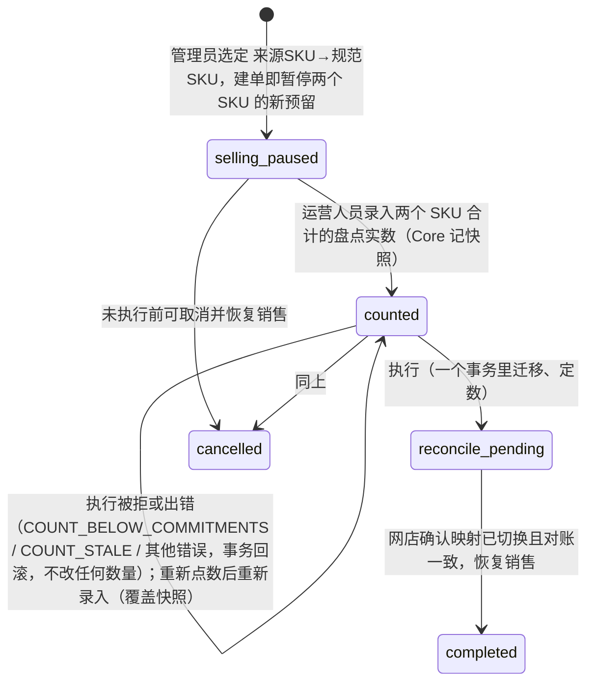
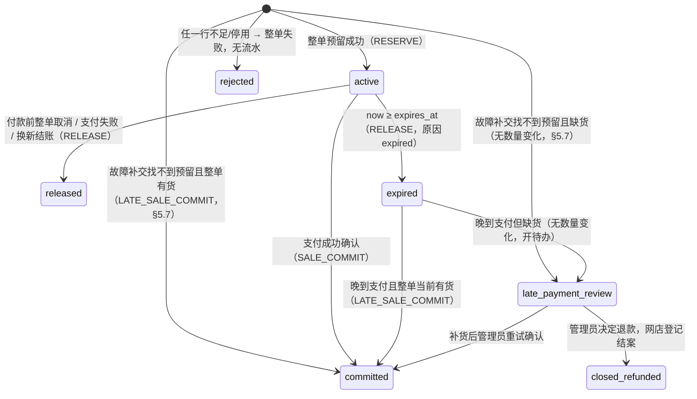

# Acuven Stock Core V1 契约

> 版本：0.18｜2026-11-21｜状态：0.18 **待 Kelvin 批准**——第 14 节第 97 条（§8.5 心跳服务改为与 `ai_billing_hub` 同一个账号；取舍见 Q-74 的修订）。
> 0.17：**Kelvin 已批准**——第 14 节第 94–96 条（§8.5 运行告警：巡检脚本、`/readyz` 正文的定时任务状态、心跳服务，§4.4 末条、§8.2 运维行的相应条目；取舍见 Q-72～Q-75）于 2026-11-21 批准。
> 0.16：**Kelvin 已批准**——第 14 节第 91–93 条（§2.8 SKU 合并的接口、判定顺序、表示与存放，§2.4 状态机简化、执行的锁序与复核，
> §2.5、§2.7、§4.4 第 5 项、§5.6、§5.7、§5.9、§6.2 第 2、3 条、§7.1 第 1、2 条、§7.2、§8.2、§8.3、§10 第 3、4 条的相应条目；取舍见 Q-70、Q-71）于 2026-11-19 批准。
> 0.15：第 14 节第 88–90 条（§5.9 订单对账查询与待审列表、预留的最后变更时间，§4.4 不变量自查，
> §5.4、§5.6、§5.7、§5.8、§8.2、§9.1、§10 第 4 条、§13 第 12 条的相应条目；取舍见 Q-67～Q-69）于 2026-11-19 批准。
> 0.14：第 14 节第 84–87 条（§5.8 发货、退款回库、退货验收与订单库存查询的接口、判定顺序、表示与存放，
> §5.3、§5.4、§5.6、§5.7、§6.7、§8.2、§8.3、§9.1、§13 的相应条目；取舍见 Q-63～Q-66）于 2026-11-18 批准。
> 0.13：第 14 节第 77–83 条（§5.7 确认销售、晚到支付、待审结案与故障补交的接口、判定顺序、表示与存放，
> §5.2 的状态机与第 4、6 条、§5.5、§5.6 的触发路径、隔离级别与出错处理、§2.4、§2.7、§7.1 第 2 条、§8.2、§8.3、§9.1 的相应条目；取舍见 Q-57～Q-62）于 2026-11-16 批准。
> 0.12：第 14 节第 70–76 条（§5.6 预留、释放、到期关闭与可售量查询的接口、判定顺序、表示与存放，
> 预留有效期的配置，读接口不关单，§5.2 第 3、4 条、§5.1、§2.4 第 0 步、§2.7、§6.2 第 1 条、§8.2、§10 第 4 条的相应条目；取舍见 Q-53～Q-56）于 2026-11-16 批准。
> 0.11：第 14 节第 66–69 条（§6.1 Demo 每日重置的正文、判定顺序、表示与存放，
> 同日同池内容不同 409，库里的实例标记、启动核对与生产库的流水类型约束；取舍见 Q-50～Q-52）于 2026-11-16 批准。
> 0.10：第 14 节第 65 条（§4.1 余额行加 `last_reconciled_version`，§6.7 的“已被吸收”改用它、不再把更正算作吸收，
> §2.4、§6.1、§6.3、§6.6 的相应步骤；取舍见 Q-49）于 2026-11-15 批准。
> 0.9：第 14 节第 54–64 条（§6.2–§6.8 库存管理命令的通用约定、期初与池切 live、收货、不可售调整、
> 盘点单的接口与存放、更正、余额与流水查询，§4.1 余额行的两个判定列，以及 §1、§2.4、§4.3、§6、§7.1、§8.2、§8.3、§10 第 3、4 条的相应条目；取舍见 Q-42～Q-48）
> 于 2026-11-15 批准。
> 0.8：第 14 节第 53 条（§2.5 整机恢复后的游标与游标的保存，§12.1 第 3 条恢复流程加一步、第 4 条恢复后重读目录，版本区的闸门说明；取舍见 Q-41）
> 于 2026-11-14 批准。
> 0.7：第 14 节第 38–52 条的 0.7 改动（§2 商品目录的命令、批量导入、
> 目录变更记录与变更流、目录写锁，§7.1 执行顺序、§7.2、§8.2、§8.3、§10 scope 表的相应条目，§4.1 余额行何时建立；取舍见 Q-36～Q-40）
> 于 2026-11-14 批准。
> 0.6 及以前：0.2、0.3 与第 14 节第 12–15 条的 0.4 改动于 2026-11-10 批准；
> 第 14 节第 16、17 条的 0.5 改动（§2.4 SKU 合并按差额定数，§6 盘点的实数作废与重试规则，§8.3 新增 `COUNT_STALE`；
> §4.1、§4.3 写回 CORE-TASK-003 对 `balance_version` 的定义）于 2026-11-12 批准。
> 第 14 节第 18–23 条的 0.6 改动（§7.1 幂等的作用域、摘要、处理中判定与保存范围，§7.2 安全日志，§8.1 请求头与检查顺序，§8.3 新增 405，
> §10 凭据、令牌、scope、角色表与池授权）
> 与第 24–37 条（审查与设计预审后的修改；取舍见 Q-31～Q-35，含 §7.1 第 2 条追加的“换键重报返回对象当前的表示”）于 2026-11-13 批准。
> 0.17 及以前的设计闸门通过；实现进度见 [TODO.md](TODO.md)。
> 按模板规则：设计有改动时，改动部分的批准作废、须重新批准。
> 依据：[REQUIREMENTS.md](../REQUIREMENTS.md)（Core V1 需求，2026-10-08）、`acuven_hub/DECISIONS.md` 的 C-01～C-19、S-01～S-10、I-02、I-04，
> 以及 `acuven_inventory/docs/API_CONTRACT.md`、`STOCK_RULES.md`（Inventory 草案，只读参照）。
> 网店现状见 [SHOP_STOCK_INVENTORY.md](SHOP_STOCK_INVENTORY.md)；问题与 Kelvin 的答复见 [OPEN_QUESTIONS.md](OPEN_QUESTIONS.md)，本文用 **Q-xx** 引用。
>
> 本文只定**语义与边界**：名词、数量不变量、命令与状态、幂等、错误、鉴权、迁移和恢复约束。字段名、路径是建议写法，
> 实现时落成 OpenAPI，字段与路径的调整不改变本文语义；技术栈已定（Q-23，见 TEMPLATE_BOOTSTRAP_PLAN.md）。

---

## 0. 一页看懂

- Core 是**一个独立进程＋一个独立持久化库**，持有两样东西：**商品身份目录**（谁是谁）和**基础库存账**（有几件、被谁占着）。
- Core 不依赖 ERP、Inventory、POS 或统一门户即可支撑单卖网店，也没有面向客户的日常后台（OPS-01）。
- 网店（以及将来的 Inventory、ERP、POS）只通过 `/v1` 私有 API 访问 Core；不直接读写 Core 的表，Core 也不读写网店的表。
- 数量只有四个账面量：`stock_balance`、`reserved`、`unavailable`、`paid_pending_dispatch`；任何变化都是一条**不可改写的流水**，
  余额只是流水的累计结果。
- 每个写命令带**幂等键**和**稳定业务引用**；同一个事实最多生效一次，响应丢了可以按原键重试或按业务引用查询。
- 网店业务代码只依赖 `StockGateway` 接口：V1 由 Core 适配器实现；将来加购 Inventory 并共卖一批货时换 Inventory 适配器。
- V1 的第一个接入方是**公开 Demo**：用一个独立的 Demo Core 实例，带 Demo 专用的每日重置（§6.1）。真实网店何时、怎么接待定（Q-24）。
- 恢复目标：整台服务器永久损坏时，已确认写入最多丢 5 分钟（RPO≤5 分钟），4 小时内恢复（RTO≤4h）。原需求是 RPO=0，Kelvin 2026-11-10 放宽（Q-15，第 12 节）。
- Core 不可用时，网店**继续收款**，但按故障前最后读到的可售量封顶；恢复后补交，有货补扣、没货交管理员（§5.5，Q-03）。

---

## 1. 标识与名词

| 名词 | 标识 | 谁生成 | 规则 |
| --- | --- | --- | --- |
| 租户 | `tenant_id` | Core 运维开通 | V1 只有一个（Acuven 自用）。**永远从调用方凭据推出，不接受请求正文/路径自选。** |
| 库存地点 | `location_id` | Core | 一个物理地点（仓库/店面）。V1 每租户一个。 |
| 库存池 | `pool_id` | Core | 一批**明确归属**的实物，绑定一个地点。V1 每租户一个；数据键和 API 保留池维度，**禁止以相同 SKU 推断两个池共享**（C-07）。 |
| 销售入口 | `channel_id` | Core 运维登记 | 一个会卖货的系统实例（V1：Acuven 网店）。入口绑定它能销售的池；V1 一个入口对一个池，不共卖（C-08）。 |
| 商品 | `product_id` | Core | 展示/归类实体，不计数。 |
| 规格 SKU | `sku_id` | Core | 可独立售卖、独立计数的最小单位。**无规格商品也有一个 SKU。**所有数量都挂在 `sku_id` 上。 |
| SKU 编码 | `sku_code` | 运营人员输入或导入 | 人看的编码，租户内唯一，可修改（保留旧值审计）；**不是**稳定身份，系统间关联一律用 `sku_id`。 |
| 条码 | `barcode` | 运营人员 | 可空；非空时租户内唯一。 |
| 服务凭据 | `credential_id` | Core 运维签发 | 一个调用方服务身份（§10 第 4 条）；轮换令牌时不变。 |

**稳定 ID 格式（Q-04 已定）：**带类型前缀的不透明字符串，前缀＋ULID，例如 `ten_01JC…`（租户）、`prd_01JC…`、`sku_01JC…`、`pool_01JC…`。数据库列统一 `VARCHAR(32)`。
生成后永不复用、永不改变；调用方只做相等比较，不解析内容。跨租户可以出现相同 `sku_code`，但 `sku_id` 全局唯一。

**调用方引用（网店生成，Core 只存不解释）：**`order_ref`、`line_ref`、`payment_ref`、`shipment_ref`、`refund_ref`、`return_ref`、
`receipt_ref`、`count_ref`、`adjustment_ref`（0.9，§6.5）。格式 1–128 个 ASCII 字符 `[A-Za-z0-9._:-]`，**不得含顾客姓名、电话、邮箱、地址、金额或支付凭据**（OPS-06）。
引用的唯一性范围是 `(tenant_id, channel_id, 引用类型)`。

---

## 2. 商品身份目录

### 2.1 Core 与网店的字段边界（C-01、C-02）

| 放在 Core 目录 | 放在网店（Core 不存、不覆盖） |
| --- | --- |
| `product_id`、`sku_id`、`sku_code`、`barcode` | 图片、分类、多语言展示名称与营销文案、SEO |
| **基本名称**（商品一个、SKU 一个，英文，Q-05） | 规格展示文案（颜色/尺码的多语言标签） |
| **参考售价** `reference_price`（只在 SKU 上；整数最小货币单位＋币种，如 `{"amount_minor": 12900, "currency": "MYR"}`；可空，金额与币种同时有或同时无） | **渠道营业价**、促销价、节日活动价、会员价 |
| 启停状态 `status`：`active / inactive` | 上下架、排序、陈列 |
| 版本 `version`、创建/更新时间、变更审计 | 订单行里的商品与成交价**快照** |
| SKU 合并关系 `merged_into_sku_id`、SKU 编码历史 | 网店侧的 `core_sku_id` 映射列 |

规则：

1. **参考价永不自动改营业价。**参考价变化只在 Core 变更流（2.5）里出现：一条 `sku_updated`，改动字段里含 `reference_price`（Q-38）；
   网店后台把它显示成“改价建议”，有权人员确认后由网店自己改营业价。
2. 订单永远保存网店当时的商品名称与成交价快照；Core 改名、改参考价不影响历史订单。
3. 网店上下架 ≠ Core 停用。Core `inactive` 的 SKU **不能新建预留**，但历史查询、已付款订单的发货/退款回库/退货照常可做。
   商品 `inactive` 时，它的全部 SKU 同样不能新建预留（409 `SKU_INACTIVE`），SKU 自己的 `status` 不变；商品重新启用后照各 SKU 自己的状态恢复（Q-36）。
4. 存在流水或任何订单引用的商品/SKU **不能硬删除**，只能停用（CAT-02）。V1 不提供任何删除接口，没有历史的商品/SKU 也只能停用。

### 2.2 唯一性与版本

- `(tenant_id, sku_code)` 唯一；`(tenant_id, barcode)` 在非空时唯一：空条码一律存 `NULL`，不存空字符串（数据库检查约束拒绝空串）；MySQL 的唯一索引允许多个 `NULL`，因此不需要部分索引。
- 名称长度：商品与 SKU 的基本名称 `VARCHAR(200)`；`sku_code`、`barcode` `VARCHAR(64)`（与网店 `sku` 列同长）；币种 `CHAR(3)`，大写字母由接口层校验。
- **数据库列约定**（目录各表通用，之后的表沿用）：
  - `tenant_id`：`VARCHAR(32) NOT NULL`。
  - 时间：`DATETIME(6) NOT NULL`，一律 UTC（数据库连接把会话时区固定为 UTC，见 `app/db.py`）；`created_at` 默认 `CURRENT_TIMESTAMP(6)`，`updated_at` 由应用在每次修改时写入。
  - 状态：`VARCHAR(16) NOT NULL`，检查约束限定取值（目录为 `active`、`inactive`）；不用数据库 ENUM，方便以后加值。
  - 编码类列（`sku_code`、`barcode`、归属表的 `code`）：排序规则 `utf8mb4_0900_ai_ci`，**唯一性不区分大小写**（`abc` 与 `ABC` 视为同一编码）；
    检查约束要求非空串且首尾无空格（`TRIM(x) = x`），接口层先去首尾空格再写入。
  - 操作人与原因（如 `sku_code_history`）：`actor_ref VARCHAR(128) NOT NULL`（第 1 节引用格式，网店管理员的不透明 ID）、
    `reason VARCHAR(500) NULL`。
- 每个商品、SKU 有整数 `version`，新建为 1，每次修改、停用、重新启用 +1（往商品加规格不改商品的版本）。
  修改请求（`PATCH`）必须在正文带 `expected_version`（0.7 起只认正文，不认 `If-Match` 头：请求头不进幂等摘要，同键换版本号重试会被当成同一请求重放）；
  不一致返回 409 `VERSION_CONFLICT` 并附当前版本，**不静默覆盖**（CAT-03）。停用与重新启用没有请求体、不比版本：它们只把状态设成目标值，
  不会覆盖别人改的字段（§2.6）。
- 修改 `sku_code` 时把旧值写入 `sku_code_history`（旧值、新值、操作者、时间、原因；只追加、无唯一约束，同一 SKU 可以改回自己用过的编码）。
- 旧编码永久保留、不再分配给其他 SKU（Q-06），由另一张表 `sku_code_claims` 保证：每个用过的编码登记一次 `(tenant_id, code) → sku_id`。
  - **数据库保证的一半**：`sku_code_claims` 的主键是 `(tenant_id, code)`（一个编码只能归一个 SKU）；`(tenant_id, sku_id)` 复合外键指向 `skus`。
  - **服务层保证的一半**：在同一事务里完成。建 SKU 时**先插 SKU 行，再插归属行**（归属行的外键要求 SKU 已存在）；建 SKU 与改编码都先查新编码：
    已登记给别的 SKU、且是那个 SKU 的当前编码，409 `SKU_CODE_TAKEN`；已登记给别的 SKU、但那个 SKU 已改用别的编码（退役编码），409 `SKU_CODE_RETIRED`；已登记给它自己（改回旧编码，或只改大小写）则不再插入归属行；未登记则插入归属行；
    然后更新 `skus.sku_code` 并写历史。
    `skus` 不反向外键到归属表（双向外键成环，MySQL 无法延迟检查）。
  - `sku_code_history` 是内部表，主键为自增 `BIGINT id`（不对外暴露，同一秒内的多条按 `id` 排序）。

### 2.3 批量导入（CAT-04、STK-03）

两步：**校验预览 → 确认执行**。

1. `POST /v1/catalog-imports`（操作类型 `catalog_imports.preview`）：上传行（JSON 行数组，CSV 由网店后台解析后转 JSON）。Core 只校验、不写目录，返回 `import_id`、
   逐行结果（`ok / duplicate_sku_code / duplicate_barcode / invalid_format / conflicts_existing / group_blocked`）和汇总。
2. `POST /v1/catalog-imports/{import_id}/confirm`：**只执行预览合格的行**（Q-07），错误行跳过。每个商品连同它的 SKU 作为一组，
   在一个事务内要么全建、要么不建，不留下半成品商品。结果逐行列出成功/跳过/失败原因，运营修正后用新的导入补齐。
   确认带幂等键；重复确认返回原结果。
3. 预览有效期 24 小时；过期须重新预览；期间目录有冲突修改的组在确认时不建，修正后用新的导入补齐（见下）。

0.7 的细化（Q-39）：

- **正文**：`{"rows": [...]}`，1–100 行（§8.1 第 7 步的批量上限，超过 413；Demo 的 76 个 SKU 一次导完）。每行一个 SKU：
  - `external_ref`：必填，第 1 节的引用格式，本次导入内唯一；网店填规格 ID，结果按它给出“网店规格 → `sku_id`”对照（§11.2）；
  - `product_ref`：必填，同一格式；同值的行归为一个商品（网店填商品 ID）。只在本次导入里分组用，Core 不把它存成商品属性；
  - `product_name`、`sku_code`、`sku_name`：必填；`barcode`、`reference_price`：可不带或为 `null`。取值规则同 §2.6 第 1 条
    （`product_name` 按商品名称、`sku_name` 按 SKU 名称）。
  导入只新建商品，不改现有商品，也不往现有商品加规格。
- **整单 422 与逐行结果的分界**：§8.1 第 7 步第一小步的解析错误（不是合法 JSON、重复的键、带小数点或指数的数、`NaN`、孤立代理项等）
  不论出在哪一行，照常整单 422；字段校验只查顶层只有 `rows`、它是数组、每个元素是 JSON 对象。行内缺字段、多字段、类型或取值不对，
  不整单拒绝，记为该行 `invalid_format`（附出错的字段名）。
- **逐行结果**，按下列顺序取第一个命中的：
  1. `invalid_format`：行内字段不合规；或 `external_ref` 在本次导入里重复（重复的各行都算）；或同一 `product_ref` 各行的 `product_name`
     （去首尾空白后）不完全相同（该组各行都算）；
  2. `duplicate_sku_code`：本次导入里别的行用了同一个 `sku_code`（去首尾空白后不区分大小写比较，各行都算）；
  3. `duplicate_barcode`：同上，比较非空条码；
  4. `conflicts_existing`：`sku_code` 已登记在 `sku_code_claims`（任何 SKU 的当前或退役编码，§2.2），或条码已被现有 SKU 使用；
  5. `group_blocked`：本行没问题，但同一 `product_ref` 的别的行有问题。一组只要有一行不合格就整组不执行，否则补齐那一行时会建成另一个商品（Q-40）；
  6. `ok`。

  判定细则：`external_ref`、`product_ref` 按字符串原样比较（区分大小写，同第 1 节的引用）；`product_ref` 本身不合规的行不归任何组，只影响自己；
  `external_ref` 本身不合规的行不参加 `external_ref` 的重复检查；“同组 `product_name` 不一致”只在 `product_name` 本身合规的行之间比较；记为 `invalid_format` 的行不参加 `sku_code`、条码的重复检查与
  `conflicts_existing` 检查（它不会被执行），但照样让所在的组 `group_blocked`。
- **预览**不写目录、不取目录写锁，只保存这次导入，返回 201：`import_id`（前缀 `imp_`）、`status`、`expires_at`、逐行结果（带行下标、
  `external_ref`、`product_ref`）与汇总（各结果的行数、可执行的组数与行数）。
- **确认**（`catalog_imports.confirm`，路径参数 `import_id`，没有请求体）。先取目录写锁（§2.7，开事务之前），再在事务里用
  `SELECT … FOR UPDATE` 读导入行，然后依次判定：
  - 导入不存在或属于别的租户：404 `IMPORT_NOT_FOUND`；
  - 已确认过：200，返回这个导入的当前表示（同 `GET`，含首次确认的逐行结果），不再执行。`import_id` 就是这个命令的业务引用
    （§7.1 第 2 条：换键重报返回当前表示；同键重试照常原样重放）；
  - 已过有效期（`expires_at` 不晚于数据库当前时间）：409 `IMPORT_EXPIRED`，重新预览；
  - 否则按组在 `rows` 里首次出现的顺序处理预览为 `ok` 的组：按当前目录重查各行的 `conflicts_existing`
    （预览之后编码或条码可能已被占用），整组都没有冲突就建商品（名称取 `product_name`）与各 SKU（名称取 `sku_name`），否则整组不建。
    全部在一个事务里，与幂等记录一起提交；目录写锁保证从重查到写入之间没有别的目录写入，所以不需要保存点；
  - 返回 200，逐行结果：`created`（带 `product_id`、`sku_id`）、`skipped`（预览不合格，带预览结果）、`failed`（确认时 `conflicts_existing`，
    或同组别的行冲突时的 `group_blocked`）。导入状态改为 `confirmed`，逐行结果与确认人存进导入记录；一组都没建成也算确认完成；
  - 运营修正后用新的导入补齐：新导入里的组建成新商品。
- **查询** `GET /v1/catalog-imports/{import_id}`（`catalog.read`）：返回当前表示，`status` 为 `previewed`、`expired`（由 `expires_at`
  推出，不存）或 `confirmed`。过期的预览保留，只能查、不能确认。
- **存放**：表 `catalog_imports`，一次导入一行：`import_id` 主键、`tenant_id`、`status`（`previewed` / `confirmed`，检查约束）、
  `expires_at`（预览时的数据库时间加 24 小时）、`rows`（JSON，各行原文与预览结果）、`result`（JSON，确认后才有）、
  预览的 `credential_id`、`actor_ref`、`request_id`、`created_at`，确认的 `confirmed_credential_id`、`confirmed_actor_ref`、
  `confirmed_request_id`、`confirmed_at`（确认后才有）。永久保留；行里不该有个人资料（§10 第 6 条）。

### 2.4 SKU 合并（CAT-05）

合并解决“同一实物被建成了两个 SKU”。**不直接把两份余额相加**（可能重复计数），而是停售、盘点、再迁移未结业务。



（0.16，Q-70：去掉 0.5 的 `draft`、单独的“暂停”命令、`migrating` 与 `failed_paused`。执行是一个事务，出错整笔回滚，合并单本来就留在 `counted`，
直接再执行即可，所以“迁移中”“迁移失败”两个状态在库里看不到；建单与暂停合成一步。CAT-05 的“失败时保持停售和可恢复状态”由 `counted` 承担。
接口、判定顺序、表示与存放见 §2.8。）

停售只停**新预留**：从建单到合并单 `completed` 或 `cancelled` 之间（0.16：执行之后来源 SKU 已合并，按已合并拒绝新预留；规范 SKU 到合并单 `completed` 才恢复），已有预留照常确认、释放、到期，已付款订单照常发货、退款回库、退货，
故障补交（§5.7，0.13）还会在这两个 SKU 上新建已确认或待审的预留与订单行，
收货、不可售、报损也照常可做。所以盘点用 §6 的**差额法**，不用盘点数覆盖执行时的账面（0.5，Q-30）：

- **合并单互不重叠**：一个 SKU 同时最多属于一张未结束（`completed`、`cancelled` 以外）的合并单；规范 SKU 必须是 `active`；来源 SKU 不能已经合并过（`merged_into_sku_id` 为空），也不能等于规范 SKU。建单时校验；执行时复核的范围见 §2.8（0.16）。两个 SKU 可以属于不同商品（同一实物被建成了两个商品时也靠合并修正）；合并不改任何商品的状态（0.16）。
- **按池分别处理**：录入实数、快照、迁移与定数都按池分别做（V1 只有一个池；0.16：V1 一张合并单只在一个池上录入与执行，§2.8）。

- **录入实数（`count`）**：两个 SKU 是同一种实物，运营人员（`stock_operator` 或 `stock_admin`，§10 第 3 条）录**合计**的两项实数——在架件数（含已付款待发的件）与不可售件数，
  都是不小于 0 的整数，否则 422。Core 在同一事务里按 `(pool_id, sku_id)` 升序锁两个余额行（某个 SKU 在该池还没有余额行时，照 §4.1 先建好，四个量为 0、版本 0），记下它们当时的四个账面量与 `balance_version` 作为**快照**。
  点数前的实物进出须先入账，规则同 §6。只有重新点过实物时才重新录入，后一次覆盖前一次的实数与快照。
- **执行（`execute`）**：第 0 步的关单在开事务之前；之后的检查与第 1–3 步在 Core 的**一个事务**里，两个余额行按 `(pool_id, sku_id)` 升序加锁
  （0.12、0.13：要改挂订单行，所以锁余额行之前先锁住涉及的预留行与订单行；用普通读找出的名单可能漏掉并发的故障补交新建的订单行，锁住余额行之后复核、多出就回滚重来。
  锁序、名单、复核与重来的上限见 §2.8 执行的判定顺序，0.16）：
  0. **前置检查**：开业务事务之前（§2.7 的先后里余额行预建之后），按 §5.6 的到期关闭把两个 SKU 上已到期的 `active` 预留逐个关掉，每个一个事务（0.12：不在锁住余额行之后关单，否则与释放、到期关单“预留行 → 余额行”的锁序成环）；
     开事务之后才到期的预留随订单行一起迁到规范 SKU，之后照常关单。再查快照之后两个 SKU 上有没有 §6 定义的**只改账的流水**（看锁住的余额行上的 `last_book_only_version` 是否大于快照版本，§4.1，0.9）；
     有则录入的实数已作废，整笔拒绝，409 `COUNT_STALE`，合并单留在 `counted`，须重新点数、重新录入。
  1. **整行迁移**：来源 SKU **执行时**的四个账面量全部转到规范 SKU——来源写 `MERGE_TRANSFER_OUT`（四个量各减去当前值，归零），
     规范写 `MERGE_TRANSFER_IN`（各加同样的量），成对出现，来源的四个量全为 0 时也写（0.16：两条流水设两个余额行的判定列，来源 SKU 上执行之前的流水因此不能再更正，§6.7 第 2 步）；同时把来源 SKU 上 `active`、`expired`、`late_payment_review`、`committed` 四种状态的预留的全部订单行（连同累计量）改挂到规范 SKU（0.13；
     已到期、已在待审的订单仍可能晚到确认，§5.7 按订单行的 `sku_id` 锁余额行），找出、锁住的预留名单也按这四种状态取；`released`、`closed_refunded` 的不改挂。
     两个各自满足不变量的账面相加仍满足不变量，这一步不会失败。两条迁移流水都是只改账的流水，照 §4.1 更新两个余额行的 `last_book_only_version` 与 `last_reconciled_version`（0.9、0.10）。
  2. **按差额定数**：`d_u` = 不可售实数 − 两个快照的 `unavailable` 之和；
     `d_shelf` = 在架实数 − 两个快照的（`stock_balance` − `unavailable` + `paid_pending_dispatch`）之和。
     在规范 SKU 上写一条 `COUNT_ADJUSTMENT`（引用合并单）：`stock_balance` 增 `d_shelf + d_u`、`unavailable` 增 `d_u`，
     加到第 1 步之后的最新账面上；两个差额都为 0 时不写。流水记两个快照、两项实数与差额。
     无论写没写，执行后规范 SKU 余额行的 `last_book_only_version` 与 `last_reconciled_version` 都设为它当时的 `balance_version`（§4.1，0.9、0.10）。
  3. **不变量**：第 2 步落账后若违反 §4.1，整笔执行回滚（第 1 步也不生效），返回 409 `COUNT_BELOW_COMMITMENTS`，
     缺口数照 §6 的公式算；合并单留在 `counted`。管理员照 §6 先处理相关预留与缺货的已付款订单，然后**直接再执行**：
     沿用原实数与快照，其间的释放、退款回库、发货等变动由差额法照常保留；不要把原来的数再录一遍（会重取快照、把其间的发货等算错）。
     执行因别的原因出错（数据库错误等）时同样整笔回滚、合并单留在 `counted`，查明后直接再执行（0.16，Q-70）。
- 结果：规范 SKU 的账面 = 盘点核实的数量 ＋ 盘点之后发生的变动，不是两份余额直接相加（CAT-05）；盘点时漏点、重复计的件数由差额修正。
- 来源 SKU 归零后设 `inactive` 且 `merged_into_sku_id = 规范 SKU`；
- 数据库约束：`merged_into_sku_id` 不能等于自身；非空时该 SKU 必须是 `inactive`。已合并的 SKU 不能重新启用（`reactivate` 返回 409 `SKU_MERGED`）。
- **历史流水、订单快照里的原 `sku_id` 不改写**；之后任何带来源 `sku_id` 的查询返回 `merged_into_sku_id`，
  带来源 `sku_id` 的**新预留**返回 409 `SKU_MERGED`（附规范 ID），**已有订单行**的发货/退款回库/退货自动作用到规范 SKU。

网店侧需要：把两个规格的映射改到规范 `sku_id`、处理两个网店规格的展示合并（这是网店的事），然后调用 `complete`。
未 `complete` 前两个 SKU 都保持停售。

**合并定数的例子**（A 为来源、B 为规范；四个量依次为 `stock_balance / reserved / unavailable / paid_pending_dispatch`）：

| # | 盘点时（快照） | 录入实数（在架 / 不可售） | 盘点之后、执行之前 | 执行：迁移后的 B | 差额 | 执行结果 |
| --- | --- | --- | --- | --- | --- | --- |
| 1 | A 5/0/0/2，B 10/0/0/0（在架合计 17） | 17 / 0 | A 1 件待发货退款回库 → A 6/0/0/1 | 16/0/0/1 | 0 / 0，不写 | B 16/0/0/1，在库 17 ✓（旧规则会定成 15/0/0/1，少 1 件） |
| 2 | A 5/2/0/0，B 10/0/0/0（在架合计 15） | 14 / 0（实际少 1 件） | A 的预留付款确认 → A 3/0/0/2 | 13/0/0/2 | `d_shelf` −1 | B 12/0/0/2，在库 14 ✓ |
| 3 | A 5/0/1/0，B 10/0/0/0（在架合计 14，不可售 1） | 14 / 1 | 又发现 1 件损坏，A 标不可售 → A 5/0/2/0 | 15/0/2/0 | 0 / 0，不写 | B 15/0/2/0，可售 13 ✓ |
| 4 | A 2/2/0/0，B 1/0/0/0（在架合计 3） | 0 / 0（全部找不到） | 无 | 3/2/0/0 | `d_shelf` −3 | 落账后 0/2/0/0 违反不变量：整笔拒绝，409 `COUNT_BELOW_COMMITMENTS`，缺口 2；A、B 不变，合并单留在 `counted` |
| 5 | A 5/0/0/0，B 10/0/0/0（在架合计 15） | 13 / 0（A 那堆少 2 件） | 另一张 §6 盘点单只点 A，确认记 −2 → A 3/0/0/0 | —（前置检查即拒） | — | 409 `COUNT_STALE`（A 在快照之后有只改账的流水）；重新点数录入 13 / 0（新快照合计 13）后执行：B 13/0/0/0 ✓（不拦会得 11/0/0/0，少 2 件） |
| 6 | A 3/3/0/2，B 1/0/0/0（在架合计 6） | 4 / 0 | 第一次执行被拒（迁移后 4/3/0/2，差额 −2 得 2/3/0/2，缺口 1）；之后释放预留、发出 2 件已付款的货 → A 3/0/0/0，实物剩 2 | 4/0/0/0 | `d_shelf` −2（原快照） | 直接再执行：B 2/0/0/0 ✓（若把 4 / 0 再录一遍，新快照合计 4、差额 0，会得 4/0/0/0，多 2 件） |

### 2.5 目录变更流

`GET /v1/catalog-changes?after=<cursor>&limit=<n>`（`catalog.read`）：按提交顺序返回本租户的目录变更记录（§2.7），每条带对象 ID、新版本、
变更字段、发生时间。网店用它刷新映射和生成改价建议（`sku_updated` 且改动字段含 `reference_price`，§2.1 第 1 条）；游标单调、可重放。
V1 用拉取，不做推送（Q-08）。

- `after` 不带时从头开始；带时是上一页返回的 `next_cursor`，不透明（调用方只原样回传、不解析），格式不对 422 `INVALID_REQUEST`。
  `limit` 是 1–100 的十进制整数，不带为 100，不合格 422。
- 响应：`changes` 数组（按游标升序）与 `next_cursor`（最后一条的游标；没有新记录时原样返回请求里的 `after`，没带则为 `null`）。
  网店保存 `next_cursor`，定时用它接着拉；用旧游标重拉得到同样的记录。
- 每条：`cursor`、`event_type`、`object_type`（`product` / `sku`）、`object_id`、`product_id`、`version`（对象这次改动后的版本）、
  `changes`（改动的字段，每个 `{"before": …, "after": …}`；新建时 `before` 都是 `null`）、`actor_ref`、`reason`、`import_id`、
  `request_id`、`occurred_at`。
- 游标格式合格、但对应的记录已不存在（如整机恢复后，见本节“整机恢复之后”一条）时，照常返回 `id` 比它大的记录，不报错。
- 网店把 `next_cursor` 存在自己的库里，与应用这一页记录的写入在同一事务提交（建议）：网店的库与 Core 在同一 `infra_mysql` 实例上，恢复点一致，
  这样保存的游标不会越过 Core 恢复后的最大 `id`。存在实例之外（缓存、文件）时就会出现下条的跳号。
- **整机恢复之后（0.8，Q-41）**：§12.1 第 3 条的恢复会丢最近的写入（目标至多 5 分钟，binlog 传输中断时可能更长），丢掉的变更记录不再出现，
  它们占过的 `id` 会被 MySQL 重新分配。网店在故障前保存的游标可能已越过这些 `id`，新记录若拿到更小的 `id` 就会被跳过。所以恢复流程在 binlog 重放完、
  启动 Core 之前，把 `catalog_changes` 的自增起点调到恢复后的最大 `id`（表为空按 0）加 1,000,000：目录写入按租户逐条串行（§2.7），
  任何现实的丢失窗口都分配不了这么多 `id`，所以之后的新记录的游标都大于故障前发出的任何游标，不会被跳过。自增计数器持久保存（MySQL 8），重启不回退；
  抬高之后不能再重放 binlog。
  “用旧游标重拉得到同样的记录”只在没有丢数据时成立：游标落在丢失窗口里的，重拉得到的是恢复后的新记录。丢失窗口里的目录变化照 §12.1 第 4 条补齐。
- 事件类型：`product_created`、`product_updated`、`product_deactivated`、`product_reactivated`、`sku_created`、`sku_updated`、
  `sku_deactivated`、`sku_reactivated`、`sku_merged`（0.16：SKU 合并执行时给来源 SKU 写，§2.8）。调用方须忽略不认识的事件类型（§8.4 只做加法）。

### 2.6 目录命令（0.7，Q-36～Q-38）

写命令要求 `catalog.write` 与 `catalog_admin` 角色，读接口要求 `catalog.read`、不要求角色（§10 第 3、4 条）；路径见 §8.2。
命令都没有业务引用（§7.1 第 2 条），去重只靠幂等键：网店按业务对象确定性派生键（例如 `shop:product:<网店商品 ID>:create:1`），响应丢了用原键重试。

1. **字段取值**（新建、修改、导入通用）。“去首尾空白”按 Python `str.strip()` 的规则；控制字符指 U+0000–U+001F 与 U+007F。
   - 名称（商品与 SKU 的 `name`）：字符串，去首尾空白后 1–200 个字符，不含控制字符。
   - `sku_code`：字符串，去首尾空白后 1–64 个字符，每个字符都是可打印 ASCII（0x20–0x7E；空格因去首尾空白只会在中间）。
   - `barcode`：字符串或 `null`；去首尾空白后为空串按 `null`（§2.2 空条码存 `NULL`），否则同 `sku_code` 的长度与字符集。
   - `reference_price`：`null`，或恰好含两个字段的对象 `{"amount_minor": 0–9007199254740991 的整数, "currency": 3 个大写 ASCII 字母}`；
     不查币种是否在 ISO 4217 清单里。
   - `reason`：可选，字符串或 `null`；字符串去首尾空白后 1–500 个字符、不含控制字符。
   - 编码与条码的重复一律按 ASCII 不区分大小写判断（等于都转小写后比较）。限定可打印 ASCII 是为了让这个判断与数据库排序规则
     `utf8mb4_0900_ai_ci` 的相等一致：该排序规则还不区分重音（`CAFÉ` 与 `cafe` 相等），放开非 ASCII 会出现请求内查不出、写入却撞唯一约束的情况。
     万一写入仍撞上编码或条码的唯一约束，按对应的 409 报（§7.1 业务拒绝撤销全部写入），不返回 500。
   - “改没改”按去首尾空白后的字符串原样比较，只改大小写也算改（写编码历史）。
2. **新建商品** `POST /v1/products`（`products.create`）：正文 `name`、`skus`、`reason`。`skus` 是 1–100 个 SKU 对象（Q-37；§8.1 第 7 步的批量数组），
   每个含 `sku_code`、`name`，可带 `barcode`、`reference_price`。同一请求里 `sku_code` 重复或非空 `barcode` 重复 422。
   与现有目录冲突：409 `SKU_CODE_TAKEN` / `SKU_CODE_RETIRED` / `BARCODE_TAKEN`（§2.2），一个都不建。有多处冲突时，顶层错误码取这三个里
   按此顺序第一个出现的；`details.conflicts` 列出全部冲突，每项带 `index`（SKU 在 `skus` 里的下标）、`field`、`value`、`code`。
   成功 201，返回商品的表示（含 SKU）。商品与 SKU 新建为 `active`、版本 1，按请求顺序写变更记录。
3. **加规格** `POST /v1/products/{product_id}/skus`（`skus.create`）：正文是一个 SKU 对象，另可带 `reason`。商品不存在 404 `PRODUCT_NOT_FOUND`；
   商品 `inactive` 时照样可以加（照 §2.1 第 3 条不能新预留）。冲突同上（`details.conflicts` 的项不带 `index`）。成功 201，返回 SKU 的表示。
4. **修改** `PATCH /v1/products/{product_id}`（`products.update`）：正文 `expected_version`（必填）、`name`、`reason`。
   `PATCH /v1/skus/{sku_id}`（`skus.update`）：`expected_version`、`sku_code`、`barcode`、`name`、`reference_price`、`reason`。
   - 除 `expected_version`、`reason` 外至少带一个字段，否则 422。不带的字段不变；`barcode`、`reference_price` 给 `null` 是清空；
     `name`、`sku_code` 给 `null` 422；其他字段（`status`、`product_id`、`merged_into_sku_id` 等）是未知字段，422。
   - 判定顺序：对象不存在 404（`PRODUCT_NOT_FOUND` / `SKU_NOT_FOUND`）→ 版本不符 409 `VERSION_CONFLICT`（`details.current_version`）
     → 编码或条码冲突 409（同第 2 条）→ 写入。要改的行在事务里用 `SELECT … FOR UPDATE` 读。
     已合并的 SKU 只接受清空条码（除 `expected_version`、`reason` 外只带 `barcode`，且按第 1 条规范化后为 `null`，即 `null` 或空白串），带别的字段 409 `SKU_MERGED`，
     这一判定在 404 之后、版本之前。
   - 与当前值相同的字段当作没带；全都相同时返回 200 与当前表示，不加版本、不写变更记录与编码历史。
   - 改了 `sku_code` 时照 §2.2 处理归属与编码历史，历史的 `actor_ref` 取 `X-Actor-Ref`、`reason` 取正文。
   - `inactive` 的商品与 SKU 也可以改；已合并的 SKU 只能清空条码（好让规范 SKU 用这个条码），不能重新启用。
     成功 200，返回改后的表示。
5. **停用与重新启用**：`POST /v1/products/{product_id}/deactivate`、`/reactivate`（`products.deactivate`、`products.reactivate`），
   `POST /v1/skus/{sku_id}/deactivate`、`/reactivate`（`skus.deactivate`、`skus.reactivate`），都没有请求体。
   - 已是目标状态：200，返回当前表示，不加版本、不写记录；停用已合并的 SKU 也按这条处理；
   - 重新启用已合并的 SKU：409 `SKU_MERGED`（§2.4）；
   - 停用商品不改它的 SKU 的状态（Q-36）；所属商品 `inactive` 时照样可以重新启用 SKU，但在商品重新启用前仍不能新预留（§2.1 第 3 条）；
   - 停用不检查库存与未结订单（已有订单照常处理，§2.1 第 3 条）。没有请求体，所以变更记录的 `reason` 为空。成功 200，返回改后的表示。
6. **查询**：
   - `GET /v1/products/{product_id}`：商品的表示；`GET /v1/skus/{sku_id}`：SKU 的表示，已合并的照常返回、带 `merged_into_sku_id`（§2.4）。
   - `GET /v1/skus?sku_code=…`、`?barcode=…`、`?ids=…`：三个参数恰好带一个，否则 422。`sku_code`、`barcode` 去首尾空白后按当前值、
     不区分大小写精确匹配，返回 0 或 1 个（退役编码查不到）；`ids` 是逗号分隔的 1–100 个 `sku_id`，有重复 422，返回其中属于本租户的，
     不存在或属于别的租户的不出现、也不报错（查询本身限定在本租户，不记 `cross_tenant`）。结果是 `skus` 数组，按 `sku_id` 升序，不分页。
   - 按路径 ID 读写别的租户的商品、SKU、导入：404（与不存在相同），记 `cross_tenant` 安全事件（§7.2）。
7. **表示**：
   - 商品：`product_id`、`name`、`status`、`version`、`created_at`、`updated_at`、`skus`（SKU 的表示，按 `sku_id` 升序）。
   - SKU：`sku_id`、`product_id`、`sku_code`、`barcode`、`name`、`reference_price`、`status`、`product_status`（所属商品的状态）、
     `merged_into_sku_id`、`version`、`created_at`、`updated_at`。

### 2.7 目录变更记录与目录写锁（0.7）

- 表 `catalog_changes`，只追加（不 UPDATE、不 DELETE），永久保留；它既是 §7.2 的目录审计，也是 §2.5 变更流的来源。
  每个命令对每个改动了的对象写一条：新建商品写一条 `product_created`，再按请求顺序给每个 SKU 写一条 `sku_created`；一次修改改了几个字段都只写一条。
- 列：`id`（自增 `BIGINT` 主键，变更流的顺序与游标都由它来）、`tenant_id`、`event_type`（`VARCHAR(32)`，不加检查约束，以后加事件类型不改表，
  由应用校验）、`object_type`（`product` / `sku`，检查约束）、`object_id`、`product_id`（SKU 事件为所属商品，商品事件等于 `object_id`；
  复合外键指向商品）、`version`（改动后的版本）、`changes`（JSON，`{字段名: {"before": …, "after": …}}`，字段名与表示里的相同，
  `reference_price` 整个对象算一个字段，停用与重新启用记 `status`）、`credential_id`、`actor_ref`、`actor_role`（写变更记录的命令都要求角色——目录命令
  `catalog_admin`、SKU 合并执行 `stock_admin`，所以两者必有）、`reason`、`import_id`（导入确认建的才有，复合外键指向 `catalog_imports`）、`request_id`、
  `idempotency_key`、`created_at`。索引 `(tenant_id, id)`、`(tenant_id, object_id, id)`。
- 与目录写入、编码历史、幂等记录在同一事务提交（§12.1 第 1 条）。
- **目录写锁**：自增值在插入时分配，不按提交顺序；不加锁时，读变更流的一方可能先看到已提交的大号，晚提交的小号就被跳过了。
  所以每个写目录的命令（§2.6 的新建、加规格、修改、停用、重新启用，§2.3 的导入确认，§2.8 的 SKU 合并执行；§2.8 的 SKU 合并新建不写目录也取，见下）在取到幂等命名锁（§7.1 执行顺序第 1 步）
  之后、开事务之前，在同一连接上再取一个 MySQL 命名锁 `GET_LOCK(目录锁名, 5)`：
  - 锁名是数据库名、字面量 `catalog`、`tenant_id` 三项以换行符（0x0A）连接后 UTF-8 编码的 SHA-256 小写十六进制，64 个字符；定下后不改。
  - 5 秒内取不到（返回 0）或出错（返回 NULL）：503 `UNAVAILABLE`（确定未生效，可同键重试），什么也不写、不保存。
  - 取到后才开事务，所以事务的读快照建立在锁之后，看得到前一个持锁者已提交的全部写入；持锁到提交或回滚之后，由 §7.1 执行顺序第 5 步的
    `RELEASE_ALL_LOCKS()` 与幂等锁一并释放。
  效果：同一租户的目录写入串行，变更记录的 `id` 按提交顺序递增，某个游标之前不会再冒出新记录；从查编码、条码、版本、导入状态到写入之间，
  没有别的目录写入。V1 目录写入很少，串行的代价可以接受。
  不锁租户行：幂等记录、流水、余额等表都有外键指向 `tenants`，插入时对租户行加共享锁，锁租户行会让目录命令与本租户的全部写命令互相阻塞，
  锁序与销售命令相反时还会死锁。命名锁不是 InnoDB 行锁，不受外键影响；取它时还没开事务、不持有任何行锁，所以不会与行锁形成环。
  既写目录又锁余额行的命令（SKU 合并执行）照此先取目录写锁，开事务后再按 §8.1 的顺序锁余额行。批量导入的预览不写目录，不取这个锁。
  SKU 合并新建不写目录，也取这个锁（0.16，§2.8）：它锁 SKU 行，取锁后与修改编码等目录命令串行，避免两边按不同顺序锁 SKU 行而死锁。
  开事务前的先后固定为：幂等锁（§7.1）→ 目录写锁（只有写目录的命令与 SKU 合并新建）→ 余额行预建的短事务（§4.1，只有要锁余额行的命令）→ 关掉相关到期预留的短事务（只有新预留、确认销售与 SKU 合并执行，§5.6、§5.7、§2.4，0.12、0.13）→ 开业务事务。
  两条规则：不在打开事务或持有行锁时带等待地 `GET_LOCK`；凡是写 `catalog_changes` 的路径都先取目录写锁。

### 2.8 SKU 合并的接口、判定顺序、表示与存放（0.16，Q-70、Q-71）

§2.4 的规则不变（状态机按 Q-70 简化），这里补接口、判定顺序、表示与存放，并定下 0.12、0.13 留到登记合并任务前的锁序、复核与名单估量。

**通用**
- scope：全部接口（含查询）要 `catalog.write` 与 `stock.write` 两者（§10 第 4 条）。角色（§10 第 3 条）：新建、执行、完成、取消要 `stock_admin`；录入实数要 `stock_operator` 或 `stock_admin`。
  操作类型依次为 `sku_merges.create`、`sku_merges.count`、`sku_merges.execute`、`sku_merges.complete`、`sku_merges.cancel`，路径参数名 `merge_id`（§7.1）。
- 池授权（§10 第 4 条，在取幂等锁之前）：录入实数按正文的 `pool_id`；执行按合并单录入实数时的池，属于“按 ID 指向池内对象”，顺序同 §10 第 4 条
  （凭据没有销售入口 403；合并单不存在或属于别的租户 404 `SKU_MERGE_NOT_FOUND`，属于别的租户的记 `cross_tenant`，不保存；池不是获准的池 403）；
  还没录入过实数的合并单没有池，只查凭据有没有销售入口；事务里先复核池（执行第 1 步，锁内的 403 作为确定结果保存），再按状态判。新建、完成、取消与查询不做池授权。
- 录入实数、完成与取消在事务里 `FOR UPDATE` 读合并单行时判 404 `SKU_MERGE_NOT_FOUND`（属于别的租户的记 `cross_tenant`），作为确定结果保存（同 §2.6 第 4 条的 404）。
- 隔离级别：本节的写事务都以 READ COMMITTED 开启——新建的重叠检查、执行的名单复核都靠普通读看到最新已提交的数据（同 §5.6）。
- 锁序：合并单行（`FOR UPDATE`）→ 预留行（`FOR UPDATE`，按 `reservation_id` 升序）→ 订单行（`FOR UPDATE`，按 `order_line_id` 升序）→ 池行（`FOR SHARE`）
  → 余额行（`FOR UPDATE`，按 §8.1 升序）→ SKU 行（按 `sku_id` 升序）；用不到的层跳过。只有本节的命令锁合并单行，所以它排在最前不会与别的命令成环；
  其后几层与 §5.6 的锁序相同。新建只锁 SKU 行（`FOR UPDATE`）；录入实数跳过预留行、订单行；执行跳过池行（录入实数时已判过 `live`，池不会退回 `initializing`，同 §6.6）。

**停售的判定**
- 一个 SKU 是某张 `selling_paused` 或 `counted` 合并单的来源或规范 SKU，或某张 `reconcile_pending` 合并单的规范 SKU，就算**停售中**
  （`reconcile_pending` 时来源 SKU 已合并，按已合并处理）。`completed`、`cancelled` 的合并单不停售。
- 新预留（§5.6 第 5 步）：按 `sku_id` 升序 `FOR SHARE` 读 SKU 行与商品行之后，用普通读查所列 SKU 有没有使它停售的合并单。
  判定顺序为已合并 → 停用 → 停售：409 `SKU_SELLING_PAUSED`，`details.sku_ids` 按请求顺序列出全部停售中的 SKU。
  新建在事务里 `FOR UPDATE` 锁两个 SKU 行，所以与新预留在 SKU 行上排队：建单先提交的，之后读 SKU 行的预留用普通读一定看得到它；
  预留先锁住 SKU 行的，建单等它提交，它占用的数量由合并的差额法照常保留。完成与取消解除停售时不锁 SKU 行：与它们并发的预留可能仍按停售拒绝，
  拒绝不占用 `order_ref`（§5.6），网店换幂等键再试即可。
- 可售量（§5.6）：`status` 在 `inactive` 之后、`sellable` 之前加 `selling_paused`，普通读，不加锁。

**新建** `POST /v1/sku-merges`（`sku_merges.create`，`stock_admin`）
- 正文：`{"source_sku_id": …, "canonical_sku_id": …, "reason": …}`，两个 ID 是字符串、不能相同（相同 422），`reason` 可选，规则同 §2.6 第 1 条；不接受别的字段。
  `reason` 存在合并单上，执行时写进来源 SKU 的 `sku_merged` 变更记录。
- 开事务之前取目录写锁（§2.7）：建单不改 SKU 行、不写 `catalog_changes`，取锁只为与目录命令串行——修改 SKU 编码时锁 SKU 行不按 `sku_id` 升序（§2.6 第 4 条锁要改的行，再读编码归属的 SKU 行），不串行会与建单成环。事务里依次：
  1. 普通读查两个 SKU：不存在或属于别的租户 404 `SKU_NOT_FOUND`，`details.sku_ids` 按来源、规范的顺序列出全部这样的 ID，属于别的租户的记 `cross_tenant`；
  2. 按 `sku_id` 升序 `FOR UPDATE` 锁两个 SKU 行；
  3. 已有一张未结束（`completed`、`cancelled` 以外）的合并单，来源与规范都与请求相同：200，返回它的当前表示，不另建（换幂等键重报同一合并，同 §7.1 第 2 条“内容相同返回原结果”；
     合并单只按这对 SKU 认，`reason` 不同也返回原单、不改它）；
  4. 来源或规范已合并：409 `SKU_MERGED`（先查来源；`details` 带该 `sku_id` 与 `merged_into_sku_id`）；
  5. 规范 SKU `inactive`：409 `SKU_INACTIVE`，`details.sku_ids` 为规范 SKU（只看 SKU 自己的状态，不看商品；来源停用不拦）；
  6. 任一个 SKU 属于别的未结束合并单（作来源或规范）：409 `SKU_MERGE_IN_PROGRESS`，`details` 带那张单的 `merge_id`、`source_sku_id`、`canonical_sku_id`（有几张时取 `merge_id` 最小的一张）；
  7. 写合并单，状态 `selling_paused`。成功 201，返回表示。
- 并发建单：涉及同一个 SKU 的两笔建单在第 2 步排队，后一笔用普通读看得到前一笔已提交的合并单，所以“合并单互不重叠”（§2.4）不靠数据库约束也成立。

**录入实数** `POST /v1/sku-merges/{merge_id}/count`（`sku_merges.count`，`stock_operator`、`stock_admin`）
- 正文：`{"pool_id": …, "shelf_count": …, "unsellable_count": …}`，两项实数是 0–1,000,000 的 JSON 整数；不接受别的字段。
- 开业务事务之前，用普通读取合并单的两个 SKU，照 §4.1 预建它们在该池的余额行（合并单不存在时跳过，由事务里报 404）。事务里依次：
  1. `FOR UPDATE` 读合并单行：不存在或属于别的租户 404 `SKU_MERGE_NOT_FOUND`；
  2. 状态不是 `selling_paused`、`counted`：409 `STATE_CONFLICT`，`details` 为 `{"status": 合并单状态}`；
  3. 已录入过而 `pool_id` 与原来的不同：409 `STATE_CONFLICT`，`details` 为 `{"status": 合并单状态, "reason": "pool_mismatch"}`（V1 一张合并单只在一个池上录入与执行；V1 每个租户只有一个池，正常碰不到）；
  4. `FOR SHARE` 读池行，不是 `live`：409 `POOL_NOT_LIVE`（§6.2 第 2 条）；
  5. 按 §8.1 升序锁两个余额行，记下快照（四个量与 `balance_version`），连同两项实数与 `pool_id` 写入，已录入过的整份替换；状态改为 `counted`。
  成功 200，返回表示。不写流水。不查 SKU 的状态（执行时在锁内复核）。
- 幂等键要确定性派生，理由同 §6.6 提交实数：换键再录入会重取快照。只有真的重新点过实物时才换键。

**执行** `POST /v1/sku-merges/{merge_id}/execute`（`sku_merges.execute`，`stock_admin`，没有请求体）
- 开业务事务之前，依次（§2.7 的先后）：取目录写锁（执行写 `sku_merged` 变更记录）；照 §4.1 预建两个 SKU 在池授权时读到的池的余额行（录入实数时已建，照样走一遍；读到时还没有池就跳过，下一步也跳过）；
  按 §5.6 的“先关到期”关掉两个 SKU 在同一个池上已到期的 `active` 预留（§2.4 第 0 步；上限 100 个、出错处理同 §5.6 预留的第 2 步，超出的随订单行迁到规范 SKU，之后照常关单）。
  合并单的池只会从空变为有值：锁外读到时还没有池、锁内已录入（之间有人录入了实数）时，这两步都跳过了——余额行录入实数时已建；没关到的到期预留按 §2.4 第 0 步随订单行迁到规范 SKU，之后照常关单。
- 事务里依次：
  1. `FOR UPDATE` 读合并单行，先复核池：`pool_id` 非空且不是凭据获准的池，403 `FORBIDDEN`，记 `forbidden` 事件（被拒的类别为池，记合并单的 `pool_id`）。
     池授权在锁外读合并单的池，读到时可能还没录入、之后才被别的凭据录入实数定下池，所以在锁内复核，并排在按状态分支之前（同 §10 第 4 条“池授权先于业务规则”）；
     这个 403 按数据库状态判出，作为确定结果保存，事件照 §7.2 写入时机的第二种写（V1 每个租户只有一个池，碰不到）。`selling_paused` 的 `pool_id` 必为空，不受影响。
     然后按状态：`reconcile_pending`、`completed`：200，返回当前表示，不再执行（合并单就是这个命令的业务引用，同 §6.3 期初确认的“已确认过”）；
     `selling_paused`（还没录入实数）、`cancelled`：409 `STATE_CONFLICT`，`details` 为 `{"status": 合并单状态}`；
  2. **名单**：普通读查出在来源 SKU（合并单的池）上有订单行、状态为 `active`、`expired`、`late_payment_review`、`committed` 的预留，按 `reservation_id` 升序 `FOR UPDATE` 锁住；
     再按 `order_line_id` 升序 `FOR UPDATE` 读这些预留落在来源 SKU 上的订单行。锁住时预留已变成 `released`、`closed_refunded` 的，它的订单行不改挂（§2.4 第 1 步）；
  3. 按 §8.1 升序锁住两个余额行；
  4. **复核**：普通读查来源 SKU 上、所属预留为第 2 步四种状态的订单行；有不在第 2 步锁住的订单行里的（名单之后提交的故障补交新建，§5.7 第 5 步），回滚，
     在同一连接上从预建余额行那一步整个重做（幂等锁与目录写锁仍持有）。一次请求最多做 3 遍；第 3 遍仍多出时 503 `UNAVAILABLE`，什么也不保存，可同键重试。
     锁住余额行之后，故障补交要等来源的余额行，等到时已读得到来源 SKU 已合并，改去规范 SKU 重新判定（§5.7 第 5 步），不会再落在来源 SKU 上；所以多出的只来自名单与锁余额行之间的短暂间隙；
  5. 按 `sku_id` 升序 `FOR UPDATE` 锁两个 SKU 行，复核（建单之后目录命令仍可停用规范 SKU）：来源或规范已合并 409 `SKU_MERGED`（`details` 同新建第 4 步）；规范 `inactive` 409 `SKU_INACTIVE`（`details` 同新建第 5 步）。
     已合并的复核是防御性的：只有合并执行会设 `merged_into_sku_id`，互不重叠又保证没有别的合并单碰这两个 SKU，按现有规则碰不到，测试只覆盖规范 SKU 停用；
     “互不重叠”“来源不等于规范”在建单之后不会变，不复核；
  6. `COUNT_STALE`：按锁住的余额行做 §2.4 第 0 步后半的检查，`details.sku_ids` 列出快照之后有只改账流水的 SKU；
  7. §2.4 第 1–3 步：成对写迁移流水、改挂订单行、按差额定数、查不变量。违反时 409 `COUNT_BELOW_COMMITMENTS`，`details` 同 §6（只有规范 SKU 一项）；
     改挂的订单行 `sku_id` 设为规范 SKU，所属预留照 §5.9 设 `last_changed_at`；
  8. 来源 SKU 改为 `inactive`、`merged_into_sku_id` 设为规范 SKU，版本加 1，写一条 `sku_merged` 变更记录（§2.7：`changes` 含 `merged_into_sku_id`，来源原来是 `active` 时还含 `status`；`reason` 取合并单的 `reason`）；
  9. 合并单改为 `reconcile_pending`，记下执行的凭据、操作者、请求 ID 与时间，三条流水的 ID（定数流水没写时为空）与改挂的订单行数。
  成功 200，返回表示。第 1、5–7 步的拒绝回滚全部写入，合并单留在原状态，作为确定结果保存；处理完原因后用新的幂等键再执行（§7.1）。
- 流水：三条流水的 `source_type` 为 `sku_merge`，`source_ref` 为 `merge_id`，`reason_code`、`note`、`line_ref` 为空，`channel_id` 取凭据的销售入口，`occurred_at` 取数据库时间；
  带凭据、操作者、请求 ID 与幂等键（同 §6 的库存命令）。§2.4 要求流水记的快照、实数与差额，经 `source_ref` 在合并单上查。
- **事务长度与名单估量**：名单含来源 SKU 上全部历史 `committed` 预留，随订单增长。V1（Demo 实例）一个 SKU 的订单在数百量级，一个事务改挂没有问题。
  每次执行在进程日志写一行改挂的订单行数与事务用时。验收要求单次执行的事务远短于 5 分钟（§5.9 窗口终点的余量）。改挂行数到了数万的量级时另行设计（例如只改挂还有余量的订单行），不在 V1。

**完成** `POST /v1/sku-merges/{merge_id}/complete`（`sku_merges.complete`，`stock_admin`，没有请求体）
- 事务里 `FOR UPDATE` 读合并单行：`reconcile_pending` 改为 `completed`，记下凭据、操作者、请求 ID 与时间；已是 `completed`：200，返回当前表示；其他状态 409 `STATE_CONFLICT`，`details` 为 `{"status": 合并单状态}`。
- Core 不核实网店侧：映射是否已切换、对账是否一致，由网店在调用前自己确认（§2.4 末段）。完成后规范 SKU 不再停售。成功 200，返回表示。

**取消** `POST /v1/sku-merges/{merge_id}/cancel`（`sku_merges.cancel`，`stock_admin`，没有请求体）
- 事务里 `FOR UPDATE` 读合并单行：`selling_paused`、`counted` 改为 `cancelled`，记下凭据、操作者、请求 ID 与时间，两个 SKU 恢复可预留；已录入的实数与快照留在合并单上备查，不再使用。
  已是 `cancelled`：200，返回当前表示；`reconcile_pending`、`completed`：409 `STATE_CONFLICT`，`details` 同上（已执行的合并不能撤销）。成功 200，返回表示。
- 取消后，同一对 SKU 可以另建新单。

**查询** `GET /v1/sku-merges/{merge_id}`：返回表示。不存在或属于别的租户 404 `SKU_MERGE_NOT_FOUND`，属于别的租户的记 `cross_tenant`（§7.2）。

**表示**
- `merge_id`（前缀 `smg_`）、`source_sku_id`、`canonical_sku_id`、`status`（`selling_paused`、`counted`、`reconcile_pending`、`completed`、`cancelled`）、`reason`、`pool_id`（录入实数前为 `null`）、`created_at`；
- `count`：录入实数前为 `null`；之后为 `shelf_count`、`unsellable_count`、`counted_at`、`snapshots`（按 `sku_id` 升序，每项 `sku_id`、四个量与 `balance_version`），
  以及按 §2.4 第 2 步的公式由快照与实数算出的 `d_shelf`、`d_u`（录入后就有，执行时落账的就是这两个数）；
- `execution`：执行前为 `null`；之后为 `executed_at`、`transfer_out_entry_id`、`transfer_in_entry_id`、`adjustment_entry_id`（两个差额都为 0 时为 `null`）与 `repointed_line_count`；
- `completed_at`、`cancelled_at`：只在对应状态时有值，其他为 `null`。

**存放**（复合外键照 §10 第 1 条）
- `sku_merges`：一张合并单一行。列有 `merge_id`（主键）、`tenant_id`、`source_sku_id`、`canonical_sku_id`、`status`（`VARCHAR(32)`，同 §5.6 存放的列宽理由：`reconcile_pending` 有 17 个字符）、`reason`、
  `pool_id`、两项实数，新建、录入实数、执行、完成、取消各自的 `credential_id`、`actor_ref`、`actor_role`、`request_id` 与时间，执行写的三个流水 ID 与 `repointed_line_count`。
  - `(tenant_id, merge_id)` 唯一，作复合外键的引用目标；`(tenant_id, source_sku_id)`、`(tenant_id, canonical_sku_id)` 索引，供重叠检查与停售判定；
  - 检查约束：`source_sku_id <> canonical_sku_id`；`status` 限五个取值；`pool_id`、两项实数与录入实数的凭据、请求 ID、时间同有同无，`status` 为 `counted`、`reconcile_pending`、`completed` 时非空、为 `selling_paused` 时为空、为 `cancelled` 时不限；
    执行的凭据、请求 ID、时间与两条迁移流水 ID、`repointed_line_count` 在 `reconcile_pending`、`completed` 时非空、其他状态为空（`adjustment_entry_id` 可空）；
    完成的三列只在 `completed` 时非空，取消的三列只在 `cancelled` 时非空；各组操作者两列同有同无；
  - 外键：`(tenant_id, source_sku_id)`、`(tenant_id, canonical_sku_id)` → `skus`，`(tenant_id, pool_id)` → `stock_pools`，各 `credential_id` → `credentials`，三个流水 ID → `ledger_entries`。
  - “互不重叠”不在库里约束（MySQL 没有部分唯一索引），由新建锁两个 SKU 行后检查保证（见“新建”）。
- `sku_merge_snapshots`：主键 `(merge_id, sku_id)`。列有 `tenant_id`、`pool_id`、四个量与 `balance_version`。外键 `(tenant_id, merge_id)` → `sku_merges`，`(tenant_id, pool_id, sku_id)` → `stock_balances`（录入时已预建）。
  `pool_id` 与所属合并单的相同，由同一事务的服务层保证；重新录入时整份替换（同 §6.6 盘点行：还没落账，不留历史）。
- 两张表只在本节的命令里写；合并单不删除。

---

## 3. 库存地点、库存池与销售入口

- V1 每租户：1 个地点、1 个池、1 个销售入口（网店），入口绑定该池。
- **销售类命令**（预留、确认销售、释放、发货、退款回库、退货）的池由**销售入口绑定**决定，正文不带 `pool_id`。
- **库存管理命令**（期初、收货、盘点、不可售）正文带 `pool_id`，Core 校验该凭据是否获准操作这个池。V1 只有一个池，但校验照做。
- 没有 Inventory 时，一个池只允许一个销售入口写销售事实；登记第二个入口到同一池会被 Core 拒绝（C-07）。
  将来启用 Inventory 共卖时，由 Inventory 的入口额度在 Core 的同一事务内校验（README“网店单卖与加购 Inventory”）。

---

## 4. 数量模型

### 4.1 账面量（每个 `tenant × pool × sku` 一行）

| 字段 | 含义 |
| --- | --- |
| `stock_balance` | 尚未售出的账面库存（含不可售、含已预留未付款） |
| `reserved` | 有效（未到期、未释放、未确认）订单预留 |
| `unavailable` | 账内但不可售（损坏、待检、冻结） |
| `paid_pending_dispatch` | 已付款扣库、实物尚未交运 |
| `available` | **派生**：`stock_balance − reserved − unavailable`，不存储为可写字段 |
| `balance_version` | 每写一条流水 +1，用于查询核对，并用来认出盘点快照之后的流水（§6，不做乐观锁比较） |
| `last_book_only_version` | （0.9）这一行的账面最后一次**被核实或另行定数**时的 `balance_version`，没有为 0。写只改账的流水（§6 的定义）时设为这条流水的 `balance_version_after`；盘点确认、合并执行、Demo 重置对一个 SKU 核实或定数却因差额为 0 没写流水时，也设为该行当时的 `balance_version`。都在同一事务里更新。检查约束 `last_book_only_version <= balance_version`。§6 的 `COUNT_STALE`、§2.4 执行的前置检查靠它判定（0.10 起 §6.7 的“已被吸收”改用下一列） |
| `last_reconciled_version` | （0.10）这一行的账面最后一次**对到实数或另行定数**时的 `balance_version`，没有为 0。与上一列的唯一区别是**不含更正**：写 `OPENING_BALANCE`、`COUNT_ADJUSTMENT`（合并定数写的；盘点确认的见下）、`DEMO_RESET`、`MERGE_TRANSFER_OUT` / `IN` 时设为这条流水的 `balance_version_after`；合并执行、Demo 重置因差额为 0 没写流水时设为该行当时的 `balance_version`；写 `CORRECTION` 时不变。**盘点确认例外**：无论差额是否为 0、写没写 `COUNT_ADJUSTMENT`，都设为该 SKU 的**快照版本**（点数核实的是快照那一刻的账面，快照之后、确认之前的流水由差额法原样保留，并没有被核实）；确认能通过 `COUNT_STALE` 就说明上一列不超过快照版本，所以这一列不会变小。每次改它时上一列也设成同一个值或更大的值（盘点确认时上一列设为当时的 `balance_version`），所以总有 `last_reconciled_version <= last_book_only_version`（检查约束）。§6.7 的“已被吸收”靠它判定 |
| `opening_entry_id` | （0.9）这一行的有效期初（§6.3）的 `OPENING_BALANCE` 流水 ID，没有为空；写期初时填上，更正这条期初时清空。不加外键（流水表已有外键指向余额行，再反向引用会成环），一致性由同一事务的服务层保证 |

这几列只为判定服务，不是账面量：只在已 `FOR UPDATE` 锁住的余额行上读写，所以判定不用另查流水区间。在 REPEATABLE READ 下，普通读查流水看不到并发刚提交的流水，加锁读查一个还没有流水的 SKU 又会锁住间隙、与并发插入互相死锁（§4.1 下文同一原则），所以凡是“某个版本之后有没有某类流水”的判定都读这几列。加这些列时还没有任何写流水的命令上线，现有余额行取默认值 0 与空即正确。

**不变量（每个事务提交前在锁内校验，违反则整笔回滚）：**

- 四个账面量均为非负整数；
- `reserved + unavailable ≤ stock_balance`（等价于 `available ≥ 0`）；
- 每个量 = 期初 + 该 SKU/池所有流水对应增量之和（可重建，STK-01）；
- 盘点时预期在库实物 = `stock_balance + paid_pending_dispatch`。

计量单位为整数件；不支持小数、负数和其他计量单位（未来另立版本）。

目录命令（§2.6、§2.3）不建余额行。库存与订单命令要锁的余额行还不存在时，在开业务事务之前用单独的短事务按 `(pool_id, sku_id)` 升序逐行
`INSERT … ON DUPLICATE KEY UPDATE`（已有的行不改）建好（四个量为 0、版本 0；全零的行与没有行等价，多建无害），开事务后再照 §8.1 加锁；
不在业务事务里对不存在的行加锁再插入（并发时间隙锁会死锁），也不用 `INSERT IGNORE`（会把外键、检查约束错误当警告吞掉）。
预建因外键失败（SKU 或池不存在、属于别的租户）时不建，业务事务照该命令自己的规则报 404。还没有余额行时，查询按四个量都为 0 处理。

### 4.2 与 Inventory 草案（STOCK_RULES）的换算

Inventory 用 O/H/C/U；两套量可互相换算，**不需要两本账**：

| Inventory | Core | 说明 |
| --- | --- | --- |
| O（on_hand，在库实物） | `stock_balance + paid_pending_dispatch` | |
| H（held） | `reserved` | |
| C（committed，已售未出库） | `paid_pending_dispatch` | |
| U（unavailable） | `unavailable` | |
| `H + C + U ≤ O` | `reserved + unavailable ≤ stock_balance` | 两式等价 |
| A（不含安全库存时） | `available` | 安全库存 S 是 Inventory 政策，Core V1 不实现 |

**已知分歧（见 OPEN_QUESTIONS Q-20）：**Inventory 允许把真实超卖事实记成 `C > O` 的“需求缺口”并标 `needs_review`；
Core 需求要求所有量非负、缺货时“暂停履约交管理员”（ORD-03）。V1 只接网店，按 Core 需求实现；接 Inventory 前要统一。

### 4.3 库存事实（流水类型）

每条流水不可修改、不可删除。字段：`entry_id`、`tenant_id`、`pool_id`、`sku_id`、`entry_type`、四个量各自的增量与变动后值、`balance_version_after`（写这条流水后余额行的版本）、
`source`（`channel_id`、来源单据类型与引用、`line_ref`）、`command_id`、`idempotency_key`、`actor`（服务身份＋网店用户引用＋角色）、
`reason_code`、`note`、`occurred_at`（业务发生时间，调用方给）、`recorded_at`（Core 数据库时间）。

| entry_type | 触发命令 | stock_balance | reserved | unavailable | paid_pending_dispatch |
| --- | --- | --- | --- | --- | --- |
| `OPENING_BALANCE` | 期初（仅初始化模式） | +q | | | |
| `RECEIPT` | 收货入库 | +q | | | |
| `COUNT_ADJUSTMENT` | 盘点差异确认（§6）/ 合并按差额定数（§2.4） | ±d | | ±u | |
| `MARK_UNAVAILABLE` / `RESTORE_AVAILABLE` | 不可售 / 恢复可售 | | | +q / −q | |
| `WRITE_OFF` | 报损（从不可售量） | −q | | −q | |
| `RESERVE` | 订单预留 | | +q | | |
| `RELEASE` | 付款前整单取消、支付失败、到期 | | −q | | |
| `SALE_COMMIT` | 支付成功确认销售（有有效预留） | −q | −q | | +q |
| `LATE_SALE_COMMIT` | 晚到支付、预留已过期但当前有货 | −q | | | +q |
| `DISPATCH` | 按行/件数交运 | | | | −q |
| `REFUND_RESTOCK` | 退款已批准、确认未交运的件数回库 | +q | | | −q |
| `RETURN_SELLABLE` | 已交运退货，验收可售 | +q | | | |
| `RETURN_UNSELLABLE` | 已交运退货，验收不可售 | +q | | +q | |
| `MERGE_TRANSFER_OUT` / `IN` | SKU 合并迁移 | 按迁移量 | 按迁移量 | 按迁移量 | 按迁移量 |
| `DEMO_RESET` | Demo 每日重置（**仅 Demo 实例**，§6.1） | 拉回目标 | | | |
| `CORRECTION` | 管理员纠正错误流水（引用原 `entry_id`） | 原增量的反向 | 同左 | 同左 | 同左 |

`CORRECTION` 只能由有纠正权限的管理员发起，必须引用原流水并给原因；原流水保留。原流水之后若已有依赖动作（例如错误的收货之后又有销售），
不能简单反向，拒绝并要求走盘点更正（参考 Inventory STOCK_RULES §4 的同一原则）。能更正哪些类型、怎么判定“依赖”见 §6.7（0.9）。

### 4.4 不变量自查（0.15，Q-68）

§4.1 的不变量在每个事务提交前校验；这里另给运维一个事后自查的读接口，查库里的账面、流水与订单之间是否对得上（OPS-04、SHOP_STOCK_INVENTORY 第 8 节末行）。

`GET /v1/ops/invariants`（`ops.read`，§10 第 4 条的运维凭据）：查凭据所属租户的全部池；不收任何查询参数，带了 422 `INVALID_REQUEST`。只读，不改、不修任何东西。

- **查哪些项**（每项一个 `check` 名，按下面的编号顺序）：
  1. `ledger_totals`：每个余额行的四个账面量，各等于该行全部流水对应增量之和（期初也是流水，所以就是 §4.1 的“每个量 = 期初 + 流水”）；
     `balance_version` 等于该行的流水条数，也等于该行流水最大的 `balance_version_after`（没有流水时为 0）：每写一条流水 +1（§4.1），两者合起来说明版本连续、没有缺号或重号。
  2. `reserved_vs_orders`：每个余额行的 `reserved`，等于落在该行（同池、同 `sku_id`）、所属预留为 `active` 的订单行的 `quantity` 之和。
     已到期还没关掉的预留在库里仍是 `active`，仍算在 `reserved` 里（§5.6），所以两边一致。
  3. `pending_dispatch_vs_orders`：每个余额行的 `paid_pending_dispatch`，等于落在该行的全部订单行的 `committed_qty − dispatched_qty − refund_restocked_qty` 之和
     （没确认的订单行这三个数都是 0）。
  4. `order_commit_state`：预留为 `committed` 时，它的每个订单行 `committed_qty = quantity`；其他状态时每行 `committed_qty = 0`（V1 整单确认，§5.6 存放）。
  5. `merged_sku_lines`（0.16）：`active`、`expired`、`late_payment_review`、`committed` 四种状态的预留，它的订单行不指向已合并的 SKU（§2.4 第 1 步改挂漏了的行，上面四项查不出来）。

  第 2、3 项成立的依据：§4.3 里改 `reserved` 与 `paid_pending_dispatch` 的只有订单命令（`RESERVE`、`RELEASE`、`SALE_COMMIT`、`LATE_SALE_COMMIT`、`DISPATCH`、`REFUND_RESTOCK`）
  与合并迁移；订单命令在同一事务里同改订单行与预留状态，合并迁移把来源 SKU 的这两个量连同订单行一起转到规范 SKU（§2.4 第 1 步，没改挂的 `released`、`closed_refunded` 订单行对两项的贡献都是 0）；
  盘点、Demo 重置不动这两个量，更正不能更正销售类流水（§6.7）。
- **不查的**：四个量非负、`available ≥ 0`、订单行累计量的上限，已由数据库检查约束保证（§4.1、§5.6 存放），存进库的数据不会违反；逐条流水的“变动后值”是否连贯，V1 不查。
- **读法**：全部查询在一个只读事务里做（REPEATABLE READ，开启时即取读快照，同一个快照），不加锁。一笔命令一个事务（§12.1 第 1 条），并发提交的命令要么整笔在快照里、要么整笔不在，所以不会因并发误报。
  全表聚合，用时随流水条数增长；V1（Demo 实例）数据量小，接受。每次自查在进程日志写一行用时与违反项数；用时到了 30 秒量级时，另行设计成定时任务存结果（Q-68 未选的做法）。
- **响应** 200（查出违反也是 200：违反是查出来的数据，不是请求出错）：
  - `checked_at`（读快照时的数据库时间）、`ok`（没有违反项为 `true`）、`violation_count`（总数）、`violations`（最多 100 项，超过时只返回前 100 项）；
  - `violations` 按 `check` 的编号、再按 `pool_id`、`sku_id`（前三项）或 `reservation_id`（第 4、5 项）升序。每项：
    - 前三项：`check`、`pool_id`、`sku_id`、`expected`（由流水或订单行算出的值）、`actual`（余额行上的值）；
      `ledger_totals` 的 `expected` 是由流水算出的对象，键为四个量的名字、`entry_count`（流水条数）与 `max_balance_version_after`（没有流水时为 0）；`actual` 是余额行上的对象，键为四个量的名字与 `balance_version`。四个量有任何一个两边不等，或 `entry_count`、`max_balance_version_after` 有任何一个不等于 `balance_version`，就算违反；另两项检查的 `expected`、`actual` 都是整数；
    - `order_commit_state` 与 `merged_sku_lines`：`check`、`reservation_id`、`order_ref`、`status`、`line_refs`（不符的行，按 `line_ref` 升序）。
- **查出违反怎么办**：说明实现有缺陷或库被绕过接口改过，Core 不自动修。按 `pool_id`、`sku_id` 用 §6.8 的流水查询、按 `order_ref` 用订单库存查询（§5.8）定位；
  查明原因之前不要用盘点或更正去“对平”（会把缺陷的痕迹盖掉）。
- 谁定时调它、`ok` 为 `false` 时怎么告警，见 §8.5（0.17）。

---

## 5. 网店订单的库存生命周期

### 5.1 订单行累计量

Core 按 `(tenant_id, channel_id, order_ref, line_ref)` 保存一行，`sku_id` 在首次预留时固定、以后不随网店的映射变化；只有 SKU 合并执行时改挂到规范 SKU（§2.4 第 1 步，0.12）：

| 字段 | 含义 |
| --- | --- |
| `quantity` | 下单数量（整单预留时确定，之后不变） |
| `committed_qty` | 已确认销售量（V1 整单确认，等于 `quantity` 或 0） |
| `dispatched_qty` | 已交运累计 |
| `refund_restocked_qty` | 付款后、未交运、已批准退款而回库的累计 |
| `returned_sellable_qty` / `returned_unsellable_qty` | 已交运后退货验收累计 |

约束：`dispatched_qty + refund_restocked_qty ≤ committed_qty`；`returned_sellable_qty + returned_unsellable_qty ≤ dispatched_qty`。
**每个后续动作都是增量，并有自己的稳定引用**（`shipment_ref`、`refund_ref`、`return_ref`）；同一引用重复送达只生效一次，
换引用重复报同一实物由累计上限兜底（ORD-04/05/07 的“重复或超量被拒”）。

### 5.2 预留状态机



规则：

1. **整单原子。**一次预留包含订单全部行；任一行缺货、停用、已合并或越权，整单失败，不产生任何预留或流水（ORD-01）。
2. **一个订单只有一个预留。**`(channel, order_ref)` 唯一；同订单同内容重复请求返回原预留，不同内容返回 409 `ORDER_REFERENCE_CONFLICT`。
   过期的订单不能原地“续期”，网店若要重新结账用新的 `order_ref`。
3. **到期时间由 Core 算、网店照用。**预留 TTL 来自 Core 配置（默认 900 秒＝15 分钟，可配置且变更有审计）；Core 返回 `expires_at`，
   网店把它作为支付截止时间显示和校验，两端不会各算一个（ORD-01）。网店**不能**在请求里指定 TTL。配置与审计的做法见 §5.6（0.12，Q-53）。
4. **到期由 Core 负责关闭**：后台任务定期扫描；释放、确认销售在锁内先判是否到期，新预留、确认销售（0.13）与 SKU 合并执行之前先关掉相关的到期预留（不只依赖定时任务，路径列在 §5.6）；读接口不写库，把它显示为 `expired`（0.12，§5.6，Q-54）。
   判断用数据库 UTC 时间：`now ≥ expires_at` 即到期；网店报的“付款时间早于到期”不能复活预留，只能走晚到支付。
5. **确认销售必须与原预留行集完全一致**（SKU、数量、行引用）；不一致 409 `RESERVATION_MISMATCH`。
6. **晚到支付**（ORD-03）：确认请求命中 `expired` 的预留时，Core 在同一事务里检查**整单**当前 `available`：
   足够则写 `LATE_SALE_COMMIT`，返回 200 并标 `late=true`；不足则**不改任何数量**，返回 409 `LATE_PAYMENT_INSUFFICIENT_STOCK`，
   把预留转 `late_payment_review` 并记一条待办（待办就是这个状态，§5.7）。补货后管理员可重试确认（新幂等键、同一 `payment_ref`）；或网店退款后调用结案。
   接口、判定顺序、表示与存放见 §5.7（0.13）。
7. **一个订单只能确认一次。**以 `(channel, order_ref)` 和 `(channel, payment_ref)` 双重唯一兜底：同一支付通知重复送达只扣一次（ORD-02）。

### 5.3 付款后的分支

| 场景 | 网店先做什么 | 调 Core | Core 校验 |
| --- | --- | --- | --- |
| 部分/全部发货（ORD-07） | 网店记录交运 | `dispatches`（`shipment_ref`＋行/件数） | 每行 `q ≤ committed − dispatched − refund_restocked` |
| 付款后退款（未交运部分） | 退款流程获批准，且网店确认这些件**仍在库未交运** | `refund-restocks`（`refund_ref`＋行/件数） | 同上；**仅有支付机构退款成功通知不触发**（ORD-04） |
| 已交运后退货（ORD-05） | 实物收到并验收 | `return-receipts`（`return_ref`＋每行的可售件数与不可售件数，0.14，Q-63） | 每行累计退货 ≤ `dispatched_qty` |
| 付款前取消 | 网店取消订单 | `reservations/{id}/release` | 只能整单；`committed` 状态返回 409 `STATE_CONFLICT` |

付款后**没有**“部分取消”命令；退款与库存是两个独立事实（ORD-04）。“只退款不退货”的已交运订单不调 Core。接口、判定顺序、表示与存放见 §5.8（0.14）。

### 5.4 订单查询与对账

- `GET /v1/orders/{order_ref}/stock`：返回该订单的预留状态、每行累计量和发货、退款回库、退货验收的单据（每行带流水 ID；流水本身用 §6.8 查），供网店后台异常处理（ORD-06）。做法见 §5.8（0.14，Q-65）。
- `GET /v1/reconciliation/orders?changed_from=&changed_to=`：按最后变更时间的窗口列出订单的预留状态与每行累计量，供网店每日自动对账（ORD-08）。做法见 §5.9（0.15，Q-67）；
  0.14 及以前写的是按游标 `changed_after` 列订单行，见第 14 节第 88 条。
  对账由网店发起、差异在网店后台成为待办；Core 不读网店数据库。对账要比较的项见 [SHOP_STOCK_INVENTORY.md](SHOP_STOCK_INVENTORY.md) 第 8 节。

### 5.5 Core 不可用时的故障收款（Q-03）

Kelvin 2026-11-10 定：Core 不可用时网店**继续收款**，并**按故障前最后读到的可售量封顶**。这取代 REQUIREMENTS 原 OPS-05 的“停止新预留与库存确认”。

**触发条件**：预留请求的结果是 `Unknown`（超时、连接失败、5xx），并且按 `order_ref` 查询也查不到结果。
**业务拒绝不触发**：缺货、停用、超量、各种冲突（4xx）照常拦截，不能当成故障放行。

**网店侧做法：**

1. **封顶。**网店为每个 SKU 记住最近一次从 Core 成功读到的 `available` 和读取时间。故障期间，满足下面两条才放行一单：
   - 该 SKU 本次故障已放行的件数加上本单件数，不超过这个读数；
   - 读数不早于 10 分钟（默认值，可配）。

   从没读到过、或读数太旧的 SKU 不放行。封顶计数只是网店的临时闸门，不是库存账，故障结束即作废。
2. **订单标记。**放行的订单标 `stock_state=unreserved_fault`。支付截止时间用网店配置的同一默认值（15 分钟），因为此时拿不到 Core 的 `expires_at`。
3. **Core 恢复后按原幂等键补交：**
   - **已付款的放行订单**：调 `sale-commits`，不带 `reservation_id`。Core 先按 `(channel, order_ref)` 找预留：
     - 找到（说明当初预留其实成功了、只是响应丢了），按 §5.2 正常确认；
     - 找不到，按晚到支付处理：整单有货写 `LATE_SALE_COMMIT`；没货不改任何数量，转 `late_payment_review`，由管理员退款或等补货（Q-20、Q-26）。
   - **未付款的放行订单**：补调预留。成功后照常走；缺货则取消订单，不再收款。
4. 当初没有成功预留的订单，取消时不调 Core 释放。

**Core 侧**：`sale-commits` 的 `reservation_id` 可为空，流水的 `reason_code` 记 `fault_mode`。对账（§5.4）要单独列出故障期间放行的订单（预留的 `fault_mode`）。做法见 §5.7（0.13）。

### 5.6 预留、释放、到期与可售量的接口与存放（0.12，Q-53～Q-56）

§5.2 的状态机与规则不变，这里补接口、判定顺序、表示、存放与到期关闭的做法。本节只覆盖预留、释放、到期与可售量查询；
确认销售、晚到支付与故障收款补交（§5.2 第 5–7 条、§5.5）见 §5.7（0.13）；付款后的分支（§5.3）与订单库存查询（§5.4）见 §5.8（0.14）；对账（§5.4）见 §5.9（0.15）。

**通用**
- scope：预留、释放要 `orders.write`，预留查询要 `orders.read`，可售量要 `stock.read`（§10 第 4 条）；都不要求角色（§10 第 3 条）。
- 池：预留与可售量用凭据的销售入口绑定的池（§10 第 4 条）；凭据没有销售入口（或入口已停用）时 403 `FORBIDDEN`，记 `forbidden` 事件（被拒的类别为池），不保存（§7.1）。
  可售量是读接口里唯一要求销售入口的（§6.2 第 1 条、§10 第 4 条的例外），因为它没有 `pool_id` 参数、池只能从入口来。
  释放按预留所属的池做池授权，顺序同 §10 第 4 条：凭据没有销售入口 403；预留不存在或属于别的租户 404 `RESERVATION_NOT_FOUND`（属于别的租户的记 `cross_tenant`）；
  所属的池不是获准的池 403。这一步在取幂等锁之前，判出的 404、403 不保存。
- 锁序：预留行（`FOR UPDATE`）→ 订单行（`FOR SHARE`）→ 池行（`FOR SHARE`）→ 余额行（`FOR UPDATE`，按 §8.1 升序）→ SKU 行（`FOR SHARE`，按 `sku_id` 升序）→ 商品行（`FOR SHARE`，按 `product_id` 升序）；
  命令用不到的那一层跳过。本节的命令一个事务最多锁一个预留行；以后的命令要锁多个时按 `reservation_id` 升序。
- **隔离级别**：本节的写事务——预留、释放与所有到期关单的事务（定时任务、新预留之前、确认销售之前〔0.13〕、SKU 合并执行之前的关单）——都以 READ COMMITTED 开启（同盘点的提交与确认）；确认销售、待审结案与 SKU 合并执行的业务事务也是（0.13，§5.7、§2.4）。
  不经幂等执行器的事务（定时任务的关单）用完要把连接的隔离级别复原再放回连接池，复原出错就作废这个连接，否则之后从池里取到它的命令会悄悄跑在 READ COMMITTED 下。
  原因：REPEATABLE READ 下按 `(tenant_id, reservation_id)` 加锁读订单行是范围扫描，会连同最后一行之后的间隙一起锁住；`reservation_id` 按时间递增，
  新预留的订单行正好插在那段间隙里，于是“新预留锁住余额行、插订单行被间隙锁挡住”与“释放锁住订单行间隙、再等余额行”成环。
  READ COMMITTED 下加锁读只锁匹配的行、不锁间隙，普通读每条语句都看到最新的已提交数据（第 1 步的业务引用与并发重报的重新判定都依赖这一点）。
  以后读写预留或订单行的命令（确认销售、付款后的分支、SKU 合并的执行）在登记前按这个顺序细化（SKU 合并见 §2.8 执行，0.16；付款后的分支见 §5.8，0.14）。
- 订单行的 `sku_id`：预留时取请求里的 SKU；SKU 合并执行时改挂到规范 SKU（§2.4 第 1 步、§5.1）。所以释放与到期关单在锁住预留行之后，用加锁读（`FOR SHARE`）读订单行，
  按读到的 `sku_id` 锁余额行：加锁读会等正在进行、还没提交的合并结束，读到它改挂后的 `sku_id`；普通读不等，可能读到合并之前的 `sku_id`，去减已经迁走的 `reserved`。
- 流水：预留写 `RESERVE`、释放与到期关闭写 `RELEASE`，每个订单行一条（§4.3）。`source_type` 为 `reservation`，`source_ref` 为 `order_ref`，`line_ref` 为该行的 `line_ref`；
  `channel_id` 取预留的销售入口，`note` 为空，`occurred_at` 取数据库时间。`reason_code`：`RESERVE` 为空，释放为请求里的 `reason`，到期关闭为 `expired`。

**预留有效期（Q-53）**：配置项 `CORE_RESERVATION_TTL_SECONDS`，60–3600 的整数，默认 900（§5.2 第 3 条）；不合格时进程拒绝启动——
API 与运维命令行读同一份配置，所以命令行也拒绝启动，与它们同在一个容器、用同一套部署配置一致。部署配置里写明这一项及默认值。
只在启动时读，运行中不能改；API 进程启动时在进程日志写一行当前值。每个预留记下创建时用的有效期（`ttl_seconds`）；
`created_at` 取本次命令的数据库时间（同一命令只取一次），`expires_at` = `created_at` + `ttl_seconds`。“变更有审计”靠这两处：改有效期要改部署配置并重启，从哪个预留起换了值可以按预留查到。

**预留** `POST /v1/reservations`（`reservations.create`）
- 正文：`{"order_ref": …, "lines": [{"line_ref": …, "sku_id": …, "quantity": …}, …]}`，不接受别的字段。
  - `order_ref`、`line_ref` 的格式见 §1；`lines` 1–100 个（超过 413，§8.1 第 7 步）；`quantity` 是 1–1,000,000 的 JSON 整数。
  - 同一请求里 `line_ref` 重复 422（§8.1），`sku_id` 重复也 422（Q-56）：一个订单里同一个 SKU 只占一行，网店下单前把同 SKU 的购物车行合并。
- **开业务事务之前**（取幂等锁之后，§7.1），依次：
  1. 照 §4.1 对所列 SKU 预建余额行；
  2. **先关到期**：查出所列 SKU 上 `active` 而数据库时间已到 `expires_at` 的预留，按 `expires_at` 升序最多 100 个，逐个按下面的“到期关闭”关掉
     （每个一个事务，与本次预留的结果无关、各自提交；超出的留给定时任务）。某个关单出错时回滚它、记进程日志，跳过它，继续本次预留；
     但查候选的普通读本身出错，或连接已作废、回滚出错、连接断开时（这时幂等命名锁与 READ COMMITTED 都已不在），不再继续，整个请求 503 `UNAVAILABLE`，什么也不保存（0.13）。
     这样刚到期、还没被定时任务扫到的预留不会让新预留误判缺货。这一步排在 §2.7 开事务前先后的余额行预建之后、开业务事务之前。
- **事务里的判定与执行**，按顺序：
  1. 业务引用：用普通读按 `(tenant_id, channel_id, order_ref)` 查预留。已有一行：规范化请求摘要（§7.1）相同，返回 200 与它的当前表示（状态可能已是释放或到期，§5.2 第 2 条：不能续期）；
     不同，409 `ORDER_REFERENCE_CONFLICT`，`details` 为 `{"ref_type": "order", "ref": order_ref}`，记 `business_ref_conflict` 事件。两个不同幂等键的请求并发撞上唯一约束时，照 §7.1 第 2 条最后一段处理；
  2. `FOR SHARE` 读池行；池不是 `live`：409 `POOL_NOT_LIVE`（§6.2 第 2 条）；
  3. 普通读查 SKU：不存在或属于别的租户 404 `SKU_NOT_FOUND`（照 §6.2 第 3 条，`details.sku_ids` 按请求顺序列全）；
  4. 按 §8.1 升序锁住所列 SKU 的余额行；
  5. 按 `sku_id` 升序 `FOR SHARE` 读 SKU 行与所属商品行：已合并 409 `SKU_MERGED`（第一个，`details` 带 `sku_id` 与 `merged_into_sku_id`，§2.4）；
     SKU 或所属商品 `inactive`：409 `SKU_INACTIVE`，`details.sku_ids` 按请求顺序列出全部这样的 SKU（Q-36）。
     然后用普通读查停售：停售中的 SKU（§2.8“停售的判定”）409 `SKU_SELLING_PAUSED`，`details.sku_ids` 按请求顺序列出全部这样的 SKU（0.16）；
  6. 可售：逐行比较 `quantity` 与锁住的余额行的 `available`；有任何一行不足，409 `INSUFFICIENT_STOCK`，`details.lines` 按请求顺序列出全部不足的行，
     每项 `line_ref`、`sku_id`、`quantity`、`available`；
  7. 写预留一行（`active`）、订单行（每行一条）与每行一条 `RESERVE` 流水，与幂等记录同一事务提交。

  第 2–6 步的拒绝不写预留与订单行，`order_ref` 不被占用（§7.1 第 2 条），网店可以用新幂等键、同一 `order_ref` 再试（例如补货之后）。
  **并发重报**：第 1 步是普通读，两个不同幂等键、同一 `order_ref` 的请求可能都读不到预留；先提交的一个用掉可售量后，后一个会在第 6 步（或第 2–5 步）被拒，而不是撞上唯一约束。
  所以第 2–6 步得出业务拒绝时，先回滚，另开事务按第 1 步重新查 `order_ref`：已有预留就按第 1 步回答（摘要相同 200 与当前表示，不同 409 `ORDER_REFERENCE_CONFLICT`），
  没有才把原来的拒绝作为确定结果保存（同 §6.2 第 7 条的单据命令）。重新判定的结果作为这个幂等键的确定结果保存。
  安全事件：保存原来的拒绝时，一并保留它在第 3 步登记的 `cross_tenant` 事件；改按第 1 步回答时丢弃这些事件（那次判定没有生效），内容不同时照第 1 步记 `business_ref_conflict`。
- 成功 201，返回预留的表示。

**释放** `POST /v1/reservations/{reservation_id}/release`（`reservations.release`）
- 正文：`{"reason": …}`，必填，取值 `cancelled`（付款前整单取消）、`payment_failed`（支付失败）或 `checkout_replaced`（换新结账，§5.2）；不接受别的字段。
- 事务里先 `FOR UPDATE` 读预留行，再按状态：
  - `active` 且数据库时间早于 `expires_at`：`FOR SHARE` 读订单行，按 §8.1 升序锁住各行 SKU 的余额行，每行写一条 `RELEASE`（`reserved` 减该行 `quantity`），预留改为 `released`，记释放原因、时间与请求方。200，返回表示；
  - `active` 而已到 `expires_at`：在同一事务里按“到期关闭”关掉，200，返回表示，状态为 `expired`（Q-55）。库存已经放回；之后的晚到支付仍按 §5.2 第 6 条处理；
  - 已是 `released` 或 `expired`：不写任何东西，200，返回当前表示（原来的释放原因不变，Q-55）；
  - `committed`、`late_payment_review`、`closed_refunded`：409 `STATE_CONFLICT`（§5.3）。

**到期关闭**（§5.2 第 4 条的做法，Q-54）
- **一次关单**：`FOR UPDATE` 读预留行；不是 `active` 或数据库时间早于 `expires_at`，什么也不做。否则 `FOR SHARE` 读订单行，按 §8.1 升序锁住各行 SKU 的余额行，每行写一条 `RELEASE`
  （`reason_code` 为 `expired`），预留改为 `expired`，记下关单时间。关单的流水不带凭据、幂等键、操作者与请求 ID，无论由哪条路径触发（它是 Core 按时间关单，不是哪个请求的结果）；
  每次关单一个新的 `command_id`。锁内复核状态，所以几条路径同时关同一个预留，只关一次（ORD-03“到期重试只释放一次”）。
- **触发路径**：
  1. 定时任务：API 进程里每 30 秒扫描一次，启动后首次等 30 秒（与安全事件的保留期清理同一种进程内定时任务，§7.2），按 `expires_at` 升序取 `active` 而已到期的预留，逐个关单，每个一个事务；一个出错回滚它、记进程日志、继续下一个；查候选出错、连接已作废、回滚出错或连接断开时停止本轮（0.13）；
  2. 新预留在开业务事务之前，关掉所列 SKU 上已到期的预留（见上）；
  3. 释放命中已到期的 `active` 预留，在同一事务里关单（见上）；确认销售同样在锁内先判（§5.2 第 4、6 条，§5.7）；
  4. SKU 合并执行之前（§2.4 第 0 步）；
  5. 确认销售在开业务事务之前，关掉所列 SKU 及其合并去向上已到期的预留（§5.7，0.13）。

  只有这几条路径关单。其他命令（收货、不可售调整、盘点确认、更正、Demo 重置）不关单，照库里的 `reserved` 判定。
- **读接口不写库**：预留的查询与预留命令返回的表示里，`active` 而数据库时间已到 `expires_at` 的预留**显示**为 `expired`，与关单之后的表示相同。
  可售量、余额与流水查询照库里的数读：已到期、还没被关掉的预留仍算在 `reserved` 里，最多晚一个扫描周期（约 30 秒）才放出来（Q-54）。

**表示**
- `reservation_id`（前缀 `rsv_`）、`order_ref`、`pool_id`、`status`、`expires_at`、`created_at`，以及只在 `released` 时有值的 `released_at` 与 `release_reason`（其他状态为 `null`）；
- `status` 取值 `active`、`released`、`expired`、`committed`、`late_payment_review`、`closed_refunded`（后三种见 §5.7，表示另加的字段也见 §5.7）；`expired` 的时间就是 `expires_at`，所以关单前后表示相同；
- `lines`：按 `line_ref` 升序，每行 `line_ref`、`sku_id`、`quantity`。订单行的累计量（§5.1）由订单库存查询返回（§5.8，0.14）。
  SKU 合并改挂之后，`sku_id` 显示规范 SKU（`released`、`closed_refunded` 的订单行不改挂，仍显示原 SKU，§2.4）。网店按原 SKU 确认时按合并去向比对（§5.7，Q-59）。

**查询**（`orders.read`）
- `GET /v1/reservations/{reservation_id}`：不存在或属于别的租户 404 `RESERVATION_NOT_FOUND`，属于别的租户的记 `cross_tenant`（§7.2）。
- `GET /v1/reservations?order_ref=…`：按凭据的销售入口查，返回 `reservations` 数组，0 或 1 个；凭据没有销售入口时返回空数组（同 §6.6 的 `count_ref` 查询）。`order_ref` 缺少或格式不对 422。
  同一路径带 `status=late_payment_review`（不带 `order_ref`）是待审列表，见 §5.9（0.15）。

**可售量** `GET /v1/availability?sku_ids=…`（`stock.read`，ORD-01）
- `sku_ids` 是逗号分隔的 1–100 个 `sku_id`，有重复 422。不属于本租户的 SKU 不出现，也不报错（同 §6.8 的余额）。
- 返回 `pool_id`、`pool_status`（`initializing` 或 `live`）与 `skus` 数组，按 `sku_id` 升序。每项：
  - `sku_id`、`available`（还没有余额行的为 0）；
  - `status`：`merged`（此时带 `merged_into_sku_id`，其他状态为 `null`）、`inactive`（SKU 或所属商品停用）或 `sellable`，按这个先后取第一个符合的（已合并的 SKU 也是停用的，报 `merged`）。
    0.16 加 `selling_paused`（停售中，§2.8），排在 `inactive` 之后、`sellable` 之前（与新预留的判定顺序相同）；调用方把不认识的值当作不能新预留。
- 只做普通读，不加锁；`available` 可能含已到期、还没关掉的预留（见上）。网店的故障收款封顶（§5.5）读的就是这个数。

**存放**（复合外键照 §10 第 1 条）
- `reservations`：一个订单一行。列有 `reservation_id`（主键）、`tenant_id`、`channel_id`、`pool_id`、`order_ref`、`status`、`ttl_seconds`（检查约束 60–3600）、`expires_at`、
  预留请求的 `request_hash`，创建的 `credential_id`、`actor_ref`、`actor_role`、`request_id`、`created_at`（都非空，操作者两列除外），
  释放的 `release_reason`、`released_credential_id`、`released_actor_ref`、`released_actor_role`、`released_request_id`，以及离开 `active` 的时间 `closed_at`（释放或到期关单的数据库时间）。
  - **列宽**：`status` 与 `release_reason` 用 `VARCHAR(32)`，是 §2.2“状态列 `VARCHAR(16)`”的例外：`late_payment_review` 有 19 个字符、`checkout_replaced` 有 17 个；改列宽不在“只加不改”的迁移之内，所以建表时就定足；
  - `(tenant_id, channel_id, order_ref)` 唯一；`(tenant_id, reservation_id)` 唯一，作复合外键的引用目标；`(status, expires_at)` 索引，供定时任务扫描；
  - 检查约束：`status` 限六个取值，`release_reason` 限三个取值；`release_reason`、`released_credential_id`、`released_request_id` 在 `status` 为 `released` 时都非空、其他状态都为空；
    `status` 为 `active` 时 `closed_at` 为空，为 `released` 或 `expired` 时非空（其他三种状态见 §5.7）；两组操作者列各自同有同无；
    `expires_at = created_at + ttl_seconds` 由服务层保证，约束只查 `expires_at > created_at`；
  - 外键：`(tenant_id, pool_id)` → `stock_pools`，`(tenant_id, channel_id)` → `sales_channels`，`(tenant_id, credential_id)` 与 `(tenant_id, released_credential_id)` → `credentials`。
- `order_lines`：§5.1 的订单行，一行一条。列有 `order_line_id`（主键，前缀 `oln_`）、`tenant_id`、`reservation_id`、`pool_id`、`sku_id`、`line_ref`、`quantity`（检查约束 1–1,000,000），
  以及 §5.1 的五个累计量（默认 0，非负）。
  - `(tenant_id, reservation_id, line_ref)` 唯一（预留与订单一一对应，等价于 §5.1 的 `(tenant_id, channel_id, order_ref, line_ref)`）；
    不加 `(reservation_id, sku_id)` 唯一：预留时同一订单的 `sku_id` 不重复由请求校验保证，合并改挂之后同一订单可能有两行指向同一个规范 SKU；
  - 检查约束：`committed_qty` 为 0 或等于 `quantity`（V1 整单确认）；`dispatched_qty + refund_restocked_qty <= committed_qty`；`returned_sellable_qty + returned_unsellable_qty <= dispatched_qty`；
  - 外键：`(tenant_id, reservation_id)` → `reservations`，`(tenant_id, pool_id, sku_id)` → `stock_balances`（预留前已预建）；`pool_id` 与所属预留的相同，由同一事务的服务层保证。
- 两张表只在本节与以后登记的订单命令里写；预留与订单行不删除。

### 5.7 确认销售、晚到支付、待审结案与故障补交（0.13，Q-57～Q-62）

§5.2 的第 5–7 条与 §5.5 的 Core 侧不变；§5.2 的状态机补上故障补交新建的两条起点（0.13）。这里补接口、判定顺序、表示与存放。付款后的分支（§5.3）与订单库存查询（§5.4）见 §5.8（0.14）；对账（§5.4）见 §5.9（0.15）。

**通用**
- scope `orders.write`，不要求角色（§10 第 3 条）。池取凭据的销售入口绑定的池；凭据没有销售入口（或入口已停用）时 403 `FORBIDDEN`，记 `forbidden` 事件（被拒的类别为池），在取幂等锁之前判出、不保存。
  预留按 `(tenant_id, channel_id, order_ref)` 查找，只会找到本入口的预留；V1 一个入口对一个池（§1、§3），找到的预留的池就是获准的池。
- 隔离级别与锁序同 §5.6：写事务以 READ COMMITTED 开启；预留行（`FOR UPDATE`）→ 订单行（`FOR SHARE`）→ 池行（`FOR SHARE`）→ 余额行（`FOR UPDATE`，按 §8.1 升序）→ SKU 行（`FOR SHARE`，按 `sku_id` 升序；只在故障补交新建时读，只为复核合并去向，不判停用），用不到的层跳过。不锁商品行（Q-58：停用不拦已付款的订单）。
- 本节的 409 `STATE_CONFLICT`（确认销售与待审结案），`details` 都带 `{"status": …}`，取表示里的状态（已到期还没关掉的 `active` 报 `expired`，§5.6）。
- **重新判定**：本节说“重新判定”的地方（撞唯一约束、故障补交复核合并去向时去向变了、要判可售时〔晚到确认、故障补交新建〕订单行或请求 SKU 的合并去向不在开事务前处理过的 SKU 里），
  都是回滚后在同一连接上（幂等命名锁仍持有）从开业务事务之前的预建余额行那一步整个重做一遍（新的合并去向也预建、先关到期）。
  “不在开事务前处理过的 SKU 里”指开事务前后之间有合并提交：新去向没有先关到期，可能把有货的订单误判进待审，所以也重判。
  每个请求最多重新判定一次；重新判定里又遇到要回滚重判的情形，503 `UNAVAILABLE`（确定未生效，可同键重试）。这是 §7.1 第 2 条“不返回 5xx”的例外：
  一次重判后读到的是已提交的对方结果，只有又碰上另一笔并发的合并或确认才会再撞，极少发生，不为它无限重试。以 503 结束时，两次尝试登记的安全事件都丢弃。
- **合并去向**：一个 SKU 的合并去向是顺着 `merged_into_sku_id` 一直走到未合并的 SKU；没合并过的 SKU 就是它自己。在事务里用普通读查（READ COMMITTED 下看到最新已提交的合并）。
- **按 SKU 合计**：判定可售时，把订单行按 `sku_id` 合计后与该 SKU 的 `available` 比较（合并改挂之后，同一订单可能有两行指向同一个 SKU，§5.6 存放）。
- 流水：确认写 `SALE_COMMIT` 或 `LATE_SALE_COMMIT`，每个订单行一条（§4.3）。`source_type` 为 `sale_commit`，`source_ref` 为 `order_ref`，`line_ref` 为该行的 `line_ref`；
  `channel_id`、凭据、幂等键、操作者与请求 ID 取本次请求；`occurred_at` 取付款时间：预留已记下 `paid_at`（待审重试）时取记下的，否则取请求里的 `paid_at`（付款是这笔流水的业务发生时间）；`note` 为空。
  `reason_code`：请求的 `reservation_id` 为 `null`（故障补交，§5.5）时两种流水都为 `fault_mode`；否则 `SALE_COMMIT` 为空、`LATE_SALE_COMMIT` 为 `late_payment`。
  同一事务里先关到期预留写的 `RELEASE` 照 §5.6 的到期关闭（`reason_code` 为 `expired`，不带凭据等，用数据库时间）。

**确认销售** `POST /v1/orders/{order_ref}/sale-commits`（`sale_commits.create`）
- 路径的 `order_ref` 格式见 §1，不合格 422。正文：`{"reservation_id": …, "payment_ref": …, "paid_at": …, "lines": [{"line_ref": …, "sku_id": …, "quantity": …}, …]}`，四个字段都必填，不接受别的字段。
  - `reservation_id` 是 1–32 个字符的字符串或 `null`，否则 422；`null` 表示网店在故障期间放行、手里没有预留 ID（§5.5）。不另校验前缀与格式：格式不对的字符串照常进第 2 步（找不到同 ID 的预留，404 或 409）；
  - `payment_ref` 的格式见 §1；`paid_at` 是带时区的 RFC 3339 时间，存为 UTC，只记录、作流水的 `occurred_at`，不参与到期判断（§5.2 第 4 条）；
  - `lines` 的规则同预留（§5.6）：1–100 个（超过 413），`quantity` 1–1,000,000 的 JSON 整数，`line_ref` 或 `sku_id` 重复 422。网店报原来下单的行，`sku_id` 可以是原 SKU（Q-59）。
- **开业务事务之前**（取幂等锁之后），同 §5.6 预留：照 §4.1 对所列 SKU 及它们的合并去向（普通读）预建余额行；再对同样这些 SKU **先关到期**，规则、上限与出错处理同 §5.6 预留的第 2 步。
  这样晚到支付与故障补交判可售时，不会因为还没关掉的到期预留误判缺货、把订单转进待审。
- **事务里的判定与执行**，按顺序（数据库时间在事务开始时取一次，下称“现在”）：
  1. 业务引用：用普通读按 `(tenant_id, channel_id, payment_ref)` 查预留。
     - 在**别的订单**上：409 `BUSINESS_REF_CONFLICT`，`details` 为 `{"ref_type": "payment", "ref": payment_ref}`，记 `business_ref_conflict` 事件；
     - 在本订单上且已 `committed`：请求摘要（§7.1）与记下的确认摘要相同，200，返回当前表示；不同，同上 409 `BUSINESS_REF_CONFLICT`；
     - 在本订单上而处于 `late_payment_review` 或 `closed_refunded`，或没查到：继续。
  2. `FOR UPDATE` 按 `(tenant_id, channel_id, order_ref)` 读预留行。
     - **没有**：`reservation_id` 不为 `null` 时 404 `RESERVATION_NOT_FOUND`（不按这个 ID 另查，不记事件）；为 `null` 时转第 5 步（故障补交新建）；
     - **有**：`reservation_id` 不为 `null` 且与它不同，409 `RESERVATION_MISMATCH`，`details` 为 `{"reason": "reservation_id"}`；`null` 视为同一个。
  3. 行集比对（§5.2 第 5 条）：`FOR SHARE` 读订单行，之后再查请求 SKU 的合并去向（加锁读会等正在改挂订单行的合并提交，之后的普通读看得到它改的 SKU 行）。请求的 `line_ref` 集合与订单行的相同，且每行 `quantity` 相同、请求 `sku_id` 的合并去向等于订单行 `sku_id` 的合并去向，才算一致（Q-59；`active`、`expired`、`late_payment_review`、`committed` 的订单行一定已改挂到规范 SKU，`released`、`closed_refunded` 的一定不改挂；比对两边都取去向，后两种照样走到第 4 步报 `STATE_CONFLICT`）；请求的 `sku_id` 不存在或属于别的租户时没有合并去向，算这一行不一致（不另报 `SKU_NOT_FOUND`，不记事件：比对的对象是本订单已有的行）；
     否则 409 `RESERVATION_MISMATCH`，`details` 为 `{"reason": "lines", "line_refs": [...]}`，按升序列出不一致的、请求里多出的与缺少的 `line_ref`。
     **报业务拒绝之前重查业务引用**：第 2–5 步要报不写东西的业务拒绝（404、`RESERVATION_MISMATCH`、`STATE_CONFLICT`、`POOL_NOT_LIVE`）之前，在同一事务里用普通读重做第 1 步
     （READ COMMITTED 下看得到第 1 步之后才并发提交的确认；不回滚，不计入“重新判定”的一次）：命中“别的订单”或“本订单已 `committed`”就按第 1 步回答，
     让并发与先后到达的同一 `payment_ref` 得到相同的结果；没命中才报原来的拒绝。`LATE_PAYMENT_INSUFFICIENT_STOCK` 不在此列（它写入状态变化，且第 1 步已在锁内之前查过）。
  4. 写入的分支（正常确认、晚到确认、关单）先 `FOR SHARE` 读池行（排在余额行之前，§5.6 锁序；预留建立时池已 `live`，池不会退回 `initializing`），再按预留状态：
     - `active` 且现在早于 `expires_at`：**正常确认**。按 §8.1 升序锁住各行 SKU 的余额行，每行写一条 `SALE_COMMIT`（`stock_balance`、`reserved` 各减该行 `quantity`，`paid_pending_dispatch` 加），
       订单行 `committed_qty` 设为 `quantity`，预留改为 `committed`，记下确认的各列（见存放），`late` 为 `false`。200，返回表示；
     - `active` 而现在已到 `expires_at`：先在同一事务里按 §5.6 的“到期关闭”关掉，再走下面的**晚到确认**；
     - `expired`、`late_payment_review`：**晚到确认**。`late_payment_review` 时请求的 `payment_ref` 须与预留记下的相同，不同 409 `STATE_CONFLICT`，`details` 加 `"reason": "payment_ref"`；
     - `committed`：请求的 `payment_ref` 与记下的相同（第 1 步之后才被并发提交的情形），按第 1 步回答；不同，409 `STATE_CONFLICT`（§5.2 第 7 条：一个订单只能确认一次）；
     - `released`、`closed_refunded`：409 `STATE_CONFLICT`，不改任何东西（Q-57：网店已宣布订单作废或已退款结案，这笔付款由网店退款）。
  5. **故障补交新建**（没有预留，`reservation_id` 为 `null`，§5.5“找不到”的分支）：
     - `FOR SHARE` 读池行，不是 `live` 409 `POOL_NOT_LIVE`；
     - 普通读查 SKU：不存在或属于别的租户 404 `SKU_NOT_FOUND`（同 §5.6 预留第 3 步，`details.sku_ids` 按请求顺序列全，属于别的租户的记 `cross_tenant`）；
     - 各行的 `sku_id` 取请求 SKU 的合并去向；按 §8.1 升序锁住这些 SKU 的余额行，再按 `sku_id` 升序 `FOR SHARE` 读这些 SKU 行（§5.6 锁序，只为等正在进行的合并提交）：
       有一个已合并（去向在算出之后被并发的合并改了），回滚，重新判定（见“通用”）。
       然后按 SKU 合计判可售。停用不拦（Q-58）；合并进行中（停售中，§2.8）也不拦：§2.4 停售只停新预留，这是已付款的订单，差额法照常保留它的扣数。
       这使 0.12 第三轮复审留下的前提“停售期间不会有新的订单行指向这两个 SKU”不再成立，SKU 合并找出要锁的预留行时要算上它们（0.16 定为锁住余额行之后复核，§2.8 执行第 4 步）；
     - 写预留一行与订单行：`fault_mode` 为 `true`；`created_at` 为现在，`ttl_seconds` 取当前配置，`expires_at` = `created_at` + `ttl_seconds`（形式值：预留从未 `active`，它不起作用；表示里照样返回，调用方对非 `active` 的预留不看 `expires_at`），`closed_at` 为现在；
       `request_hash` 取“同内容的预留请求”的摘要（`path` 为 `{}`、`body` 为 `{"order_ref": …, "lines": 请求的 lines}`，§7.1），所以网店之后用同样的行补调预留时按 §5.6 第 1 步得到 200 与这个预留，而不是 409；
       创建的凭据、操作者与请求 ID 取本次请求。然后照下面晚到确认的“够”与“不够”两支写入。
- **晚到确认**（§5.2 第 6 条，ORD-03）：（池行已在第 4 或 5 步读过）按 §8.1 升序锁住订单行各 SKU 的余额行（同一事务里关单已锁的不重复），按 SKU 合计判可售（停用不拦，Q-58；合并进行中也不拦，见第 5 步）：
  - **够**：每行写一条 `LATE_SALE_COMMIT`（`stock_balance` 减该行 `quantity`，`paid_pending_dispatch` 加），订单行 `committed_qty` 设为 `quantity`，预留改为 `committed`，`late` 为 `true`，记下确认的各列。200，返回表示；
  - **不够**：不改任何数量；预留改为 `late_payment_review`，第一次转入时记下 `payment_ref`、`paid_at`、确认摘要与 `commit_*` 各列（`reservation_id` 为 `null` 时 `fault_mode` 设为 `true`）；
    已在待审的（重试仍不够）不改预留的任何列。409 `LATE_PAYMENT_INSUFFICIENT_STOCK`，
    `details.lines` 同 `INSUFFICIENT_STOCK`（§5.6 预留第 6 步）按请求里的顺序列出所在 SKU 合计不足的行，每项 `line_ref`、`sku_id`（合并去向）、`quantity`、`available`（该 SKU 的可售量；判定是拿它与该 SKU 各行的合计比较）。
    这是“被拒时也要留下状态变化”的命令（§7.1 第 1 条）：同一事务里的到期关单、转入待审与新建的预留和订单行，与幂等记录一起提交。
  - §5.2 第 6 条的“记一条待办”就是预留处于 `late_payment_review`，Core 不另建待办表。网店收到这个 409 时就知道该订单待审，记进自己的待办；
    按订单查它用预留查询（`order_ref`）；列出本入口全部待审的预留用待审列表（§5.9，0.15）。
    管理员补货后用**新幂等键**、同一 `payment_ref` 重试确认（同键只会重放 409）；或网店退款后调用结案（见下）。Core 不在补货时自动补扣（Q-26）。
- **撞唯一约束**：任何一支的写入（正常确认、晚到确认、转入待审记下 `payment_ref`、故障补交新建）撞上 `(tenant_id, channel_id, order_ref)` 或 `(tenant_id, channel_id, payment_ref)` 唯一约束（并发的预留或确认）时，
  回滚，重新判定（见“通用”），结果作为这个幂等键的确定结果保存（§7.1 第 2 条最后一段）；被回滚的那次登记的安全事件丢弃（同 §5.6 并发重报）。
- 第 2–4 步的拒绝（404、409 `RESERVATION_MISMATCH`、`STATE_CONFLICT`）与第 5 步的 404、`POOL_NOT_LIVE` 不写任何东西，只保存幂等记录；它们不占用 `payment_ref`（§7.1 第 2 条）。

**待审结案** `POST /v1/orders/{order_ref}/late-payment-review/close`（`late_payment_reviews.close`）
- 路径的 `order_ref` 格式见 §1，不合格 422。没有请求体（Q-60，§8.1 第 7 步）；网店的退款由网店自己记，Core 不收退款引用。
- 事务里 `FOR UPDATE` 按 `(tenant_id, channel_id, order_ref)` 读预留行：没有 404 `RESERVATION_NOT_FOUND`；
  `late_payment_review`：改为 `closed_refunded`，记下结案的时间、凭据、操作者与请求 ID，不写流水（待审时没有扣过数）。200，返回表示；
  已是 `closed_refunded`：不写任何东西，200，返回当前表示；其他状态 409 `STATE_CONFLICT`。

**表示**（§5.6 的表示加这些字段，预留查询与本节的命令都返回）
- `payment_ref`、`paid_at`：`committed`、`late_payment_review`、`closed_refunded` 时有值，其他状态为 `null`；
- `committed_at`：只在 `committed` 时有值；`late`：经 `LATE_SALE_COMMIT` 确认的为 `true`，其余为 `false`；
- `fault_mode`：由故障补交新建，或被 `reservation_id` 为 `null` 的请求确认或转入待审的为 `true`（对账要单独列出，§5.5）；一旦为 `true` 不再改回；
- `review_closed_at`：只在 `closed_refunded` 时有值。
- 只在 `committed` 时，订单行累计量才有意义；累计量仍由订单库存查询返回（§5.8，0.14）。

**存放**（迁移只加列、加索引、加约束，§2.2）
- `reservations` 加列：`payment_ref`、`paid_at`、确认摘要 `commit_request_hash`、`committed_at`、`late`（布尔，默认 `false`）、`fault_mode`（布尔，默认 `false`），
  确认（或转入待审）的 `commit_credential_id`、`commit_actor_ref`、`commit_actor_role`、`commit_request_id`，结案的 `review_closed_at`、`review_closed_credential_id`、`review_closed_actor_ref`、`review_closed_actor_role`、`review_closed_request_id`。
  以上列的类型照现有约定：ID 列 `VARCHAR(32)`、引用列同 §1、时间同 `created_at`、摘要同 `request_hash`；`late`、`fault_mode` 非空，其余可空。
  - `(tenant_id, channel_id, payment_ref)` 唯一（MySQL 唯一索引允许多个 `NULL`）；
  - 检查约束：`payment_ref`、`paid_at`、`commit_request_hash`、`commit_credential_id`、`commit_request_id` 在 `status` 为 `committed`、`late_payment_review`、`closed_refunded` 时都非空、其他状态都为空；
    `committed_at` 在 `committed` 时非空、其他状态为空；`late` 只在 `committed` 时可为真；`review_closed_at`、`review_closed_credential_id`、`review_closed_request_id` 在 `closed_refunded` 时都非空、其他状态都为空；
    `status` 为这三种时 `closed_at` 非空（离开 `active` 的时间：正常确认为确认时间，经到期再确认的保留到期关单时间，故障补交新建的为创建时间）；两组新的操作者列各自同有同无；
  - 外键：`(tenant_id, commit_credential_id)` 与 `(tenant_id, review_closed_credential_id)` → `credentials`。
- 晚到确认重试成功时，`commit_request_hash`、`commit_*` 改记成功的那次请求；`payment_ref`、`paid_at` 不变（重试须同一 `payment_ref`，`paid_at` 取第一次转入待审时的）。
- `order_lines` 不加列：确认时 `committed_qty` 设为 `quantity`（§5.1、§5.6 已建的约束）。

### 5.8 发货、退款回库、退货验收与订单库存查询（0.14，Q-63～Q-66）

§5.1 的累计量与约束、§5.3 的分支不变；这里补三个付款后命令与订单库存查询的接口、判定顺序、表示与存放。
对账查询（§5.4 第二项）与待审列表（§5.7）见 §5.9（0.15）。

**通用**（三个命令：发货、退款回库、退货验收）
- scope `orders.write`，不要求角色（§10 第 3 条）。凭据没有销售入口（或入口已停用）时 403 `FORBIDDEN`，记 `forbidden` 事件（被拒的类别为池），在取幂等锁之前判出、不保存；
  预留按 `(tenant_id, channel_id, order_ref)` 查找，只会找到本入口的预留（同 §5.7 通用）。路径的 `order_ref` 格式见 §1，不合格 422。
- **只对 `committed` 的预留**：三个命令改的是已确认订单行的累计量（§5.1）。其他状态没有付款后扣过数的件（`late_payment_review` 还没扣数），409 `STATE_CONFLICT`。
  全部件数都已发货、回库或退货之后，预留仍是 `committed`，不另加状态；订单走到哪一步看累计量。
- **没有“开业务事务之前”的步骤**：不预建余额行（`committed` 预留的订单行在预留时已有余额行，§5.6 存放的外键），不先关到期（`committed` 的预留不会到期）。
- 隔离级别同 §5.6：写事务以 READ COMMITTED 开启（按 `(tenant_id, reservation_id)` 加锁读订单行是范围扫描，理由同 §5.6）。
- 锁序同 §5.6：预留行（`FOR UPDATE`）→ 订单行（`FOR UPDATE`，本节要改累计量）→ 余额行（`FOR UPDATE`，按 §8.1 升序）。
  - 不读池行：预留建立时池已 `live`，池不会退回 `initializing`（§6.2 第 2 条），所以不判 `POOL_NOT_LIVE`；
  - 不读 SKU 行与商品行：停用、合并进行中都不拦（§2.4“已付款订单照常发货、退款回库、退货”，§6.2 第 3 条同理）；`committed` 的订单行在合并执行时已改挂到规范 SKU（§2.4 第 1 步），不会落在已合并的 SKU 上；
  - 同一订单上的这三个命令、确认销售与 SKU 合并执行都先锁预留行，彼此排队。
- 订单行的 `sku_id`：照 §5.6 用加锁读读订单行，按读到的 `sku_id` 锁余额行、写流水（合并改挂之后就是规范 SKU，§2.4 末段）。
  合并改挂之后同一订单可能有两行指向同一个 SKU：余额行只锁一次，两行各写各的流水。
- **行**：请求只按 `line_ref` 指订单行，不带 `sku_id`（Core 照订单行的 `sku_id` 记账，合并改挂之后网店不必知道规范 SKU，Q-66）。
  `lines` 1–100 个（超过 413，§8.1 第 7 步），同一请求里 `line_ref` 重复 422；可以只列订单的部分行，没列的行不动。
- **公共字段**：可选 `reason_code`、`note`、`occurred_at`，规则同 §6.2 第 6 条，写进本命令的每条流水；不带 `occurred_at` 时取数据库时间。
- **事务里的判定与执行**，按顺序（一个请求有多种错误时只报最先遇到的一种）：
  1. 业务引用：用普通读按 `(tenant_id, channel_id, document_type, document_ref)` 查订单单据（见存放）。已有：规范化请求摘要（§7.1，`path` 含 `order_ref`）相同，200，返回它的 `result`
     （单据生效后不变，所以就是当前表示，同 §6.2 第 7 条）；不同，409 `BUSINESS_REF_CONFLICT`，`details` 为 `{"ref_type": …, "ref": …}`（`ref_type` 取 `shipment`、`refund` 或 `return`），
     记 `business_ref_conflict` 事件。同一个引用报到别的订单上，摘要不同，同样 409；
  2. `FOR UPDATE` 按 `(tenant_id, channel_id, order_ref)` 读预留行：没有，404 `RESERVATION_NOT_FOUND`（不记事件）；不是 `committed`，409 `STATE_CONFLICT`，`details` 为 `{"status": …}`
     （取表示里的状态，已到期还没关掉的 `active` 报 `expired`，同 §5.7 通用）；
  3. `FOR UPDATE` 读该预留的全部订单行。请求里有订单没有的 `line_ref`：409 `RESERVATION_MISMATCH`，`details` 为 `{"reason": "lines", "line_refs": [...]}`，按升序列出这些 `line_ref`；
  4. 余量：逐行比较本次件数与该行的余量（各命令见下）。有任何一行超过，409 `QUANTITY_EXCEEDS_OUTSTANDING`，`details.lines` 按请求顺序列出全部超过的行，
     每项 `line_ref`、`sku_id`（订单行的）、`quantity`（退货验收为两个数之和）与 `limit`（这一行当前的余量），形状同 §6.5；
  5. 按 §8.1 升序锁住所列订单行的 SKU 的余额行；按 `line_ref` 升序逐行写流水（见各命令）、加订单行的累计量；写订单单据一行；与幂等记录同一事务提交。§4.1 的不变量照常在锁内校验。

  **报业务拒绝之前重查业务引用**（同 §5.7 第 3 步）：第 2–4 步要报拒绝之前，在同一事务里用普通读重做第 1 步（READ COMMITTED 下看得到第 1 步之后才并发提交的同一引用；不回滚）。
  查到就按第 1 步回答，没查到才报原来的拒绝。这样同一引用换键并发重报时，后到的一个不会因为先到的已用掉余量而得到 `QUANTITY_EXCEEDS_OUTSTANDING`。
  **撞唯一约束**：第 5 步写订单单据撞上唯一约束（并发的同一引用）时，照 §7.1 第 2 条最后一段：回滚，另开事务按第 1 步重新判定，结果作为这个幂等键的确定结果保存；被回滚的那次登记的安全事件丢弃。
  第 2–4 步的拒绝不写任何东西，只保存幂等记录，不占用业务引用（§7.1 第 2 条）。
- **流水**：每条的 `source_type` 为 `dispatch`、`refund_restock` 或 `return_receipt`，`source_ref` 为本命令的 `shipment_ref`、`refund_ref` 或 `return_ref`，`line_ref` 为订单行的 `line_ref`；
  `channel_id`、凭据、幂等键、操作者与请求 ID 取本次请求。从流水找订单经订单单据（流水的引用 → 单据 → `reservation_id`）。

**发货** `POST /v1/orders/{order_ref}/dispatches`（`dispatches.create`，ORD-07）
- 正文：`{"shipment_ref": …, "lines": [{"line_ref": …, "quantity": …}, …]}`，加可选的公共字段，不接受别的字段。`quantity` 是 1–1,000,000 的 JSON 整数。
- 余量：`committed_qty − dispatched_qty − refund_restocked_qty`。
- 每行写一条 `DISPATCH`（`paid_pending_dispatch` 减 `quantity`），订单行 `dispatched_qty` 加 `quantity`。
- 网店在实物交运（离开库存池）时报；一次交运一个 `shipment_ref`，可以只报部分行、部分件数，余下的之后换 `shipment_ref` 再报。

**退款回库** `POST /v1/orders/{order_ref}/refund-restocks`（`refund_restocks.create`，ORD-04）
- 正文：`{"refund_ref": …, "lines": [{"line_ref": …, "quantity": …}, …]}`，加可选的公共字段，规则同发货。余量同发货。
- 每行写一条 `REFUND_RESTOCK`（`stock_balance` 加、`paid_pending_dispatch` 减 `quantity`），订单行 `refund_restocked_qty` 加 `quantity`。
- 网店的退款已批准、且确认这些件仍在库未交运之后才调（§5.3）；支付机构的退款成功通知本身不触发。
  一笔退款分两次确认回库时，第二次换一个 `refund_ref`（网店从退款记录派生，例如加序号）：同一个 `refund_ref` 只生效一次。

**退货验收** `POST /v1/orders/{order_ref}/return-receipts`（`return_receipts.create`，ORD-05）
- 正文：`{"return_ref": …, "lines": [{"line_ref": …, "sellable_quantity": …, "unsellable_quantity": …}, …]}`，加可选的公共字段，不接受别的字段。
  两个数都必填，都是 0–1,000,000 的 JSON 整数，每行之和至少 1，否则 422。一次验收里同一行可以有可售也有不可售的件（Q-63）。
- 余量：`dispatched_qty − returned_sellable_qty − returned_unsellable_qty`，与本行两个数之和比较。
- 每行：`sellable_quantity` 大于 0 时写一条 `RETURN_SELLABLE`（`stock_balance` 加），`unsellable_quantity` 大于 0 时再写一条 `RETURN_UNSELLABLE`（`stock_balance`、`unavailable` 各加）；
  订单行的两个累计量各加。不可售的件之后按 §6.5 恢复可售或报损。
- 实物收到并验收之后才调；只退款不退货的已交运订单不调（§5.3）。

**录错了怎么办**（Q-64）：V1 不提供撤销，这三类流水也不能更正（§6.7 第 1 步）。订单行累计量保持原样，差异由网店后台人工处理；账面靠库存命令对回实物：
- 多报了发货（实物其实还在库）：账面少了这几件的待发量。之后真正交运时不再报（该行余量已用掉）；在那之前盘点这个 SKU 时，这几件不算进在架件数（账上它们已经交运），否则盘点会把它们算成可售、真正交运后账面多出这几件；
  订单若改为退款、这几件不再交运，它们不能再退款回库，由盘点（§6）按差额补回；
- 多报了退款回库或可售退货（实物其实不在）：可售量虚高，可能超卖。尽快对这几件标不可售再报损（§6.5），或盘点；
- 多报了不可售退货（实物其实不在）：这几件已在不可售量里，直接报损（§6.5），不要先标不可售（那会把好货也标掉）；
- 多报了退款回库而货其实已交运：之后顾客真把货退回来，这一行的已发货量里没有这几件、不能走退货验收。若“多报了退款回库或可售退货”那条的标不可售再报损已经做了，或之后盘点过这个 SKU（虚增的件数已被差额冲掉），退回的货按收货（§6.4）入账；
  都还没做，退回的货正好补上虚增的那几件，两步都不用做。无论哪种，退回的货验收不可售时，再对它们标不可售（§6.5）；
- 多报了退款回库而货其实仍在库、仍要发给这个订单：可售量虚高，之后也报不了这几件的发货（该行余量已用掉）。发现时先对它们标不可售（§6.5）；
  交运前盘点时把它们计入不可售件数；交运之后报损。订单若改为退款、不再交运，对它们恢复可售（§6.5），不报损；
- 退货验收的可售、不可售报反了：用恢复可售或标不可售（§6.5）对回，订单行的两个累计量保持原样；
- 少报的照常补报（换一个引用，余量还在）。

代价：录错的订单行累计量与实物不再一致，订单对账（§5.4）会一直显示这一行的差异，由网店记为已知差异。

**成功** 201，返回订单单据的表示：
- `document_id`、`document_type`（`dispatch`、`refund_restock` 或 `return_receipt`）、`order_ref`、`reservation_id`、`pool_id`、本类型的引用字段（`shipment_ref`、`refund_ref`、`return_ref` 三者只出现本类型的一个）、
  `reason_code`、`note`、`occurred_at`、`created_at`；
- `lines`：按 `line_ref` 升序，每行 `line_ref`、`sku_id`（写流水用的订单行 SKU）；发货与退款回库另带 `quantity`、`entry_id`；
  退货验收另带 `sellable_quantity`、`unsellable_quantity`、`sellable_entry_id`、`unsellable_entry_id`（对应的数为 0 时为 `null`）；
- 不含订单行累计量：单据生效后不变（换键重报返回它），累计量随之后的命令变，查订单库存查询。
- 结果未知时（§8.3），用原内容重报（同键或换键都可以）取回结果，或查订单库存查询的单据列表；不另设单据查询接口。

**订单库存查询** `GET /v1/orders/{order_ref}/stock?after=…&limit=…`（`orders.read`，ORD-06，Q-65）
- 路径的 `order_ref` 格式见 §1，不合格 422。按凭据的销售入口查 `(tenant_id, channel_id, order_ref)`；没有预留、或凭据没有销售入口时 404 `RESERVATION_NOT_FOUND`
  （不记事件：查找本身限定在本入口，同 §5.6 的 `order_ref` 查询）。
- 返回：
  - `reservation`：预留的表示（§5.6、§5.7；已到期还没关掉的 `active` 显示为 `expired`）；
  - `lines`：按 `line_ref` 升序，每行 `line_ref`、`sku_id`、`quantity` 与 §5.1 的五个累计量；
  - `documents`：该订单的订单单据，按生效先后，每项是上面的单据表示；以及 `next_cursor`。
- 不返回流水（Q-65）：发货、退款回库、退货的流水由单据每行的 `entry_id` 指明；预留、释放、到期关单与确认销售的流水不挂在单据上，§6.8 也不能按订单筛，
  要看只能在 §6.8 里按池、SKU 与时间段翻（这些流水的 `source_ref` 为 `order_ref`；SKU 合并之前写的，按原 SKU 查，历史流水不改写，§2.4；原 SKU 从网店自己的订单快照里取，本查询的 `lines` 已是规范 SKU）。
  这与 REQUIREMENTS ORD-06 的“可查询订单关联的预留、销售、释放及回库流水”有出入，见第 13 节第 11 条。
- **单据分页**：一个订单的单据数没有固定上限（每张至少用掉 1 件余量，件数可到百万），所以分页；`reservation` 与 `lines` 每页都返回。
  `limit` 规则同 §2.5：1–100，不带为 100；`after` 是上一页的 `next_cursor`。游标为 `v1.`、单据的 `document_seq` 十进制、`.` 加 `reservation_id` 的 SHA-256 小写十六进制的前 16 个字符
  （绑定这个订单，同 §6.8 绑定筛选条件）；格式不对或与本订单不符 422。没有新单据时 `next_cursor` 原样返回请求里的 `after`，没带则为 `null`（同 §2.5）。
- 判定顺序：路径的 `order_ref`、`limit` 与游标的格式不对先 422；再查预留，没有 404；最后游标与本订单不符 422。
- 只做普通读，不加锁；三部分在同一个只读事务里读（REPEATABLE READ，同一个读快照），所以同一页的累计量与单据对得上；翻多页时其间可能有新单据，核对全部单据以最后一页的 `lines` 为准。

**存放**（新表；迁移只加表，§2.2）
- `order_documents`：每条已生效的发货、退款回库、退货验收命令一行，只追加、不改不删。列：
  - `document_seq`：主键，`BIGINT` 自增，只作订单库存查询的分页顺序，不对外当身份用（同一订单的命令在预留行锁下逐个提交，所以同一订单里它随生效先后递增）。设成主键是因为 MySQL 的自增列由建表工具按主键生成，插入后能直接取回；
  - `document_id`：唯一，对外的单据 ID，前缀按类型分别是 `shp_`、`rfr_`、`rtn_`；
  - `tenant_id`、`channel_id`、`pool_id`、`reservation_id`；
  - `document_type`：`dispatch`、`refund_restock` 或 `return_receipt`，加检查约束；`document_ref`：本类型的引用（格式同 §1）；
  - `request_hash`（§7.1 的摘要）、`result`（JSON，首次 201 响应的 `data`）；
  - `credential_id`、`actor_ref`、`actor_role`、`request_id`、`created_at`（操作者两列同有同无，其余非空）。

  `(tenant_id, channel_id, document_type, document_ref)` 唯一；`(tenant_id, reservation_id, document_seq)` 索引，供订单库存查询。
  外键：`(tenant_id, reservation_id)` → `reservations`，`(tenant_id, pool_id)` → `stock_pools`，`(tenant_id, channel_id)` → `sales_channels`，`(tenant_id, credential_id)` → `credentials`。
  `pool_id` 与所属预留的相同，由同一事务的服务层保证。
  不并进 `stock_documents`（§6.2 第 7 条）：那张表的 `document_type` 检查约束只有三个取值、也没有 `reservation_id`，改约束不在“只加不改”的迁移之内。
- `order_lines` 不加列：三个命令加的是 §5.1 已建的累计量，§5.6 存放已有的两条检查约束兜底上限。
- 整机恢复后（§12.1）`document_seq` 会从恢复出的最大值往后发，可能重用丢失的单据用过的值（同 Q-41 的自增问题）；它只在一个订单内分页，网店不沿用恢复前拿到的游标即可。

### 5.9 订单对账与待审列表（0.15，Q-67、Q-69）

§5.4 的对账由网店发起，Core 只提供两个读接口：**对账查询**按最后变更时间的窗口列出订单的当前状态，**待审列表**列出本入口全部待审的预留。
网店拿它们与自己的订单、支付、发货与退货记录比对（比较的项见 [SHOP_STOCK_INVENTORY.md](SHOP_STOCK_INVENTORY.md) 第 8 节），差异在网店后台成为待办（ORD-08）。
Core 不读网店数据库，也不保存对账结果。账面与流水、订单之间的自查是另一个接口（§4.4）。

**最后变更时间**
- `reservations` 加列 `last_changed_at`：凡改动一个预留行或它的订单行任何一列的事务，在同一事务里把它设为本事务取的数据库时间；一个事务为写库取了不止一次（例如确认销售先关到期、再晚到确认，`closed_at` 与 `committed_at` 各取一次）时，用写库用到的最晚一次（只为生成响应而取的时间不算）；不写预留时间列的发货、退款回库、退货验收取本命令的时间。
  现有的这类事务：预留新建（等于 `created_at`）、释放、到期关单（各条触发路径都算，§5.6）、确认销售（正常与晚到）、第一次转入待审、故障补交新建、待审结案、发货、退款回库、退货验收（§5.6–§5.8）；
  SKU 合并执行改挂订单行时同样设（§2.8 执行第 7 步，0.16）。以后新增改预留行或订单行的命令，照这条设。
- 不改任何列的路径不设：幂等重放与换键重报返回已有结果、对已 `released` 或 `expired` 的预留再释放、待审重试仍不够（§5.7“不改预留的任何列”）、对已 `closed_refunded` 的再结案。
- **存放**：`DATETIME(6)`，非空。迁移加列时以 `CURRENT_TIMESTAMP(6)` 为默认值，并在同一迁移里回填已有的行：取 `created_at`、`closed_at`、`committed_at`、`review_closed_at`
  与该预留的 `order_documents.created_at` 中最大的一个（空值不计）。转入待审的时刻没有单独记，回填值可能早于真实的最后变更时间，只影响上线前的旧订单落在哪个窗口（见下“第一次对账”）。
  加索引 `(tenant_id, channel_id, last_changed_at, reservation_id)` 供对账查询，`(tenant_id, channel_id, status, reservation_id)` 供待审列表（迁移只加列、加索引，§2.2）。
  `last_changed_at` 不进预留的表示（§5.6、§5.7），只在对账查询里返回。

**对账查询** `GET /v1/reconciliation/orders?changed_from=…&changed_to=…&after=…&limit=…`（`orders.read`，ORD-08，Q-67）
- `changed_from`、`changed_to` 必填，是带时区的 RFC 3339 时间，规范化成 UTC 微秒，都不得早于 `2000-01-01T00:00:00Z`（否则 422；`DATETIME` 只保证 1000 年以后的值）；选出 `changed_from ≤ last_changed_at < changed_to` 的预留。不收别的查询参数，带了 422。
- **窗口终点至少早于现在 5 分钟**：`changed_to` 晚于“数据库时间减 300 秒”时 422 `INVALID_REQUEST`，`details` 为 `{"latest_changed_to": …}`（这一刻允许的最晚终点）。
  原因：`last_changed_at` 在事务里取、提交在其后；订单命令并发提交，读的那一刻还没提交的事务，稍后会带着更早的 `last_changed_at` 出现在已经读过的窗口里。
  Core 的命令事务以秒计（每条语句等锁的时间受 MySQL 的锁等待超时限制），终点留出 5 分钟，读到的窗口之后就不会再冒出新的行。
  以后登记可能长时间持有事务的命令时，把“单次事务远短于 5 分钟”写进验收（SKU 合并执行已写，§2.8“事务长度与名单估量”，0.16）。这也是不用自增 `id` 作游标的原因：`id` 的分配顺序与提交顺序不一致，读的人会越过还没提交的小 `id`；整机恢复后还会重用丢失的 `id`（Q-41 同类问题）。
- 只查凭据的销售入口的预留（`(tenant_id, channel_id)`）；凭据没有销售入口（或入口已停用）时，在下面的各种 422 都判过之后返回空数组，`next_cursor` 照 §2.5（原样返回 `after`，没带为 `null`；同 §5.6 的 `order_ref` 查询）。
- **分页**：按 `(last_changed_at, reservation_id)` 升序。`limit` 规则同 §2.5（1–100，不带为 100）；`after` 是上一页的 `next_cursor`。
  游标为 `v1.`、`last_changed_at` 的 UTC 微秒时间戳十进制、`.`、`reservation_id`、`.` 加窗口摘要（规范化后的 `changed_from`、`changed_to` 以换行符连接，取 SHA-256 小写十六进制的前 16 个字符，同 §6.8 绑定筛选条件）。
  游标格式不对或与本次窗口不符，422。没有新记录时 `next_cursor` 原样返回请求里的 `after`，没带则为 `null`（同 §2.5）。
- **判定顺序**：两个时间、`limit`、游标的格式不对（含时间早于 2000 年），先 422；再 `changed_from` 不早于 `changed_to` 422；再终点太晚 422；最后游标与本次窗口不符 422。
- **返回** `orders` 数组与 `next_cursor`。每项：
  - `reservation`：预留的表示（§5.6、§5.7；已到期还没关掉的 `active` 显示为 `expired`），故障期间放行的订单看其中的 `fault_mode`（§5.5 要求单独列出）；
  - `last_changed_at`；
  - `lines`：同订单库存查询（§5.8），按 `line_ref` 升序，每行 `line_ref`、`sku_id`、`quantity` 与 §5.1 的五个累计量。
  不返回单据与流水：要看某个订单的单据，用订单库存查询（§5.8）。
- 每页在一个只读事务里读（REPEATABLE READ，同一个读快照），同一项的预留与订单行对得上。返回的是读的那一刻的**当前**状态，不是窗口终点时的状态。
- **网店怎么用**：按首尾相接、不重叠的窗口逐日读（例如每天 00:10 之后读前一天 00:00 到当天 00:00），拿 Core 的当前状态与网店当前的记录比对。
  Core 侧：订单在窗口终点之后又变了，它的 `last_changed_at` 就移到之后的窗口，在那里以最新状态出现；所以首尾相接的窗口不会漏掉 Core 里任何订单的最新状态，不必重叠读。
  **每个窗口比对两边的并集**：Core 窗口里的订单，加上网店自己在同一窗口里有变化的订单（下单、付款、取消、发货、退款、退货验收、转入或结束待审），以及仍未补交的故障收款订单（§5.5）。
  后两类里不在 Core 窗口里的，逐单用订单库存查询（§5.8）或预留查询（`order_ref`，§5.6）查 Core 的当前状态。
  原因：通知漏发时 Core 那一单没有变化，不会出现在 Core 的任何窗口里——例如发货、退款回库、退货验收的调用丢了，到期之后才到的付款确认调用丢了，故障期间放行的订单一直没补交；
  只看 Core 的窗口就发现不了这类“漏通知”（ORD-08）。
  **第一次对账**用覆盖全部历史的窗口（`changed_from` 取足够早的时间，例如 Core 上线之日之前）。
- **整机恢复之后**：丢失窗口里的改动已不在库里（§12.1 第 4 条）。网店补交“结果未知”的命令之后，从故障前最后一次成功对账的窗口终点起，重新读到当前允许的最晚终点。
  窗口按时间取，不受自增 `id` 重用的影响。

**待审列表** `GET /v1/reservations?status=late_payment_review&after=…&limit=…`（`orders.read`，Q-69）
- 与 §5.6 的 `order_ref` 查询同一路径：`order_ref` 与 `status` 必须且只能带一个，都带或都不带 422。带 `order_ref` 时照 §5.6，仍不收别的参数；
  带 `status` 时只收 `status`、`after`、`limit`，别的参数 422。`status` 只接受 `late_payment_review`，别的值 422（以后要列别的状态时按 §8.4 只做加法）。
- 只列凭据的销售入口的预留；凭据没有销售入口（或入口已停用）时，在各种 422 都判过之后返回空数组，`next_cursor` 照 §2.5（原样返回 `after`，没带为 `null`）。
- **分页**：按 `reservation_id` 升序（ID 按创建时间递增，第 1 节）。`limit` 规则同 §2.5；游标为 `v1.`、`reservation_id`、`.` 加摘要（`status` 的 SHA-256 小写十六进制的前 16 个字符）；
  格式不对或与 `status` 不符 422；没有新记录时同 §2.5。判定顺序：参数格式不对先 422，再游标与 `status` 不符 422。
- **返回** `reservations`（预留的表示，§5.6、§5.7）与 `next_cursor`。普通读，不加锁；列表是翻页那段时间里的扫描：
  翻页期间结案的预留不再出现在之后的页里，`reservation_id` 比游标小、翻页期间才转入待审的，到下一次列出时才出现。
- 用途：网店定时（例如每天对账时）列一遍，与自己的待审待办比对，找出“Core 在待审、网店没有待办”或反过来的订单（SHOP_STOCK_INVENTORY 第 8 节末行）。
  转入待审的那一刻，网店本来就从确认销售的 409 `LATE_PAYMENT_INSUFFICIENT_STOCK` 得知（§5.7），对账查询也会在当天的窗口里报出；这个列表补的是“待审了很多天、期间没有变动”的订单。

---

## 6. 库存管理命令

| 命令 | 规则 |
| --- | --- |
| 期初 `opening-balances` | 只在池处于 `initializing` 状态时可用；批量“校验预览 → 确认”，与 2.3 同形；**Demo 库存数不得作为期初**（STK-03）。池切到 `live` 后期初命令一律拒绝，只能走盘点更正或经审批的重建流程（Q-09）。接口、逐行结果与池切 live 见 §6.3（0.9）。 |
| 收货 `receipts` | `receipt_ref` 唯一；同引用重试不重复入库（STK-02）。V1 无采购单，`receipt_ref` 由网店后台生成。接口见 §6.4（0.9）。 |
| 盘点 `counts` | 三步：**开单 → 提交实数 → 管理员确认**。实数分两项录：**在架件数**（含已付款待发的件）与**不可售件数**。两项实数都必须是不小于 0 的整数，否则提交 422。**点数之前已发生的实物进出（收货、发货、报损处理）须在提交实数前入账**，否则会被差额重复计入或漏计；对已提交实数的 SKU，之后的 `WRITE_OFF` 只用于点数之后才处理掉的实物。提交实数**按 SKU 计**：一次提交可以只列部分 SKU，再次提交只替换所列 SKU 的实数与快照，没列的 SKU 保留原实数与原快照（0.5）。确认只对已提交实数的 SKU 落账，一个都没提交时 422；没提交的 SKU 不动，不当作实数 0。`count_ref` 只标识开单；提交与确认靠幂等键去重，按 SKU 重新提交不算 §7.1 的业务引用冲突。提交实数时，Core 在同一事务里记下当时每个 SKU 的四个账面量作为**快照**（表示“这个时刻点到的就是这么多”）。确认时按**差额**落账，不用快照覆盖最新账面：`d_u` = 不可售件数 − 快照 `unavailable`；`d_shelf` = 在架件数 − 快照（`stock_balance` − `unavailable` + `paid_pending_dispatch`）；写一条 `COUNT_ADJUSTMENT`：`stock_balance` 增 `d_shelf + d_u`、`unavailable` 增 `d_u`，加到确认时的最新账面上。这样提交之后、确认之前发生的收货、销售、发货都保留（例：提交时点到 20、之后收货 10，确认时差额为 0，账面仍是 30）。快照也记下每个 SKU 的 `balance_version`，不做乐观锁比较（其间的收货、销售、发货照常保留），只用来认出快照之后的**只改账的流水**：`OPENING_BALANCE`、`COUNT_ADJUSTMENT`、`CORRECTION`、`DEMO_RESET`、`MERGE_TRANSFER_OUT` / `IN`——它们改账面但不对应实物进出，差额法会把它们与实数的差额重复计入（例：快照 5、点到 3，另一张盘点单先把同一 SKU 记了 −2，再确认又记 −2）。确认时在锁内看每个 SKU 的余额行上 `last_book_only_version` 是否大于快照版本（§4.1，0.9；即快照之后有没有这类流水，或快照之后、别的盘点以差额 0 核实之前另有流水——偏保守，不会漏判；快照与那次核实之间没有流水时不报，这张盘点单的差额仍然有效）；有则这些 SKU 的实数作废，整笔确认拒绝，409 `COUNT_STALE`，`details` 列出 SKU，管理员只重新点这些 SKU、只为它们重新提交实数，其余 SKU 不重录（重录会重取快照，见第 14 节第 17 条）；一时点不了的，只能取消这张盘点单、另开新单（0.5）。**取消**（`POST /v1/counts/{id}/cancel`，0.6）：只有未确认的盘点单（已开单、无论有没有提交实数）能取消；取消不写流水，丢弃已提交的实数与快照；对已确认或已取消的盘点单再提交、确认或取消，409 `STATE_CONFLICT`；取消后 `count_ref` 仍被占用，另开新单要用新的 `count_ref`；用原 `count_ref` 换新幂等键再开单（同内容），按 §7.1 第 2 条返回原单当前的表示（状态 `cancelled`），不开新单；开单与查询的响应都带盘点单状态。流水记快照、实数、差额、原因（STK-02、STK-05）。**若落账后会违反 §4.1 不变量**（任一量为负，或 `reserved` + `unavailable` > `stock_balance`），整笔拒绝，返回 409 `COUNT_BELOW_COMMITMENTS`，逐 SKU 给出落账后的四个量和一个缺口数 = max(0, `reserved` + 新 `unavailable` − 新 `stock_balance`, −新 `stock_balance`, −新 `unavailable`)（任一项违反时缺口都大于 0）；盘点单保持未确认：管理员先让相关预留释放或到期，对缺货的已付款订单走退款（退款回库把待发货量转回账面，两步都有流水），然后**直接再确认**：沿用原实数与快照，实际短缺由同一个差额记掉；只有重新点过实物时才重新提交实数（0.5）。Core 不记负数，也不替管理员决定先砍哪笔订单（Q-20 同一原则）。接口、表示与存放见 §6.6（0.9）。 |
| 不可售 / 恢复 / 报损 | 见 4.3；`unavailable` 不得超过 `stock_balance − reserved`。接口见 §6.5（0.9）。 |
| 更正 `corrections` | 见 4.3 的 `CORRECTION`；能更正的类型与依赖判定见 §6.7（0.9）。 |

确认盘点差异、更正、报损需要“库存管理员”角色；普通操作员只能录入、不能确认（STK-05）。角色由网店断言、Core 校验，见第 10 节。

### 6.1 Demo 实例与每日重置

背景：公开 Demo 是 Core V1 的第一个接入方，Kelvin 定 Demo 的每日重置用 Core 里的 Demo 专用命令来做。

**实例区分**
- Core 启动时读配置 `CORE_ENV=demo|production`，运行中不能改。
- Demo 实例与将来的生产实例各用独立的库和凭据。
- 健康检查返回这个环境标记，供网店做启动核对（§9.2）。
- **库里的实例标记（0.11，Q-50）**：表 `core_instance` 只有一行，列为 `singleton`（主键，检查约束恒为 1）、`core_env`（检查约束 `demo` 或 `production`）与 `created_at`。
  建这张表的迁移（下称标记迁移）按执行迁移的进程的 `CORE_ENV` 写入这一行，步骤依次是：先校验 `CORE_ENV`，没有设或取值不合法就失败、不改库；
  `production` 时收窄流水类型约束（见下面的生产实例的防护）；最后建 `core_instance` 并写入这一行。MySQL 的 DDL 会隐式提交，按这个顺序，“有这一行”就说明约束已经按环境处理过。
  之后的迁移不改这一行，所以只要不降级，库一旦标记就不能换环境。降级（downgrade）只用于 CI 与开发库：标记迁移的降级删掉 `core_instance`，生产库上恢复原约束。
  部署时迁移在 Core 的容器里执行，用的就是这个实例的 `CORE_ENV`。
- **迁移前核对（0.11）**：库里已有 `core_instance` 时，迁移环境在执行任何迁移之前比对 `core_env` 与执行进程的 `CORE_ENV`，不一致就失败、不改库；
  还没有这张表（标记迁移之前）时跳过这一步。这样部署配错连接串、指向了另一种实例的库时，迁移也不会跑。
- **以后的迁移**：凡是重建流水类型约束（例如加新的流水类型）或重建流水表的迁移，按库里 `core_instance.core_env` 决定约束是否包含 `DEMO_RESET`，
  不按 `CORE_ENV`，也不按模型里的静态列表。
- **启动核对（0.11）**：所有连库的 Core 进程（API、运维命令行，以及将来独立的定时任务进程）在开始处理请求或命令之前读 `core_instance`。
  表或行不存在（迁移没跑到）、读不到（数据库连不上）、或 `core_env` 与 `CORE_ENV` 不同，都拒绝启动：退出码非 0，输出一行原因，不带连接串与异常文本。
  所以 API 进程的 `CORE_DATABASE_URL` 从此必填（以前没配时照常启动、`/readyz` 回 503）。运维命令行在连库之前就结束的情形（`--help`、参数错误）不做核对。
  这样 Demo 配置的进程连不上生产库，生产配置的进程也连不上 Demo 库。

**重置命令**：`POST /v1/demo/resets`，只在 Demo 实例上存在。操作类型 `demo_resets.create`，scope `demo.reset`，不要求角色（§10 第 3、4 条）。
- **正文（0.11，Q-52）**：`{"pool_id": …, "business_date": …, "skus": [{"sku_id": …, "target": …}, …]}`，不接受别的字段（没有 `reason_code`、`note`、`occurred_at`）。
  - `business_date`：`YYYY-MM-DD` 形式的合法日历日期字符串，表示马来西亚日期。Core 不拿它与当前日期比较，什么时候调、传哪一天由网店定。
  - `skus`：1–100 个（批量数组，超过 413，§8.1 第 7 步）；`sku_id` 是字符串，`target` 是 0–1,000,000 的 JSON 整数（0 表示当天该 SKU 售罄，上限与期初、盘点实数相同）。
    不合格的整批 422；同一请求里 `sku_id` 重复也是 422。
- **池授权**按 `pool_id`（§6.2 第 1 条）。余额行照 §4.1 预建（§6.2 第 5 条）。
- **事务里的判定与执行**，按顺序（§6.2 第 4 条的顺序）：
  1. 业务引用：用普通读按 `(tenant_id, pool_id, business_date)` 查 `demo_resets`（见下面的存放）。已有一行：规范化请求摘要（§7.1）相同，返回 200 与这一行的 `result`，不再执行；
     不同，409 `BUSINESS_REF_CONFLICT`，记 `business_ref_conflict` 事件（Q-51）；事件与错误的 `details` 都是 `{"ref_type": "demo_reset", "ref": business_date, "pool_id": …}`。两个不同幂等键的请求并发撞上唯一约束时，照 §7.1 第 2 条最后一段处理；
  2. `FOR SHARE` 读池行；池不是 `live`：409 `POOL_NOT_LIVE`（§6.2 第 2 条）；
  3. SKU 不存在或属于别的租户（普通读）：404 `SKU_NOT_FOUND`（§6.2 第 3 条）；
  4. 按 §8.1 升序锁住所列 SKU 的余额行；
  5. 用加锁读（`FOR SHARE`，按 `sku_id` 升序）读 SKU 行，已合并：409 `SKU_MERGED`（§6.2 第 3 条）。先锁余额行、再加锁读 SKU 行，与收货、盘点等命令的加锁顺序相同，
     而且看得到第 1 步建立读快照之后才提交的合并；加锁不算判定，判定顺序仍同 §6.2 第 4 条。停用的 SKU 与合并进行中的 SKU 照常重置；
  6. 对每个所列 SKU 计算 `new_balance = max(target, reserved + unavailable)`；
  7. 增量 = `new_balance − stock_balance`，不为 0 时写一条 `DEMO_RESET` 流水：`source_type` 为 `demo_reset`，`source_ref` 为 `reset_id`，没有 `line_ref`；
     `reason_code`、`note` 为空，`occurred_at` 取数据库时间，`channel_id` 取凭据的销售入口。增量为 0 不写（见下）。
     无论写没写，余额行的 `last_book_only_version` 与 `last_reconciled_version` 都设为写完之后的 `balance_version`（§4.1，0.9、0.10）；
  8. `reserved`、`unavailable`、`paid_pending_dispatch` 都不动。新的 `stock_balance` 不小于 `reserved + unavailable`，所以重置不会违反 §4.1 不变量，没有数量上的拒绝；
  9. 写 `demo_resets` 一行，与流水、余额、幂等记录在同一事务提交。被拒绝的请求（第 1、2、3、5 步）不写这一行，因为只有已生效的重置才占用 `(pool_id, business_date)`。
- 结果：`available = max(target − reserved − unavailable, 0)`，与网店现在的规则“当日可用 = max(初始 − 待付预留, 0)”一致；未结订单的预留和待发货量照常保留。
- 增量为 0 的 SKU 不写流水，但在该次重置的结果里列出（`delta = 0`）。
- 请求里没列的 SKU 不动。
- **成功（0.11）**：201，返回重置的表示：
  - `reset_id`（前缀 `drs_`）、`pool_id`、`business_date`、`created_at`；
  - `skus`：按请求顺序，每项 `sku_id`、`target`、`delta`、`entry_id`（`delta` 为 0 时为 `null`），以及写后的四个量、`available` 与 `balance_version`。
- `(pool_id, business_date)` 是这个命令的业务引用：同一池同一天只生效一次。同一天换幂等键重报：内容相同返回第一次的结果（200），内容不同 409 `BUSINESS_REF_CONFLICT`（0.11，Q-51；
  网店当天改了每日初始库存，新值从下一天的重置起生效）。重置生效后不再改变，所以“原结果”就是首次的结果。结果未知时（§8.3）用原内容重报取回结果，不另设查询接口。
  摘要里 `skus` 保持请求里的顺序（§7.1 只给顶层 `lines` 排序），所以网店重报时要按同一顺序列 SKU（例如按 `sku_id` 升序）。
- **存放（0.11）**：表 `demo_resets`，只追加，永久保留。列为 `reset_id`（主键）、`tenant_id`、`channel_id`、`pool_id`（复合外键）、`business_date`（日期）、
  `request_hash`（§7.1 的规范化请求摘要）、`result`（JSON，首次 201 响应的 `data`）、`credential_id`、`actor_ref`、`actor_role`、`request_id`、`created_at`；
  `(tenant_id, pool_id, business_date)` 唯一。两种实例都建这张表，生产库上它始终是空的。
- 一次最多列 100 个 SKU（§8.1 批量上限），所以一个池超过 100 个 SKU 时当天无法全部重置；Demo 现在 76 个，够用，超过时再改契约。

**生产实例的防护**
- 该路径返回 404：生产实例不挂这个路由，按 §8.1 第 1 步返回 404 `NOT_FOUND`，与不存在的路径相同，不鉴权；
- `DEMO_RESET` 流水类型在数据库约束层面就被拒（0.11，Q-50）：标记迁移在 `CORE_ENV` 为 `production` 时，把流水表 `entry_type` 的检查约束换成不含 `DEMO_RESET` 的版本；
  Demo 库保持原约束。两种库只有这一处约束不同，以后的迁移按 `core_instance` 保持这个差别（见上面的以后的迁移）；
- 启动时如果发现 Demo 配置和生产标记冲突，直接拒绝启动：即上面的启动核对与迁移前核对，`CORE_ENV` 与库里的 `core_instance` 不一致就不启动、不迁移；
- 运维命令行在 `CORE_ENV=production` 时拒绝签发带 `demo.reset` 的凭据（§10 第 4 条）。

**留在网店的部分**
- 什么时候调重置（马来西亚 00:00 之后），以及“每日恢复库存开关”，仍由网店决定。
- “每日初始库存”是 Demo 的展示配置，也留在网店，不进 Core 目录。
- Demo 原有的“当日库存调整”（直接把可用量改成某个值）改成调 Core 的盘点更正（§6），Core 不开放直接改数量的接口。

### 6.2 库存管理命令的通用约定（0.9，Q-42～Q-48）

§6.3–§6.7 的写命令都要 `stock.write`，角色见 §10 第 3 条；§6.3、§6.6、§6.8 的读接口要 `stock.read`，不要求角色。路径见 §8.2。

1. **池授权**（§10 第 4 条，§8.1 第 9 步，在取幂等锁之前）：正文或路径带 `pool_id` 的（期初预览、池切 live、收货、不可售调整、盘点开单）按这个池判定；
   按 ID 指向对象的按对象所属的池判定：期初确认按导入所属的池，盘点的提交、确认、取消按盘点单所属的池，更正按原流水所属的池。
   这一步判出的 404（池或对象不存在、属于别的租户）不保存（§7.1）。读接口不做池授权，只限定在本租户（例外：可售量查询按凭据的销售入口取池，没有入口 403，§5.6）：路径或必填参数指向的池、SKU、对象属于别的租户时 404（与不存在相同），记 `cross_tenant`（§7.2）；
   批量查询里查不到的 ID 不出现、不报错（§6.8 的余额，同 §2.6 第 6 条的 `ids`）。
2. **池状态（Q-42）**：池建成时是 `initializing`。`initializing` 时只能做期初（预览、确认）、更正（§6.7，用于冲掉错的期初）和读；
   收货、不可售调整、盘点 409 `POOL_NOT_LIVE`。池切到 `live`（§6.3）后，期初的预览与确认 409 `POOL_ALREADY_LIVE`；`live` 不能回到 `initializing`。
   销售类命令（§5）、Demo 重置（§6.1）与 SKU 合并的录入实数（§2.8；执行不读池行，录入实数时已判过）同样只在 `live` 可用（409 `POOL_NOT_LIVE`），在登记它们的任务里实现。
   命令在业务事务里先用 `SELECT … FOR SHARE` 读池行判定状态（池切 live 用 `FOR UPDATE`），然后才按 §8.1 锁余额行；这样池切 live 与期初确认不会交错。
3. **SKU**：库存命令一律用 `sku_id` 指定 SKU，不接受编码或条码。
   - 停用的 SKU（含所属商品停用）照常可以入账、盘点、标不可售与报损：实物还在，停用只停新预留（§2.1 第 3 条）。合并进行中（停售中，§2.8）也照常可做。
   - 已合并的 SKU（`merged_into_sku_id` 非空）：409 `SKU_MERGED`，`details` 带 `sku_id` 与 `merged_into_sku_id`，改用规范 SKU。
   - 请求里的 `sku_id` 不存在或属于别的租户：404 `SKU_NOT_FOUND`，`details.sku_ids` 按请求顺序列出全部这样的 ID；其中属于别的租户的记 `cross_tenant`（§7.2）。
4. **判定顺序**（取锁之后）：业务引用（第 7 条）→ 池状态 → SKU 不存在 → SKU 已合并 → 各命令自己的规则。一个请求有多种错误时只报最先遇到的一种。
   §6.3、§6.6、§6.7 逐条写了判定顺序的命令，按该命令写的为准。
5. **数量与批量**：
   - 数量都是 JSON 整数（§8.1 第 7 步类型严格）。收货与不可售调整的件数是 1–1,000,000；期初数量与盘点实数是 0–1,000,000。
   - 同一请求里 `sku_id` 不能重复，否则 422。
   - 命令涉及的余额行照 §4.1 预建，按 §8.1 升序加锁，全部在一个事务里。除期初确认（§6.3 逐行独立）外，任何一行被拒，整笔都不生效。
6. **公共字段**，写进本命令的每条流水（§4.3）：
   - `reason_code`：字符串，1–32 个 `[a-z0-9_]` 字符，例如 `damaged`、`supplier_short`。取值由网店定，Core 不解释。不可售调整与更正必填，收货可选。
   - `note`：可选，字符串或 `null`，规则同 §2.6 第 1 条的 `reason`：去首尾空白后 1–500 个字符，不含控制字符。
   - `occurred_at`：可选，带时区的 RFC 3339 时间（`Z` 或 `±hh:mm`），存为 UTC。不带时取数据库当前时间。它只记录业务发生的时间，不参与排序，也不参与任何判定。

   没有请求体的命令（期初确认、池切 live、盘点取消），`reason_code`、`note` 为空，`occurred_at` 取数据库时间；盘点确认带 `reason_code` 与 `note`（§6.6），`occurred_at` 取数据库时间。
   流水的 `channel_id` 取凭据的销售入口；`source_type`、`source_ref` 见各命令；`line_ref` 只有收货与不可售调整有。
7. **单据与业务引用（Q-44、Q-45）**：收货、不可售调整与更正共用一张只追加的表 `stock_documents`，每条已生效的命令一行。
   - **列**：
     - `document_id`：主键，前缀按类型分别是 `rcp_`、`adj_`、`cor_`；
     - `tenant_id`、`channel_id`、`pool_id`（复合外键）；
     - `document_type`：`receipt`、`unavailable_adjustment` 或 `correction`，加检查约束；
     - `document_ref`：收货是 `receipt_ref`，不可售调整是 `adjustment_ref`，更正是原流水的 `entry_id`；
     - `request_hash`：§7.1 的规范化请求摘要；
     - `result`：JSON，首次 201 响应的 `data`；
     - `credential_id`、`actor_ref`、`actor_role`、`request_id`、`created_at`。

     `(tenant_id, channel_id, document_type, document_ref)` 唯一。这一行与流水、余额、幂等记录在同一事务提交。命令被业务规则拒绝时不写这一行，因为只有已生效的命令才占用业务引用（§7.1 第 2 条）。
   - **换幂等键重报同一引用**：摘要相同，返回 200 与 `result`。这些单据生效后不再改变，所以对象当前的表示就是首次的结果。摘要不同，409 `BUSINESS_REF_CONFLICT`，记 `business_ref_conflict` 事件；更正例外，见 §6.7。
     判定用普通读查这一行。两个不同键的请求并发撞上唯一约束时，照 §7.1 第 2 条最后一段处理。

### 6.3 期初与池切 live（Q-42、Q-43）

- **预览** `POST /v1/stock-imports`（操作类型 `stock_imports.preview`，`stock_admin`）。正文 `{"pool_id": …, "rows": [{"sku_id": …, "quantity": …}, …]}`，`rows` 为 1–100 行（批量数组，超过 413）。
  - **整单 422 与逐行结果的分界**同 §2.3：字段校验只查三点——顶层只有 `pool_id` 和 `rows`，`pool_id` 是字符串，`rows` 是数组且每个元素都是对象。行内的问题不整单拒绝，记在该行的结果里。
  - 池已 `live`：409 `POOL_ALREADY_LIVE`（保存）。
  - **逐行结果**，按下列顺序取第一个命中的：
    1. `invalid_format`：缺字段、多字段，`sku_id` 不是字符串，或 `quantity` 不是 0–1,000,000 的整数；
    2. `duplicate_sku`：本次导入里有别的行也是这个 `sku_id`。按字符串原样比较，相关的各行都算；`invalid_format` 的行不参加比较；
    3. `sku_not_found`：本租户没有这个 SKU。别的租户的 SKU 也记这个结果，不记安全事件，因为预览本身只在本租户里查；
    4. `sku_merged`：SKU 已合并；
    5. `already_opened`：这个 SKU 在这个池已经有有效期初（见下文“有效期初”）；
    6. `ok`。
  - 停用的 SKU 可以导期初。每行一个 SKU，行与行互不牵连（不像 §2.3 按商品组整组处理）。
  - 预览不写流水，也不锁余额行，只保存这次导入。返回 201，内容包括：
    - `import_id`（前缀 `simp_`）、`pool_id`、`status`、`expires_at`（预览时的数据库时间加 24 小时）；
    - 逐行结果：`index`、`sku_id`（只在是字符串时回显，否则为 `null`）、`quantity`（只在是整数时回显，否则为 `null`）、`result`；
    - 汇总：各种结果的行数、可执行的行数与件数合计。
- **确认** `POST /v1/stock-imports/{import_id}/confirm`（`stock_imports.confirm`，`stock_admin`，没有请求体）。
  - 池授权按导入所属的池（§6.2 第 1 条）。导入不存在或属于别的租户：404 `STOCK_IMPORT_NOT_FOUND`。
  - 余额行的预建（§4.1，在开业务事务之前）覆盖导入里预览为 `ok` 的行。之后在事务里依次：
    1. `FOR UPDATE` 读导入行；
    2. 已确认过：200，返回当前表示，不再执行。`import_id` 就是这个命令的业务引用，同 §2.3；
    3. 已过有效期（`expires_at` 不晚于数据库当前时间）：409 `IMPORT_EXPIRED`；
    4. `FOR SHARE` 读池行，池已 `live`：409 `POOL_ALREADY_LIVE`；
    5. 按 §8.1 升序锁住预览为 `ok` 的各行的余额行；
    6. 逐行重查 SKU：仍在本租户、未合并、没有有效期初。“有效期初”看锁住的余额行上 `opening_entry_id` 是否为空（§4.1），不查流水；余额行是 `FOR UPDATE` 读的，所以看得到并发的另一笔确认已提交的期初。
       通过且 `quantity` 大于 0 的，写一条 `OPENING_BALANCE`（`source_type` 为 `stock_import`，`source_ref` 为 `import_id`），并把余额行的 `opening_entry_id` 设为这条流水、`last_book_only_version` 与 `last_reconciled_version` 设为它的版本；`quantity` 为 0 的不写流水、不算有效期初。
  - 每行的结果是下面三种之一：
    - `created`：带 `entry_id`，数量为 0 时 `entry_id` 为 `null`；
    - `skipped`：预览时就不合格，带预览结果；
    - `failed`：确认时重查不合格，带原因 `sku_not_found`、`sku_merged` 或 `already_opened`。

    行与行互不影响，一行失败不拖累别的行（Q-07）。全部在一个事务里，与幂等记录一起提交。导入状态改为 `confirmed`，逐行结果与确认人存进导入记录。返回 200。
- **查询** `GET /v1/stock-imports/{import_id}`（`stock.read`）：返回当前表示。`status` 为 `previewed`、`expired`（由 `expires_at` 推出，不存）或 `confirmed`。
- **存放**：表 `stock_imports`，列同 `catalog_imports`（§2.3），另加 `pool_id`（复合外键）。每行原文照 §2.3 序列化成字符串后存放。永久保留。
- **有效期初与作废重导（Q-09、Q-43）**：
  - **定义**：有 `OPENING_BALANCE` 流水、而且这条流水没有被更正，就算有效期初，记在余额行的 `opening_entry_id`（§4.1）。每个 SKU 在一个池最多一笔有效期初。预览的 `already_opened` 也按这一列判（预览不加锁，确认时重查）。
  - **上线前**：期初整批错了或个别错了，用更正（§6.7）逐条冲掉错的 `OPENING_BALANCE`。被冲掉的 SKU 不再有有效期初，可以用新的导入导入正确的数。
    不另设作废接口。池在 `initializing` 时只有期初流水，所以这种更正不会因 §6.7 的依赖判定被拒。
  - **上线后**：期初只能靠盘点更正（Q-09）。
- **池切 live** `POST /v1/pools/{pool_id}/go-live`（`pools.go_live`，`stock_admin`，没有请求体）。
  - 在事务里 `FOR UPDATE` 读池行。已是 `live`：200，返回当前表示，不再改，`pool_id` 就是业务引用。
  - 否则改为 `live`，并记下 `went_live_at`（数据库时间）、`went_live_credential_id`、`went_live_actor_ref`、`went_live_request_id`。这四列是 `stock_pools` 新加的。
  - 不检查有没有期初：一个 SKU 都没导也可以切，之后靠收货入库。切换不可逆。返回 200 与池的表示。
- **池的查询** `GET /v1/pools/{pool_id}`（`stock.read`）：`pool_id`、`location_id`、`name`、`status`、`went_live_at`、`created_at`。

### 6.4 收货（Q-44）

`POST /v1/receipts`（`receipts.create`，`stock_operator` 或 `stock_admin`）。
- **正文**：`pool_id`、`receipt_ref`（第 1 节的引用格式）、`lines`（1–100 行，每行 `line_ref`、`sku_id`、`quantity`），可选 `reason_code`、`note`、`occurred_at`。同一请求里 `line_ref` 不能重复，`sku_id` 也不能重复，否则 422。
- **判定**照 §6.2 第 4 条；通过后每行写一条 `RECEIPT`（`source_type` 为 `receipt`，`source_ref` 为 `receipt_ref`，带 `line_ref`）。收货只加 `stock_balance`，不会违反不变量。
- **成功** 201，返回收货单的表示：
  - `document_id`、`receipt_ref`、`pool_id`、`reason_code`、`note`、`occurred_at`、`created_at`；
  - `lines`：按请求顺序，每行 `line_ref`、`sku_id`、`quantity`、`entry_id`，以及写后的四个量、`available` 与 `balance_version`。
- 结果未知时（§8.3），用原内容重报（同键或换键都可以）取回结果，所以不另设收货查询接口。

### 6.5 不可售、恢复与报损（Q-45）

`POST /v1/unavailable-adjustments`（`unavailable_adjustments.create`）。
- **正文**：`pool_id`、`adjustment_ref`（第 1 节的引用格式，0.9 新增的引用类型）、`action`（`mark_unavailable`、`restore_available` 或 `write_off`）、`reason_code`（必填）、
  `lines`（1–100 行，每行 `line_ref`、`sku_id`、`quantity`），可选 `note`、`occurred_at`。一个请求只做一种动作。
- **角色**：`write_off` 只接受 `stock_admin`，另两种接受 `stock_operator` 与 `stock_admin`（§10 第 3 条；在请求体校验之后判，见 §8.1 第 8 步）。
- **判定**照 §6.2 第 4 条，然后逐行按当前账面检查。任何一行不满足，整笔 409、不写任何流水；`details.lines` 列出全部不满足的行，每项带 `line_ref`、`sku_id`、`quantity` 和 `limit`（这一行当前最多能做的件数）。
  - `mark_unavailable`：`quantity` 不超过 `available`，即 §6 要求的 `unavailable` 不超过 `stock_balance − reserved`；否则 409 `INSUFFICIENT_STOCK`。
  - `restore_available`：`quantity` 不超过 `unavailable`；否则 409 `QUANTITY_EXCEEDS_UNAVAILABLE`。
  - `write_off`：`quantity` 不超过 `unavailable`，因为报损只从不可售量里出（§4.3）；否则 409 `QUANTITY_EXCEEDS_UNAVAILABLE`。要报损可售的货，先标不可售，再报损。
- 全部满足时，每行写一条 `MARK_UNAVAILABLE`、`RESTORE_AVAILABLE` 或 `WRITE_OFF`（`source_type` 为 `unavailable_adjustment`，`source_ref` 为 `adjustment_ref`）。
- **成功** 201，表示同收货单：`receipt_ref` 换成 `adjustment_ref`，另带 `action` 与 `reason_code`。
- **为什么加业务引用**：这三种动作原先只靠幂等键去重。网店崩溃后若换新键重试，同一件事会重复生效（Q-45）。

### 6.6 盘点单的接口与存放（Q-47）

§6 表里的盘点规则不变，这里补接口、表示与存放。盘点只能在 `live` 的池上开单（§6.2 第 2 条）；池切到 `live` 后不能回退，
所以之后的提交、确认、取消不会再遇到 `initializing`，这三个命令不读池行。

- **开单** `POST /v1/counts`（`counts.create`）。
  - 正文：`pool_id`、`count_ref`，可选 `note`。
  - 成功 201，返回盘点单的表示，状态为 `open`。
  - `count_ref` 是业务引用。换键重报时，开单的规范化请求摘要（存在盘点单上）相同，返回 200 与当前表示（这时可能已确认或已取消，§6）；摘要不同，409 `BUSINESS_REF_CONFLICT`。
- **提交实数** `POST /v1/counts/{count_id}/submit`（`counts.submit`）。
  - 正文：`skus`，1–100 个 `{"sku_id", "shelf_count", "unsellable_count"}`（批量数组），两项实数都是 0–1,000,000，`sku_id` 不能重复。
  - 开业务事务之前，照 §4.1 对请求里的全部 SKU 预建余额行（§2.7 的先后）。
  - 事务里判定依次为：
    1. 盘点单不是 `open`：409 `STATE_CONFLICT`；
    2. SKU 不合格：照 §6.2 第 3 条；
    3. 提交后这张盘点单的 SKU 总数超过 100：422 `INVALID_REQUEST`，`details.reason` 为 `count_sku_limit`。它按数据库状态判出，所以作为确定结果保存。SKU 更多时分几张盘点单；
    4. 按 §8.1 升序锁余额行，记下每个 SKU 当时的四个量与 `balance_version` 作为快照，连同两项实数写入盘点行。已有的行整行替换。
  - 提交不写流水。成功 200，返回盘点单的表示。
  - **幂等键要确定性派生**：重新提交会重取快照（§6），所以同一次点数的重试必须用同一个键重放，不能换键再提交。
    例：提交在架 20，之后收货 10；若换个键再提交同样的 20，快照变成 30，确认时差额 −10，收到的 10 件就丢了。
    网店应按“盘点单＋这一次点数”派生键（例如 `shop:count:<count_id>:submit:<网店这次点数记录的 ID>`），只有真的重新点过实物时才换键。
- **确认** `POST /v1/counts/{count_id}/confirm`（`counts.confirm`，`stock_admin`）。
  - 正文：`reason_code`（必填，格式同 §6.2 第 6 条）、可选 `note`。它们写进每条 `COUNT_ADJUSTMENT`，并存在盘点单上（STK-05：可查原因）。
  - 事务里判定依次为：
    1. 盘点单不是 `open`：409 `STATE_CONFLICT`；
    2. 一个盘点行都没有：422；
    3. 按 §8.1 升序锁住全部盘点行 SKU 的余额行（这些行在提交时已建好）；
    4. `COUNT_STALE` 检查（§6，按余额行的 `last_book_only_version`，§4.1）；
    5. 逐 SKU 按差额算出落账后的四个量，任一个违反不变量：整笔 409 `COUNT_BELOW_COMMITMENTS`（§6）；
    6. 差额不全为 0 的 SKU 各写一条 `COUNT_ADJUSTMENT`（`source_type` 为 `count`，`source_ref` 为 `count_ref`），并把余额行的 `last_book_only_version` 设为它的版本；两个差额都为 0 的不写流水，但 `last_book_only_version` 也设为该行当时的 `balance_version`；无论写没写，`last_reconciled_version` 都设为该 SKU 的快照版本（§4.1，0.10：快照之后的流水没有被核实，仍可更正）；
    7. 盘点单改为 `confirmed`，每行记下流水 ID。

    成功 200，返回盘点单的表示。被 `COUNT_BELOW_COMMITMENTS` 拒绝、处理订单后“直接再确认”时，用新的幂等键（§7.1），正文照旧。
- **取消** `POST /v1/counts/{count_id}/cancel`（`counts.cancel`，没有请求体）：规则见 §6。成功 200，返回盘点单的表示。
- 提交、确认、取消时盘点单不存在或属于别的租户：404 `COUNT_NOT_FOUND`。这在取锁之前按对象做池授权时判出（§6.2 第 1 条）。
- 提交、确认、取消在业务事务里先 `FOR UPDATE` 读盘点单行，再判状态、锁余额行（锁序：盘点单行 → 余额行），所以同一张盘点单上的这三个命令互相串行，
  不会出现“确认已读到盘点行、提交又改了实数”或“取消与确认都成功”。
- **查询**（`stock.read`）：
  - `GET /v1/counts/{count_id}`；
  - `GET /v1/counts?count_ref=…`：按凭据的销售入口查，返回 `counts` 数组，0 或 1 个。
- **表示**：
  - `count_id`（前缀 `cnt_`）、`count_ref`、`pool_id`、`status`（`open`、`confirmed` 或 `cancelled`）、`note`、`created_at`，
    确认后才有的 `confirmed_at`、`reason_code`、`confirm_note`，取消后才有的 `cancelled_at`；
  - `lines`：按 `sku_id` 升序。每行 `sku_id`、`shelf_count`、`unsellable_count`、`snapshot`（四个量与 `balance_version`）、`submitted_at`、
    `d_shelf`、`d_u`（按 §6 的公式由快照与实数算出，提交后就有，确认时落账的就是这两个数；STK-02“显示账面与实数差异”），以及确认后才有的 `entry_id`（两个差额都为 0 时为 `null`）。
- **存放**（复合外键照 §10 第 1 条）：
  - `stock_counts`：一张盘点单一行。列有 `count_id`（主键）、`tenant_id`、`channel_id`、`pool_id`、`count_ref`、`status`（检查约束）、`note`、开单的 `request_hash`，
    开单、确认、取消各自的 `credential_id`、`actor_ref`、`request_id` 与时间，以及确认的 `reason_code` 与 `confirm_note`。
    `(tenant_id, channel_id, count_ref)` 唯一；`(tenant_id, count_id)` 唯一，作复合外键的引用目标。
    外键：`(tenant_id, pool_id)` → `stock_pools`，`(tenant_id, channel_id)` → `sales_channels`。
  - `stock_count_lines`：主键 `(count_id, sku_id)`。列有 `tenant_id`、`pool_id`、两项实数、快照的四个量与 `balance_version`、`d_shelf`、`d_u`、
    提交的 `actor_ref`、`request_id`、`submitted_at`，以及确认后的 `entry_id`。
    外键：`(tenant_id, count_id)` → `stock_counts`，`(tenant_id, pool_id, sku_id)` → `stock_balances`（提交时已预建），`(tenant_id, entry_id)` → `ledger_entries`。
    `pool_id` 必须与所属盘点单的相同，由同一事务的服务层保证。
  - 重新提交时整行替换，只保留最后一次的实数与快照；之前的提交不留历史，因为那时还没有落账。确认之后，盘点单与盘点行都不再改。
  - `COUNT_ADJUSTMENT` 流水经 `source_ref` 可以找到盘点单，§6 要求流水记的快照、实数、差额与原因，分别在盘点行、流水与盘点单上。

### 6.7 更正（Q-46）

`POST /v1/corrections`（`corrections.create`，`stock_admin`）。
- **正文**：`entry_id`（要更正的原流水）、`reason_code`（必填），可选 `note`、`occurred_at`。
- **池授权**按原流水所属的池（§6.2 第 1 条）。原流水不存在或属于别的租户：404 `ENTRY_NOT_FOUND`，在取锁之前判出。池状态：两种状态都能更正；但 `OPENING_BALANCE` 只在池为 `initializing` 时能更正（用来冲掉错的期初，§6.3），池已 `live` 时期初只能靠盘点更正（Q-09、STK-02），见下面第 1 步。
- **业务引用**：`entry_id` 就是更正的业务引用，一条流水最多被更正一次。换键重报同一个 `entry_id`、摘要相同，照 §6.2 第 7 条返回 200 与原结果。
  摘要不同时**不**按 §7.1 第 2 条报 `BUSINESS_REF_CONFLICT`：两个管理员先后更正同一条流水是正常的业务情形，不是调用方 bug。改为 409 `ENTRY_NOT_CORRECTABLE`，
  `details.reason` 为 `already_corrected`，带已有更正的 `document_id`，不记安全事件。并发撞上唯一约束时同样按这条重新判定。
  流水表另加 `(tenant_id, corrects_entry_id)` 唯一约束兜底；MySQL 的唯一索引允许多个 `NULL`，所以不影响其他流水。
- **判定**：先 `FOR SHARE` 读池行，再 `FOR UPDATE` 锁原流水所在的余额行（锁序同 §6.2 第 2 条），然后依次做：
  1. **类型**：能更正的只有 `OPENING_BALANCE`、`RECEIPT`、`MARK_UNAVAILABLE`、`RESTORE_AVAILABLE`、`WRITE_OFF`。其他类型 409 `ENTRY_NOT_CORRECTABLE`，`details.reason` 为 `entry_type`。
     原流水是 `OPENING_BALANCE` 而池已 `live`：409 `ENTRY_NOT_CORRECTABLE`，`details.reason` 为 `pool_live`。
     不能更正的原因：
     - 销售类流水牵动订单行累计量，错了按订单流程处理（释放、退款回库、退货）；发货、退款回库、退货验收自己录错了，V1 不撤销，账面靠盘点或 §6.5 的命令对回实物（做法见 §5.8，0.14，Q-64）；
     - 盘点差异、合并迁移、Demo 重置错了，重新盘点；
     - 更正本身不能再更正，错了也重新盘点。
  2. **已被吸收**：原流水之后，同一余额行的账面已被对到实数或另行定数——有了 `OPENING_BALANCE`、`COUNT_ADJUSTMENT`、`DEMO_RESET`、
     `MERGE_TRANSFER_OUT` / `IN` 流水，或在原流水之时或之后被差额为 0 的盘点确认、Demo 重置核实过（§4.1）。**更正不算**（0.10）：它只反向冲掉一条流水，
     并不核实账面，不吸收别的错误。按锁住的余额行判：设原流水的版本为 v，
     `last_reconciled_version` 大于 v；或者等于 v 且原流水不是 `OPENING_BALANCE`。
     “等于”要分开看，因为这一列有两种来源：写定数类流水时它等于这条流水自己的版本，表示“比它早的都已吸收”，所以等于 v 的期初就是它自己设的、不算被吸收（期初只在池 `initializing` 时能更正，那时不能盘点、也不能 Demo 重置，所以这一列不会由核实设成 v）；
     能更正的其余类型（收货、标不可售、恢复、报损）不写这一列，它等于 v 只能是核实设的：盘点确认的快照版本恰为 v，或差额为 0 的合并执行、Demo 重置在 v 之后、没有新流水时设的，都表示 v 已被核实。
     成立时 409 `ENTRY_NOT_CORRECTABLE`，`details.reason` 为 `superseded`，并带 `details.last_reconciled_version`（不再查是哪条流水；要看的话用 §6.8 的流水查询）。
     这类流水已经把账面对到实数或另行定数，原来的错误已被吸收，再反向一次就会重复更正。差额为 0 的盘点确认同样算核实过（§4.1）：
     例如同一批到货被录了两次收货 R1（版本 1）、R2（版本 2），各 10 件，实际确实到了 20 件；盘点快照在版本 2、点到 20、差额 0，这一列设为快照版本 2；
     之后更正 R2，这一列等于 R2 的版本、R2 不是期初，拦下；更正 R1，这一列大于 1，也拦下。不拦就会把账面改得比实物少 10。
     反过来，同一行上互不相干的几笔错误可以各自更正：R1、R2 两笔收货都录错了，更正 R2（写 `CORRECTION`，版本 3）之后这一列不变，R1 照样能更正；
     标不可售（版本 1）与恢复（版本 2）录反了，可以先更正恢复、再更正标不可售。反向后账面是否合法仍由第 3 步把关。
     盘点快照之后才录的流水也能更正：快照在版本 2、点到 20 与账面相符，之后录了一笔实际没到货的收货 R3（版本 3），确认时差额为 0，这一列设为快照版本 2；
     R3 的版本 3 大于 2，可以更正，账面回到 20。
  3. **落账**：写一条 `CORRECTION`。四个增量各取原流水增量的相反数；`corrects_entry_id` 为原流水；`source_type` 为 `correction`，`source_ref` 为原 `entry_id`。
     `CORRECTION` 是只改账的流水，所以同时把余额行的 `last_book_only_version` 设为它的版本（§6 的 `COUNT_STALE` 要认出它）；`last_reconciled_version` 不变（0.10）；原流水的 `entry_id` 等于余额行的 `opening_entry_id` 时把它清空（§4.1、§6.3）。
     落账后若违反 §4.1 不变量——说明原流水之后的预留、销售等动作已经用到了这批错误的数量——整笔拒绝，409 `CORRECTION_BREAKS_INVARIANTS`，
     `details` 给出落账后的四个量与缺口数（公式同 §6）。处理办法是给这个 SKU 盘点（§6），用差额修正。
  
  §4.3 说的“原流水之后已有依赖动作”就按第 3 步判：看反向之后账面是否仍然合法，而不是看原流水之后有没有任何流水；否则收货之后只要来一笔预留，就再也不能更正了。
- **成功** 201：`document_id`、`corrected_entry_id`、`entry`（新写的 `CORRECTION` 流水的表示，§6.8）。

### 6.8 余额与流水查询（Q-48）

两个接口都要 `stock.read`，不要求角色，不做池授权（§6.2 第 1 条）。池不存在或属于别的租户：404 `POOL_NOT_FOUND`。

- **余额** `GET /v1/balances?pool_id=…&sku_ids=…`：
  - `sku_ids` 是逗号分隔的 1–100 个 `sku_id`，有重复 422。
  - 返回 `balances` 数组，按 `sku_id` 升序。每项 `sku_id`、四个量、`available`、`balance_version`、`merged_into_sku_id`。
  - 还没有余额行的 SKU 按四个量 0、版本 0 返回。不属于本租户的 SKU 不出现，也不报错，同 §2.6 第 6 条的 `ids`。
- **流水** `GET /v1/ledger?pool_id=…&sku_id=…&from=…&to=…&after=…&limit=…`：
  - 一次查一个池、一个 SKU，两者都必填。SKU 不存在或属于别的租户：404 `SKU_NOT_FOUND`。已合并的 SKU 返回它自己的历史流水，因为历史不改写（§2.4）。
  - 按 `balance_version_after` 升序。`from`、`to` 可选，是带时区的 RFC 3339 时间，按 `recorded_at` 筛选，包含 `from`、不包含 `to`。两个都带而 `from` 不早于 `to` 时，422。
  - `limit` 规则同 §2.5：1–100，不带为 100。`after` 是上一页返回的 `next_cursor`。
  - **游标绑定筛选条件**（§8.1）：游标由三段组成——`v1.`、`balance_version_after` 的十进制、`.` 加筛选条件摘要。摘要的取法：把 `pool_id`、`sku_id` 与规范化成 UTC 微秒的 `from`、`to`（没带为空串）以换行符连接，
    取 SHA-256 小写十六进制的前 16 个字符。游标格式不对，或与本次筛选条件不符，422。
  - **响应**：`entries` 与 `next_cursor`。没有新记录时 `next_cursor` 原样返回请求里的 `after`，没带则为 `null`，同 §2.5。
  - **流水的表示**：`entry_id`、`pool_id`、`sku_id`、`entry_type`、`deltas`（四个量的增量）、`after`（四个量写后的值）、`balance_version_after`、`channel_id`、
    `source_type`、`source_ref`、`line_ref`、`command_id`、`actor_ref`、`actor_role`、`reason_code`、`note`、`request_id`、`corrects_entry_id`、`occurred_at`、`recorded_at`。
    不返回 `idempotency_key` 与 `credential_id`。

---

## 7. 幂等、业务引用与审计

### 7.1 两层去重

1. **幂等键（请求级）**：每个写请求带 `Idempotency-Key` 头（1–128 个可见 ASCII 字符，即 0x21–0x7E，不含空格）。
   作用域 `(tenant_id, credential_id, 操作类型, 键)`：`credential_id` 是服务凭据的稳定 ID，轮换令牌时不变（§10 第 4 条，Q-31），
   所以轮换前后用同一个键重试照常重放。操作类型是每个写接口固定的名字（例如 `reservations.create`）；操作类型与该接口的路径参数名
   都进摘要或锁名，定下后不改名。Core 保存“规范化请求摘要＋首次确定的 HTTP 状态和响应体”，**与命令的写入同一事务提交**。
   - **规范化请求摘要**（请求体校验通过之后计算）：
     - 把路径参数与请求体放进一个对象 `{"path": {参数名: 值}, "body": …}`；没有请求体时 `body` 为 `null`；
     - 请求体取调用方发来的 JSON 解析结果，不补默认值（以免 `/v1` 加了可选字段后旧请求的摘要变化）；
     - 只有请求体**顶层**名为 `lines`、元素都是带字符串 `line_ref` 的对象的数组按 `line_ref` 排序（同一请求内 `line_ref` 不能重复，§8.1）；
       更深层的数组与其他数组保持原序；
     - 摘要无法确定的输入在请求体校验时就 422：重复的键、带小数点或指数的数、`NaN` 与 `Infinity`、含孤立代理项的字符串；
       所以摘要里的数都是整数，按十进制、无前导零写出；
     - 序列化等价于 Python 的 `json.dumps(obj, sort_keys=True, separators=(",", ":"), ensure_ascii=False)`（键名排序、不留空白、
       非 ASCII 字符原样，控制字符等按该函数的规则转义），UTF-8 编码后取 SHA-256，记小写十六进制。
   - 操作者头（`X-Actor-Ref`、`X-Actor-Role`）与 `X-Request-ID` 有意不进摘要：同一操作换个操作者或请求 ID 重试仍算同内容，
     保存与重放的都是首次的结果。
   - 同键同内容 → 原样重放：原状态码、原响应体（含原 `expires_at`、原 `request_id` 等），加响应头 `Idempotency-Replayed: true`；
     响应头 `X-Request-ID` 是本次请求的。响应体存在 MySQL 的 JSON 列里，重放与首次语义相同，键序与空白可能不同；首次的其他响应头不保存；
     `/v1` 以后新增的响应字段，重放旧记录时没有，调用方须容忍。
   - 同键不同内容 → 409 `IDEMPOTENCY_CONFLICT`，不产生任何变化，本身不保存，记一条安全事件（§7.2）；
   - 同键请求仍在处理 → 409 `REQUEST_IN_PROGRESS` ＋ `Retry-After: 1`，调用方等待同一操作，不另造订单。
   - **处理中判定与执行顺序（Q-32）**：
     1. 用处理这个请求的连接（鉴权等前几步已用过的那个也可以，但先结束它上面的事务；还没取就从连接池取一个），在**没有打开事务**时取 MySQL 命名锁 `GET_LOCK(锁名, 0)`。锁名是数据库名、`tenant_id`、`credential_id`、
        操作类型、幂等键五项以换行符（0x0A）连接后 UTF-8 编码的 SHA-256 小写十六进制，64 个字符；带数据库名，同一 MySQL 实例上的
        Demo 库与生产库不会撞名。这个拼法定下后不改，否则新旧版本同时运行时互斥失效。
     2. 返回 0 → 409 `REQUEST_IN_PROGRESS`；返回 NULL（出错）→ 503 `UNAVAILABLE`。两种都什么也不写。
     3. 返回 1 → 写目录的命令与 SKU 合并新建先再取目录写锁（§2.7），然后才在同一连接上开事务（读快照在取锁之后建立，看得到前一个持锁请求已提交的记录），查幂等记录，
        按上面三种情况重放、冲突或执行命令；执行完写幂等记录并提交，或回滚。
     4. 写幂等记录撞上唯一约束（例如锁意外失效）时，回滚命令，另开事务读出已有记录，按重放或冲突返回，不返回 5xx；
        得到冲突时照常记 `idempotency_conflict` 事件；被回滚的命令登记的安全事件丢弃（那次执行没有生效）。
     5. 无论结果如何，事务结束后在同一连接上执行 `RELEASE_ALL_LOCKS()`（之后才写本请求的安全事件，§7.2）（同一会话取锁可重入，只释放一次放不干净）；释放出错或连接已坏时，
        把这个连接从连接池作废、不放回池里（连接断开时 MySQL 释放它持有的锁）。
     幂等记录表因此只追加、只存确定结果，不存“处理中”状态。
   - **哪些结果保存**：判据是在哪一步产生。取锁之前的检查（§8.1 检查顺序的第 1–9 步）的拒绝都不保存，调用方改正后可以用同一个键重发；
     取锁之后命令返回的 2xx 与 4xx 都作为确定结果保存，包括按数据库状态判出的 404、409、422（如缺货、盘点一个 SKU 都没提交），以及 SKU 合并执行在锁内复核池的 403（§2.8）；
     不保存的只有 409 `REQUEST_IN_PROGRESS`、`IDEMPOTENCY_CONFLICT`、429 与 5xx（事务回滚，可重试）。
   - **业务拒绝时的写入**：命令以业务 4xx 拒绝时，默认撤销命令的全部写入，只保存幂等记录；契约规定被拒时也要留下状态变化的命令
     （如 §5.2 晚到支付缺货转入待审），把这些变化与幂等记录在同一事务提交。
   - **已保存的业务 4xx，同键只会重放。**处理完原因后要再试的（如补货后重试确认、`COUNT_BELOW_COMMITMENTS` 处理订单后
     “直接再确认或执行”），必须用**新的幂等键**；业务引用（第 2 条）保证换键不会让同一事实生效两次。
2. **业务引用（事实级）**：`(channel, order_ref)` 一个预留；`(channel, payment_ref)`、`shipment_ref`、`refund_ref`、`return_ref`、
   `receipt_ref`、`count_ref`、`adjustment_ref` 各自唯一，Demo 重置的 `(pool_id, business_date)` 唯一，SKU 合并新建按未结束的合并单的（来源，规范）一对 SKU 认、执行按合并单认（0.16，§2.8）（库存管理命令的业务引用另见 §6.2 第 7 条、§6.3、§6.7，Demo 重置见 §6.1）。换幂等键重报同一业务引用：内容相同返回原结果，内容不同 409 `BUSINESS_REF_CONFLICT`（更正的例外见 §6.7；SKU 合并新建只按这对 SKU 认、不比内容，见 §2.8）。
   这里的“原结果”是该业务对象**当前**的表示（状态可能已变，如盘点单已取消）；同键重放（第 1 条）才是首次保存的响应原样。
   这一层防止“调用方崩溃后用新键重试”造成重复扣库。业务引用只被**已生效**的命令占用：被业务规则拒绝的命令（如确认一个已释放的订单、行集不一致）
   不占用该引用，改正后可以用新幂等键、同一引用再试。例外（0.13，§5.7）：晚到支付缺货转入待审是被拒时留下的状态变化，预留记下这个 `payment_ref`，
   之后同一订单仍可用它重试，别的订单不能再用；故障补交新建时转入待审，还同时占用了 `order_ref`（新建的预留，§5.7）。
   确认销售在一次“重新判定”之后仍要回滚重判时返回 503，是本条最后一句“不返回 5xx”的例外（§5.7）。
   两个不同幂等键的请求并发占用同一业务引用、撞上唯一约束时，后到的回滚，按已生效的那一条重新判定（内容相同返回原结果，
   不同 409 `BUSINESS_REF_CONFLICT`），不返回 5xx；重新判定的结果作为后到请求那个幂等键的确定结果保存（它在取锁之后产生）。

**网店侧生成键的建议：**由业务对象确定性派生，持久化在网店订单/支付/发货记录上，例如 `shop:order:<order_id>:reserve:1`。
进程崩溃重启后用同一个键重试，而不是新生成随机键。

**保留期：**幂等记录和业务引用唯一约束随库存流水长期保留（不放 Redis，不随缓存清理），流水与幂等记录永久保留、安全日志保留 1 年（Q-10）。

### 7.2 审计

- **库存流水**本身就是数量审计（4.3）。
- **目录审计**：商品/SKU 每次创建、修改、停用、重新启用、合并记一条（前后值、操作者、原因、版本），存放见 §2.7。
- **安全日志**：凭据无效、越权、跨租户访问、幂等冲突、超限一律记录（不记录 Authorization 头与完整请求体，OPS-06、API-02）。
  **存放（Q-33）**：Core 库里一张安全事件表，随整库备份。每条记：事件类型、发生时间（数据库时间）、`request_id`、
  `credential_id` 与 `tenant_id`（认出来了才有，凭据无效时为空）、操作者（命令行操作必填的运维人员标识；HTTP 请求带了合格的
  `X-Actor-Ref` 时记它，见下；都不含姓名、邮箱）、HTTP 方法、
  请求路径（不含查询串）、`User-Agent`（截断到 200 字符）、不含令牌与请求体的补充说明（JSON）。
  补充说明的内容：401 记内部原因（头缺少、头格式不对、令牌不存在、令牌已吊销、令牌已到截止时间、凭据已吊销、租户已停用之一，只记在事件里，
  不进响应）；403 记被拒的类别（scope、角色、池）及缺的 scope、被拒的角色或请求的 `pool_id`（按对象判定的记对象所属的池，例如合并单的 `pool_id`）；跨租户 404 记对象类型与请求里的 ID；
  冲突类记操作类型或业务引用类型与值；命令行操作记原因、目标凭据与令牌 ID、轮换时旧令牌的截止时间。
  “带了合格的 `X-Actor-Ref`”指两个操作者头都带且都合格（§8.1）；只带一个或不合格时不记操作者。
  事件类型：`invalid_credential`（401）、`forbidden`（403：缺 scope、池未获准、角色不被接受）、
  `cross_tenant`（按 ID 找到的对象属于别的租户，对外照样 404）、`idempotency_conflict`、`business_ref_conflict`、
  `rate_limited`（V1 不限流，保留，Q-34），以及命令行操作 `credential_issued`、`token_issued`（含轮换时签发新令牌）、
  `token_revoked`、`credential_revoked`。
  命令行操作只在成功时改变权限，成功即记一条（OPS-06 的发起者、来源、时间与结果：操作者、原因、目标凭据与令牌 ID、轮换时旧令牌的截止时间
  记在事件里）；失败的操作什么也不改，只在命令行报错。
  写入时机：安全事件总在业务事务之外另开短事务写入，不随业务事务回滚，也不在业务事务进行中另占一个连接。通用规则：
  - 产生事件时没有打开的业务事务（§8.1 检查顺序第 4–9 步的 401、403、跨租户 404，读接口的跨租户 404），在返回响应前写，
    用处理这个请求的连接，还没取连接就从池里取一个；
  - 产生事件时有业务事务（写命令取锁之后：幂等冲突、业务引用冲突、命令执行中按请求里的 ID 找到别的租户的对象，如第 9 步池授权没覆盖的 SKU ID；SKU 合并执行锁内复核池的 403，§2.8），先结束事务、释放命名锁
    （§7.1 执行顺序第 5 步），再用同一个连接写；那个连接已被作废时，从池里另取一个。
  写入失败只记进程日志，不改变对调用方的响应。
  事件写入后不改；除保留期清理（满 1 年的事件整批删除，由 Core 自己的定时任务用 Core 的数据库账号执行，另做任务）外不删。
- 每个请求的 `X-Request-ID`（调用方提供或 Core 生成）写进所有相关记录与日志，可从网店订单一路追到 Core 流水（API-03）。

---

## 8. 版本化 API（`/v1`）

### 8.1 协议约定（API-01：所有写命令都带租户〔由凭据推出〕、来源入口、稳定业务引用、服务身份与操作者、幂等键）

- HTTPS（第 10 节）、JSON/UTF-8；时间 UTC RFC 3339，过期判断以 Core 数据库时间为准；金额为整数最小单位＋ISO 4217 币种。
- 成功：`{"data": {...}, "request_id": "..."}`；错误：`{"error": {"code", "message", "retryable", "details"}, "request_id"}`——与
  Inventory 草案同形，便于两种适配器共用解析代码。
- 请求禁止未知字段；单次批量最多 100 行（见下面检查顺序第 7 步）、请求体最多 128 KiB；同一请求内重复 `line_ref` 为 422。
- 列表接口用不透明游标分页；游标绑定筛选条件。
- **请求头**：
  - `Authorization: Bearer <令牌>`：除 `/healthz`、`/readyz` 外都必须带；缺少、格式不对或认不出，一律 401 `UNAUTHORIZED`（§10 第 4 条）。
  - `Idempotency-Key`：写请求必带，格式见 §7.1；缺少或不合格 400 `INVALID_REQUEST`。
  - `X-Request-ID`：可选，1–128 个 `[A-Za-z0-9._:-]` 字符；不合格 400 `INVALID_REQUEST`，这个 400 的响应带 Core 生成的 ID。
    `/healthz`、`/readyz` 不校验，不合格时改用生成的 ID。没带时 Core 生成 `req_`＋ULID。每个响应都带 `X-Request-ID` 头，
    响应体的 `request_id` 与它相同（幂等重放除外，见 §7.1）。
  - `X-Actor-Ref`（1–128 个 `[A-Za-z0-9._:-]` 字符）与 `X-Actor-Role`（§10 第 3 条的三个值之一，区分大小写）：要么都带、要么都不带，
    不合格 400 `INVALID_REQUEST`；角色表要求角色的命令必须带，没带 400；其他请求带了照样校验格式并记入流水与审计。
  - `User-Agent`：截断到 200 字符后记入安全事件与进程日志（§8.4）。
- **检查顺序**（一个请求有多种错误时，只报最先遇到的一种）：
  1. 路由：路径不存在 404 `NOT_FOUND`，路径存在但方法不对 405 `METHOD_NOT_ALLOWED`；这两种响应的 `X-Request-ID`：调用方提供的合格就回显，
     不合格或没带就用生成的；
  2. `X-Request-ID` 格式（400）；
  3. 请求体大小：超过 128 KiB 413 `REQUEST_TOO_LARGE`（先按 `Content-Length`，没有时按实际读到的字节数）；
  4. 鉴权（401）；
  5. scope（403）；
  6. 其他请求头格式：`Idempotency-Key`、操作者头（400）；
  7. 请求体。接口定义里没有请求体的命令（如取消、停用）：收到空请求体就跳过这一步，摘要里 `body` 为 `null`（§7.1）；收到非空请求体 422。
     接口定义里有请求体的命令：请求体为空 422；`Content-Type` 不是 `application/json` 422。然后分三小步：
     先解析 JSON（不是合法 JSON、顶层不是对象、有重复的键、带小数点或指数的数、`NaN` 与 `Infinity`、
     含孤立代理项的字符串，都 422 `INVALID_REQUEST`）；再查批量数组长度（`lines` 与各命令定义的批量数组，如 Demo 重置的逐 SKU 列表、
     批量导入的行，各最多 100 个元素，超过 413；这些字段不是数组时不计数，留给下一小步报 422）；最后做字段校验 422 `INVALID_REQUEST`
     （未知字段、类型与取值、重复 `line_ref`）。类型严格匹配，不做转换：整数字段只接受 JSON 整数（不接受字符串 `"5"` 与布尔），
     字符串字段只接受字符串，布尔字段只接受 `true`、`false`；
  8. 角色：要求角色却没带操作者头 400，角色不被接受 403；放在请求体之后，因为有的命令按请求体里的动作定角色（如报损，§10 第 3 条）；
  9. 池授权（403 / 404，§10 第 4 条）；
  10. 写请求进入幂等（§7.1），然后执行命令。
- **限流（Q-34）**：V1 不限流；429 `RATE_LIMITED` 留在错误码表里，将来要限流时再做。
- 并发：一个命令涉及多个 SKU 时，按 `(pool_id, sku_id)` 升序对余额行加行锁（`SELECT … FOR UPDATE`），在同一事务内更新余额、
  订单行累计、预留、流水、幂等记录和 outbox，避免死锁与部分生效（STK-04）。

### 8.2 接口清单（建议路径）

| 组 | 方法与路径 | 需求 |
| --- | --- | --- |
| 目录 | `POST /v1/products`，`GET/PATCH /v1/products/{product_id}`，`POST /v1/products/{id}/deactivate`、`/reactivate` | CAT-01～03 |
| | `POST /v1/products/{product_id}/skus`，`GET/PATCH /v1/skus/{sku_id}`，`POST /v1/skus/{id}/deactivate`、`/reactivate` | CAT-01～03 |
| | `GET /v1/skus?sku_code=&barcode=&ids=` | CAT-01 |
| | `POST /v1/catalog-imports`，`POST /v1/catalog-imports/{id}/confirm`，`GET /v1/catalog-imports/{id}` | CAT-04 |
| | `POST /v1/sku-merges`，`POST /v1/sku-merges/{id}/{count,execute,complete,cancel}`，`GET /v1/sku-merges/{id}`（§2.8） | CAT-05 |
| | `GET /v1/catalog-changes?after=&limit=` | CAT-03 |
| 库存 | `GET /v1/availability?sku_ids=…`（批量 ≤100，只回 `available` 与状态，§5.6） | ORD-01 |
| | `GET /v1/balances?pool_id=&sku_ids=`（四个账面量＋版本，管理用，§6.8） | STK-01 |
| | `POST /v1/stock-imports`、`/{id}/confirm`，`GET /v1/stock-imports/{id}`（期初，§6.3） | STK-03 |
| | `POST /v1/pools/{pool_id}/go-live`，`GET /v1/pools/{pool_id}`（§6.3） | STK-02、03 |
| | `POST /v1/receipts`，`POST /v1/counts`、`/v1/counts/{id}/submit`、`/confirm`、`/cancel`，`GET /v1/counts/{id}`、`GET /v1/counts?count_ref=`，`POST /v1/unavailable-adjustments`，`POST /v1/corrections`（§6.4–§6.7） | STK-02、05 |
| | `GET /v1/ledger?pool_id=&sku_id=&from=&to=&after=&limit=`（§6.8） | STK-01 |
| 订单 | `POST /v1/reservations`，`GET /v1/reservations/{id}`，`GET /v1/reservations?order_ref=`（§5.6） | ORD-01 |
| | `POST /v1/reservations/{id}/release`（§5.6） | ORD-03 |
| | `POST /v1/orders/{order_ref}/sale-commits`（`reservation_id` 可空〔故障收款，§5.5〕、`payment_ref`、`paid_at`、`lines`，§5.7） | ORD-02、03 |
| | `POST /v1/orders/{order_ref}/dispatches`、`/refund-restocks`、`/return-receipts`（§5.8） | ORD-04、05、07 |
| | `POST /v1/orders/{order_ref}/late-payment-review/close`（无请求体，§5.7） | ORD-03 |
| | `GET /v1/orders/{order_ref}/stock?after=&limit=`（§5.8），`GET /v1/reconciliation/orders?changed_from=&changed_to=&after=&limit=`（§5.9） | ORD-06、08 |
| | `GET /v1/reservations?status=late_payment_review&after=&limit=`（待审列表，§5.9） | ORD-03、08 |
| Demo | `POST /v1/demo/resets`（**仅 Demo 实例**） | §6.1 |
| 运维 | `GET /healthz`（存活＋线上 commit SHA），`GET /readyz`（状态码看数据库是否可达，正文另带进程内定时任务的状态，§8.5），`GET /v1/ops/invariants`（运维凭据，§4.4） | OPS-04 |

### 8.3 错误码（API-03）

| HTTP | code | 含义 / 调用方动作 |
| --- | --- | --- |
| 400/422 | `INVALID_REQUEST` | 修正请求；不重试 |
| 401 / 403 | `UNAUTHORIZED` / `FORBIDDEN` | 凭据或权限问题；不重试，告警 |
| 405 | `METHOD_NOT_ALLOWED` | 调用方 bug；不重试 |
| 404 | `NOT_FOUND`（`PRODUCT_NOT_FOUND`、`SKU_NOT_FOUND`、`IMPORT_NOT_FOUND`、`RESERVATION_NOT_FOUND`、`POOL_NOT_FOUND`、`COUNT_NOT_FOUND`、`STOCK_IMPORT_NOT_FOUND`、`ENTRY_NOT_FOUND`、`SKU_MERGE_NOT_FOUND`…） | 跨租户对象同样返回 404，不暴露存在性：同一类对象不存在与属于别的租户，错误码与 message 完全相同；路由不存在用 `NOT_FOUND` |
| 409 | `INSUFFICIENT_STOCK` | 整单不进入付款；`details.lines` 列出不足的行。标不可售超过可售量也用它（§6.5） |
| 409 | `POOL_NOT_LIVE` / `POOL_ALREADY_LIVE` | 库存池还在初始化，只能做期初、更正与读 / 池已上线，期初一律拒绝（§6.2 第 2 条）；不重试 |
| 409 | `QUANTITY_EXCEEDS_UNAVAILABLE` | 恢复可售或报损的件数超过不可售量（§6.5）；不重试 |
| 409 | `ENTRY_NOT_CORRECTABLE` / `CORRECTION_BREAKS_INVARIANTS` | 这条流水不能更正，或更正后账面不合法；改走盘点（§6.7）；`details.reason` 为 `already_corrected` 时别人已经更正过，查看已有的那条更正；不重试 |
| 409 | `SKU_INACTIVE` / `SKU_MERGED` / `SKU_SELLING_PAUSED` | 不可新预留（`SKU_MERGED` 也用于重新启用、或清空条码以外的修改已合并的 SKU，§2.6；`SKU_MERGED`、`SKU_INACTIVE` 也用于 SKU 合并的新建与执行，§2.8） |
| 409 | `SKU_MERGE_IN_PROGRESS` | SKU 合并新建时，两个 SKU 之一已在别的未结束合并单里；`details` 带那张单（§2.8，0.16）；先完成或取消那张单 |
| 409 | `SKU_CODE_TAKEN` / `SKU_CODE_RETIRED` / `BARCODE_TAKEN` | 编码是别的 SKU 的当前编码 / 退役编码（永不再分配），条码已被别的 SKU 使用；换一个再提交（§2.2、§2.6） |
| 409 | `IMPORT_EXPIRED` | 批量导入或期初导入的预览已过有效期；重新预览（§2.3、§6.3） |
| 409 | `VERSION_CONFLICT` | 重新读取后让人决定 |
| 409 | `COUNT_BELOW_COMMITMENTS` / `COUNT_STALE` | 盘点或合并定数：先处理订单再直接重试 / 实数已作废，重新点数录入（§6、§2.4） |
| 409 | `RESERVATION_EXPIRED` / `STATE_CONFLICT` / `RESERVATION_MISMATCH` | 查最新状态再处理 |
| 409 | `LATE_PAYMENT_INSUFFICIENT_STOCK` | 暂停履约，交管理员；`details.lines` 的形状同 `INSUFFICIENT_STOCK`；预留已转 `late_payment_review`（§5.7） |
| 409 | `QUANTITY_EXCEEDS_OUTSTANDING` | 发货/回库/退货超过该行余量；`details.lines` 列出超过的行与 `limit`（§5.8）；不重试 |
| 409 | `ORDER_REFERENCE_CONFLICT` / `BUSINESS_REF_CONFLICT` / `IDEMPOTENCY_CONFLICT` | 调用方 bug；不重试，告警 |
| 409 | `REQUEST_IN_PROGRESS` | 按 `Retry-After` 用同键等待 |
| 413 | `REQUEST_TOO_LARGE` | 不得把整单拆成逐行预留绕过原子性 |
| 429 | `RATE_LIMITED` | 按 `Retry-After` 同键退避 |
| 503 | `UNAVAILABLE` | 结果**确定未生效**，可同键重试 |
| 500 | `INTERNAL_ERROR`（`retryable: true`） | 未处理的异常；结果**未知**，处理同下一行；响应体不含异常文本与内部信息 |
| 超时 / 连接中断 / 其他 5xx | — | 结果**未知**：先按业务引用查询，再同键重试；绝不当成功或失败处理 |

表中“处理后重试”“直接再执行”一类的 409 是已保存的确定结果，同键只会重放；处理完原因后要用新的幂等键（§7.1）。

### 8.4 兼容规则（API-04）

V1 已实现与“保留”的字段在 OpenAPI 里逐个标注；`pool_id`、`channel_id`、`location_id` 是保留维度，V1 各只有一个值。


- `/v1` 内只做**加法**：新增可选请求字段、新增响应字段、新增错误码（调用方须把未知错误码当不可重试错误处理）。
- 删除/改名字段、改变数量语义、新增必填字段、改鉴权方式 → `/v2`，与 `/v1` 并行至少一个网店发布周期。
- 调用方在 `User-Agent` 里带自己的名字与版本（例如 `acuven-shop/<commit>`），Core 记录，用于升级前核对版本矩阵。
- 契约以 OpenAPI 3.1 文件为准（设计闸门通过后生成），CI 校验实际响应与 OpenAPI 一致。

### 8.5 运行告警（0.17，OPS-04，Q-72～Q-75）

V1 先把三类“不会让任何请求报错、没人看就发现不了”的故障送到人手里；做法沿用 `ai_billing_hub` 已在跑的巡检（服务器 cron → 外部心跳服务 → Telegram）。

- **范围**（Q-72）：三个维度，各用心跳服务里的一个检查（一个检查红着时，同一检查里的第二个问题不会再通知，所以不合并）：

  | 维度 | 判据 | 级别 |
  | --- | --- | --- |
  | `readyz` | 找不到恰好一个运行中的 `core_api` 容器，或 `GET /readyz` 不是 200、正文 `status` 不是 `ok`，或超时 | P1 |
  | `periodic` | `/readyz` 正文的 `periodic.status` 不是 `ok`（判据见下），或读不到 `/readyz` 正文、正文里没有 `periodic`（例如回滚到 0.17 之前的镜像） | P2 |
  | `invariants` | `GET /v1/ops/invariants` 回 200 且 `ok` 为 `false`：P1；不是 200、超时、读不到正文或没配运维令牌（自查没跑成）：P2 | P1 / P2 |

  不在 V1：命令失败率与积压（要先有指标采集）、数据库连接池指标、备份状态（随 binlog 异地传输与备份一项另做，§12.1 第 2 条）。
  级别只写在通知正文开头（`P1 …`）：通道只有一条，P1 与 P2 的区别是人该多快处理。
- **`/readyz` 正文加定时任务状态**：状态码仍只看数据库能否执行一条查询（200 / 503），**不因定时任务变化**——部署脚本与容器自带的健康检查都按它判健康，
  到期扫描或安全事件清理停转不该让部署失败、回滚。200 与 503 的正文都带 `periodic`：
  - `periodic.tasks`：进程内的每个定时任务一项（V1 为 `reservation-expiry` 与 `security-event-purge`，§5.6、§7.2），按名字升序；每项 `name`、`alive`（线程是否在跑；还没启动的任务为 `false`）、
    `last_success_at`、`last_failure_at`（本进程里最近一次运行正常结束、抛出异常的时间，UTC，格式同其他时间字段；本进程里还没有过时为 `null`）、`stale`；
  - “正常结束”指一次运行没有抛出异常。到期扫描里单个关单出错跳过、继续（§5.6）仍算正常结束；查候选出错、连接已作废等停止本轮的情形抛出异常，不算；
  - `stale` 为 `true`，满足任一条：
    1. 线程不在跑；
    2. 最近一次结束的运行抛出了异常（按进程记下的最近一次结束的结果判定，不比较两个展示用的时间）：到期扫描偶尔失败一次，30 秒加一轮的用时之后下一轮正常结束就恢复，
       单轮少于约 15 秒时巡检的 45 秒复核会把它滤掉；积压多、单轮更久时会报一次 P2，下一轮巡检自己恢复，接受；
       安全事件清理失败一次就一直 `stale` 到下次正常结束（最长约 24 小时），所以部署再勤也藏不住持续失败的清理；
    3. 距最近一次正常结束（本进程里还没有过时，距启动后该任务第一次应运行的时刻）超过 **2 个运行间隔加 300 秒**（到期扫描为 360 秒，安全事件清理为 48 小时 5 分钟）：
       一次运行卡住、既不结束也不抛异常时靠这一条发现。
    判定用进程的单调时钟算间隔，`last_success_at`、`last_failure_at` 只作展示；不读数据库，数据库不可达时照样能判。
    这不是业务上的过期判断，与 §8.1“过期判断以数据库时间为准”不冲突；
  - `periodic.status`：没有 `stale` 的任务为 `ok`，否则为 `stale`。判据在应用里算，巡检脚本只读这一个字段，报警时把 `stale` 任务的名字写进正文；
  - 记录只在进程内存里，进程重启（含每次部署）后重新计；清理在启动后 60 秒就跑一次，所以重启后最多约 1 分钟就会重新报出持续的失败。
  - 已知缺口：到期扫描里单个关单每次都出错时，整轮仍正常结束，`periodic` 不变红；这样的预留在库里仍是 `active`、仍算在 `reserved` 里，§4.4 的自查也查不出。
    只能靠进程日志里每轮重复出现的那一行发现，V1 接受（命令失败率一类的监控另做时再补）。
  - `/readyz` 照旧不鉴权、不经 `/v1` 的检查顺序（§8.1）；Core 没有公网入口（§10 第 5 条），正文里也没有业务数据。
- **巡检脚本**（Q-73）：本仓库的 `deploy/monitor.sh`，由服务器 cron **每 5 分钟**跑一次（Q-75：不变量自查也在每一轮里，不另设频率；
  自查用时到 30 秒量级时按 §4.4 另行设计）。cron 文件放在仓库里，检出目录与运行账号用占位符；由人照运行手册装到 `/etc/cron.d`（不用 `crontab <文件>`，那会整个替换该账号的 crontab），部署不自动装。
  - 连接：同部署健康检查（`deploy/healthcheck.sh`），按 compose 标签找 `core_api` 容器，`docker exec` 进去用容器里的 Python 取 `http://127.0.0.1:8000/…`；
    另加 `com.docker.compose.oneoff=False` 的过滤，排除部署跑迁移时的一次性容器；不是恰好一个容器就算没查成；
  - 限时：每一步都有上限，免得一次挂住叠到下一轮。找容器 10 秒；取 `/readyz` 外层 15 秒（容器里的请求 10 秒）；自查外层 60 秒（容器里的请求 45 秒，§4.4 的“30 秒量级”之内）；
    每次推心跳 10 秒。一轮最坏约 4 分钟（首轮 85 秒＋等 45 秒＋复核 85 秒＋三次推心跳 30 秒），短于 5 分钟的周期；超时按该维度没查成处理；
  - 运维令牌：`ops.read` 的运维凭据（§10 第 4 条）由运维命令行签发、不设截止时间，令牌存服务器上本仓库检出目录的 `.env`（`CORE_MONITOR_TOKEN`），
    脚本只读它要的几个键，不 `source` 整个文件；经 `docker exec -e` 按名字传进容器，不出现在命令行参数里，也不写进日志与通知正文。轮换按 §10 第 4 条，换完改 `.env`。
    `.env` 的路径与复核等待的秒数可用环境变量覆盖（CI 不必真等 45 秒，演练不必改服务器上真实的 `.env`）；
  - 一个凭据只查它所属的租户（§4.4）：V1 一个租户、一个令牌；以后有第二个租户时每个租户一个令牌、各一个 `invariants` 检查，另行设计；
  - 每轮：三个维度都查；有不合格的，隔 **45 秒**整轮复核一次（换容器的部署会让 `/readyz` 短暂失败，不复核每次部署都误报，被误报惯了的人不会再看告警），
    复核仍不合格的才算不合格；
  - 每个维度每轮都推一次心跳：合格推成功，不合格推失败并带正文。**全绿也推**：cron 没跑、整台机器挂了、脚本卡死都不会写任何日志，
    只有“该到的心跳没到”能暴露；
  - 某个维度没法查（例如容器不在，`periodic`、`invariants` 也就查不了）算不合格，正文写明“没查成”与原因，不跳过、不推成功；
    原因从固定的几种里取（容器数不对、超时、HTTP 状态码、正文读不出、没配令牌），不贴 `docker exec` 或 Python 的错误输出原文；
  - 通知正文：一行一个问题，以级别开头。`invariants` 写 `violation_count`、返回的各项按 `check` 数出的项数（`violation_count` 超过 100 时注明只数了返回的前 100 项），
    以及最多前 5 项的 `check` 与 ID（`pool_id`＋`sku_id`，或 `reservation_id`）；
    不写 `order_ref`、令牌与响应原文；按 ID 用 §6.8 的流水查询、`GET /v1/reservations/{id}` 与 §5.8 的订单库存查询定位（§4.4“查出违反怎么办”）；
  - 每个不合格也写一行到服务器的系统日志（固定标签，便于查）；推心跳失败只记日志，不改变本轮结论；某个维度没配心跳地址时记一行“不会通知任何人”，只写键名。
    心跳地址与令牌一样不进日志；
    有不合格时以非 0 退出；
  - cron 那一行不加 `flock`：巡检只读，重叠无害，而一次卡死会让 `flock` 把之后每一轮都挡在外面。
- **心跳服务**（Q-74，0.18）：Healthchecks.io，与 `ai_billing_hub` **同一个账号**（Healthchecks 把用多个账号绕过免费档的检查数上限视为滥用）。免费档 20 个检查原已被计费平台用满，
  由计费平台合并 5 个应用告警维度为 2 个、腾出 3 个给 Core（那边的改动在 `ai_billing_hub` 另做）。Core 的三个检查只由 Core 的巡检推，不与计费平台共用检查（两个脚本往同一个检查推会互相把对方的失败刷掉）；
  建 Core 的检查要等计费平台腾出位置之后。
  通知走 Telegram，与计费平台的接收人相同。检查名带实例：`stock_core demo readyz`、`stock_core demo periodic`、`stock_core demo invariants`；
  以后的生产实例与第二个租户的检查没有空位，到时另定（再合并或升级付费档），不另开账号。周期 5 分钟，宽限 15 分钟（容得下一次复核加一次错过）。三个检查的心跳地址写进服务器的 `.env`
  （`CORE_HEALTHCHECK_READYZ_URL`、`CORE_HEALTHCHECK_PERIODIC_URL`、`CORE_HEALTHCHECK_INVARIANTS_URL`），不进仓库、文档与对话。
- **由人做的**（不在编号任务里，写进运行手册）：在现有心跳服务账号里建三个检查（等计费平台腾出位置之后，建之前先在账号里看一眼剩几个位置）、接 Telegram；签发运维凭据；写服务器 `.env`；装 cron；装好后演练。
  运行手册另写明：只有安全事件清理 `stale` 时，先按进程日志查原因，再用重启或下次部署清掉（清理失败一次会让 `periodic` 红到下次正常结束，期间到期扫描再停转不会另行通知）；
  演练用的临时 `.env` 里有真实的心跳地址，放在只有运行账号可读的位置，演练完删除。
- **验收**：
  - 脚本用假 `docker` 与记录请求的假心跳服务在 CI 里跑场景：全绿；容器不在；有两个容器；找容器或 `/readyz` 超时（`readyz` P1、`periodic` 没查成 P2）；
    `/readyz` 503（`periodic` 照样从 503 的正文读出，任务正常时推成功）；`/readyz` 200 但正文没有 `periodic`；`periodic` 为 `stale`；
    自查 `ok` 为 `false`（含 `violation_count` 超过 100）；自查 200 但正文读不出；自查 401；自查 503；自查超时；没配运维令牌；第一轮不合格、复核时已恢复；没配心跳地址；心跳服务连不上。
    每个场景核对推到哪个检查、成功还是失败、正文与退出码，并核对日志与正文里没有令牌和心跳地址；
  - `stale` 的判定写成纯函数，按上面的两个间隔各测：刚好不超、刚好超过、从没成功过、最近一次失败、失败后又成功、线程不在跑；
  - 服务器上装好后演练一次：用一个错的令牌手工跑一轮（覆盖 `.env` 路径，不改真实的 `.env`），`invariants` 变红、Telegram 收到；
    首轮加复核会记 2 条 `invalid_credential` 安全事件（§7.2），是预期的；改回后恢复；不为演练停容器或改库。

---

## 9. 网店侧 `StockGateway`

### 9.1 接口（Python 形状示意，**不是**要现在写进网店的代码）

```python
class StockGateway(Protocol):
    # 只读
    def get_availability(self, sku_ids: list[str]) -> dict[str, Availability]: ...
    def get_order_stock(self, order_ref: str, after: str | None = None) -> OrderStock | Unknown: ...  # 单据分页（§5.8）
    def list_order_changes(self, changed_from: datetime, changed_to: datetime, after: str | None = None) -> OrderChangesPage | Unknown: ...  # 对账查询（§5.9）
    def list_late_payment_reviews(self, after: str | None = None) -> ReservationsPage | Unknown: ...  # 待审列表（§5.9）
    # 下单与付款
    def reserve_order(self, order_ref: str, lines: list[Line], key: str) -> Reserved | Rejected | Unknown: ...
    def find_reservation(self, order_ref: str) -> Reserved | NotFound | Unknown: ...
    def release(self, reservation_id: str, reason: ReleaseReason, key: str) -> Released | Rejected | Unknown: ...
    def commit_sale(self, order_ref: str, reservation_id: str | None, payment_ref: str, paid_at: datetime, lines: list[Line], key: str
                    ) -> Committed | Pending | Rejected | Unknown: ...
    # 付款后
    def record_dispatch(self, order_ref: str, shipment_ref: str, lines: list[LineQty], key: str) -> Applied | Pending | Rejected | Unknown: ...
    def restock_refund(self, order_ref: str, refund_ref: str, lines: list[LineQty], key: str) -> Applied | Pending | Rejected | Unknown: ...
    def receive_return(self, order_ref: str, return_ref: str, lines: list[ReturnLine], key: str) -> Applied | Pending | Rejected | Unknown: ...
```

要点：

1. **`Unknown` 是一等结果。**超时、连接中断、5xx 都返回 `Unknown`，调用方必须先 `find_*`/`get_order_stock` 查询、再用**同一个键**重试；
   不能当成功（会让订单显示已扣库）也不能当失败（会让顾客重下单造成双占）。
2. **`Pending` 现在就留着。**Core 适配器的写命令是同步的，永远不返回 `Pending`；Inventory 草案的事件接口是“202 已接收、稍后处理”，
   将来 Inventory 适配器会返回 `Pending`。网店状态机现在就要能处理“已提交、待确认”，切换时才不用改业务代码。
3. **`Rejected` 带标准化原因**（缺货、停用、超量、状态冲突…），由适配器把 Core/Inventory 各自的错误码翻译过来；顾客看到的文案由网店自己写，
   不透传内部错误。
4. 网店业务代码（结账、支付回调、后台发货/退款/退货、定时对账）只调 `StockGateway`；**不得**再直接读写 `ProductVariant.available_stock`
   这类本地库存列（生产环境）。商品目录写操作（建商品、改 SKU、合并）另走 `CatalogGateway`（同样的结果模型），后台库存操作走
   `StockAdminGateway`；它们在加购 Inventory 时**不切换**，始终直连 Core（Inventory 只在库存命令路径上，README）。

### 9.2 适配器

| 适配器 | 用在哪 | 说明 |
| --- | --- | --- |
| `CoreStockGateway` | 公开 Demo（接 Demo Core）；将来的真实网店 | 直连 Core `/v1`；同步语义。 |
| `InventoryStockGateway` | 将来加购 Inventory 且该池启用共卖 | 调 Inventory 兼容库存接口，Inventory 再向同一 Core 提交唯一命令。**未实现**，切换前须统一第 9.3 节的差异。 |
| `LocalStockGateway`（暂名，过渡用） | 纯重构阶段（Q-25） | 把网店现有本地库存列与每日重置包在同一接口后面，行为不变。Demo 切到 Core 并稳定后删除（删除前它也是 Demo 的回退路径，§11.4）。生产配置启用即启动失败。 |

适配器由部署配置选择（例如 `STOCK_BACKEND=core|local`），而不是由代码分支判断“是不是 Demo”。启动检查：后端为 `core` 时，
Core 健康检查返回的环境标记（`demo` / `production`）必须与网店自身环境一致，防止 Demo 网店连到生产 Core 或反之。

### 9.3 两种适配器语义上还没对齐的地方（切换前必须定）

| 主题 | Core V1（本文） | Inventory 草案 | 影响 |
| --- | --- | --- | --- |
| 预留有效期 | 默认 15 分钟，Core 配置 | 固定 30 分钟 | Q-19：以 Core 为准，接 Inventory 前改 Inventory 草案 |
| 付款后取消 | 只有“已批准退款且未交运”回库 | `sale_cancelled` 取消未出库部分 | Q-28：Inventory 适配器映射到 Core 的退款回库 |
| 事实提交 | 同步，200 即已生效 | 202 已接收，稍后 `processed/needs_review` | 网店须支持 `Pending` |
| 超卖事实 | 不改数量，暂停履约待管理员 | 先入账为需求缺口，`needs_review` | Q-20：V1 按 Core；接 Inventory 时再议 |
| Core 不可用时 | 故障继续收款，按最后读到的可售量封顶（§5.5） | Acuven Shop 可“故障继续收款”，不封顶 | Q-03：方向一致，接 Inventory 前统一封顶规则 |
| 未付款占用上限 | 无 | 网店本地每顾客最多 3 笔 | 网店规则，与 Core 无关，但需决定是否保留 |

### 9.4 Core → Inventory 切换步骤（将来，摘要）

1. 停止该池的新结账；等待/处理所有 `active` 预留（到期或确认）。
2. 核对 SKU 映射、库存池、未结订单行累计量和当前账面量；Inventory 登记入口与份额并在 Core 生效。
3. 网店切换适配器配置；旧 Core 直连凭据收回该池的销售写权限（防止双写）。
4. 用新路径做一笔测试订单，跑一次全量对账，恢复结账。回退时反向执行，**不删除、不倒写**切换期间的 Core 流水。

---

## 10. 租户、身份与鉴权

1. **租户来自凭据。**每个服务凭据绑定唯一 `tenant_id`、`channel_id`（如有）和一组 scope；请求里没有任何可以改变租户的字段。
   每张业务表都带 `tenant_id`。主键是全局唯一的稳定 ID（单列）；所有业务唯一约束都含 `tenant_id`；表间引用用 `(tenant_id, 被引用 ID)` 复合外键，
   数据库层保证引用不跨租户（例如 SKU 的 `merged_into_sku_id` 只能指向同租户的 SKU）。例外有两处，都因为鉴权时还不知道租户：令牌摘要全库唯一、不含 `tenant_id`（第 4 条）；安全事件表的 `tenant_id` 可空（凭据无效时，§7.2）。跨租户对象一律 404。V1 只有一个租户，但测试必须覆盖“第二租户不可见”。
2. **一个网店服务身份（Q-11）：**每个网店环境一个 `shop` 凭据，持有网店需要的全部 scope（查可售、预留、确认销售、订单库存查询、
   目录读写、库存管理、发货、退款回库、退货验收、对账读取、合并）。凭据只在网店服务端环境变量里，不进浏览器、不进模型上下文。
   代价是网店前台进程被攻破时也能调库存管理命令；兜底靠网店自己的后台权限检查、Core 的角色校验（第 3 条）和流水审计。
   Demo Core 与将来的生产 Core 各发各的凭据，互不通用。
3. **运营人员身份。**后台命令带 `X-Actor-Ref`（网店管理员的不透明 ID，不含姓名/邮箱）与 `X-Actor-Role`
   （`stock_operator` / `stock_admin` / `catalog_admin`）。Core 不认识网店的用户，只能**信任网店服务断言**，但会：按角色表校验命令
   （例如确认盘点、更正、报损只接受 `stock_admin`）、把断言写入流水与审计。这一信任边界写在验收里，网店后台必须先做自己的权限检查。
   **角色表**（0.6 一次列齐 §8.2 的全部写命令，角色分配 Kelvin 2026-11-13 定；以后新增写命令时，在登记它的任务之前补进本表并重新批准，表里没有的命令不得登记）。
   角色不被接受、或要求角色却没带两个头时，分别是 403 `FORBIDDEN` 与 400 `INVALID_REQUEST`。
   按请求体里的动作定角色的命令（`POST /v1/unavailable-adjustments` 的报损），角色检查在请求体校验之后（§8.1 第 8 步）。

   | 命令 | 接受的角色 |
   | --- | --- |
   | 目录写命令（商品与 SKU 的新建、修改、停用、重新启用）、批量导入的预览与确认 | `catalog_admin` |
   | SKU 合并的新建、执行、完成、取消（0.16 去掉暂停，§2.8） | `stock_admin` |
   | SKU 合并的录入实数（与盘点提交实数一致） | `stock_operator`、`stock_admin` |
   | 期初导入的预览与确认；池切 live（0.9，§6.3） | `stock_admin` |
   | 收货；盘点开单、提交实数、取消；标不可售、恢复可售 | `stock_operator`、`stock_admin` |
   | 确认盘点、更正、报损（§6：普通操作员只能录入、不能确认） | `stock_admin` |
   | 预留、释放、确认销售、发货、退款回库、退货验收、晚到支付待审关闭（网店按订单流程调用，可自动调用） | 不要求 |
   | Demo 重置（网店定时任务调用） | 不要求 |
   | 全部读接口 | 不要求 |
4. **凭据形式（0.6 细化，Q-31）：**
   - **凭据与令牌分开。**凭据（`credential_id`，前缀 `cred_`）是一个调用方服务身份：绑定 `tenant_id`、可空的 `channel_id`、
     一组 scope，状态为 active 或 revoked。一个凭据下可以有多个令牌（令牌 ID 前缀 `ctk_`）。
   - **令牌**：`csk_` 加 32 字节随机数的 base64url 编码（不补 `=`；编码 43 个字符，连前缀共 47 个），用 `Authorization: Bearer` 携带。
     Core 只存令牌全文 UTF-8 的 SHA-256 小写十六进制摘要（全库唯一）、令牌 ID、所属凭据，以及可空的截止时间与吊销时间。
   - **鉴权**：按摘要找令牌；令牌不存在、已吊销、已到截止时间（按数据库时间，到点即失效）、所属凭据已吊销、所属租户已停用（inactive），
     一律 401 `UNAUTHORIZED`，
     对外不区分原因。每个请求都查库、不缓存，所以吊销立即生效。
   - **轮换**：给同一个凭据签发新令牌，同时给旧令牌设截止时间作为重叠期，截止时间不晚于轮换时刻后 7 天；`credential_id` 不变，幂等作用域（§7.1）因此不变。
   - **scope 签发后不改**：要改就签发新凭据，旧凭据吊销。新凭据的 `credential_id` 不同，幂等作用域随之改变，所以换凭据前，调用方要先把
     结果未知的请求用旧凭据补交完（§8.3 超时一行），再切到新凭据。
   - **吊销**：可以吊销单个令牌或整个凭据，立即生效，不可撤销（要恢复就签发新令牌或新凭据）。
   - **签发、轮换、吊销**只用 Core 容器里的运维命令行做，没有 HTTP 管理接口；命令行必须给出操作者标识与原因；
     明文令牌只在签发时向执行命令的终端输出一次，不落库、不写文件、不进日志，不经 CI；每次成功的操作记一条安全事件（§7.2）。
   - **`demo.reset`**：Demo 网店的凭据带它；生产实例（`CORE_ENV=production`）的命令行拒绝签发带它的凭据（§6.1）。
   - **scope**：缺少接口要求的 scope 时 403 `FORBIDDEN`。V1 的 scope 清单（§8.2 的接口按组划分；`/v1` 内只加不改）：

     | scope | 接口 |
     | --- | --- |
     | `catalog.read` | 目录的 `GET`（含 `GET /v1/catalog-imports/{import_id}`）、`GET /v1/catalog-changes` |
     | `catalog.write` | 目录的写命令、批量导入的预览与确认 |
     | `stock.read` | `GET /v1/availability`、`GET /v1/balances`、`GET /v1/ledger`、盘点单查询、`GET /v1/stock-imports/{import_id}`、`GET /v1/pools/{pool_id}` |
     | `stock.write` | 期初、池切 live、收货、盘点、不可售与报损、更正 |
     | `orders.read` | 预留查询（含待审列表，§5.9）、`GET /v1/orders/{order_ref}/stock`、对账查询（§5.9） |
     | `orders.write` | 预留、释放、确认销售、发货、退款回库、退货验收、晚到支付关闭 |
     | `catalog.write` 与 `stock.write` 两者都要 | SKU 合并的全部接口（含查询） |
     | `demo.reset` | `POST /v1/demo/resets`（只在 Demo 实例上存在，§6.1） |
     | `ops.read` | `GET /v1/ops/invariants` |

     运维接口用独立凭据：带 `ops.read` 的凭据不带 `channel_id`，也不能同时有别的 scope（签发时由命令行拒绝）。
   - **池授权**：凭据获准操作的池，就是它的销售入口绑定的池（第 3 节）。销售入口已停用（inactive）时视同没有销售入口。
     池的状态（`initializing`、`live`）不影响池授权，各命令在哪种状态下可用由该命令的规则定（如期初只在 `initializing`，§6）。
     - 销售类命令不带 `pool_id`，池由入口绑定决定；凭据没有销售入口时 403。
     - 正文或路径带 `pool_id` 的命令（库存管理、Demo 重置、SKU 合并的录入实数）按顺序判定：凭据没有销售入口 403；
       `pool_id` 不属于本租户 404；属于本租户但不是获准的池 403。
     - 按 ID 指向池内对象的命令（期初导入的确认，盘点单的提交、确认、取消，更正所指的原流水，SKU 合并的执行〔合并单录入实数时的池；还没录入的只查有没有销售入口；锁内再复核一次，那里的 403 保存，§2.8〕等）按这个对象所属的池判定，顺序同上：凭据没有销售入口 403；
       对象不属于本租户 404；对象所属的池不是获准的池 403。
     - 其余命令（目录命令，SKU 合并的新建、完成、取消与查询）不做池授权，只查 scope 与角色。
     - 读接口不做池授权，只限定在本租户（0.9，§6.2 第 1 条）；例外是可售量查询，池取凭据的销售入口，没有入口 403（0.12，§5.6）。
5. **网络（Q-12）：**Core 不暴露公网入口（不挂到 `infra_nginx` 的公开 vhost）。与网店同机时只挂在仅内部的容器网络上，
   **不加 TLS**：流量不出宿主机，靠凭据鉴权。这偏离 REQUIREMENTS OPS-02“服务间通信加密”的字面要求，Kelvin 已接受；
   将来跨机时改走加密隧道。Demo Core 与将来的生产 Core 使用不同实例、不同库、不同凭据，网络上互不可达。
6. **不存个人资料：**Core 不接收顾客姓名、电话、地址、邮箱、订单金额和支付凭据；`payment_ref` 是网店自己的支付记录 ID，不是支付机构流水号
   （如需对照，由网店保存映射）。

---

## 11. 迁移与回退样例

### 11.1 原则

- **V1 的第一个接入方是公开 Demo（Q-02 答复）**，迁移因此分两件事：
  1. **Demo 切到 Demo Core**：把 Demo 的商品和库存数字（种子数据：30 件商品、76 个 SKU）导入 Demo Core。这些本来就是演示数据，允许导入。
  2. **将来的真实网店**（Q-24 暂缓）：Demo 数字一律不进生产 Core，期初来自实物盘点（STK-03）。
- 网店先做一次行为不变的纯重构，把库存读写收拢到 `StockGateway`＋`LocalStockGateway`（Q-25）；之后再切到 `CoreStockGateway`。
- 网店侧要加映射列，见 [SHOP_STOCK_INVENTORY.md](SHOP_STOCK_INVENTORY.md) 第 7 节。
- 迁移脚本调用目录回填（`catalog_admin`）与期初导入（`stock_admin`）时，要带执行迁移的运营人员的 `X-Actor-Ref` 与对应角色（§10 第 3 条），
  流水与审计记的是这个人。

### 11.2 样例 A：Demo 目录回填（网店 → Demo Core）

1. 导出网店的商品和规格，每个规格带上：
   - 网店的 `product_id`、`variant_id`；
   - SKU 编码：直接用网店 `product_variants.sku`（全站唯一，Q-13）；
   - 条码：网店没有这一列，留空；
   - 基本名称：取 `name_en`（Q-05）；
   - 参考价：取当前 `price_sen`。
2. 调 `catalog-imports` 预览。确认时只执行合格行（Q-07）；被跳过的行修正后重新导入，直到 76 个 SKU 全部成功。
   Core 按导入行的 `external_ref` 返回“网店规格 → `sku_id`”对照表。
3. 网店按对照表回填 `core_sku_id`。校验：规格数等于 SKU 数，没有空映射，没有重复映射；抽查 10 条，名称和编码一致。
4. **回退**：网店切换适配器之前，清空映射列即可；Demo Core 里的这批商品设为 `inactive`，不硬删除。

### 11.3 样例 B：Demo 切换到 Core

设某个 Demo SKU 的每日初始库存是 20；切换前，本地 `available_stock` 是 17，有一笔待付款订单占着 3 件。

1. **选时间、清空未结预留。**选在当天每日重置之后的低峰时段。网店进入维护：停止新结账，公开页面显示维护提示。
   等所有待付款订单付款或到 15 分钟期限被取消（本例那 3 件被释放，本地回到 20）。
2. **遗留订单不进 Core。**切换时已付款但还没发货的 Demo 订单标为 `legacy_local`，之后发货、退款都不调 Core，因为这些数量本来就不在 Core 里。
3. **导入期初。**Demo Core 的池处于 `initializing`，按当前本地 `available_stock` 导入期初（本例 20），然后池切 `live`（§6.3 的 `go-live`，0.9）。
4. **切换。**网店配置改为 `STOCK_BACKEND=core`，启动核对环境标记（§9.2）通过后恢复结账。

切换后的账面变化（`stock_balance / reserved / unavailable / paid_pending_dispatch / available`）：

| 步骤 | 动作 | 结果 |
| --- | --- | --- |
| 1 | 期初 20（`OPENING_BALANCE`） | 20 / 0 / 0 / 0 / 20 |
| 2 | 访客下单 3 件：预留 | 20 / 3 / 0 / 0 / 17 |
| 3 | 模拟支付成功：确认 | 17 / 0 / 0 / 3 / 17 |
| 4 | 后台发货 2 件 | 17 / 0 / 0 / 1 / 17 |
| 5 | 剩下 1 件退款获批、确认未发货：退款回库 | 18 / 0 / 0 / 0 / 18 |
| 6 | 另一访客下单 4 件，未付款，到 00:00 仍在预留 | 18 / 4 / 0 / 0 / 14 |
| 7 | 00:00 Demo 重置，target 20：`new_balance = max(20, 4) = 20`，`DEMO_RESET` +2 | 20 / 4 / 0 / 0 / 16 |

第 7 步结果符合网店现行规则：可用 = 初始 20 − 待付预留 4 = 16。

### 11.4 回退

| 情况 | 回退做法 | 不能做的 |
| --- | --- | --- |
| Demo 切到 Core 后发现问题 | Demo **可以退回**本地库存：停结账 → 等未结预留结束 → 配置切回 `local` → 跑一次本地每日重置，重建 `available_stock`（Demo 数据本来就每天重建）。只要 `LocalStockGateway` 还没删掉，这条路就在 | 不删除 Demo Core 的流水 |
| 将来真实网店切到 Core 之后 | **没有退回本地库存的路径**（Q-14）：停卖 → 修复 → 按幂等键补交 → 对账 → 恢复 | 不能把网店本地列改回权威；不能删除或倒写 Core 已确认的流水 |
| Core 所在机器损坏 | 按第 12 节从异地备份加日志恢复；网店按幂等键补交；最多 5 分钟的缺口，按网店订单和支付记录对账补录 | 不能无限期地按缓存继续卖。故障收款有封顶和读数时效（§5.5） |

### 11.5 将来的真实网店（备查，Q-24 暂缓）

真实网店的期初来自实物盘点，Demo 的数字忽略。示例：某 SKU 实物盘点 20 件，其中 2 件外盒破损。

| 步骤 | 动作 | 结果（同上五个量） |
| --- | --- | --- |
| 1 | 期初 20 | 20 / 0 / 0 / 0 / 20 |
| 2 | 2 件标不可售 | 20 / 0 / 2 / 0 / 18 |
| 3 | 订单买 3 件：预留 → 支付确认 | 17 / 0 / 2 / 3 / 15 |
| 4 | 发货 2 件；剩 1 件退款获批、确认未发货，回库 | 18 / 0 / 2 / 0 / 16 |
| 5 | 已发的 2 件退回 1 件，验收可售 | 19 / 0 / 2 / 0 / 17 |

核对：在库实物 = 20 − 2（发出）+ 1（退回）= 19，等于 `stock_balance + paid_pending_dispatch` ✓。

### 11.6 ERP 旧数据

DEVPRI 阶段 1 也要求 ERP 旧数据的升级与回退样例。Kelvin 定为分两步（Q-18）：ERP 接 Core 之前，再写“ERP 的 SKU 与多仓余额 → Core”的迁移设计。

---

## 12. RPO≤5 分钟 / RTO≤4h 对设计的约束

**Kelvin 2026-11-10 的决定（Q-15）**：已确认写入的 RPO 从 0 放宽到 **≤5 分钟**，RTO≤4 小时不变；不为同步副本另加机器。
这改变了 REQUIREMENTS 原 OPS-03 和 DECISIONS C-12（两者均已于 2026-11-10 更新）。

### 12.1 设计约束

1. **一笔命令一个数据库事务。**余额、订单行累计、预留、流水、幂等记录、outbox 在同一个库的同一个事务里提交。
   这条不是为了 RPO，而是为了恢复后网店按原幂等键补交时不会重复扣库。Redis 只能做非权威缓存。
2. **异地日志。**`infra_mysql` 开启 binlog（ROW 格式），至少每 5 分钟把新的 binlog 传到另一家供应商或另一地区的存储；
   每日全量备份也传到异地。超过 5 分钟没传成功就告警。
3. **恢复流程（RTO≤4h）。**新开一台机器（开机器的时间也算在 4 小时里）→ 拉最近一次全量备份 → 重放 binlog 到最后一份 →
   把 `catalog_changes` 的自增起点调到恢复后的最大 `id` 加 1,000,000（§2.5，0.8；Demo 库与生产库各做一次，用 `SHOW CREATE TABLE` 核对新起点，
   不用 `information_schema.TABLES`——它默认缓存统计值、可能显示旧值）→ 启动 Core 和网店 → 网店补交“结果未知”的命令 → 对账。写成运行手册，按步骤计时。
4. **丢失窗口怎么补。**目标是最多丢 5 分钟的 Core 写入（binlog 传输中断时可能更长）。网店的库在同一个 `infra_mysql` 实例上，会丢同一段时间，所以两边大体一致；
   外部可信的记录是支付机构的成功付款。恢复后，把这段窗口内支付机构有、网店没有的付款逐笔补成订单，再补交库存。
   目录（0.8）：丢失窗口里的目录变更记录已不存在，网店分不出哪些受影响，所以用 `GET /v1/skus?ids=…`（§2.6 第 6 条，每次 100 个）把它映射的全部 `sku_id`
   重读一遍，名称、编码、条码、参考价、状态与合并关系以 Core 当前的为准；再对重读结果里出现的每个 `product_id` 用 `GET /v1/products/{product_id}` 重读商品名称与状态。
   Core 查不到的 `sku_id`（建在丢失窗口里的）在网店标为待处理，由运营人员重建后改映射。
5. **数据库结构迁移只做向前兼容的扩展。**合并即部署时用“先加后删”两段式；迁移前自动备份。
6. **时间点恢复也防误操作。**binlog 加全量备份可以恢复到误操作之前的那一刻。
7. **演练是验收项（Q-16）。**上线前做一次，之后每季度一次，备份方式或数据库拓扑变化后加做一次：
   模拟整机损坏 → 在另一台机器恢复 → 核对丢失窗口 ≤5 分钟、恢复用时 ≤4 小时。
8. **不再有“副本失联就拒写”。**Core 整体不可用时，网店按 §5.5 故障收款。

### 12.2 对现有基础设施的影响

- **不需要第二台数据库服务器。**Core 的库放在共享 `infra_mysql` 里的独立库（Q-17），用独立账号、最小权限。
- binlog 异地传输是**实例级**设置，会顺带保护同实例上网店、CRM 等其他项目的库，但要在 `vps_infra` 里统一配置。
  这是 vps_infra 的改动，需另开任务。
- **需要一处异地存储**放 binlog 和全量备份（另一家供应商的对象存储之类），放在哪家待定（OPEN_QUESTIONS 第二节）。
- 将来真实网店若要求更严的恢复目标（例如重新要求 RPO=0），再回到“同步副本加第二故障域”的方案。

---

## 13. 与现有文档的出入

| # | 出入 | 涉及 | 处理 |
| --- | --- | --- | --- |
| 1 | RPO=0 改为 ≤5 分钟 | DECISIONS C-12；REQUIREMENTS OPS-03 | Q-15。REQUIREMENTS 与 DECISIONS C-12 均已于 2026-11-10 更新 |
| 2 | V1 首个验收对象由“自用网店”改为“公开 Demo（Demo Core 实例）” | DECISIONS C-13；REQUIREMENTS §1–2 | Q-02 答复。REQUIREMENTS 与 DECISIONS C-13 均已于 2026-11-10 更新 |
| 3 | Core 不可用时由“停卖”改为“封顶故障收款” | REQUIREMENTS OPS-05；Inventory API_CONTRACT §5（不封顶） | Q-03。REQUIREMENTS 已修订；Inventory 草案接入前统一 |
| 4 | 同机服务间通信不加 TLS | REQUIREMENTS OPS-02 | Q-12。REQUIREMENTS 已修订 |
| 5 | 预留 30 分钟（Inventory）对 15 分钟可配（Core） | API_CONTRACT §3.1 | Q-19：以 Core 为准 |
| 6 | 超卖事实入账为缺口（Inventory）对不入账、暂停履约（Core） | STOCK_RULES §1.1 | Q-20：V1 按 Core |
| 7 | `sale_cancelled` 对退款回库 | API_CONTRACT §4 | Q-28：Inventory 适配器映射 |
| 8 | DEVPRI 阶段 1 的 ERP 样例与套餐权限契约 | DEVPRI 阶段 1 | Q-18：分两步 |
| 9 | 网店 Demo 现行规则要改：退款不回补、当日直接改库存、迟到付款自动退款、本地每日重置 | `acuven-shop/docs/DESIGN.md` 第 6、12 条与 Stripe 第 6 条 | 网店接 Core 的设计任务（网店设计闸门） |
| 10 | REQUIREMENTS 要求运营在网店后台完成建商品、合并、期初、入库、盘点，网店现有后台没有这些页面 | REQUIREMENTS §1；网店盘点 | 计入工期（ESTIMATE_BREAKDOWN W6） |
| 11 | 订单库存查询不返回流水，预留、释放、确认销售的流水不能按订单查（只能按池、SKU 与时间段翻） | REQUIREMENTS ORD-06 | Q-65（0.14）：每行状态由累计量还原、发货回库退货的流水由单据指明；REQUIREMENTS ORD-06 已于 2026-11-18 随 0.14 更新 |
| 12 | ORD-08 写对账比对“库存流水”，对账查询（§5.9）不返回流水 | REQUIREMENTS ORD-08 | Q-67（0.15）：比对预留状态与每行累计量，累计量与流水在同一事务里写，账面与流水是否一致由不变量自查（§4.4）查；要看某单的流水照第 11 条。REQUIREMENTS ORD-08 已于 2026-11-19 随 0.15 更新 |

---

## 14. 变更记录（0.3、0.4 于 2026-11-10、0.5 于 2026-11-12、0.6 于 2026-11-13、0.7、0.8 于 2026-11-14、0.9、0.10 于 2026-11-15、0.11、0.12、0.13 于 2026-11-16、0.14 于 2026-11-18、0.15、0.16 于 2026-11-19、0.17 于 2026-11-21 经 Kelvin 批准）

来源：登记 CORE-TASK-001、002 时跑的设计预审（`worker.design_precheck`），两个任务都判 `NOT_READY`，共 8 条发现。逐条处理如下：

| # | 预审发现 | 类型 | 0.3 的处理 | 改了哪里 |
| --- | --- | --- | --- | --- |
| 1 | 盘点差异只改 `stock_balance`，实物短缺超过余量时（例如 17/0/2/3 盘到 4 件）新值违反不变量、无法入账 | 设计缺陷 | 盘点分“在架件数”“不可售件数”两项录；`COUNT_ADJUSTMENT` 同时改 `stock_balance` 与 `unavailable`；会违反不变量时整笔拒绝（409 `COUNT_BELOW_COMMITMENTS`），管理员先释放预留、对缺货订单退款再确认 | §4.3、§6 |
| 2 | Demo 重置没说 `target` 能否为 0、负数怎么办、增量为 0 是否写流水 | 未决定 | `target` 为不小于 0 的整数，负数 422；增量为 0 不写流水但在结果里列出 | §6.1 |
| 3 | 编码历史的“旧编码唯一”会拒绝合法操作（A→B→A→C），也拦不住别的 SKU 占用退役编码 | 设计缺陷 | 历史表只追加、无唯一约束；另设 `sku_code_claims` 表，`(tenant_id, code)` 唯一，编码永久归属第一次使用它的 SKU | §2.2 |
| 4 | MySQL 没有部分唯一索引，空条码存 `NULL` 还是空串没定 | 未决定 | 一律存 `NULL`，检查约束拒绝空串；普通唯一索引允许多个 `NULL` | §2.2 |
| 5 | 集成测试与 CI 的迁移往返共用一个库，测试怎么建、删表没说 | 未决定 | 由任务定义：需要表结构的集成测试用共享夹具在开始时 `alembic upgrade head`、结束时 `alembic downgrade base`，不影响之后的迁移往返 | `.platform/tasks.yaml` 的 CORE-TASK-002 |
| 6 | 主键是否含 `tenant_id`、`merged_into_sku_id` 是否限同租户 | 未决定 | 主键是单列全局 ID；业务唯一约束含 `tenant_id`；表间引用用 `(tenant_id, ID)` 复合外键，保证不跨租户 | §10 第 1 条 |
| 7 | 已合并 SKU 是否必须停用、能否自引用 | 未决定 | 不能自引用；已合并必须 `inactive`，且不能重新启用 | §2.4 |
| 8 | 租户 ID 前缀、名称长度、参考价是否可空、放商品还是 SKU、币种检查 | 未决定 | 租户前缀 `ten_`、ID 列 `VARCHAR(32)`；名称 200、编码与条码 64；参考价只在 SKU、可空（金额与币种同有同无）；币种 `CHAR(3)`，大写由接口层校验 | §1、§2.1、§2.2 |

第二轮预审（同日）又提出 3 条，一并处理：

| # | 预审发现 | 类型 | 处理 | 改了哪里 |
| --- | --- | --- | --- | --- |
| 9 | 盘点拒绝条件写错（不可售为 0 时也可能违反不变量） | 设计缺陷 | ~~改为：在架件数 < `reserved` + `paid_pending_dispatch` 时拒绝~~ **已被第 12 条取代**：以 §6 差额法落账后的不变量为准 | §6 |
| 10 | `COUNT_BELOW_COMMITMENTS` 的缺口怎么算没说 | 未决定 | ~~逐 SKU 一个数：`reserved` + `paid_pending_dispatch` − 在架件数~~ **已被第 12 条取代**：缺口公式见 §6（含任一量为负的情形） | §6 |
| 11 | 编码归属表与 SKU 表双向外键成环；历史表、归属表的主键没定 | 设计缺陷／未决定 | 数据库只保证“一个编码归一个 SKU”（归属表主键 `(tenant_id, code)`，外键指向 SKU），“当前编码已登记给自己”由同一事务的服务层保证；历史表用自增 `BIGINT id` | §2.2 |

预审另记了一条“0.3 尚未批准”；Kelvin 已于同日批准。

第三轮预审（同日，0.3 批准后）又提出 4 条，处理如下（Kelvin 同日确认）：

| # | 预审发现 | 类型 | 处理 | 改了哪里 |
| --- | --- | --- | --- | --- |
| 12 | 盘点确认用最新账面算绝对值，会吞掉提交实数后才发生的收货、发货；与 `balance_version` 检查自相矛盾 | 设计缺陷 | 改回差额法：提交实数时记快照，确认时把“实数 − 快照”的差额加到最新账面；`balance_version` 只备查 | §6 |
| 13 | 建 SKU 若先插归属行，复合外键立即失败 | 设计缺陷 | 写明先插 SKU、再插归属行；改编码的顺序也写明 | §2.2 |
| 14 | 编码与条码的排序规则（大小写、重音、空格）没定 | 未决定 | `utf8mb4_0900_ai_ci`，唯一性不区分大小写；检查约束拒绝空串和首尾空格 | §2.2 |
| 15 | 历史表操作人与原因、租户列、时间戳、状态的列类型没定 | 未决定 | 补“数据库列约定” | §2.2 |

其中只有第 1、9、12 条影响业务流程（盘点遇到实物少于已承诺数量时，要求先处理订单再确认），其余是数据库与校验细节。

### 0.5（2026-11-11 起草，Kelvin 2026-11-12 批准）

来源：登记 CORE-TASK-003 时第三轮设计预审报出的 `DESIGN_DEFECT §2.4`，记为 OPEN_QUESTIONS Q-30。

| # | 预审发现 | 类型 | 处理 | 改了哪里 |
| --- | --- | --- | --- | --- |
| 16 | 合并时规范 SKU 的 `stock_balance`「以盘点确认数为准」是绝对定数；停售只停新预留，盘点之后、执行之前的退款回库、退货、确认销售照常发生，会被吞掉（例：A 5/0/0/2、B 10/0/0/0 盘到 17，A 退款回库 1 件后执行得 15/0/0/1，在库账面 16、实物 17）。与第 12 条同类 | 设计缺陷 | 改为 §6 的差额法：录入两个 SKU 合计的两项实数时记两个 SKU 的快照；执行时先把来源 SKU 的四个量整行迁到规范 SKU，再把「实数 − 快照合计」的差额作为 `COUNT_ADJUSTMENT` 加到规范 SKU 的最新账面；违反不变量则整笔拒绝（409 `COUNT_BELOW_COMMITMENTS`），合并单留在 `counted`，处理订单后直接再执行。另补：合并单互不重叠、规范 SKU 须 active、按池分别处理、执行前先关闭已到期预留、`counted` 与 `failed_paused` 可取消。附六个例子 | §2.4（状态图、迁移规则、例子）、§4.3 `COUNT_ADJUSTMENT` 行 |
| 17 | 差额法（§6 与改后的 §2.4）会把快照之后同一 SKU 上**只改账**的流水与差额重复计入（例：快照 5、点到 3，另一张盘点单先记 −2，确认再记 −2）；§6 被拒后「重新提交实数并确认」会重取快照，把其间的发货等算错（例 6）。0.5 首版审查发现，§6 自 0.3 起就有 | 设计缺陷 | 定义只改账的流水（`OPENING_BALANCE`、`COUNT_ADJUSTMENT`、`CORRECTION`、`DEMO_RESET`、`MERGE_TRANSFER_OUT/IN`）；快照之后出现这类流水则实数作废，确认或执行 409 `COUNT_STALE`（新错误码），重新点数；`COUNT_BELOW_COMMITMENTS` 后处理订单再**直接**确认或执行，沿用原实数与快照；盘点提交按 SKU 计，重新提交只替换所列 SKU，确认只对已提交的 SKU 落账，`count_ref` 只标识开单；点数前的实物进出须先入账；`balance_version` 改为每条流水 +1、不做乐观校验，流水字段补 `balance_version_after` | §4.1、§4.3 字段、§6 盘点行、§2.4、§8.3 |

影响业务流程的有两点：合并执行遇到实物少于已承诺数量时，与盘点一样先处理订单、再直接执行；盘点或合并录入实数之后，若同一 SKU 上又有更正、别的盘点确认、Demo 重置或合并迁移，录入的实数作废，要重新点数。

### 0.6（2026-11-13 起草，Kelvin 同日批准）

来源：登记 CORE-TASK-003 时设计预审的 `UNDECIDED §7.1`（凭据轮换），以及登记「通用幂等与服务凭据鉴权」前对 §7、§8.1、§10 的通读。
第 18–21 条的取舍由 Kelvin 2026-11-13 定（OPEN_QUESTIONS Q-31～Q-34），第 22、23 条是按这些取舍补齐的细节。

| # | 发现 | 类型 | 处理 | 改了哪里 |
| --- | --- | --- | --- | --- |
| 18 | 幂等作用域含“凭据”，而凭据可轮换；没定轮换后是否还是同一个凭据。若换了，同键重试会被当成新请求，没有业务引用的命令（如新建商品）会重复执行 | 未决定 | 凭据与令牌分开：`credential_id` 是稳定的服务身份，一个凭据下可有多个令牌；轮换只加新令牌、给旧令牌设截止时间，作用域按 `credential_id`（Q-31） | §1、§7.1、§10 第 4 条 |
| 19 | 没定怎么判断“同键请求仍在处理” | 未决定 | MySQL 命名锁，等待 0；取不到即 409 `REQUEST_IN_PROGRESS`；幂等记录表保持只追加、只存确定结果（Q-32） | §7.1 |
| 20 | 安全日志存在哪、怎么保留 1 年没定 | 未决定 | Core 库里只追加的安全事件表，独立短事务写入，满 1 年整批删除（Q-33）；列出事件类型与字段 | §7.2 |
| 21 | 429 `RATE_LIMITED` 是否在 V1 实现 | 未决定 | V1 不限流，错误码保留（Q-34） | §8.1 |
| 22 | 请求摘要怎么规范化（路径参数算不算、默认值补不补）；鉴权与格式错误是否作为确定结果保存 | 未决定 | 摘要含路径参数、取原始 JSON 解析结果、只有 `lines` 按 `line_ref` 排序；进入幂等前的拒绝不保存，之后的 2xx、4xx 保存（409 处理中与 429 除外） | §7.1 |
| 23 | `Idempotency-Key`、`X-Request-ID`、操作者头的格式，scope 清单，“凭据获准操作的池”怎么定，每个命令接受哪些角色 | 未决定 | 补请求头格式；scope 按接口组列表；获准的池就是凭据销售入口绑定的池；角色表在登记各命令任务前写进 §10 第 3 条 | §8.1、§10 第 3、4 条 |

不影响库存数量规则。对调用方的影响：令牌带 `csk_` 前缀；同一凭据轮换期间新旧令牌都能用，幂等键照常重放；
被鉴权或格式校验拒绝的请求，改正后可以用原来的幂等键重发；被业务规则拒绝、处理后要再试的命令，要换新的幂等键。

首轮独立审查（PR #15）与四个任务的设计预审之后的修改：

| # | 发现 | 类型 | 处理 | 改了哪里 |
| --- | --- | --- | --- | --- |
| 24 | 命名锁与连接池：连接回池不断开，漏放的锁挂在池里；同一会话可重入；`GET_LOCK` 返回 NULL 没定；若先开事务再取锁，读快照早于锁，看不到前一个请求刚提交的记录 | 设计缺陷 | 写明执行顺序：不在事务中取锁、取到锁再开事务；NULL 为 503；最后 `RELEASE_ALL_LOCKS()`，出错则作废连接；撞唯一约束转为重放或冲突 | §7.1 |
| 25 | 业务 4xx 作为确定结果保存，与 §6、§2.4、§8.3 的“处理后直接重试”矛盾：同键只会重放旧的 409 | 设计缺陷 | 写明同键只重放，处理完原因后用新幂等键 | §7.1、§8.3 |
| 26 | 请求头“格式不合格一律 400”与 Authorization 的 401 冲突；多种错误时先报哪个、错误方法是什么码都没定 | 设计缺陷／未决定 | 固定十步检查顺序；Authorization 一律 401；新增 405 `METHOD_NOT_ALLOWED`（加法）；`/healthz`、`/readyz` 不校验请求 ID | §8.1、§8.3 |
| 27 | 命令行签发、轮换、吊销的安全事件没有发起者、原因、目标与结果（OPS-06 要求权限变更记发起者） | 设计缺陷 | 命令行必填操作者与原因；事件记目标凭据与令牌 ID；列出四个命令行事件类型（轮换记为 `token_issued`） | §7.2、§10 第 4 条 |
| 28 | 执行器对业务 4xx 一律回滚，但 §5.2 晚到支付缺货要在 409 的同时转入待审 | 设计缺陷 | 默认回滚；契约规定被拒也要留下的状态变化与幂等记录同事务提交 | §7.1 |
| 29 | 摘要规范化的歧义：`lines` 只排顶层还是各层、无请求体取什么、1 与 1.0、重复的键、孤立代理项；保存范围里 422、404 的判据；安全事件写入时机 | 未决定 | 只排顶层；无请求体为 `null`；这些输入在校验时 422；以“取锁前后”为保存判据；安全事件在业务事务结束后用同一连接写 | §7.1、§7.2 |
| 30 | 第 1 条“业务唯一约束都含 `tenant_id`”与令牌摘要全库唯一矛盾 | 设计缺陷 | 在第 1 条写明这是唯一例外 | §10 第 1 条 |
| 31 | 杂项：角色表“没写就不要求”是默认放行；池授权没覆盖 Demo 重置与合并，403 与 404 的先后；scope 能否改；重叠期上限；`demo.reset` 在生产；令牌全长；登记时机 | 未决定 | 角色表先列已知的 `stock_admin` 一行，没列的命令不得登记；池授权按顺序判定并覆盖带 `pool_id` 的命令；scope 签发后不改；重叠期至多 7 天；生产拒签 `demo.reset`；全长 47；0.6 批准前任何相关任务都不登记 | §10 第 3、4 条、版本行 |

第二轮独立审查之后的修改：

| # | 发现 | 类型 | 处理 | 改了哪里 |
| --- | --- | --- | --- | --- |
| 32 | 报损要求 `stock_admin`，但它与不可售、恢复共用 `POST /v1/unavailable-adjustments`；角色检查在请求体之前，判断不出是不是报损 | 设计缺陷 | 检查顺序改为先请求体（第 7 步）、后角色（第 8 步）；批量数组超长的 413 先于字段 422 | §8.1、§10 第 3 条 |
| 33 | 角色表只有一行，之后每类命令都要改契约；没有业务事务的安全事件何时写、与释放锁的先后；换凭据会断开幂等作用域；SKU 合并哪些接口做池授权；摘要的转义；并发撞业务引用的结果是否保存；安全事件 `tenant_id` 可空不在例外里；HTTP 请求的操作者是否记 | 未决定 | 角色表一次列齐全部写命令（**角色分配请 Kelvin 确认**）；写明两类事件的写入时机；换凭据前先补交结果未知的请求；合并里按池处理的命令才做池授权；摘要等价于 `json.dumps(sort_keys=True, separators=(",", ":"), ensure_ascii=False)`；重新判定的结果保存；§10 第 1 条列两处例外；带了 `X-Actor-Ref` 就记 | §7.1、§7.2、§8.1、§10 第 1、3、4 条 |

第三轮独立审查（通过）之后的补充：

| # | 发现 | 类型 | 处理 | 改了哪里 |
| --- | --- | --- | --- | --- |
| 34 | §6 要求“取消这张盘点单、另开新单”，§8.2 却没有取消接口；跨租户 404 发生在取锁之后或读接口时，安全事件的写入时机没覆盖；Demo 重置一次最多 100 个 SKU；迁移脚本按角色表要带运营人员身份；角色分配的三处意见 | 未决定 | 加 `POST /v1/counts/{id}/cancel`；写入时机改成按“有没有打开的业务事务”的通用规则；§6.1 注明 100 个上限；§11.1 写明迁移脚本带执行人的身份；Kelvin 定：合并录入实数与盘点提交一致（`stock_operator`、`stock_admin`），合并其余写命令只给 `stock_admin`，晚到支付待审关闭不要求角色，取消盘点单 `stock_operator`、`stock_admin` | §6.1、§7.1、§7.2、§8.2、§10 第 3 条、§11.1 |

第四轮独立审查（通过）与第二轮设计预审之后的补充：

| # | 发现 | 类型 | 处理 | 改了哪里 |
| --- | --- | --- | --- | --- |
| 35 | 按 ID 指向池内对象的命令（盘点单、更正）不属于池授权的任何一类；取消盘点单没有状态规则；§2.4 写“管理员录入实数”与角色表不符；404/405 响应带哪个请求 ID；请求体结构错误与批量计数谁先；停用的租户、销售入口与池状态是否影响鉴权与池授权 | 未决定 | 加一类：按对象所属的池判定；取消只对未确认的盘点单，已确认或已取消再操作 409 `STATE_CONFLICT`，`count_ref` 仍占用；改为“运营人员”；404/405 合格就回显、否则生成；第 7 步分解析、计数、字段三小步；租户停用 401，入口停用视同没有入口，池状态不影响池授权 | §2.4、§6、§8.1、§10 第 4 条 |
| 36 | 没有请求体的命令照第 7 步字面会被当成非法 JSON；§7.2 取锁后跨租户的例子与按对象的池授权（取锁前）不符；取消后用原 `count_ref` 开单会拿到已取消的原单 | 未决定 | 请求体为空时跳过第 7 步；例子改为池授权没覆盖的 ID（如 SKU ID）；写明返回原单、响应带盘点单状态 | §6、§7.2、§8.1 |
| 37 | 第六轮审查：“请求体为空的命令”两种读法；盘点单没有查询接口；§6“返回原单”与 §7.1“返回原结果”说法不一。第三轮设计预审：500 没有错误码；整数字段收不收字符串；没有请求体的命令收到请求体、`Content-Type` 不对；池与对象 404 用什么码；401、403 事件补充说明记什么；只带一个操作者头记不记；执行器用哪个连接；撞唯一约束时的事件 | 未决定 | 第 7 步按接口定义区分有无请求体，`Content-Type` 不对 422；加盘点单按 ID 与按 `count_ref` 查询（`stock.read`）；§7.1 第 2 条写明换键重报返回对象当前的表示；新增 500 `INTERNAL_ERROR`；类型严格匹配；各类对象用自己的 `*_NOT_FOUND`，不存在与跨租户完全相同；列出补充说明内容；两个头都合格才记操作者；执行器可用请求已用过的连接，取锁前结束事务；撞约束得冲突照常记事件，被回滚命令的事件丢弃 | §6、§7.1、§7.2、§8.1、§8.2、§8.3、§10 第 4 条（scope 表） |

### 0.7（2026-11-13 起草，Kelvin 2026-11-14 批准）

来源：登记「商品目录接口」前对 §2、§7.2、§8 的通读。第 38–41 条的取舍由 Kelvin 2026-11-13 定（OPEN_QUESTIONS Q-36～Q-39），
第 42–46 条是按这些取舍补齐的细节。

| # | 发现 | 类型 | 处理 | 改了哪里 |
| --- | --- | --- | --- | --- |
| 38 | 商品有 `status`，但没定停用商品对 SKU 的影响；§8.2 没有商品的重新启用接口，角色表却写了“重新启用” | 未决定 | 不级联：SKU 自己的状态不变，商品 `inactive` 期间它的 SKU 都不能新预留；补 `POST /v1/products/{id}/reactivate`（Q-36） | §2.1 第 3 条、§2.6、§8.2 |
| 39 | 新建商品时带不带 SKU 没定；不带就会出现没有 SKU 的商品 | 未决定 | 必须带 1–100 个 SKU，同一事务建成；之后加规格用 `POST /v1/products/{id}/skus`（Q-37） | §2.6 |
| 40 | §2.1、§2.5 说改参考价出一条 `reference_price_changed`，一次修改同时改名称与参考价时怎么记没定 | 未决定 | 每个对象每次命令一条记录；改价是 `sku_updated` 且改动字段含 `reference_price`，不另设事件类型（Q-38） | §2.1 第 1 条、§2.5 |
| 41 | 批量导入的正文、分组、逐行结果的判定、确认时的重查、存放都没定 | 未决定 | 本轮一并细化（Q-39）：行带 `external_ref` 与 `product_ref`；行内错误记 `invalid_format` 不整单 422；新增 `group_blocked`，一组有一行不合格整组不执行（Q-40，Kelvin 2026-11-14 批准）；确认时取目录写锁重查冲突，一个事务建完；已确认再确认返回当前表示，过期 409 `IMPORT_EXPIRED`；存 `catalog_imports` 表 | §2.3、§8.3 |
| 42 | §7.2 要求目录审计、§2.5 要求游标单调可重放的变更流，但都没有表；自增 ID 不按提交顺序，并发时读变更流会跳号 | 未决定／设计缺陷 | 一张只追加的 `catalog_changes` 同时作审计与变更流；每个写目录的命令在开事务前取本租户的目录写锁（MySQL 命名锁，见第 47 条），同租户目录写入串行，`id` 按提交顺序递增 | §2.5、§2.7、§7.2 |
| 43 | 修改带 `If-Match` 头还是正文 `expected_version` 没定；头不进幂等摘要，同键换版本号会被当成同一请求重放 | 未决定 | 只认正文 `expected_version`；停用与重新启用没有请求体、不比版本 | §2.2、§2.6 |
| 44 | PATCH 能改哪些字段、`null` 的含义、改成相同值算不算改、已合并的 SKU 能不能改、判定顺序都没定 | 未决定 | 列出可改字段；`null` 只用于清空条码与参考价；相同值不算改、全同不加版本；判定顺序 404 → 版本 → 冲突；~~已合并的 SKU 可以改（第 50 条）~~ **已被第 52 条取代**：已合并的 SKU 只能清空条码 | §2.6 |
| 45 | §2.2 用了 `SKU_CODE_RETIRED`，§8.3 没有；编码与条码被现有 SKU 占用、商品与导入不存在都没有错误码 | 未决定 | 新增 `SKU_CODE_TAKEN`、`SKU_CODE_RETIRED`、`BARCODE_TAKEN`、`IMPORT_EXPIRED`、`PRODUCT_NOT_FOUND`、`IMPORT_NOT_FOUND`（都是加法） | §2.2、§8.3 |
| 46 | 字段取值（空白、控制字符、条码空串、金额上限）、按编码 / 条码 / ID 列表查询的语义、表示的字段、导入查询要哪个 scope、目录命令建不建余额行没定 | 未决定 | 补字段取值与查询规则；`ids` 只查本租户、查不到的不出现；列出商品与 SKU 的表示；导入查询用 `catalog.read`；目录命令不建余额行 | §2.6、§4.1、§10 第 4 条（scope 表） |

不影响库存数量规则。对调用方（网店）的影响：新建商品必须带 SKU；修改用正文 `expected_version`；停用商品即停售它的全部 SKU；
改价建议从 `sku_updated` 的改动字段里取；批量导入一组有一行不合格时整组不建，补齐时要连同组内其他行一起重新导入。

首轮独立审查（PR #34，提交 `99f6927`，要求修改）之后的修改：

| # | 发现 | 类型 | 处理 | 改了哪里 |
| --- | --- | --- | --- | --- |
| 47 | 首稿的目录写锁锁租户行：幂等记录、流水、余额等表都有外键指向 `tenants`，插入时对租户行加共享锁，目录命令会与本租户全部写命令互卡，锁序与销售命令相反时死锁；而且执行器在命令运行前已用普通查询建立读快照，锁后的普通读看不到前一个持锁者的提交，两个 `expected_version` 相同的 PATCH 会互相覆盖 | 设计缺陷 | 改为 MySQL 命名锁：取到幂等锁之后、开事务之前在同一连接上 `GET_LOCK(目录锁名, 5)`，取不到或出错 503；读快照因此建立在锁之后；由 `RELEASE_ALL_LOCKS()` 一并释放；要改的行再用 `FOR UPDATE` 读 | §2.6 第 4 条、§2.7、§7.1 执行顺序第 3 步 |
| 48 | 导入确认先判“已确认”再取锁，两个不同键的确认并发时，后者会把首次的逐行结果覆盖成全部失败 | 设计缺陷 | 先取目录写锁、开事务后 `FOR UPDATE` 读导入行，再判不存在、已确认、已过期 | §2.3 |
| 49 | 请求内查重只按大小写，排序规则 `utf8mb4_0900_ai_ci` 还不区分重音，`CAFÉ` 与 `cafe` 会过查重、撞唯一约束得 500 | 设计缺陷 | `sku_code`、条码限定可打印 ASCII，查重按 ASCII 不区分大小写；万一仍撞约束按 409 报 | §2.6 第 1 条 |
| 50 | 杂项：余额行首次建立在事务里“锁不存在的行再插入”会因间隙锁死锁；导入的解析错误与逐行错误分界、不合规行参不参加查重、引用比较是否区分大小写；多处冲突取哪个错误码；已合并 SKU 不能改会让它的条码永远占着；停用没有原因；导入确认没记确认人；`SHOP_STOCK_INVENTORY.md` 还写着 `If-Match` | 未决定 | 余额行在业务事务前用短事务 ~~`INSERT IGNORE`~~ 建好（**语句已被第 52 条取代**：`INSERT … ON DUPLICATE KEY UPDATE`）；解析错误整单 422、字段错误记行；写明判定细则；冲突按 TAKEN、RETIRED、BARCODE 的顺序取顶层码，`details.conflicts` 列全部；~~已合并 SKU 可以改~~（**已被第 52 条取代**：只能清空条码）、不能重新启用；停用的 `reason` 为空；导入表加确认人三列；网店清单改为 `expected_version` | §2.3、§2.4、§2.6、§4.1、§8.3、`SHOP_STOCK_INVENTORY.md` |
| 51 | `group_blocked` 比 Q-07“只执行合格行”更严，原先记在 Q-39 名下，而 Q-39 只定了范围 | 未决定 | 单列 Q-40，随 0.7 经 Kelvin 2026-11-14 批准 | `OPEN_QUESTIONS.md` |

第二轮独立审查（提交 `8f02bb2`，通过，非阻塞 4 条）之后的补充：

| # | 发现 | 类型 | 处理 | 改了哪里 |
| --- | --- | --- | --- | --- |
| 52 | 目录写锁与余额行预建都在“取幂等锁之后、开事务之前”，先后没写；`INSERT IGNORE` 会吞掉外键与检查约束错误；已合并的 SKU 什么都能改，会再占编码或条码；组内 `product_name` 本身不合规时“同组名称不一致”怎么判 | 未决定 | 写明先后：幂等锁 → 目录写锁 → 余额行预建 → 开业务事务，以及不在事务中带等待取锁、写变更记录必先取目录锁；预建改用 `INSERT … ON DUPLICATE KEY UPDATE`，外键失败不建、由命令报 404；已合并的 SKU 只能清空条码（规范化后为 `null` 的都算）；名称一致性只在合规的行之间比较。第 44、50 条里被取代的说法加删除线 | §2.3、§2.6、§2.7、§4.1、§8.3 |

### 0.8（2026-11-14 起草，Kelvin 同日批准）

来源：登记 CORE-TASK-020（目录变更流）时设计预审的 `DESIGN_DEFECT §2.5`。取舍由 Kelvin 2026-11-14 定（OPEN_QUESTIONS Q-41）。

| # | 发现 | 类型 | 处理 | 改了哪里 |
| --- | --- | --- | --- | --- |
| 53 | 游标是 `catalog_changes` 的自增 `id`；整机恢复丢了最近的写入后，MySQL 会把丢掉的 `id` 重新分给新记录，网店在故障前保存的游标若已越过这些 `id`，新记录被跳过，旧游标也不再得到同样的记录 | 设计缺陷 | 恢复流程在 binlog 重放完、启动 Core 前把自增起点调到恢复后最大 `id` 加 1,000,000；游标格式不变；“旧游标重拉得同样记录”限定为没有丢数据时；游标对应的记录不存在时照常返回其后的记录；建议网店把游标与应用的记录同事务存在自己的库里；恢复后网店按 `ids` 重读全部映射的 SKU（Q-41）。首轮独立审查后补：第 4 条的目录重读（含商品）、运行手册细节、余量的理由，第 4 条的丢失窗口说法与 §2.5 统一 | §2.5、§12.1 第 3、4 条、版本行 |

不影响库存数量规则。对调用方（网店）的影响：没有接口变化；建议把游标存在自己的库里、与应用的记录同事务提交；整机恢复后照 §12.1 第 4 条用 `ids` 重读全部映射的 SKU。

### 0.9（2026-11-15 起草，Kelvin 同日批准）

来源：登记「库存管理命令（期初、收货、盘点、不可售与报损、更正）与流水查询」前对 §4、§6、§8.2、§10 的通读。§6 只把盘点的数量规则写细了，
其余命令只有 §8.2 的路径。第 54–61 条的取舍记为 OPEN_QUESTIONS Q-42～Q-48，随 0.9 经 Kelvin 2026-11-15 批准。

| # | 发现 | 类型 | 处理 | 改了哪里 |
| --- | --- | --- | --- | --- |
| 54 | 池有 `initializing` / `live`，只定了“期初只在 `initializing`”：其他命令在 `initializing` 能不能用、池怎么切到 `live`、谁来切都没定（`provisioning` 命令行只建 `initializing` 的池） | 未决定 | `initializing` 只能做期初、更正与读，其他库存与销售命令、Demo 重置 409 `POOL_NOT_LIVE`；`live` 后期初 409 `POOL_ALREADY_LIVE`；加 `POST /v1/pools/{pool_id}/go-live`（`stock_admin`，不可逆，不检查有没有期初）与池查询；命令在事务里先 `FOR SHARE` 读池行（Q-42） | §6.2 第 2 条、§6.3、§8.2、§8.3、§10 第 3、4 条 |
| 55 | 期初“与 2.3 同形”，但没定行的形状、逐行结果、同一 SKU 能不能导两次；Q-09“上线前可作废重导”没有作废接口 | 未决定 | 行为 `{sku_id, quantity}`，数量 0–1,000,000，只录在库数（不可售在上线后标）；六种逐行结果，行与行互不牵连；每个 SKU 在一个池最多一笔有效期初（`already_opened`）；作废重导用更正逐条冲掉 `OPENING_BALANCE` 后再导，不另设作废接口；存 `stock_imports` 表（Q-43） | §6、§6.3 |
| 56 | 收货一次几个 SKU、停用或已合并的 SKU 能不能收、`receipt_ref` 存在哪没定 | 未决定 | 一次 1–100 行（`lines` 带 `line_ref`）；停用的照收、已合并的 409 `SKU_MERGED`；与不可售调整、更正共用只追加的 `stock_documents` 表，`(tenant_id, channel_id, document_type, document_ref)` 唯一（Q-44） | §6.2 第 3、7 条、§6.4 |
| 57 | 不可售、恢复、报损没有业务引用，网店换键重试会重复生效；原因必不必填、超量报什么码没定 | 设计缺陷／未决定 | 加引用类型 `adjustment_ref`；一个请求一种动作，`reason_code` 必填；标不可售超过可售 409 `INSUFFICIENT_STOCK`，恢复与报损超过不可售 409 `QUANTITY_EXCEEDS_UNAVAILABLE`（新错误码）；报损只从不可售量出（Q-45） | §1、§6.5、§7.1、§8.3 |
| 58 | §4.3 只说“原流水之后若已有依赖动作就拒绝”，没定哪些类型能更正、什么算依赖、能不能更正两次 | 未决定 | 只能更正期初、收货、标不可售、恢复、报损；之后同一余额行有只改账的流水（§6 的定义）即拒（`ENTRY_NOT_CORRECTABLE`）；反向后违反不变量即拒（`CORRECTION_BREAKS_INVARIANTS`），两者都改走盘点；一条流水只更正一次，`entry_id` 作业务引用，流水表加 `(tenant_id, corrects_entry_id)` 唯一（Q-46） | §4.3、§6.7、§8.3 |
| 59 | 盘点单的表、开单与提交的正文、表示、一张盘点单多少 SKU 没定 | 未决定 | 开单 `pool_id`、`count_ref`、`note`；提交 `skus` 数组；一张盘点单最多 100 个 SKU；表 `stock_counts` 与 `stock_count_lines`，重新提交整行替换，确认后不改；列出表示（Q-47） | §6.6 |
| 60 | 余额与流水查询的参数、分页、排序、游标怎么绑定筛选条件没定 | 未决定 | 余额按 `pool_id` 与 1–100 个 `sku_ids` 查；流水一次一个池一个 SKU，按 `balance_version_after` 排序、按 `recorded_at` 筛选，游标带筛选条件摘要；列出流水的表示（Q-48） | §6.8、§8.2 |
| 61 | 库存管理命令的通用部分（用 `sku_id` 还是编码、停用与合并中的 SKU、数量上限、`reason_code` 与 `note` 的格式、`occurred_at`、判定顺序、读接口做不做池授权）没定 | 未决定 | 一律 `sku_id`；停用与合并中的照常、已合并的 409；件数上限 1,000,000；`reason_code` 为 1–32 个 `[a-z0-9_]`；`occurred_at` 可选、只作记录；判定顺序 业务引用 → 池状态 → SKU → 命令规则；读接口只限定租户、不做池授权 | §6.2、§10 第 4 条 |

影响库存数量规则的有两点：报损只能从不可售量出（要报损可售的货先标不可售），以及更正的适用范围与依赖判定。
首轮独立审查（PR #61，提交 `c85654a`，要求修改：阻塞 4 条、非阻塞 6 条）之后的修改：

| # | 发现 | 类型 | 处理 | 改了哪里 |
| --- | --- | --- | --- | --- |
| 62 | ①“快照或原流水之后有没有只改账的流水”“有没有有效期初”若用普通读查流水，在 REPEATABLE READ 下看不到并发刚提交的流水（并发更正与盘点确认会重复更正，两张盘点单会把差额记两次）；用加锁读查还没有流水的 SKU 又会锁间隙、与并发插入死锁。§2.4 执行的前置检查与 0.5 起的 §6 `COUNT_STALE` 同样有这个问题。②上线后能不能更正期初，§6.3 与 §6.7 矛盾。③盘点确认没有请求体，原因无处安放（STK-05）。④盘点表缺 `tenant_id` 与复合外键。⑤非阻塞：合并在 `initializing` 池上能不能做；换键重新提交会重取快照；确认前看不到差额；提交实数的预建位置；两个管理员先后更正同一条被当成调用方 bug；Q-46 漏了期初 | 设计缺陷／未决定 | ①余额行加 `last_book_only_version` 与 `opening_entry_id` 两列，在已 `FOR UPDATE` 的余额行上判定，不查流水区间；§6、§2.4、§6.3、§6.7 都改为按这两列判；②期初只在池 `initializing` 时能更正，`live` 时 409 `ENTRY_NOT_CORRECTABLE`（`pool_live`）；③盘点确认带 `reason_code`（必填）与 `note`，存在盘点单与流水上；④写明两张盘点表的 `tenant_id`、唯一约束与复合外键；⑤合并按池处理的命令只在 `live`；写明提交实数的幂等键要确定性派生；`d_shelf`、`d_u` 提交后就给；预建在开事务之前；同一条流水的第二次不同更正报 `already_corrected`、不记安全事件；Q-46 补期初；更正的锁序改为先池行后余额行 | §2.4、§4.1、§6、§6.2、§6.3、§6.6、§6.7、`OPEN_QUESTIONS.md` |

第二轮独立审查（提交 `dca9e71`，通过，非阻塞 4 条）之后的补充：

| # | 发现 | 类型 | 处理 | 改了哪里 |
| --- | --- | --- | --- | --- |
| 63 | 合并迁移与 Demo 重置更新判定列没写进步骤；差额为 0 的盘点确认不更新判定列，之后仍能更正它已核实过的流水；`already_corrected` 的例外只写在 §6.7；`opening_entry_id` 的清空条件 | 未决定 | 判定列改为“账面最后一次被核实或另行定数的版本”，差额为 0 的盘点确认、合并执行、Demo 重置也更新它（代价：快照更早的别的盘点单多报一次 `COUNT_STALE`，偏保守），加检查约束 `last_book_only_version <= balance_version`；§2.4、§6.1、§6.6 步骤里写明；§6.2 第 7 条、§7.1 第 2 条、§8.3 指向 §6.7 的例外；按 `entry_id` 等于 `opening_entry_id` 清空 | §2.4、§4.1、§6.1、§6.2、§6.6、§6.7、§7.1、§8.3 |

第三轮独立审查（提交 `8c4b19b`，要求修改：阻塞 1 条、非阻塞 2 条）之后的修改：

| # | 发现 | 类型 | 处理 | 改了哪里 |
| --- | --- | --- | --- | --- |
| 64 | 差额为 0 的核实把判定列设成当时的 `balance_version`，等于最后一条流水的版本；§6.7 第 2 步用“严格大于”，核实前的最后一笔收货仍能被更正，§6.7 自己的例子拦不住。§6 表 `COUNT_STALE` 的括号说得比实际宽；OPEN_QUESTIONS 没同步第 63 条 | 设计缺陷 | §6.7 第 2 步改为：判定列大于原流水的版本，或等于且原流水不是 `OPENING_BALANCE`，都算已被吸收（写明两种来源的边界）；例子改为带版本号的写法，两笔收货都拦下；§6 表的括号改准；Q-46、Q-47 补上 | §6、§6.7、`OPEN_QUESTIONS.md` |

对调用方（网店）的影响：
- 迁移时先导期初、再调池切 live，之后才能收货、盘点、预留；
- 不可售调整要带 `adjustment_ref`；
- 一张盘点单最多 100 个 SKU；确认盘点要带原因；提交实数的幂等键按“盘点单＋这一次点数”确定性派生；
- 库存命令里已合并的 SKU 要换成规范 SKU。

### 0.10（2026-11-15 起草，Kelvin 同日批准）

来源：登记 CORE-TASK-030（更正）时设计预审的 `DESIGN_DEFECT §6.7`。取舍由 Kelvin 2026-11-15 定（OPEN_QUESTIONS Q-49）。

| # | 发现 | 类型 | 处理 | 改了哪里 |
| --- | --- | --- | --- | --- |
| 65 | §6.7 第 2 步把 `CORRECTION` 也算作吸收更早流水的流水，理由是“账面已对到实数或另行定数”，但更正只反向一条流水，并不核实账面。后果：同一行上更正 R2 之后，同样录错的 R1 被判 `superseded`、不能再更正；标不可售与恢复录反了只能撤回一笔，剩下的只能盘点 | 设计缺陷 | 余额行加 `last_reconciled_version`：与 `last_book_only_version` 同样更新，但写 `CORRECTION` 时不变；盘点确认时取快照版本而不是当时的版本（首轮独立审查的非阻塞意见：快照之后、确认之前的流水没有被核实，不该因此不能更正）；§6.7 第 2 步改用它，`details` 带它；`last_book_only_version` 不变，`COUNT_STALE` 与合并前置检查照旧（更正之后盘点快照照样作废）；检查约束 `last_reconciled_version <= last_book_only_version` | §4.1、§2.4、§6.1、§6.3、§6.6、§6.7 |

不影响库存数量规则，也没有接口变化（`superseded` 的 `details` 字段名由 `last_book_only_version` 改为 `last_reconciled_version`，相关接口还没实现）。
对调用方（网店）的影响：同一 SKU 上几笔互不相干的错误流水可以各自更正，不必盘点。

### 0.11（2026-11-16 起草，Kelvin 同日批准）

来源：登记「Demo 专用每日重置命令」前对 §6.1 的通读。§6.1 只写了数量规则，没有正文、表示、存放与判定顺序；“生产库在数据库约束层面拒绝 `DEMO_RESET`”
与“Demo 配置和生产标记冲突就拒绝启动”没写怎么做，而现行流水表的类型约束在所有实例上都允许 `DEMO_RESET`。第 66、67 条的取舍由 Kelvin 2026-11-16 定（Q-50、Q-51），
第 68 条按 §6.2–§6.4 的既有写法补齐（Q-52）。

| # | 发现 | 类型 | 处理 | 改了哪里 |
| --- | --- | --- | --- | --- |
| 66 | “`DEMO_RESET` 在数据库约束层面就被拒”与“Demo 配置和生产标记冲突拒绝启动”没有机制：迁移与运行环境无关，库里没有环境标记，类型约束在所有库上相同；MySQL 触发器在开了 binlog 时要额外权限 | 未决定 | 加单行表 `core_instance`，由建它的迁移按执行进程的 `CORE_ENV` 写入、之后不改；同一迁移在生产库上把流水类型约束换成不含 `DEMO_RESET` 的版本；所有连库的 Core 进程启动时比对库里的标记与 `CORE_ENV`，不一致或读不到就拒绝启动（Q-50） | §6.1 实例区分、生产实例的防护 |
| 67 | “同一天重复调用，返回第一次的结果”不论内容，与 §7.1 第 2 条“内容不同 409”不一致，网店当天改了每日初始库存再调会被静默忽略 | 未决定 | 与其他业务引用一致：内容相同返回第一次的结果，内容不同 409 `BUSINESS_REF_CONFLICT` 并记 `business_ref_conflict`（Q-51） | §6.1、§7.1 第 2 条 |
| 68 | 重置的正文字段、`business_date` 格式、`target` 上限、判定顺序（池状态、不存在与已合并的 SKU）、流水的来源字段、成功的表示与业务引用的存放都没定 | 未决定 | 正文 `pool_id`、`business_date`（`YYYY-MM-DD`，不与当前日期比较）、`skus`（1–100 个 `{sku_id, target}`，`target` 0–1,000,000）；判定顺序同 §6.2 第 4 条；流水 `source_type` 为 `demo_reset`、`source_ref` 为 `reset_id`；201 返回逐 SKU 的增量、流水 ID 与写后账面；只追加的表 `demo_resets`，`(tenant_id, pool_id, business_date)` 唯一（Q-52） | §6.1 |

不影响库存数量规则（§6.1 的 `new_balance` 公式与判定列的更新不变）。
对调用方（网店）的影响：
- 重置正文用 `skus` 数组；同一天只能重置一次，改了每日初始库存从下一天起生效，当天重报不同内容会得到 409；
- 重报要保持同样的 SKU 顺序；
- 每日初始库存表里还留着已合并的 SKU 时整批 409 `SKU_MERGED`，当天全部 SKU 都没有重置；两个规格映射到同一个规范 SKU 时请求里 `sku_id` 重复，整批 422。

首轮独立审查（PR #88，提交 `4aabc0d`，要求修改：阻塞 2 条、非阻塞 8 条）之后的修改：

| # | 发现 | 类型 | 处理 | 改了哪里 |
| --- | --- | --- | --- | --- |
| 69 | ①先查“已合并”再锁余额行：普通读看不到第 1 步建立快照之后提交的合并，重置会把已迁出的 SKU 拉回 `target`；改用加锁读又与其他命令的加锁顺序相反。②只约束了标记迁移：以后重建流水类型约束的迁移会按静态列表把 `DEMO_RESET` 加回生产库；迁移在 API 启动之前跑，启动核对管不到迁移进程。③非阻塞：标记迁移的步骤顺序（DDL 隐式提交）、降级的语义、启动核对使 `CORE_DATABASE_URL` 必填、命令行哪些情形不核对、冲突的 `details`、合并对网店重置的影响 | 设计缺陷／未决定 | ①先普通读查 SKU 存在，锁余额行之后再加锁读查合并（同收货、盘点）；②以后的迁移按 `core_instance` 决定约束；迁移环境在已有标记时先比对 `CORE_ENV`；③标记迁移先校验、再收窄约束、最后写标记；降级只用于 CI 与开发库；启动核对覆盖所有连库进程，API 的连接串必填，`--help` 与参数错误不核对；`details` 为 `ref_type`、`ref`、`pool_id`；调用方影响补两条 | §6.1 |

### 0.12（2026-11-16 起草，Kelvin 同日批准）

来源：登记「整单预留、到期关闭与释放」前对 §5 的通读。§5.2 只写了状态机与规则，没有正文、判定顺序、表示、存放、有效期的配置方式与到期关闭的做法；
§5.2 第 4 条“任何读命中已到期的预留先转 `expired`”会让读接口写库。第 70–72 条的取舍由 Kelvin 2026-11-16 定（Q-53～Q-55），第 73、74 条按 §6.1、§6.2、§6.6、§6.8 的既有写法补齐（Q-56）。

| # | 发现 | 类型 | 处理 | 改了哪里 |
| --- | --- | --- | --- | --- |
| 70 | 预留有效期“可配置且变更有审计”没写配置放在哪、审计怎么留 | 未决定 | 环境变量 `CORE_RESERVATION_TTL_SECONDS`（60–3600，默认 900），启动时读、不合格拒绝启动；启动日志写当前值；每个预留记下创建时用的 `ttl_seconds`（Q-53） | §5.2 第 3 条、§5.6 |
| 71 | “任何读命中已到期的 `active` 预留先在锁内转 `expired`”让读接口写库加锁；可售量查询要按 SKU 找出到期预留逐个关 | 未决定 | 读接口不写库：预留的表示把已到期的 `active` 显示为 `expired`（`expired` 的时间就是 `expires_at`，关单前后表示相同）；可售量与余额最多晚一个扫描周期（约 30 秒）放出到期的数量；定时任务每 30 秒扫描；新预留之前先关所列 SKU 上已到期的预留；释放在锁内先判（Q-54） | §5.2 第 4 条、§5.6 |
| 72 | 释放已到期或已释放的预留返回什么没定 | 未决定 | 200 与当前表示，不改状态、不写流水（已到期的保持 `expired`，晚到支付仍可走 §5.2 第 6 条）；已确认等状态 409 `STATE_CONFLICT`（Q-55） | §5.6 |
| 73 | 预留与释放的正文、判定顺序、`INSUFFICIENT_STOCK` 的 `details`、流水的来源字段、表示、查询与存放都没定 | 未决定 | 预留正文 `order_ref`、`lines`（1–100 个 `{line_ref, sku_id, quantity}`，`quantity` 1–1,000,000，`sku_id` 不能重复）；判定顺序 业务引用 → 池状态 → SKU 存在 → 锁余额行 → 合并与停用 → 可售；释放正文 `reason`（三个取值）；流水 `source_type` 为 `reservation`、`source_ref` 为 `order_ref`；表 `reservations` 与 `order_lines`（§5.1 的累计量与约束一并建）；锁序 预留行 → 余额行 → SKU 行 → 商品行（Q-56） | §5.6 |
| 74 | `GET /v1/availability` 的参数、池、返回的“状态”没定 | 未决定 | `sku_ids` 逗号分隔 1–100 个；池取凭据的销售入口；返回 `pool_status` 与逐 SKU 的 `available`、`status`（`sellable`、`inactive`、`merged`，合并任务加 `selling_paused`）（Q-56） | §5.6、§8.2 |

不影响库存数量规则（§4.3 的 `RESERVE`、`RELEASE` 与 §5.2 的状态机不变）。
对调用方（网店）的影响：
- 一个订单里同一个 SKU 只能占一行，下单前合并同 SKU 的购物车行；
- 被拒的预留（缺货、停用等）不占用 `order_ref`，补货后可以用新幂等键、同一 `order_ref` 再试；释放或到期之后要重新结账，仍须用新的 `order_ref`（§5.2 第 2 条）；
- 可售量查询可能最多晚约 30 秒才反映刚到期的预留；
- 释放已到期的预留得到 200、状态 `expired`，网店按“已放回库存”处理即可。

首轮独立审查（PR #96，提交 `5cf465a`，要求修改：阻塞 3 条、非阻塞 8 条）之后的修改：

| # | 发现 | 类型 | 处理 | 改了哪里 |
| --- | --- | --- | --- | --- |
| 75 | ①`late_payment_review`（19 个字符）、`checkout_replaced`（17 个）放不进 §2.2 的 `VARCHAR(16)` 状态列，以后改列宽不在“只加不改”的迁移之内。②两个不同幂等键、同一 `order_ref` 的请求并发时，后一个在可售判定被拒、走不到插入，会把错误的拒绝存成确定结果。③“SKU 合并照这个锁序”与 §2.4 第 0 步（锁余额行之后关单）矛盾、成环；合并改挂订单行的 `sku_id` 与 §5.1“固定不变”矛盾，释放用普通读可能读到合并前的 `sku_id`；多个预留行的锁序没写。④非阻塞：关单路径的范围、新预留前关单的位置与上限与出错处理、锁序缺池行与商品行、释放的池授权与安全事件、可售量 403 是读接口的例外、`status` 的先后、释放一组列重名与非空约束、`created_at` 与 `expires_at` 同一时间、配置对命令行的影响与首次等待 | 设计缺陷／未决定 | ①两列用 `VARCHAR(32)`，写明是 §2.2 的例外；②第 2–6 步的拒绝先回滚、另开事务按 `order_ref` 重新判定，同 §6.2 第 7 条；③§2.4 第 0 步改在开事务前关单，开事务后才到期的随订单行迁走；订单行 `sku_id` 只在合并时改挂（§5.1）；释放与关单锁住预留行后加锁读订单行；完整锁序，一个事务最多锁一个预留行，多个时按 `reservation_id` 升序；④列出关单的四条路径，其余命令照库里的 `reserved`；新预留前关单排在余额行预建之后、最多 100 个、出错跳过；释放照 §10 先判销售入口、跨租户记 `cross_tenant`；可售量的例外写进 §6.2、§10；`status` 先后 `merged` → `inactive` →（`selling_paused`）→ `sellable`；释放列加 `released_` 前缀并定非空约束；`created_at` 取命令时间、`expires_at` 由它加有效期；命令行同样校验配置；首次等 30 秒 | §5.1、§5.2 第 4 条、§5.6、§2.4 第 0 步、§2.7、§6.2 第 1 条、§10 第 4 条 |

第 75 条③改了已批准的 §2.4 第 0 步（关单的时机），SKU 合并还没有实现，不影响已上线的行为。

复审（PR #96，提交 `995848c`，要求修改：阻塞 1 条、非阻塞 4 条）之后的修改：

| # | 发现 | 类型 | 处理 | 改了哪里 |
| --- | --- | --- | --- | --- |
| 76 | ①释放与到期关单在 REPEATABLE READ 下 `FOR SHARE` 读订单行会锁住索引末端的间隙，与正在插订单行的新预留成环死锁（`reservation_id` 按时间递增）。②非阻塞：合并改挂订单行的锁序没细化；改挂后表示里的 `sku_id` 与确认销售的行集比对；并发重报重新判定时安全事件的去留；§2.4 执行开头仍写“一个事务” | 设计缺陷／未决定 | ①本节的写事务（预留、释放、各路径的关单）都以 READ COMMITTED 开启，同盘点；②合并在锁余额行之前按 `reservation_id` 升序锁预留行，细节登记前定；表示注明改挂后显示规范 SKU，比对规则留给确认销售；保存原拒绝时保留 `cross_tenant`，改按第 1 步回答时丢弃；§2.4 写明第 0 步在事务之前 | §5.6、§2.4 |

第三轮复审（提交 `50949fb`）结论为通过，另有非阻塞 4 条：隔离级别一条补上 SKU 合并执行之前的关单，并写明定时任务用完连接要复原隔离级别；订单行加锁读的理由改为“等未提交的合并”；
合并要锁的预留行怎么找出（停售期间不会有新的订单行指向这两个 SKU），留到登记合并任务前定。前三条已改，不改变语义。

### 0.13（2026-11-16 起草，Kelvin 同日批准）

来源：登记「确认销售、晚到支付与故障收款补交」前对 §5.2、§5.5 的通读。§5.2 第 5–7 条与 §5.5 只写了规则，没有正文、判定顺序、表示、存放；
§5.6 表示一节把“改挂过的行怎么比对”留到这里。第 78–81 条的取舍由 Kelvin 2026-11-16 定（Q-57～Q-60），第 77、82 条按 §5.6 的既有写法补齐（Q-61），
第 83 条是登记 CORE-TASK-039 时写进任务的细化，补回正文。

| # | 发现 | 类型 | 处理 | 改了哪里 |
| --- | --- | --- | --- | --- |
| 77 | 确认销售的正文、判定顺序、流水的来源字段、`RESERVATION_MISMATCH` 的 `details`、确认前要不要先关到期预留都没定 | 未决定 | 正文 `reservation_id`（可 `null`）、`payment_ref`、`paid_at`、`lines`；判定顺序 业务引用（`payment_ref`）→ 锁预留行 → 行集比对 → 按状态分支；流水 `source_type` 为 `sale_commit`、`source_ref` 为 `order_ref`、`occurred_at` 取 `paid_at`；开事务前照预留先关所列 SKU 及其合并去向上的到期预留；锁序与隔离级别同 §5.6（Q-61） | §5.7、§5.6 触发路径与隔离级别、§2.4、§2.7、§5.2 第 4 条、§8.2、§8.3、§9.1 |
| 78 | 已释放（取消、支付失败、换新结账）的预留又收到付款确认怎么办 | 未决定 | 409 `STATE_CONFLICT`，不改任何东西，网店退款；状态机不变（Q-57） | §5.7 |
| 79 | 晚到支付或故障补交时 SKU 已停用，能否补扣 | 未决定 | 照常补扣，只看整单（按 SKU 合计）的可售量；停用只拦新预留（Q-58） | §5.7 |
| 80 | SKU 合并改挂之后，网店按原 SKU 确认怎么比对 | 未决定 | 请求 `sku_id` 的合并去向等于订单行的 `sku_id` 即一致；故障补交新建时订单行取合并去向（Q-59） | §5.7、§5.6 表示 |
| 81 | 待审结案带什么 | 未决定 | 没有请求体，记结案的时间、凭据、操作者与请求 ID；退款由网店自己记（Q-60） | §5.7、§8.2 |
| 82 | 故障补交找不到预留时怎么存；“记一条待办”存在哪；转入待审后 `payment_ref` 算不算占用；故障补交新建遇上 SKU 合并 | 未决定 | 新建一个从未 `active` 的预留（`fault_mode`，`expires_at` 为形式值，`request_hash` 取同内容预留请求的摘要），§5.2 状态机加两条起点；待办就是 `late_payment_review` 状态，不另建表；转入待审时记下 `payment_ref`，只有同一订单能用它重试；合并进行中不拦，锁余额行后 `FOR SHARE` 读 SKU 行复核合并去向，变了就重新判定（Q-61、Q-62） | §5.7、§5.2 状态机与第 6 条、§2.4、§5.5、§7.1 第 2 条 |
| 83 | §5.6 先关到期与定时任务只写了“出错记日志、继续”，没区分连接本身出错 | 未决定 | 查候选出错、连接已作废、回滚出错或连接断开时：新预留之前的关单让整个请求 503 `UNAVAILABLE`、什么也不保存；定时任务停止本轮（CORE-TASK-039 登记时已写进任务） | §5.6 |

不改库存数量规则：§4.3 的 `SALE_COMMIT`、`LATE_SALE_COMMIT` 不变；§5.2 的状态机只加故障补交新建的两条起点（`committed`、`late_payment_review`），原有转换不变。
对调用方（网店）的影响：
- 确认销售要带订单的全部行（与预留时相同的 `line_ref`、`sku_id`、`quantity`）；SKU 合并之后仍可报原 SKU；
- 已释放的订单收到付款，Core 返回 409，网店按退款处理；
- 晚到支付缺货时 Core 返回 409 `LATE_PAYMENT_INSUFFICIENT_STOCK`，订单进入待审；补货后用新幂等键、同一 `payment_ref` 重试，或退款后调用结案；
- 故障补交时 Core 找不到预留会新建一个（`fault_mode` 为真），之后用同样的行补调预留得到 200 与它。

首轮独立审查（PR #104，提交 `8988011`，要求修改：阻塞 3 条、非阻塞 13 条）之后的修改，并进上面第 77、82 条，不另编号：
阻塞——①故障补交新建遇上 SKU 合并：合并进行中不拦（已付款订单，同 Q-58 的理由），锁余额行后 `FOR SHARE` 读 SKU 行复核合并去向，变了就回滚重新判定一次，再变 503，并写明它推翻了 0.12 留给合并任务的前提；
②§5.2 状态机补上故障补交新建的两条起点，去掉“状态机不变”的说法；③§2.7 开事务前的先后、§5.2 第 4 条、§5.6 隔离级别的列举补上确认销售。
非阻塞——待审重试的 `occurred_at` 取记下的 `paid_at`；撞唯一约束的重新判定适用于所有写入分支；合并去向在 `FOR SHARE` 读订单行之后查；预建余额行覆盖合并去向；池行在余额行之前读；
`STATE_CONFLICT` 的 `details` 都带当前状态；`LATE_PAYMENT_INSUFFICIENT_STOCK` 按请求顺序列行；§7.1 第 2 条改写为“例外”；按状态列出待审留给 §5.4；`fault_mode` 不回退；
摘要的 `path` 写成 `{}`、形式 `expires_at` 照样返回；结案路径的 `order_ref` 不合格 422；变更记录补齐“改了哪里”。

复审（PR #104，提交 `088234e`，要求修改：阻塞 2 条、非阻塞 11 条）之后的修改，同样并进第 77、82 条：
阻塞——①“通用”的锁序补上 SKU 行（只在故障补交新建时读、只复核合并去向），写明不锁商品行；②行集比对时请求 SKU 不存在或属于别的租户，算该行不一致（`RESERVATION_MISMATCH`），不另报 404、不记事件。
非阻塞——“重新判定”统一为从预建余额行那一步整个重做、每个请求最多一次、再遇到 503（写明是 §7.1 的例外）；§2.4 两处写明故障补交会在停售的 SKU 上新建订单行，合并锁住余额行后要复核订单行；
§7.1 第 2 条的例子换成已释放的确认与行集不一致；页首待批准范围补齐；`STATE_CONFLICT` 的 `details` 挪到“通用”、取表示里的状态；待审重试仍不够时不改任何列；
`reservation_id` 1–32 个字符或 `null`，否则 422；`available` 注明是整个 SKU 的可售量；新列类型照现有约定。“合并进行中不拦”单列为 Q-62，请 Kelvin 单独确认。

第三轮复审（PR #104，提交 `5ceb37a`，要求修改：阻塞 1 条、非阻塞 8 条）之后的修改，同样并进第 77、82 条：
阻塞——合并改挂来源 SKU 上 `active`、`expired`、`late_payment_review`、`committed` 四种状态的预留的全部订单行，名单也按这四种取（已到期、待审的订单仍可能晚到确认）。
非阻塞——事务里算出的合并去向不在开事务前处理过的 SKU 里也重新判定；重新判定在同一连接上、以 503 结束时两次的安全事件都丢弃；§7.1 回指 503 例外并补上故障补交新建占用 `order_ref`；
§2.4 合并复核订单行用 READ COMMITTED 普通读、重来次数由合并任务定、不在锁余额行前锁 SKU 行；第 2、3 步报 `RESERVATION_MISMATCH` 前先看已 `committed` 且同 `payment_ref` 的；变更记录补 §2.4；列类型那句挪到清单之后。

第四轮复审（提交 `09041d0`）结论为通过，另有非阻塞 7 条，都已改：行集比对两边都取合并去向（合并后已释放、已结案订单的付款仍报 `STATE_CONFLICT`，与 Q-57 一致）；
报 `RESERVATION_MISMATCH` 前用普通读重做第 1 步；新加的重判情形只在判可售时检查；
§2.4 合并以 READ COMMITTED 开启、复核按四种状态过滤、按锁住时的状态判、名单随时间增长留给合并任务估量，第 1 步合成一句；§7.1 措辞。

第五轮复审（提交 `3fb3aee`）结论为通过，另有非阻塞 5 条，都已改：§2.4 合并只复核来源 SKU 上的订单行；报业务拒绝前重查业务引用扩到第 2–5 步全部不写东西的拒绝，
写明在同一事务里查、不回滚、不计入重新判定；第 3 步写准哪些订单行一定改挂、§5.6 表示补上未改挂的仍显示原 SKU；§5.6 隔离级别一条列上确认销售、待审结案与合并执行的业务事务。

### 0.14（2026-11-18 起草，Kelvin 同日批准）

来源：登记「按行发货、退款回库、退货验收与订单库存查询」前对 §5.1、§5.3、§5.4 的通读。§5.3 只列了三个命令与上限，§5.4 只列了订单库存查询的内容，
都没有正文、判定顺序、表示与存放；§5.6、§5.7 也把它们留到登记前细化。第 85–87 条的取舍由 Kelvin 2026-11-18 定（Q-63～Q-65），第 84 条按 §5.6、§5.7、§6.2 的既有写法补齐（Q-66）。

| # | 发现 | 类型 | 处理 | 改了哪里 |
| --- | --- | --- | --- | --- |
| 84 | 发货、退款回库、退货验收的正文、判定顺序、锁序、流水的来源字段、业务引用存在哪、超量时的 `details` 都没定 | 未决定 | 只对 `committed` 的预留；请求行只带 `line_ref` 与件数；判定顺序 业务引用 → 锁预留行 → 锁订单行比对 `line_ref` → 余量 → 锁余额行写入；隔离级别与锁序同 §5.6（不读池行、SKU 行）；报拒绝前重查业务引用；流水 `source_ref` 为本命令的引用；新表 `order_documents` 存单据与首次结果，引用按销售入口唯一；全部发完或回库后预留仍是 `committed`（Q-66） | §5.8、§5.3、§5.6、§5.7、§8.2、§8.3 |
| 85 | §5.3 的退货一个请求只有一个 `disposition`，同一次验收里有好有坏要拆成两个 `return_ref` | 未决定 | 每行带可售件数与不可售件数两个数，一个 `return_ref` 就是一次验收（Q-63） | §5.8、§5.3 |
| 86 | 发货、退款回库、退货录错了怎么办：§6.7 不许更正销售类流水，而发货没有反向的订单命令 | 未决定 | V1 不提供撤销；订单行累计量保持原样、由网店记为已知差异，账面靠盘点或 §6.5 的命令对回实物，做法见 §5.8（Q-64） | §5.8、§6.7 |
| 87 | 订单库存查询返回多少：§5.4 写“相关流水”，一个订单的流水条数没有上限 | 未决定 | 返回预留表示、每行累计量与订单单据（每行带流水 ID），不返回流水；单据按 `document_seq` 分页，游标绑定订单；与 ORD-06 的出入记入第 13 节（Q-65） | §5.8、§5.4、§5.6、§5.7、§8.2、§9.1、§13 |

不改库存数量规则：§4.3 的 `DISPATCH`、`REFUND_RESTOCK`、`RETURN_SELLABLE`、`RETURN_UNSELLABLE` 与 §5.1 的累计量、约束不变；§5.2 的状态机不变。
对调用方（网店）的影响：
- 三个命令按订单路径调用，行只报 `line_ref` 与件数，每次交运、每次回库、每次退货验收各用一个新引用；
- 退货验收每行报可售、不可售两个数；
- 报错了没有撤销命令，网店后台记为已知差异，库存管理员按 §5.8 用盘点或 §6.5 的命令对回实物；
- 订单库存查询的单据要翻页，流水按池与 SKU 另查。

首轮独立审查（PR #126，提交 `b80badf`，通过：阻塞 0 条、非阻塞 6 条）之后的修改，并进上面第 84、86、87 条，不另编号：
“录错了怎么办”补上多报发货后盘点时不计这几件、多报不可售退货直接报损、多报回库而货已交运的退回走收货；`document_seq` 改为主键、`document_id` 改为唯一；
订单库存查询写准哪些流水能从单据找到、加第 13 节第 11 条记下与 ORD-06 的出入；写明查询的判定顺序与同一读快照；§9.1 的 `get_order_stock` 加分页参数。

第二轮复审（提交 `c9d58f0`，通过：阻塞 0 条、非阻塞 3 条）之后的修改，同样并进第 86、87 条：“录错了怎么办”补上多报回库而货仍在库要发、可售与不可售报反了两种情形，
写明退回走收货的前提；ORD-06 引文补全“及回库”；合并前的流水按原 SKU 查；翻多页时以最后一页的累计量为准。

第三轮复审（提交 `5cd0927`，通过：阻塞 0 条、非阻塞 3 条）之后的修改，同样并进第 86、87 条：退回走收货的前提指准条目、补上“或已盘点过”，退回的货验收不可售时再标不可售；
多报回库而货仍在库的订单改为退款时恢复可售；§6.7、第 86 条、对调用方的影响与 Q-64 统一为“盘点或 §6.5 的命令（做法见 §5.8）”；原 SKU 从网店订单快照取。

### 0.15（2026-11-19 起草，Kelvin 同日批准）

来源：登记「对账变更流与不变量自查」前对 §5.4 的通读。§5.4 只有对账接口的路径与一句话，§5.6–§5.8 都把它留到登记前细化；
§5.7 把“按状态列出全部待审”留给对账；§8.2 的 `GET /v1/ops/invariants` 与 SHOP_STOCK_INVENTORY 第 8 节末行的“Core 自查”没有正文。
第 88、89 条的取舍由 Kelvin 2026-11-19 定（Q-67、Q-68），第 90 条按 §5.6、§5.8、§6.8 的既有写法补齐（Q-69）。

| # | 发现 | 类型 | 处理 | 改了哪里 |
| --- | --- | --- | --- | --- |
| 88 | §5.4 的对账变更流 `GET /v1/reconciliation/order-lines?changed_after=<cursor>` 若照 §2.5 用自增 `id` 作游标：订单命令并发提交，`id` 的分配顺序与提交顺序不一致，读的人会越过还没提交的小 `id`（目录变更靠按租户串行写才没有这个问题，§2.7）；整机恢复后还会重用丢失的 `id`（Q-41 同类，OPEN_QUESTIONS 第二节记过） | 设计缺陷／未决定 | 改为按时间窗口：预留加 `last_changed_at`，凡改预留行或订单行的事务都设它；`GET /v1/reconciliation/orders?changed_from=&changed_to=` 按 `(last_changed_at, reservation_id)` 键集分页，窗口终点至少早于现在 5 分钟；网店每个窗口比对两边的并集（Core 窗口里的订单，加网店同一窗口有变化的订单与未补交的故障订单）；一个订单一项，返回预留表示与每行累计量，不返回单据与流水；网店按首尾相接的窗口逐日读、比对当前状态，整机恢复后从故障前最后一次对账的终点重读（Q-67） | §5.9、§5.4、§8.2、§9.1、§10 第 4 条、§13、SHOP_STOCK_INVENTORY 第 8 节 |
| 89 | `GET /v1/ops/invariants` 查什么、怎么读、返回什么没定 | 未决定 | 请求时现算，查凭据所属租户：余额对流水累计（含 `balance_version` 对流水条数）、`reserved` 对 `active` 预留的订单行、`paid_pending_dispatch` 对订单行的未发未回库件数、预留状态对 `committed_qty`；一个只读快照、不加锁；违反也是 200，列出前 100 项与总数；不自动修（Q-68） | §4.4、§8.2、SHOP_STOCK_INVENTORY 第 8 节 |
| 90 | §5.7 的“按状态列出全部待审”、`last_changed_at` 由哪些事务设与怎么回填、两处分页的游标与判定顺序没定 | 未决定 | 待审列表与 `order_ref` 查询同一路径，带 `status=late_payment_review`（只此一值），按 `reservation_id` 键集分页；`last_changed_at` 只在真改了列的事务里设、迁移回填取已有时间列的最大值；游标照 §6.8 绑定筛选条件（Q-69） | §5.9、§5.6、§5.7、§5.8、§8.2、§9.1、§10 第 4 条 |

不改库存数量规则：§4.1 的不变量、§4.3 的流水类型、§5.1 的累计量与 §5.2 的状态机都不变。两个接口只读；`last_changed_at` 是预留表上新加的一列，不进预留的表示。
对调用方（网店）的影响：
- 对账查询换了路径与参数：按时间窗口读，窗口终点至少早于现在 5 分钟，每天按首尾相接的窗口读一次，第一次用覆盖全部历史的窗口；
- 待审列表补上“待审了很多天、期间没有变动”的订单；
- 不变量自查只给运维凭据，告警另行登记。

首轮独立审查（PR #138，提交 `9a1da5e`，要求修改：阻塞 1 条、非阻塞 6 条）之后的修改，并进上面第 88–90 条，不另编号：
对账改为每个窗口比对两边的并集（Core 窗口里的订单，加网店同一窗口有变化的订单与未补交的故障订单，后者逐单查 Core），否则发现不了漏通知（阻塞）；
`last_changed_at` 取本事务最晚的一次数据库时间；5 分钟余量写明依据，长事务的命令登记时写进验收；两个接口没有销售入口时先判 422、`next_cursor` 照 §2.5；
自查的版本项加“最大 `balance_version_after` 等于 `balance_version`”，合并改挂的检查留到登记 SKU 合并时加；第 13 节加第 12 条记下与 ORD-08 的出入；窗口时间下界 2000 年；“改了哪里”补齐。

第二轮复审（提交 `0b92f89`，通过：阻塞 0 条、非阻塞 3 条）之后的修改，同样并进第 88–90 条：`ledger_totals` 的 `expected`、`actual` 写明键名与什么算违反；
`last_changed_at` 只取写库用到的最晚一次时间，发货、退款回库、退货验收取命令时间；时间下界并入判定顺序的格式一步；页首范围补 §13；第 88 条写上并集比对；网店侧变化补“下单”。

第三轮复审（提交 `1ab0921`，通过：阻塞 0 条、非阻塞 1 条）之后的修改：§4.4 响应里“另两项是整数”单起一句，与违反判定分开。

### 0.16（2026-11-19 起草，Kelvin 同日批准）

来源：登记「SKU 合并」前对 §2.4 的通读。§2.4 有状态机与定数规则，但接口、判定顺序、表示与存放都没有正文；0.12、0.13 把执行的锁序、名单复核的上限与名单大小的估量留到登记合并任务前定（第 76 条②与 0.13 写进 §2.4 的复核）；
§5.6 的 `SKU_SELLING_PAUSED`、可售量的 `selling_paused`、§2.5 的 `sku_merged`、§4.4 的“改挂漏了的行”都写着“登记 SKU 合并时加”。
第 91 条的取舍由 Kelvin 2026-11-19 定（Q-70），第 92、93 条按 §5.6、§5.7、§6.6、§6.3 的既有写法补齐（Q-71）。

| # | 发现 | 类型 | 处理 | 改了哪里 |
| --- | --- | --- | --- | --- |
| 91 | 0.5 的状态机里 `migrating`、`failed_paused` 在库里看不到：执行是一个事务，出错整笔回滚，合并单本来就留在 `counted`；要记下这两个状态得另开事务，没有用处。`draft` 与单独的“暂停”命令只是多一步 | 未决定 | 建单即停售；状态为 `selling_paused` → `counted` → `reconcile_pending` → `completed`，前两个可 `cancelled`；去掉 `draft`、“暂停”命令、`migrating`、`failed_paused`；执行出错留在 `counted`、直接再执行（Q-70） | §2.4、§8.2、§10 第 3、4 条 |
| 92 | 合并的六个接口没有正文、判定顺序、表示与存放；停售怎么判、新建的重叠检查怎么防并发、新建换键重报怎么认、合并单在哪个池上录入与执行都没定 | 未决定 | 新建锁两个 SKU 行后查重叠，同一对 SKU 的未结束单换键重报返回原单，别的重叠 409 `SKU_MERGE_IN_PROGRESS`；停售中 = `selling_paused`、`counted` 的两个 SKU 与 `reconcile_pending` 的规范 SKU，新预留在读 SKU 行之后用普通读判；录入实数同 §6.6 提交实数，一张单一个池；执行按合并单认业务引用，已执行的 200；完成不核实网店侧；表 `sku_merges`、`sku_merge_snapshots`；`sku_merged` 事件；自查加第 5 项（Q-71） | §2.8、§2.4、§2.5、§2.7、§4.4、§5.6、§5.7、§5.9、§6.2 第 2、3 条、§7.1 第 1、2 条、§7.2、§8.2、§8.3、§10 第 4 条 |
| 93 | 执行的锁序、名单复核“多出就回滚重来”的次数上限、名单随历史 `committed` 预留增长的估量没定（0.12、0.13 留到登记前）；来源四个量全为 0 时要不要写迁移流水没写明 | 未决定 | 锁序：合并单行 → 预留行 → 订单行（`FOR UPDATE`，要改挂）→ 余额行 → SKU 行；一次请求最多 3 遍，仍多出 503；V1 一个 SKU 的订单在数百量级，进程日志记改挂行数与用时，验收要求单次事务远短于 5 分钟；迁移流水全为 0 也成对写，好让来源 SKU 执行前的流水不能再更正（Q-71） | §2.8、§2.4 |

不改库存数量规则：§2.4 的差额法与例子、§4.1 的不变量、§4.3 的流水类型、§5.2 的预留状态机都不变。
对调用方（网店）的影响：
- 合并向导少一步：建单即停售，没有“暂停”；
- 新预留与可售量多一种停售（`SKU_SELLING_PAUSED`、`selling_paused`），从建单到完成或取消；
- 执行被拒（`COUNT_STALE`、`COUNT_BELOW_COMMITMENTS`、SKU 状态变了）或出错时合并单仍是 `counted`，处理后用新幂等键再执行；
- 目录变更流多一种事件 `sku_merged`；
- Demo：把映射切到规范 SKU 时，同时从每日重置的清单里去掉来源 SKU（执行之后带它整批重置会 409 `SKU_MERGED`，§6.1）；
  `DEMO_RESET` 是只改账的流水，跨过重置的录入实数会在执行时 `COUNT_STALE`，所以录入实数与执行尽量在同一个营业日内做完；
- 合并执行持有目录写锁期间，本租户的目录写命令与合并新建要等锁，等满 5 秒 503 `UNAVAILABLE`（确定未生效，同键重试即可，§2.7）。

首轮独立审查（PR #142，提交 `816123d`，通过：阻塞 0 条、非阻塞 10 条）之后的修改，并进上面第 91–93 条，不另编号：
§10 第 4 条与 §6.2 第 2 条把执行归入“按 ID 指向池内对象”、写明执行不读池行；§7.1 第 2 条注明新建只按这对 SKU 认；§5.6、§5.7、§5.9 的前向引用改指 §2.8；
页首与第 92 条的“改了哪里”补齐；执行与录入实数、完成、取消的 `STATE_CONFLICT` 带 `{"status"}`，执行第 5 步的 `details` 同新建并注明不复核重叠；
录入实数那组列在 `selling_paused` 时为空；§2.4“到 `completed` 才恢复”与 §2.7 `actor_role` 的措辞；新建也取目录写锁，免得与修改编码按不同顺序锁 SKU 行而死锁；“对调用方的影响”补 Demo 重置。

第二轮复审（提交 `190438e`，通过：阻塞 0 条、非阻塞 4 条）之后的修改，同样并进第 91–93 条：§7.1 执行顺序第 3 步与 §2.7 首句写明新建也取目录写锁；执行在锁内复核合并单的池是否获准（锁外读池时可能还没录入）；执行第 5 步注明已合并的复核是防御性的，§2.4 改指 §2.8；“对调用方的影响”补目录写锁的等待。

第三轮复审（提交 `5ec2028`，通过：阻塞 0 条、非阻塞 4 条）之后的修改，同样并进第 91–93 条：执行第 1 步先复核池、再按状态分支，写明开事务前两步用锁外读到的池；§2.8 通用、§10 第 4 条、§7.1“哪些结果保存”、§7.2 的补充说明与写入时机补上这个锁内 403；执行第 5 步恢复“已合并 → 停用”的先后（上一轮误对调）；“改了哪里”补 §7.1 第 1 条与 §7.2。

第四轮复审（提交 `8423ec7`，通过：阻塞 0 条、非阻塞 2 条）之后只改措辞：§7.1“哪些结果保存”的例子括注挪回 404、409、422 之后；执行第 1 步末尾的说明句挪到开事务前两步之后，写明只有“锁外为空、锁内已录入”一种情形。

### 0.17（2026-11-21 起草，Kelvin 同日批准）

来源：§4.4 末条把“谁定时调不变量自查、`ok` 为 `false` 时怎么告警”留给 OPS-04 另行登记；登记前先定范围与做法。
第 94–96 条的取舍由 Kelvin 2026-11-21 定（Q-72～Q-75）。

| # | 发现 | 类型 | 处理 | 改了哪里 |
| --- | --- | --- | --- | --- |
| 94 | OPS-04 列了七类监控，V1 没有指标采集；只靠进程日志等于没有告警 | 未决定 | V1 只做三个维度：`readyz`（进程与数据库）、`periodic`（进程内定时任务）、`invariants`（不变量自查）；命令失败率、积压、连接池指标、备份状态不在 V1，备份状态随备份一项另做（Q-72） | §8.5 |
| 95 | 谁定时调、怎么送到人手里、多久一次 | 未决定 | 本仓库的巡检脚本由服务器 cron 每 5 分钟跑，全绿也推心跳，不合格隔 45 秒复核一次；经 Healthchecks.io 推到 Telegram；Core 单独一个免费账号，三个维度各一个检查；不变量自查每轮都跑（Q-73～Q-75） | §8.5、§4.4 |
| 96 | 进程内定时任务（到期扫描、安全事件清理）停转或一直失败时，没有任何对外可见的信号；`/readyz` 的状态码又被部署与容器健康检查用着 | 未决定 | `/readyz` 状态码不变，正文加 `periodic`：每个任务的线程是否在跑、本进程里最近一次正常结束与抛出异常的时间、是否 `stale`（线程不在跑、最近一次运行抛了异常、或超过 2 个间隔加 300 秒没有正常结束）；判据在应用里算；§8.2 运维行的“同步副本”是 Q-15 之前的旧写法，一并改掉 | §8.5、§8.2 |

不改库存数量规则、任何 `/v1` 接口与错误码；`/readyz` 只加正文字段（按 §8.4 只做加法的同一原则），状态码语义不变。
对调用方（网店）没有影响。由人做的步骤（开账号、签发运维凭据、写服务器 `.env`、装 cron、演练）写进运行手册，不在编号任务里。

首轮独立审查（PR #164，提交 `b09f9cc`，要求修改：阻塞 2 条、非阻塞 10 条）之后的修改，并进上面第 94–96 条，不另编号：
`stale` 加“最近一次运行抛了异常”一条（原写的清理缺口门槛与后果都不对：部署相隔不到两天就会把持续失败的清理藏住，满一年的事件会一直留着）；巡检每一步限时、写明一轮最坏约 4 分钟；
找容器排除一次性容器、不是恰好一个算没查成；没查成的原因取固定几种；违反项数注明只数前 100 项；心跳地址不进日志；`.env` 路径与复核秒数可覆盖；验收补场景；
到期扫描单个关单持续出错列为已知缺口；判定用单调时钟；cron 用占位符、装到 `/etc/cron.d`。

第二轮复审（提交 `4dcfdbb`，通过：阻塞 0 条、非阻塞 6 条）之后的修改，同样并进第 94–96 条：“抛了异常”一条按最近一次结束的结果判定、不比较展示用的时间，并写明单轮较久时会报一次 P2；
运行手册补清理单独 `stale` 时的处理与演练用临时 `.env` 的存放；验收补 `/readyz` 超时、自查正文读不出，`/readyz` 503 时核对 `periodic` 照样读出。

第三轮复审（提交 `1fe7051`，通过：阻塞 0 条、非阻塞 1 条）之后只挪了段落：“对调用方没有影响”一句挪回数量规则那句之后。

### 0.18（2026-11-21 起草，待 Kelvin 批准）

来源：按 0.17 准备开心跳服务账号时，Healthchecks 的定价页写明用多个账号绕过免费档的检查数上限视为滥用，0.17 定的“Core 单独一个免费账号”不可行。

| # | 发现 | 类型 | 处理 | 改了哪里 |
| --- | --- | --- | --- | --- |
| 97 | Core 另开免费账号违反心跳服务的使用条款；现有账号的 20 个检查已被计费平台用满 | 设计缺陷 | 放进现有账号（“由人做的”一条同改；生产实例与第二个租户的检查到时另定）；计费平台把 `fx_fetch`、`fx_stale` 合成一个维度，把 `usage_pricing_error`、`usage_fx_rate_error`、`usage_model_unknown` 合成一个维度，腾出 3 个检查给 Core（Kelvin 2026-11-21 定，Q-74 修订）；Core 自己的三个检查仍各自独立 | §8.5 |

只改心跳服务放在哪个账号；三个维度、判据、巡检脚本与 `/readyz` 都不变，CORE-TASK-064 不受影响；CORE-TASK-065 的运行手册要求随之改写（“单独开一个账号”改为在现有账号里新建三个检查）。
