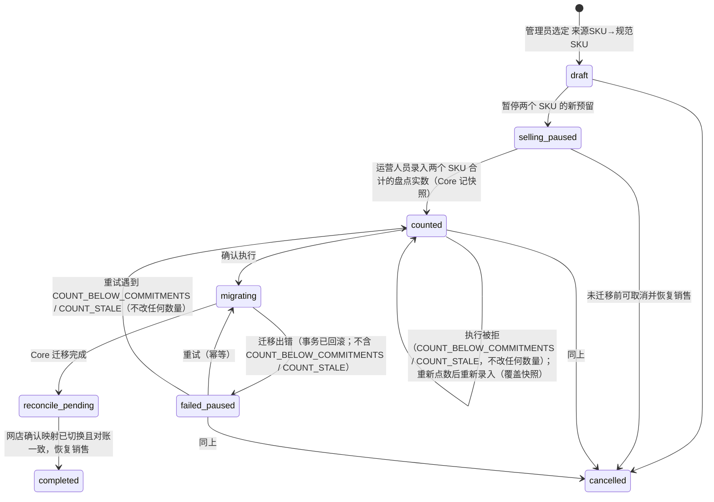
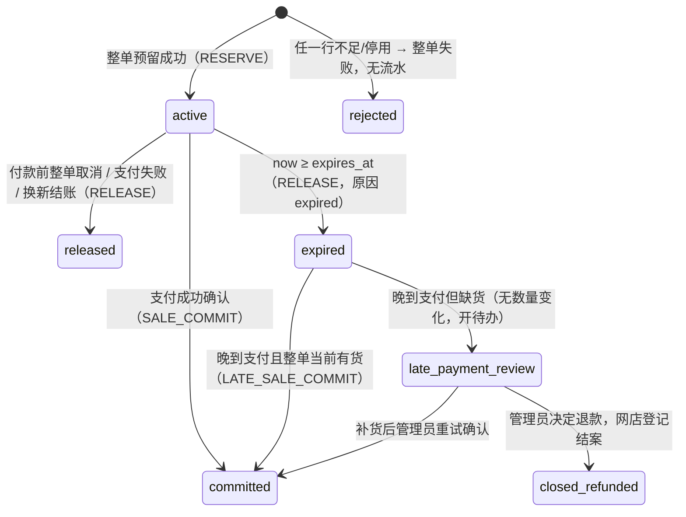

# Acuven Stock Core V1 契约

> 版本：0.8（起草）｜2026-11-14｜状态：**0.8 改动待 Kelvin 批准**——第 14 节第 53 条（§2.5 整机恢复后的游标、§12.1 第 3 条恢复流程加一步；取舍见 Q-41）
> 尚未批准，批准前目录变更流任务不改回 ready。
> 0.7：第 14 节第 38–52 条的 0.7 改动（§2 商品目录的命令、批量导入、
> 目录变更记录与变更流、目录写锁，§7.1 执行顺序、§7.2、§8.2、§8.3、§10 scope 表的相应条目，§4.1 余额行何时建立；取舍见 Q-36～Q-40）
> 于 2026-11-14 批准。
> 0.6 及以前：0.2、0.3 与第 14 节第 12–15 条的 0.4 改动于 2026-11-10 批准；
> 第 14 节第 16、17 条的 0.5 改动（§2.4 SKU 合并按差额定数，§6 盘点的实数作废与重试规则，§8.3 新增 `COUNT_STALE`；
> §4.1、§4.3 写回 CORE-TASK-003 对 `balance_version` 的定义）于 2026-11-12 批准。
> 第 14 节第 18–23 条的 0.6 改动（§7.1 幂等的作用域、摘要、处理中判定与保存范围，§7.2 安全日志，§8.1 请求头与检查顺序，§8.3 新增 405，
> §10 凭据、令牌、scope、角色表与池授权）
> 与第 24–37 条（审查与设计预审后的修改；取舍见 Q-31～Q-35，含 §7.1 第 2 条追加的“换键重报返回对象当前的表示”）于 2026-11-13 批准。
> 0.7 及以前的设计闸门通过；实现进度见 [TODO.md](TODO.md)。
> 按模板规则：设计有改动时，改动部分的批准作废、须重新批准。
> 依据：[REQUIREMENTS.md](../REQUIREMENTS.md)（Core V1 需求，2026-10-08）、`acuven_hub/DECISIONS.md` 的 C-01～C-19、S-01～S-10、I-02、I-04，
> 以及 `acuven_inventory/docs/API_CONTRACT.md`、`STOCK_RULES.md`（Inventory 草案，只读参照）。
> 网店现状见 [SHOP_STOCK_INVENTORY.md](SHOP_STOCK_INVENTORY.md)；问题与 Kelvin 的答复见 [OPEN_QUESTIONS.md](OPEN_QUESTIONS.md)，本文用 **Q-xx** 引用。
>
> 本文只定**语义与边界**：名词、数量不变量、命令与状态、幂等、错误、鉴权、迁移和恢复约束。字段名、路径是建议写法，
> 实现时落成 OpenAPI，字段与路径的调整不改变本文语义；技术栈已定（Q-23，见 TEMPLATE_BOOTSTRAP_PLAN.md）。

---

## 0. 一页看懂

- Core 是**一个独立进程＋一个独立持久化库**，持有两样东西：**商品身份目录**（谁是谁）和**基础库存账**（有几件、被谁占着）。
- Core 不依赖 ERP、Inventory、POS 或统一门户即可支撑单卖网店，也没有面向客户的日常后台（OPS-01）。
- 网店（以及将来的 Inventory、ERP、POS）只通过 `/v1` 私有 API 访问 Core；不直接读写 Core 的表，Core 也不读写网店的表。
- 数量只有四个账面量：`stock_balance`、`reserved`、`unavailable`、`paid_pending_dispatch`；任何变化都是一条**不可改写的流水**，
  余额只是流水的累计结果。
- 每个写命令带**幂等键**和**稳定业务引用**；同一个事实最多生效一次，响应丢了可以按原键重试或按业务引用查询。
- 网店业务代码只依赖 `StockGateway` 接口：V1 由 Core 适配器实现；将来加购 Inventory 并共卖一批货时换 Inventory 适配器。
- V1 的第一个接入方是**公开 Demo**：用一个独立的 Demo Core 实例，带 Demo 专用的每日重置（§6.1）。真实网店何时、怎么接待定（Q-24）。
- 恢复目标：整台服务器永久损坏时，已确认写入最多丢 5 分钟（RPO≤5 分钟），4 小时内恢复（RTO≤4h）。原需求是 RPO=0，Kelvin 2026-11-10 放宽（Q-15，第 12 节）。
- Core 不可用时，网店**继续收款**，但按故障前最后读到的可售量封顶；恢复后补交，有货补扣、没货交管理员（§5.5，Q-03）。

---

## 1. 标识与名词

| 名词 | 标识 | 谁生成 | 规则 |
| --- | --- | --- | --- |
| 租户 | `tenant_id` | Core 运维开通 | V1 只有一个（Acuven 自用）。**永远从调用方凭据推出，不接受请求正文/路径自选。** |
| 库存地点 | `location_id` | Core | 一个物理地点（仓库/店面）。V1 每租户一个。 |
| 库存池 | `pool_id` | Core | 一批**明确归属**的实物，绑定一个地点。V1 每租户一个；数据键和 API 保留池维度，**禁止以相同 SKU 推断两个池共享**（C-07）。 |
| 销售入口 | `channel_id` | Core 运维登记 | 一个会卖货的系统实例（V1：Acuven 网店）。入口绑定它能销售的池；V1 一个入口对一个池，不共卖（C-08）。 |
| 商品 | `product_id` | Core | 展示/归类实体，不计数。 |
| 规格 SKU | `sku_id` | Core | 可独立售卖、独立计数的最小单位。**无规格商品也有一个 SKU。**所有数量都挂在 `sku_id` 上。 |
| SKU 编码 | `sku_code` | 运营人员输入或导入 | 人看的编码，租户内唯一，可修改（保留旧值审计）；**不是**稳定身份，系统间关联一律用 `sku_id`。 |
| 条码 | `barcode` | 运营人员 | 可空；非空时租户内唯一。 |
| 服务凭据 | `credential_id` | Core 运维签发 | 一个调用方服务身份（§10 第 4 条）；轮换令牌时不变。 |

**稳定 ID 格式（Q-04 已定）：**带类型前缀的不透明字符串，前缀＋ULID，例如 `ten_01JC…`（租户）、`prd_01JC…`、`sku_01JC…`、`pool_01JC…`。数据库列统一 `VARCHAR(32)`。
生成后永不复用、永不改变；调用方只做相等比较，不解析内容。跨租户可以出现相同 `sku_code`，但 `sku_id` 全局唯一。

**调用方引用（网店生成，Core 只存不解释）：**`order_ref`、`line_ref`、`payment_ref`、`shipment_ref`、`refund_ref`、`return_ref`、
`receipt_ref`、`count_ref`。格式 1–128 个 ASCII 字符 `[A-Za-z0-9._:-]`，**不得含顾客姓名、电话、邮箱、地址、金额或支付凭据**（OPS-06）。
引用的唯一性范围是 `(tenant_id, channel_id, 引用类型)`。

---

## 2. 商品身份目录

### 2.1 Core 与网店的字段边界（C-01、C-02）

| 放在 Core 目录 | 放在网店（Core 不存、不覆盖） |
| --- | --- |
| `product_id`、`sku_id`、`sku_code`、`barcode` | 图片、分类、多语言展示名称与营销文案、SEO |
| **基本名称**（商品一个、SKU 一个，英文，Q-05） | 规格展示文案（颜色/尺码的多语言标签） |
| **参考售价** `reference_price`（只在 SKU 上；整数最小货币单位＋币种，如 `{"amount_minor": 12900, "currency": "MYR"}`；可空，金额与币种同时有或同时无） | **渠道营业价**、促销价、节日活动价、会员价 |
| 启停状态 `status`：`active / inactive` | 上下架、排序、陈列 |
| 版本 `version`、创建/更新时间、变更审计 | 订单行里的商品与成交价**快照** |
| SKU 合并关系 `merged_into_sku_id`、SKU 编码历史 | 网店侧的 `core_sku_id` 映射列 |

规则：

1. **参考价永不自动改营业价。**参考价变化只在 Core 变更流（2.5）里出现：一条 `sku_updated`，改动字段里含 `reference_price`（Q-38）；
   网店后台把它显示成“改价建议”，有权人员确认后由网店自己改营业价。
2. 订单永远保存网店当时的商品名称与成交价快照；Core 改名、改参考价不影响历史订单。
3. 网店上下架 ≠ Core 停用。Core `inactive` 的 SKU **不能新建预留**，但历史查询、已付款订单的发货/退款回库/退货照常可做。
   商品 `inactive` 时，它的全部 SKU 同样不能新建预留（409 `SKU_INACTIVE`），SKU 自己的 `status` 不变；商品重新启用后照各 SKU 自己的状态恢复（Q-36）。
4. 存在流水或任何订单引用的商品/SKU **不能硬删除**，只能停用（CAT-02）。V1 不提供任何删除接口，没有历史的商品/SKU 也只能停用。

### 2.2 唯一性与版本

- `(tenant_id, sku_code)` 唯一；`(tenant_id, barcode)` 在非空时唯一：空条码一律存 `NULL`，不存空字符串（数据库检查约束拒绝空串）；MySQL 的唯一索引允许多个 `NULL`，因此不需要部分索引。
- 名称长度：商品与 SKU 的基本名称 `VARCHAR(200)`；`sku_code`、`barcode` `VARCHAR(64)`（与网店 `sku` 列同长）；币种 `CHAR(3)`，大写字母由接口层校验。
- **数据库列约定**（目录各表通用，之后的表沿用）：
  - `tenant_id`：`VARCHAR(32) NOT NULL`。
  - 时间：`DATETIME(6) NOT NULL`，一律 UTC（数据库连接把会话时区固定为 UTC，见 `app/db.py`）；`created_at` 默认 `CURRENT_TIMESTAMP(6)`，`updated_at` 由应用在每次修改时写入。
  - 状态：`VARCHAR(16) NOT NULL`，检查约束限定取值（目录为 `active`、`inactive`）；不用数据库 ENUM，方便以后加值。
  - 编码类列（`sku_code`、`barcode`、归属表的 `code`）：排序规则 `utf8mb4_0900_ai_ci`，**唯一性不区分大小写**（`abc` 与 `ABC` 视为同一编码）；
    检查约束要求非空串且首尾无空格（`TRIM(x) = x`），接口层先去首尾空格再写入。
  - 操作人与原因（如 `sku_code_history`）：`actor_ref VARCHAR(128) NOT NULL`（第 1 节引用格式，网店管理员的不透明 ID）、
    `reason VARCHAR(500) NULL`。
- 每个商品、SKU 有整数 `version`，新建为 1，每次修改、停用、重新启用 +1（往商品加规格不改商品的版本）。
  修改请求（`PATCH`）必须在正文带 `expected_version`（0.7 起只认正文，不认 `If-Match` 头：请求头不进幂等摘要，同键换版本号重试会被当成同一请求重放）；
  不一致返回 409 `VERSION_CONFLICT` 并附当前版本，**不静默覆盖**（CAT-03）。停用与重新启用没有请求体、不比版本：它们只把状态设成目标值，
  不会覆盖别人改的字段（§2.6）。
- 修改 `sku_code` 时把旧值写入 `sku_code_history`（旧值、新值、操作者、时间、原因；只追加、无唯一约束，同一 SKU 可以改回自己用过的编码）。
- 旧编码永久保留、不再分配给其他 SKU（Q-06），由另一张表 `sku_code_claims` 保证：每个用过的编码登记一次 `(tenant_id, code) → sku_id`。
  - **数据库保证的一半**：`sku_code_claims` 的主键是 `(tenant_id, code)`（一个编码只能归一个 SKU）；`(tenant_id, sku_id)` 复合外键指向 `skus`。
  - **服务层保证的一半**：在同一事务里完成。建 SKU 时**先插 SKU 行，再插归属行**（归属行的外键要求 SKU 已存在）；建 SKU 与改编码都先查新编码：
    已登记给别的 SKU、且是那个 SKU 的当前编码，409 `SKU_CODE_TAKEN`；已登记给别的 SKU、但那个 SKU 已改用别的编码（退役编码），409 `SKU_CODE_RETIRED`；已登记给它自己（改回旧编码，或只改大小写）则不再插入归属行；未登记则插入归属行；
    然后更新 `skus.sku_code` 并写历史。
    `skus` 不反向外键到归属表（双向外键成环，MySQL 无法延迟检查）。
  - `sku_code_history` 是内部表，主键为自增 `BIGINT id`（不对外暴露，同一秒内的多条按 `id` 排序）。

### 2.3 批量导入（CAT-04、STK-03）

两步：**校验预览 → 确认执行**。

1. `POST /v1/catalog-imports`（操作类型 `catalog_imports.preview`）：上传行（JSON 行数组，CSV 由网店后台解析后转 JSON）。Core 只校验、不写目录，返回 `import_id`、
   逐行结果（`ok / duplicate_sku_code / duplicate_barcode / invalid_format / conflicts_existing / group_blocked`）和汇总。
2. `POST /v1/catalog-imports/{import_id}/confirm`：**只执行预览合格的行**（Q-07），错误行跳过。每个商品连同它的 SKU 作为一组，
   在一个事务内要么全建、要么不建，不留下半成品商品。结果逐行列出成功/跳过/失败原因，运营修正后用新的导入补齐。
   确认带幂等键；重复确认返回原结果。
3. 预览有效期 24 小时；过期须重新预览；期间目录有冲突修改的组在确认时不建，修正后用新的导入补齐（见下）。

0.7 的细化（Q-39）：

- **正文**：`{"rows": [...]}`，1–100 行（§8.1 第 7 步的批量上限，超过 413；Demo 的 76 个 SKU 一次导完）。每行一个 SKU：
  - `external_ref`：必填，第 1 节的引用格式，本次导入内唯一；网店填规格 ID，结果按它给出“网店规格 → `sku_id`”对照（§11.2）；
  - `product_ref`：必填，同一格式；同值的行归为一个商品（网店填商品 ID）。只在本次导入里分组用，Core 不把它存成商品属性；
  - `product_name`、`sku_code`、`sku_name`：必填；`barcode`、`reference_price`：可不带或为 `null`。取值规则同 §2.6 第 1 条
    （`product_name` 按商品名称、`sku_name` 按 SKU 名称）。
  导入只新建商品，不改现有商品，也不往现有商品加规格。
- **整单 422 与逐行结果的分界**：§8.1 第 7 步第一小步的解析错误（不是合法 JSON、重复的键、带小数点或指数的数、`NaN`、孤立代理项等）
  不论出在哪一行，照常整单 422；字段校验只查顶层只有 `rows`、它是数组、每个元素是 JSON 对象。行内缺字段、多字段、类型或取值不对，
  不整单拒绝，记为该行 `invalid_format`（附出错的字段名）。
- **逐行结果**，按下列顺序取第一个命中的：
  1. `invalid_format`：行内字段不合规；或 `external_ref` 在本次导入里重复（重复的各行都算）；或同一 `product_ref` 各行的 `product_name`
     （去首尾空白后）不完全相同（该组各行都算）；
  2. `duplicate_sku_code`：本次导入里别的行用了同一个 `sku_code`（去首尾空白后不区分大小写比较，各行都算）；
  3. `duplicate_barcode`：同上，比较非空条码；
  4. `conflicts_existing`：`sku_code` 已登记在 `sku_code_claims`（任何 SKU 的当前或退役编码，§2.2），或条码已被现有 SKU 使用；
  5. `group_blocked`：本行没问题，但同一 `product_ref` 的别的行有问题。一组只要有一行不合格就整组不执行，否则补齐那一行时会建成另一个商品（Q-40）；
  6. `ok`。

  判定细则：`external_ref`、`product_ref` 按字符串原样比较（区分大小写，同第 1 节的引用）；`product_ref` 本身不合规的行不归任何组，只影响自己；
  `external_ref` 本身不合规的行不参加 `external_ref` 的重复检查；“同组 `product_name` 不一致”只在 `product_name` 本身合规的行之间比较；记为 `invalid_format` 的行不参加 `sku_code`、条码的重复检查与
  `conflicts_existing` 检查（它不会被执行），但照样让所在的组 `group_blocked`。
- **预览**不写目录、不取目录写锁，只保存这次导入，返回 201：`import_id`（前缀 `imp_`）、`status`、`expires_at`、逐行结果（带行下标、
  `external_ref`、`product_ref`）与汇总（各结果的行数、可执行的组数与行数）。
- **确认**（`catalog_imports.confirm`，路径参数 `import_id`，没有请求体）。先取目录写锁（§2.7，开事务之前），再在事务里用
  `SELECT … FOR UPDATE` 读导入行，然后依次判定：
  - 导入不存在或属于别的租户：404 `IMPORT_NOT_FOUND`；
  - 已确认过：200，返回这个导入的当前表示（同 `GET`，含首次确认的逐行结果），不再执行。`import_id` 就是这个命令的业务引用
    （§7.1 第 2 条：换键重报返回当前表示；同键重试照常原样重放）；
  - 已过有效期（`expires_at` 不晚于数据库当前时间）：409 `IMPORT_EXPIRED`，重新预览；
  - 否则按组在 `rows` 里首次出现的顺序处理预览为 `ok` 的组：按当前目录重查各行的 `conflicts_existing`
    （预览之后编码或条码可能已被占用），整组都没有冲突就建商品（名称取 `product_name`）与各 SKU（名称取 `sku_name`），否则整组不建。
    全部在一个事务里，与幂等记录一起提交；目录写锁保证从重查到写入之间没有别的目录写入，所以不需要保存点；
  - 返回 200，逐行结果：`created`（带 `product_id`、`sku_id`）、`skipped`（预览不合格，带预览结果）、`failed`（确认时 `conflicts_existing`，
    或同组别的行冲突时的 `group_blocked`）。导入状态改为 `confirmed`，逐行结果与确认人存进导入记录；一组都没建成也算确认完成；
  - 运营修正后用新的导入补齐：新导入里的组建成新商品。
- **查询** `GET /v1/catalog-imports/{import_id}`（`catalog.read`）：返回当前表示，`status` 为 `previewed`、`expired`（由 `expires_at`
  推出，不存）或 `confirmed`。过期的预览保留，只能查、不能确认。
- **存放**：表 `catalog_imports`，一次导入一行：`import_id` 主键、`tenant_id`、`status`（`previewed` / `confirmed`，检查约束）、
  `expires_at`（预览时的数据库时间加 24 小时）、`rows`（JSON，各行原文与预览结果）、`result`（JSON，确认后才有）、
  预览的 `credential_id`、`actor_ref`、`request_id`、`created_at`，确认的 `confirmed_credential_id`、`confirmed_actor_ref`、
  `confirmed_request_id`、`confirmed_at`（确认后才有）。永久保留；行里不该有个人资料（§10 第 6 条）。

### 2.4 SKU 合并（CAT-05）

合并解决“同一实物被建成了两个 SKU”。**不直接把两份余额相加**（可能重复计数），而是停售、盘点、再迁移未结业务。



停售只停**新预留**：`selling_paused` 与 `counted` 期间，已有预留照常确认、释放、到期，已付款订单照常发货、退款回库、退货，
收货、不可售、报损也照常可做。所以盘点用 §6 的**差额法**，不用盘点数覆盖执行时的账面（0.5，Q-30）：

- **合并单互不重叠**：一个 SKU 同时最多属于一张未结束（`completed`、`cancelled` 以外）的合并单；规范 SKU 必须是 `active`；来源 SKU 不能已经合并过（`merged_into_sku_id` 为空），也不能等于规范 SKU。建单时校验，执行时在锁内复核。
- **按池分别处理**：录入实数、快照、迁移与定数都按池分别做（V1 只有一个池）。

- **录入实数（`count`）**：两个 SKU 是同一种实物，运营人员（`stock_operator` 或 `stock_admin`，§10 第 3 条）录**合计**的两项实数——在架件数（含已付款待发的件）与不可售件数，
  都是不小于 0 的整数，否则 422。Core 在同一事务里按 `(pool_id, sku_id)` 升序锁两个余额行（某个 SKU 在该池还没有余额行时，照 §4.1 先建好，四个量为 0、版本 0），记下它们当时的四个账面量与 `balance_version` 作为**快照**。
  点数前的实物进出须先入账，规则同 §6。只有重新点过实物时才重新录入，后一次覆盖前一次的实数与快照。
- **执行（`execute`）**，在 Core 的**一个事务**里，两个余额行按 `(pool_id, sku_id)` 升序加锁：
  0. **前置检查**：先按 §5.2 第 4 条把两个 SKU 上已到期的 `active` 预留转 `expired`。再查快照之后两个 SKU 上有没有 §6 定义的**只改账的流水**；
     有则录入的实数已作废，整笔拒绝，409 `COUNT_STALE`，合并单留在 `counted`，须重新点数、重新录入。
  1. **整行迁移**：来源 SKU **执行时**的四个账面量全部转到规范 SKU——来源写 `MERGE_TRANSFER_OUT`（四个量各减去当前值，归零），
     规范写 `MERGE_TRANSFER_IN`（各加同样的量），成对出现；来源的未结预留、订单行累计量同时改挂到规范 SKU。
     两个各自满足不变量的账面相加仍满足不变量，这一步不会失败。
  2. **按差额定数**：`d_u` = 不可售实数 − 两个快照的 `unavailable` 之和；
     `d_shelf` = 在架实数 − 两个快照的（`stock_balance` − `unavailable` + `paid_pending_dispatch`）之和。
     在规范 SKU 上写一条 `COUNT_ADJUSTMENT`（引用合并单）：`stock_balance` 增 `d_shelf + d_u`、`unavailable` 增 `d_u`，
     加到第 1 步之后的最新账面上；两个差额都为 0 时不写。流水记两个快照、两项实数与差额。
  3. **不变量**：第 2 步落账后若违反 §4.1，整笔执行回滚（第 1 步也不生效），返回 409 `COUNT_BELOW_COMMITMENTS`，
     缺口数照 §6 的公式算；合并单留在 `counted`。管理员照 §6 先处理相关预留与缺货的已付款订单，然后**直接再执行**：
     沿用原实数与快照，其间的释放、退款回库、发货等变动由差额法照常保留；不要把原来的数再录一遍（会重取快照、把其间的发货等算错）。
     这类业务拒绝不进 `failed_paused`（那是迁移本身出错的分支）。
- 结果：规范 SKU 的账面 = 盘点核实的数量 ＋ 盘点之后发生的变动，不是两份余额直接相加（CAT-05）；盘点时漏点、重复计的件数由差额修正。
- 来源 SKU 归零后设 `inactive` 且 `merged_into_sku_id = 规范 SKU`；
- 数据库约束：`merged_into_sku_id` 不能等于自身；非空时该 SKU 必须是 `inactive`。已合并的 SKU 不能重新启用（`reactivate` 返回 409 `SKU_MERGED`）。
- **历史流水、订单快照里的原 `sku_id` 不改写**；之后任何带来源 `sku_id` 的查询返回 `merged_into_sku_id`，
  带来源 `sku_id` 的**新预留**返回 409 `SKU_MERGED`（附规范 ID），**已有订单行**的发货/退款回库/退货自动作用到规范 SKU。

网店侧需要：把两个规格的映射改到规范 `sku_id`、处理两个网店规格的展示合并（这是网店的事），然后调用 `complete`。
未 `complete` 前两个 SKU 都保持停售。

**合并定数的例子**（A 为来源、B 为规范；四个量依次为 `stock_balance / reserved / unavailable / paid_pending_dispatch`）：

| # | 盘点时（快照） | 录入实数（在架 / 不可售） | 盘点之后、执行之前 | 执行：迁移后的 B | 差额 | 执行结果 |
| --- | --- | --- | --- | --- | --- | --- |
| 1 | A 5/0/0/2，B 10/0/0/0（在架合计 17） | 17 / 0 | A 1 件待发货退款回库 → A 6/0/0/1 | 16/0/0/1 | 0 / 0，不写 | B 16/0/0/1，在库 17 ✓（旧规则会定成 15/0/0/1，少 1 件） |
| 2 | A 5/2/0/0，B 10/0/0/0（在架合计 15） | 14 / 0（实际少 1 件） | A 的预留付款确认 → A 3/0/0/2 | 13/0/0/2 | `d_shelf` −1 | B 12/0/0/2，在库 14 ✓ |
| 3 | A 5/0/1/0，B 10/0/0/0（在架合计 14，不可售 1） | 14 / 1 | 又发现 1 件损坏，A 标不可售 → A 5/0/2/0 | 15/0/2/0 | 0 / 0，不写 | B 15/0/2/0，可售 13 ✓ |
| 4 | A 2/2/0/0，B 1/0/0/0（在架合计 3） | 0 / 0（全部找不到） | 无 | 3/2/0/0 | `d_shelf` −3 | 落账后 0/2/0/0 违反不变量：整笔拒绝，409 `COUNT_BELOW_COMMITMENTS`，缺口 2；A、B 不变，合并单留在 `counted` |
| 5 | A 5/0/0/0，B 10/0/0/0（在架合计 15） | 13 / 0（A 那堆少 2 件） | 另一张 §6 盘点单只点 A，确认记 −2 → A 3/0/0/0 | —（前置检查即拒） | — | 409 `COUNT_STALE`（A 在快照之后有只改账的流水）；重新点数录入 13 / 0（新快照合计 13）后执行：B 13/0/0/0 ✓（不拦会得 11/0/0/0，少 2 件） |
| 6 | A 3/3/0/2，B 1/0/0/0（在架合计 6） | 4 / 0 | 第一次执行被拒（迁移后 4/3/0/2，差额 −2 得 2/3/0/2，缺口 1）；之后释放预留、发出 2 件已付款的货 → A 3/0/0/0，实物剩 2 | 4/0/0/0 | `d_shelf` −2（原快照） | 直接再执行：B 2/0/0/0 ✓（若把 4 / 0 再录一遍，新快照合计 4、差额 0，会得 4/0/0/0，多 2 件） |

### 2.5 目录变更流

`GET /v1/catalog-changes?after=<cursor>&limit=<n>`（`catalog.read`）：按提交顺序返回本租户的目录变更记录（§2.7），每条带对象 ID、新版本、
变更字段、发生时间。网店用它刷新映射和生成改价建议（`sku_updated` 且改动字段含 `reference_price`，§2.1 第 1 条）；游标单调、可重放。
V1 用拉取，不做推送（Q-08）。

- `after` 不带时从头开始；带时是上一页返回的 `next_cursor`，不透明（调用方只原样回传、不解析），格式不对 422 `INVALID_REQUEST`。
  `limit` 是 1–100 的十进制整数，不带为 100，不合格 422。
- 响应：`changes` 数组（按游标升序）与 `next_cursor`（最后一条的游标；没有新记录时原样返回请求里的 `after`，没带则为 `null`）。
  网店保存 `next_cursor`，定时用它接着拉；用旧游标重拉得到同样的记录。
- 每条：`cursor`、`event_type`、`object_type`（`product` / `sku`）、`object_id`、`product_id`、`version`（对象这次改动后的版本）、
  `changes`（改动的字段，每个 `{"before": …, "after": …}`；新建时 `before` 都是 `null`）、`actor_ref`、`reason`、`import_id`、
  `request_id`、`occurred_at`。
- 游标格式合格、但对应的记录已不存在（如整机恢复后，见下条）时，照常返回 `id` 比它大的记录，不报错。
- 网店把 `next_cursor` 存在自己的库里，与应用这一页记录的写入在同一事务提交（建议）：网店的库与 Core 在同一 `infra_mysql` 实例上，恢复点一致，
  这样保存的游标不会越过 Core 恢复后的最大 `id`。存在实例之外（缓存、文件）时就会出现下条的跳号。
- **整机恢复之后（0.8，Q-41）**：§12.1 第 3 条的恢复会丢最近的写入（目标至多 5 分钟，binlog 传输中断时可能更长），丢掉的变更记录不再出现，
  它们占过的 `id` 会被 MySQL 重新分配。网店在故障前保存的游标可能已越过这些 `id`，新记录若拿到更小的 `id` 就会被跳过。所以恢复流程在 binlog 重放完、
  启动 Core 之前，把 `catalog_changes` 的自增起点调到恢复后的最大 `id`（表为空按 0）加 1,000,000：目录写入按租户逐条串行（§2.7），
  丢失窗口再长也分配不了这么多 `id`，所以之后的新记录的游标都大于故障前发出的任何游标，不会被跳过。自增计数器持久保存（MySQL 8），重启不回退；
  抬高之后不能再重放 binlog。
  “用旧游标重拉得到同样的记录”只在没有丢数据时成立：游标落在丢失窗口里的，重拉得到的是恢复后的新记录。丢失窗口里的目录变化照 §12.1 第 4 条补齐。
- 事件类型：`product_created`、`product_updated`、`product_deactivated`、`product_reactivated`、`sku_created`、`sku_updated`、
  `sku_deactivated`、`sku_reactivated`；登记 SKU 合并时再加 `sku_merged`。调用方须忽略不认识的事件类型（§8.4 只做加法）。

### 2.6 目录命令（0.7，Q-36～Q-38）

写命令要求 `catalog.write` 与 `catalog_admin` 角色，读接口要求 `catalog.read`、不要求角色（§10 第 3、4 条）；路径见 §8.2。
命令都没有业务引用（§7.1 第 2 条），去重只靠幂等键：网店按业务对象确定性派生键（例如 `shop:product:<网店商品 ID>:create:1`），响应丢了用原键重试。

1. **字段取值**（新建、修改、导入通用）。“去首尾空白”按 Python `str.strip()` 的规则；控制字符指 U+0000–U+001F 与 U+007F。
   - 名称（商品与 SKU 的 `name`）：字符串，去首尾空白后 1–200 个字符，不含控制字符。
   - `sku_code`：字符串，去首尾空白后 1–64 个字符，每个字符都是可打印 ASCII（0x20–0x7E；空格因去首尾空白只会在中间）。
   - `barcode`：字符串或 `null`；去首尾空白后为空串按 `null`（§2.2 空条码存 `NULL`），否则同 `sku_code` 的长度与字符集。
   - `reference_price`：`null`，或恰好含两个字段的对象 `{"amount_minor": 0–9007199254740991 的整数, "currency": 3 个大写 ASCII 字母}`；
     不查币种是否在 ISO 4217 清单里。
   - `reason`：可选，字符串或 `null`；字符串去首尾空白后 1–500 个字符、不含控制字符。
   - 编码与条码的重复一律按 ASCII 不区分大小写判断（等于都转小写后比较）。限定可打印 ASCII 是为了让这个判断与数据库排序规则
     `utf8mb4_0900_ai_ci` 的相等一致：该排序规则还不区分重音（`CAFÉ` 与 `cafe` 相等），放开非 ASCII 会出现请求内查不出、写入却撞唯一约束的情况。
     万一写入仍撞上编码或条码的唯一约束，按对应的 409 报（§7.1 业务拒绝撤销全部写入），不返回 500。
   - “改没改”按去首尾空白后的字符串原样比较，只改大小写也算改（写编码历史）。
2. **新建商品** `POST /v1/products`（`products.create`）：正文 `name`、`skus`、`reason`。`skus` 是 1–100 个 SKU 对象（Q-37；§8.1 第 7 步的批量数组），
   每个含 `sku_code`、`name`，可带 `barcode`、`reference_price`。同一请求里 `sku_code` 重复或非空 `barcode` 重复 422。
   与现有目录冲突：409 `SKU_CODE_TAKEN` / `SKU_CODE_RETIRED` / `BARCODE_TAKEN`（§2.2），一个都不建。有多处冲突时，顶层错误码取这三个里
   按此顺序第一个出现的；`details.conflicts` 列出全部冲突，每项带 `index`（SKU 在 `skus` 里的下标）、`field`、`value`、`code`。
   成功 201，返回商品的表示（含 SKU）。商品与 SKU 新建为 `active`、版本 1，按请求顺序写变更记录。
3. **加规格** `POST /v1/products/{product_id}/skus`（`skus.create`）：正文是一个 SKU 对象，另可带 `reason`。商品不存在 404 `PRODUCT_NOT_FOUND`；
   商品 `inactive` 时照样可以加（照 §2.1 第 3 条不能新预留）。冲突同上（`details.conflicts` 的项不带 `index`）。成功 201，返回 SKU 的表示。
4. **修改** `PATCH /v1/products/{product_id}`（`products.update`）：正文 `expected_version`（必填）、`name`、`reason`。
   `PATCH /v1/skus/{sku_id}`（`skus.update`）：`expected_version`、`sku_code`、`barcode`、`name`、`reference_price`、`reason`。
   - 除 `expected_version`、`reason` 外至少带一个字段，否则 422。不带的字段不变；`barcode`、`reference_price` 给 `null` 是清空；
     `name`、`sku_code` 给 `null` 422；其他字段（`status`、`product_id`、`merged_into_sku_id` 等）是未知字段，422。
   - 判定顺序：对象不存在 404（`PRODUCT_NOT_FOUND` / `SKU_NOT_FOUND`）→ 版本不符 409 `VERSION_CONFLICT`（`details.current_version`）
     → 编码或条码冲突 409（同第 2 条）→ 写入。要改的行在事务里用 `SELECT … FOR UPDATE` 读。
     已合并的 SKU 只接受清空条码（除 `expected_version`、`reason` 外只带 `barcode`，且按第 1 条规范化后为 `null`，即 `null` 或空白串），带别的字段 409 `SKU_MERGED`，
     这一判定在 404 之后、版本之前。
   - 与当前值相同的字段当作没带；全都相同时返回 200 与当前表示，不加版本、不写变更记录与编码历史。
   - 改了 `sku_code` 时照 §2.2 处理归属与编码历史，历史的 `actor_ref` 取 `X-Actor-Ref`、`reason` 取正文。
   - `inactive` 的商品与 SKU 也可以改；已合并的 SKU 只能清空条码（好让规范 SKU 用这个条码），不能重新启用。
     成功 200，返回改后的表示。
5. **停用与重新启用**：`POST /v1/products/{product_id}/deactivate`、`/reactivate`（`products.deactivate`、`products.reactivate`），
   `POST /v1/skus/{sku_id}/deactivate`、`/reactivate`（`skus.deactivate`、`skus.reactivate`），都没有请求体。
   - 已是目标状态：200，返回当前表示，不加版本、不写记录；停用已合并的 SKU 也按这条处理；
   - 重新启用已合并的 SKU：409 `SKU_MERGED`（§2.4）；
   - 停用商品不改它的 SKU 的状态（Q-36）；所属商品 `inactive` 时照样可以重新启用 SKU，但在商品重新启用前仍不能新预留（§2.1 第 3 条）；
   - 停用不检查库存与未结订单（已有订单照常处理，§2.1 第 3 条）。没有请求体，所以变更记录的 `reason` 为空。成功 200，返回改后的表示。
6. **查询**：
   - `GET /v1/products/{product_id}`：商品的表示；`GET /v1/skus/{sku_id}`：SKU 的表示，已合并的照常返回、带 `merged_into_sku_id`（§2.4）。
   - `GET /v1/skus?sku_code=…`、`?barcode=…`、`?ids=…`：三个参数恰好带一个，否则 422。`sku_code`、`barcode` 去首尾空白后按当前值、
     不区分大小写精确匹配，返回 0 或 1 个（退役编码查不到）；`ids` 是逗号分隔的 1–100 个 `sku_id`，有重复 422，返回其中属于本租户的，
     不存在或属于别的租户的不出现、也不报错（查询本身限定在本租户，不记 `cross_tenant`）。结果是 `skus` 数组，按 `sku_id` 升序，不分页。
   - 按路径 ID 读写别的租户的商品、SKU、导入：404（与不存在相同），记 `cross_tenant` 安全事件（§7.2）。
7. **表示**：
   - 商品：`product_id`、`name`、`status`、`version`、`created_at`、`updated_at`、`skus`（SKU 的表示，按 `sku_id` 升序）。
   - SKU：`sku_id`、`product_id`、`sku_code`、`barcode`、`name`、`reference_price`、`status`、`product_status`（所属商品的状态）、
     `merged_into_sku_id`、`version`、`created_at`、`updated_at`。

### 2.7 目录变更记录与目录写锁（0.7）

- 表 `catalog_changes`，只追加（不 UPDATE、不 DELETE），永久保留；它既是 §7.2 的目录审计，也是 §2.5 变更流的来源。
  每个命令对每个改动了的对象写一条：新建商品写一条 `product_created`，再按请求顺序给每个 SKU 写一条 `sku_created`；一次修改改了几个字段都只写一条。
- 列：`id`（自增 `BIGINT` 主键，变更流的顺序与游标都由它来）、`tenant_id`、`event_type`（`VARCHAR(32)`，不加检查约束，以后加事件类型不改表，
  由应用校验）、`object_type`（`product` / `sku`，检查约束）、`object_id`、`product_id`（SKU 事件为所属商品，商品事件等于 `object_id`；
  复合外键指向商品）、`version`（改动后的版本）、`changes`（JSON，`{字段名: {"before": …, "after": …}}`，字段名与表示里的相同，
  `reference_price` 整个对象算一个字段，停用与重新启用记 `status`）、`credential_id`、`actor_ref`、`actor_role`（目录写命令都要求
  `catalog_admin`，所以两者必有）、`reason`、`import_id`（导入确认建的才有，复合外键指向 `catalog_imports`）、`request_id`、
  `idempotency_key`、`created_at`。索引 `(tenant_id, id)`、`(tenant_id, object_id, id)`。
- 与目录写入、编码历史、幂等记录在同一事务提交（§12.1 第 1 条）。
- **目录写锁**：自增值在插入时分配，不按提交顺序；不加锁时，读变更流的一方可能先看到已提交的大号，晚提交的小号就被跳过了。
  所以每个写目录的命令（§2.6 的新建、加规格、修改、停用、重新启用，§2.3 的导入确认，以后的 SKU 合并）在取到幂等命名锁（§7.1 执行顺序第 1 步）
  之后、开事务之前，在同一连接上再取一个 MySQL 命名锁 `GET_LOCK(目录锁名, 5)`：
  - 锁名是数据库名、字面量 `catalog`、`tenant_id` 三项以换行符（0x0A）连接后 UTF-8 编码的 SHA-256 小写十六进制，64 个字符；定下后不改。
  - 5 秒内取不到（返回 0）或出错（返回 NULL）：503 `UNAVAILABLE`（确定未生效，可同键重试），什么也不写、不保存。
  - 取到后才开事务，所以事务的读快照建立在锁之后，看得到前一个持锁者已提交的全部写入；持锁到提交或回滚之后，由 §7.1 执行顺序第 5 步的
    `RELEASE_ALL_LOCKS()` 与幂等锁一并释放。
  效果：同一租户的目录写入串行，变更记录的 `id` 按提交顺序递增，某个游标之前不会再冒出新记录；从查编码、条码、版本、导入状态到写入之间，
  没有别的目录写入。V1 目录写入很少，串行的代价可以接受。
  不锁租户行：幂等记录、流水、余额等表都有外键指向 `tenants`，插入时对租户行加共享锁，锁租户行会让目录命令与本租户的全部写命令互相阻塞，
  锁序与销售命令相反时还会死锁。命名锁不是 InnoDB 行锁，不受外键影响；取它时还没开事务、不持有任何行锁，所以不会与行锁形成环。
  既写目录又锁余额行的命令（SKU 合并）照此先取目录写锁，开事务后再按 §8.1 的顺序锁余额行。批量导入的预览不写目录，不取这个锁。
  开事务前的先后固定为：幂等锁（§7.1）→ 目录写锁（只有写目录的命令）→ 余额行预建的短事务（§4.1，只有要锁余额行的命令）→ 开业务事务。
  两条规则：不在打开事务或持有行锁时带等待地 `GET_LOCK`；凡是写 `catalog_changes` 的路径都先取目录写锁。

---

## 3. 库存地点、库存池与销售入口

- V1 每租户：1 个地点、1 个池、1 个销售入口（网店），入口绑定该池。
- **销售类命令**（预留、确认销售、释放、发货、退款回库、退货）的池由**销售入口绑定**决定，正文不带 `pool_id`。
- **库存管理命令**（期初、收货、盘点、不可售）正文带 `pool_id`，Core 校验该凭据是否获准操作这个池。V1 只有一个池，但校验照做。
- 没有 Inventory 时，一个池只允许一个销售入口写销售事实；登记第二个入口到同一池会被 Core 拒绝（C-07）。
  将来启用 Inventory 共卖时，由 Inventory 的入口额度在 Core 的同一事务内校验（README“网店单卖与加购 Inventory”）。

---

## 4. 数量模型

### 4.1 账面量（每个 `tenant × pool × sku` 一行）

| 字段 | 含义 |
| --- | --- |
| `stock_balance` | 尚未售出的账面库存（含不可售、含已预留未付款） |
| `reserved` | 有效（未到期、未释放、未确认）订单预留 |
| `unavailable` | 账内但不可售（损坏、待检、冻结） |
| `paid_pending_dispatch` | 已付款扣库、实物尚未交运 |
| `available` | **派生**：`stock_balance − reserved − unavailable`，不存储为可写字段 |
| `balance_version` | 每写一条流水 +1，用于查询核对，并用来认出盘点快照之后的流水（§6，不做乐观锁比较） |

**不变量（每个事务提交前在锁内校验，违反则整笔回滚）：**

- 四个账面量均为非负整数；
- `reserved + unavailable ≤ stock_balance`（等价于 `available ≥ 0`）；
- 每个量 = 期初 + 该 SKU/池所有流水对应增量之和（可重建，STK-01）；
- 盘点时预期在库实物 = `stock_balance + paid_pending_dispatch`。

计量单位为整数件；不支持小数、负数和其他计量单位（未来另立版本）。

目录命令（§2.6、§2.3）不建余额行。库存与订单命令要锁的余额行还不存在时，在开业务事务之前用单独的短事务按 `(pool_id, sku_id)` 升序逐行
`INSERT … ON DUPLICATE KEY UPDATE`（已有的行不改）建好（四个量为 0、版本 0；全零的行与没有行等价，多建无害），开事务后再照 §8.1 加锁；
不在业务事务里对不存在的行加锁再插入（并发时间隙锁会死锁），也不用 `INSERT IGNORE`（会把外键、检查约束错误当警告吞掉）。
预建因外键失败（SKU 或池不存在、属于别的租户）时不建，业务事务照该命令自己的规则报 404。还没有余额行时，查询按四个量都为 0 处理。

### 4.2 与 Inventory 草案（STOCK_RULES）的换算

Inventory 用 O/H/C/U；两套量可互相换算，**不需要两本账**：

| Inventory | Core | 说明 |
| --- | --- | --- |
| O（on_hand，在库实物） | `stock_balance + paid_pending_dispatch` | |
| H（held） | `reserved` | |
| C（committed，已售未出库） | `paid_pending_dispatch` | |
| U（unavailable） | `unavailable` | |
| `H + C + U ≤ O` | `reserved + unavailable ≤ stock_balance` | 两式等价 |
| A（不含安全库存时） | `available` | 安全库存 S 是 Inventory 政策，Core V1 不实现 |

**已知分歧（见 OPEN_QUESTIONS Q-20）：**Inventory 允许把真实超卖事实记成 `C > O` 的“需求缺口”并标 `needs_review`；
Core 需求要求所有量非负、缺货时“暂停履约交管理员”（ORD-03）。V1 只接网店，按 Core 需求实现；接 Inventory 前要统一。

### 4.3 库存事实（流水类型）

每条流水不可修改、不可删除。字段：`entry_id`、`tenant_id`、`pool_id`、`sku_id`、`entry_type`、四个量各自的增量与变动后值、`balance_version_after`（写这条流水后余额行的版本）、
`source`（`channel_id`、来源单据类型与引用、`line_ref`）、`command_id`、`idempotency_key`、`actor`（服务身份＋网店用户引用＋角色）、
`reason_code`、`note`、`occurred_at`（业务发生时间，调用方给）、`recorded_at`（Core 数据库时间）。

| entry_type | 触发命令 | stock_balance | reserved | unavailable | paid_pending_dispatch |
| --- | --- | --- | --- | --- | --- |
| `OPENING_BALANCE` | 期初（仅初始化模式） | +q | | | |
| `RECEIPT` | 收货入库 | +q | | | |
| `COUNT_ADJUSTMENT` | 盘点差异确认（§6）/ 合并按差额定数（§2.4） | ±d | | ±u | |
| `MARK_UNAVAILABLE` / `RESTORE_AVAILABLE` | 不可售 / 恢复可售 | | | +q / −q | |
| `WRITE_OFF` | 报损（从不可售量） | −q | | −q | |
| `RESERVE` | 订单预留 | | +q | | |
| `RELEASE` | 付款前整单取消、支付失败、到期 | | −q | | |
| `SALE_COMMIT` | 支付成功确认销售（有有效预留） | −q | −q | | +q |
| `LATE_SALE_COMMIT` | 晚到支付、预留已过期但当前有货 | −q | | | +q |
| `DISPATCH` | 按行/件数交运 | | | | −q |
| `REFUND_RESTOCK` | 退款已批准、确认未交运的件数回库 | +q | | | −q |
| `RETURN_SELLABLE` | 已交运退货，验收可售 | +q | | | |
| `RETURN_UNSELLABLE` | 已交运退货，验收不可售 | +q | | +q | |
| `MERGE_TRANSFER_OUT` / `IN` | SKU 合并迁移 | 按迁移量 | 按迁移量 | 按迁移量 | 按迁移量 |
| `DEMO_RESET` | Demo 每日重置（**仅 Demo 实例**，§6.1） | 拉回目标 | | | |
| `CORRECTION` | 管理员纠正错误流水（引用原 `entry_id`） | 原增量的反向 | 同左 | 同左 | 同左 |

`CORRECTION` 只能由有纠正权限的管理员发起，必须引用原流水并给原因；原流水保留。原流水之后若已有依赖动作（例如错误的收货之后又有销售），
不能简单反向，拒绝并要求走盘点更正（参考 Inventory STOCK_RULES §4 的同一原则）。

---

## 5. 网店订单的库存生命周期

### 5.1 订单行累计量

Core 按 `(tenant_id, channel_id, order_ref, line_ref)` 保存一行，`sku_id` 在首次预留时固定、以后不随映射变化：

| 字段 | 含义 |
| --- | --- |
| `quantity` | 下单数量（整单预留时确定，之后不变） |
| `committed_qty` | 已确认销售量（V1 整单确认，等于 `quantity` 或 0） |
| `dispatched_qty` | 已交运累计 |
| `refund_restocked_qty` | 付款后、未交运、已批准退款而回库的累计 |
| `returned_sellable_qty` / `returned_unsellable_qty` | 已交运后退货验收累计 |

约束：`dispatched_qty + refund_restocked_qty ≤ committed_qty`；`returned_sellable_qty + returned_unsellable_qty ≤ dispatched_qty`。
**每个后续动作都是增量，并有自己的稳定引用**（`shipment_ref`、`refund_ref`、`return_ref`）；同一引用重复送达只生效一次，
换引用重复报同一实物由累计上限兜底（ORD-04/05/07 的“重复或超量被拒”）。

### 5.2 预留状态机



规则：

1. **整单原子。**一次预留包含订单全部行；任一行缺货、停用、已合并或越权，整单失败，不产生任何预留或流水（ORD-01）。
2. **一个订单只有一个预留。**`(channel, order_ref)` 唯一；同订单同内容重复请求返回原预留，不同内容返回 409 `ORDER_REFERENCE_CONFLICT`。
   过期的订单不能原地“续期”，网店若要重新结账用新的 `order_ref`。
3. **到期时间由 Core 算、网店照用。**预留 TTL 来自 Core 配置（默认 900 秒＝15 分钟，可配置且变更有审计）；Core 返回 `expires_at`，
   网店把它作为支付截止时间显示和校验，两端不会各算一个（ORD-01）。网店**不能**在请求里指定 TTL。
4. **到期由 Core 负责关闭**：后台任务定期扫描；任何读或写命中已到期的 `active` 预留时也先在锁内转 `expired`（不只依赖定时任务）。
   判断用数据库 UTC 时间：`now ≥ expires_at` 即到期；网店报的“付款时间早于到期”不能复活预留，只能走晚到支付。
5. **确认销售必须与原预留行集完全一致**（SKU、数量、行引用）；不一致 409 `RESERVATION_MISMATCH`。
6. **晚到支付**（ORD-03）：确认请求命中 `expired` 的预留时，Core 在同一事务里检查**整单**当前 `available`：
   足够则写 `LATE_SALE_COMMIT`，返回 200 并标 `late=true`；不足则**不改任何数量**，返回 409 `LATE_PAYMENT_INSUFFICIENT_STOCK`，
   把预留转 `late_payment_review` 并记一条待办。补货后管理员可重试确认（新幂等键、同一 `payment_ref`）；或网店退款后调用结案。
7. **一个订单只能确认一次。**以 `(channel, order_ref)` 和 `(channel, payment_ref)` 双重唯一兜底：同一支付通知重复送达只扣一次（ORD-02）。

### 5.3 付款后的分支

| 场景 | 网店先做什么 | 调 Core | Core 校验 |
| --- | --- | --- | --- |
| 部分/全部发货（ORD-07） | 网店记录交运 | `dispatches`（`shipment_ref`＋行/件数） | 每行 `q ≤ committed − dispatched − refund_restocked` |
| 付款后退款（未交运部分） | 退款流程获批准，且网店确认这些件**仍在库未交运** | `refund-restocks`（`refund_ref`＋行/件数） | 同上；**仅有支付机构退款成功通知不触发**（ORD-04） |
| 已交运后退货（ORD-05） | 实物收到并验收 | `return-receipts`（`return_ref`＋行/件数＋`disposition: sellable/unsellable`） | 每行累计退货 ≤ `dispatched_qty` |
| 付款前取消 | 网店取消订单 | `reservations/{id}/release` | 只能整单；`committed` 状态返回 409 `STATE_CONFLICT` |

付款后**没有**“部分取消”命令；退款与库存是两个独立事实（ORD-04）。“只退款不退货”的已交运订单不调 Core。

### 5.4 订单查询与对账

- `GET /v1/orders/{order_ref}/stock`：返回该订单的预留状态、每行累计量和相关流水，供网店后台异常处理（ORD-06）。
- `GET /v1/reconciliation/order-lines?changed_after=<cursor>`：按变更顺序列出订单行累计量，供网店每日自动对账（ORD-08）。
  对账由网店发起、差异在网店后台成为待办；Core 不读网店数据库。对账要比较的项见 [SHOP_STOCK_INVENTORY.md](SHOP_STOCK_INVENTORY.md) 第 8 节。

### 5.5 Core 不可用时的故障收款（Q-03）

Kelvin 2026-11-10 定：Core 不可用时网店**继续收款**，并**按故障前最后读到的可售量封顶**。这取代 REQUIREMENTS 原 OPS-05 的“停止新预留与库存确认”。

**触发条件**：预留请求的结果是 `Unknown`（超时、连接失败、5xx），并且按 `order_ref` 查询也查不到结果。
**业务拒绝不触发**：缺货、停用、超量、各种冲突（4xx）照常拦截，不能当成故障放行。

**网店侧做法：**

1. **封顶。**网店为每个 SKU 记住最近一次从 Core 成功读到的 `available` 和读取时间。故障期间，满足下面两条才放行一单：
   - 该 SKU 本次故障已放行的件数加上本单件数，不超过这个读数；
   - 读数不早于 10 分钟（默认值，可配）。

   从没读到过、或读数太旧的 SKU 不放行。封顶计数只是网店的临时闸门，不是库存账，故障结束即作废。
2. **订单标记。**放行的订单标 `stock_state=unreserved_fault`。支付截止时间用网店配置的同一默认值（15 分钟），因为此时拿不到 Core 的 `expires_at`。
3. **Core 恢复后按原幂等键补交：**
   - **已付款的放行订单**：调 `sale-commits`，不带 `reservation_id`。Core 先按 `(channel, order_ref)` 找预留：
     - 找到（说明当初预留其实成功了、只是响应丢了），按 §5.2 正常确认；
     - 找不到，按晚到支付处理：整单有货写 `LATE_SALE_COMMIT`；没货不改任何数量，转 `late_payment_review`，由管理员退款或等补货（Q-20、Q-26）。
   - **未付款的放行订单**：补调预留。成功后照常走；缺货则取消订单，不再收款。
4. 当初没有成功预留的订单，取消时不调 Core 释放。

**Core 侧**：`sale-commits` 的 `reservation_id` 可为空，流水的 `reason_code` 记 `fault_mode`。对账（§5.4）要单独列出故障期间放行的订单。

---

## 6. 库存管理命令

| 命令 | 规则 |
| --- | --- |
| 期初 `opening-balances` | 只在池处于 `initializing` 状态时可用；批量“校验预览 → 确认”，与 2.3 同形；**Demo 库存数不得作为期初**（STK-03）。池切到 `live` 后期初命令一律拒绝，只能走盘点更正或经审批的重建流程（Q-09）。 |
| 收货 `receipts` | `receipt_ref` 唯一；同引用重试不重复入库（STK-02）。V1 无采购单，`receipt_ref` 由网店后台生成。 |
| 盘点 `counts` | 三步：**开单 → 提交实数 → 管理员确认**。实数分两项录：**在架件数**（含已付款待发的件）与**不可售件数**。两项实数都必须是不小于 0 的整数，否则提交 422。**点数之前已发生的实物进出（收货、发货、报损处理）须在提交实数前入账**，否则会被差额重复计入或漏计；对已提交实数的 SKU，之后的 `WRITE_OFF` 只用于点数之后才处理掉的实物。提交实数**按 SKU 计**：一次提交可以只列部分 SKU，再次提交只替换所列 SKU 的实数与快照，没列的 SKU 保留原实数与原快照（0.5）。确认只对已提交实数的 SKU 落账，一个都没提交时 422；没提交的 SKU 不动，不当作实数 0。`count_ref` 只标识开单；提交与确认靠幂等键去重，按 SKU 重新提交不算 §7.1 的业务引用冲突。提交实数时，Core 在同一事务里记下当时每个 SKU 的四个账面量作为**快照**（表示“这个时刻点到的就是这么多”）。确认时按**差额**落账，不用快照覆盖最新账面：`d_u` = 不可售件数 − 快照 `unavailable`；`d_shelf` = 在架件数 − 快照（`stock_balance` − `unavailable` + `paid_pending_dispatch`）；写一条 `COUNT_ADJUSTMENT`：`stock_balance` 增 `d_shelf + d_u`、`unavailable` 增 `d_u`，加到确认时的最新账面上。这样提交之后、确认之前发生的收货、销售、发货都保留（例：提交时点到 20、之后收货 10，确认时差额为 0，账面仍是 30）。快照也记下每个 SKU 的 `balance_version`，不做乐观锁比较（其间的收货、销售、发货照常保留），只用来认出快照之后的**只改账的流水**：`OPENING_BALANCE`、`COUNT_ADJUSTMENT`、`CORRECTION`、`DEMO_RESET`、`MERGE_TRANSFER_OUT` / `IN`——它们改账面但不对应实物进出，差额法会把它们与实数的差额重复计入（例：快照 5、点到 3，另一张盘点单先把同一 SKU 记了 −2，再确认又记 −2）。确认时在锁内查每个 SKU 有没有 `balance_version_after` 大于快照版本的这类流水；有则这些 SKU 的实数作废，整笔确认拒绝，409 `COUNT_STALE`，`details` 列出 SKU，管理员只重新点这些 SKU、只为它们重新提交实数，其余 SKU 不重录（重录会重取快照，见第 14 节第 17 条）；一时点不了的，只能取消这张盘点单、另开新单（0.5）。**取消**（`POST /v1/counts/{id}/cancel`，0.6）：只有未确认的盘点单（已开单、无论有没有提交实数）能取消；取消不写流水，丢弃已提交的实数与快照；对已确认或已取消的盘点单再提交、确认或取消，409 `STATE_CONFLICT`；取消后 `count_ref` 仍被占用，另开新单要用新的 `count_ref`；用原 `count_ref` 换新幂等键再开单（同内容），按 §7.1 第 2 条返回原单当前的表示（状态 `cancelled`），不开新单；开单与查询的响应都带盘点单状态。流水记快照、实数、差额、原因（STK-02、STK-05）。**若落账后会违反 §4.1 不变量**（任一量为负，或 `reserved` + `unavailable` > `stock_balance`），整笔拒绝，返回 409 `COUNT_BELOW_COMMITMENTS`，逐 SKU 给出落账后的四个量和一个缺口数 = max(0, `reserved` + 新 `unavailable` − 新 `stock_balance`, −新 `stock_balance`, −新 `unavailable`)（任一项违反时缺口都大于 0）；盘点单保持未确认：管理员先让相关预留释放或到期，对缺货的已付款订单走退款（退款回库把待发货量转回账面，两步都有流水），然后**直接再确认**：沿用原实数与快照，实际短缺由同一个差额记掉；只有重新点过实物时才重新提交实数（0.5）。Core 不记负数，也不替管理员决定先砍哪笔订单（Q-20 同一原则）。 |
| 不可售 / 恢复 / 报损 | 见 4.3；`unavailable` 不得超过 `stock_balance − reserved`。 |

确认盘点差异、更正、报损需要“库存管理员”角色；普通操作员只能录入、不能确认（STK-05）。角色由网店断言、Core 校验，见第 10 节。

### 6.1 Demo 实例与每日重置

背景：公开 Demo 是 Core V1 的第一个接入方，Kelvin 定 Demo 的每日重置用 Core 里的 Demo 专用命令来做。

**实例区分**
- Core 启动时读配置 `CORE_ENV=demo|production`，运行中不能改。
- Demo 实例与将来的生产实例各用独立的库和凭据。
- 健康检查返回这个环境标记，供网店做启动核对（§9.2）。

**重置命令**：`POST /v1/demo/resets`，只在 Demo 实例上存在。
- 请求正文：`business_date`（马来西亚日期）、`pool_id`、逐 SKU 的 `target`（网店的“每日初始库存”）。
- Core 的处理：
  1. 在一个事务里，按 SKU 升序加锁；
  2. 对每个列出的 SKU 计算 `new_balance = max(target, reserved + unavailable)`；
  3. 写一条 `DEMO_RESET` 流水，增量 = `new_balance − stock_balance`；
  4. `reserved`、`unavailable`、`paid_pending_dispatch` 都不动。
- 结果：`available = max(target − reserved − unavailable, 0)`，与网店现在的规则“当日可用 = max(初始 − 待付预留, 0)”一致；未结订单的预留和待发货量照常保留。
- `target` 必须是不小于 0 的整数（0 表示当天该 SKU 售罄），负数或非整数整批 422；同一请求里同一 SKU 重复出现也是 422。
- 增量为 0 的 SKU 不写流水，但在该次重置的结果里列出（`delta = 0`）。
- 请求里没列的 SKU 不动。
- `(pool_id, business_date)` 唯一：同一天重复调用，返回第一次的结果。
- 一次最多列 100 个 SKU（§8.1 批量上限），所以一个池超过 100 个 SKU 时当天无法全部重置；Demo 现在 76 个，够用，超过时再改契约。

**生产实例的防护**
- 该路径返回 404；
- `DEMO_RESET` 流水类型在数据库约束层面就被拒；
- 启动时如果发现 Demo 配置和生产标记冲突，直接拒绝启动。

**留在网店的部分**
- 什么时候调重置（马来西亚 00:00 之后），以及“每日恢复库存开关”，仍由网店决定。
- “每日初始库存”是 Demo 的展示配置，也留在网店，不进 Core 目录。
- Demo 原有的“当日库存调整”（直接把可用量改成某个值）改成调 Core 的盘点更正（§6），Core 不开放直接改数量的接口。

---

## 7. 幂等、业务引用与审计

### 7.1 两层去重

1. **幂等键（请求级）**：每个写请求带 `Idempotency-Key` 头（1–128 个可见 ASCII 字符，即 0x21–0x7E，不含空格）。
   作用域 `(tenant_id, credential_id, 操作类型, 键)`：`credential_id` 是服务凭据的稳定 ID，轮换令牌时不变（§10 第 4 条，Q-31），
   所以轮换前后用同一个键重试照常重放。操作类型是每个写接口固定的名字（例如 `reservations.create`）；操作类型与该接口的路径参数名
   都进摘要或锁名，定下后不改名。Core 保存“规范化请求摘要＋首次确定的 HTTP 状态和响应体”，**与命令的写入同一事务提交**。
   - **规范化请求摘要**（请求体校验通过之后计算）：
     - 把路径参数与请求体放进一个对象 `{"path": {参数名: 值}, "body": …}`；没有请求体时 `body` 为 `null`；
     - 请求体取调用方发来的 JSON 解析结果，不补默认值（以免 `/v1` 加了可选字段后旧请求的摘要变化）；
     - 只有请求体**顶层**名为 `lines`、元素都是带字符串 `line_ref` 的对象的数组按 `line_ref` 排序（同一请求内 `line_ref` 不能重复，§8.1）；
       更深层的数组与其他数组保持原序；
     - 摘要无法确定的输入在请求体校验时就 422：重复的键、带小数点或指数的数、`NaN` 与 `Infinity`、含孤立代理项的字符串；
       所以摘要里的数都是整数，按十进制、无前导零写出；
     - 序列化等价于 Python 的 `json.dumps(obj, sort_keys=True, separators=(",", ":"), ensure_ascii=False)`（键名排序、不留空白、
       非 ASCII 字符原样，控制字符等按该函数的规则转义），UTF-8 编码后取 SHA-256，记小写十六进制。
   - 操作者头（`X-Actor-Ref`、`X-Actor-Role`）与 `X-Request-ID` 有意不进摘要：同一操作换个操作者或请求 ID 重试仍算同内容，
     保存与重放的都是首次的结果。
   - 同键同内容 → 原样重放：原状态码、原响应体（含原 `expires_at`、原 `request_id` 等），加响应头 `Idempotency-Replayed: true`；
     响应头 `X-Request-ID` 是本次请求的。响应体存在 MySQL 的 JSON 列里，重放与首次语义相同，键序与空白可能不同；首次的其他响应头不保存；
     `/v1` 以后新增的响应字段，重放旧记录时没有，调用方须容忍。
   - 同键不同内容 → 409 `IDEMPOTENCY_CONFLICT`，不产生任何变化，本身不保存，记一条安全事件（§7.2）；
   - 同键请求仍在处理 → 409 `REQUEST_IN_PROGRESS` ＋ `Retry-After: 1`，调用方等待同一操作，不另造订单。
   - **处理中判定与执行顺序（Q-32）**：
     1. 用处理这个请求的连接（鉴权等前几步已用过的那个也可以，但先结束它上面的事务；还没取就从连接池取一个），在**没有打开事务**时取 MySQL 命名锁 `GET_LOCK(锁名, 0)`。锁名是数据库名、`tenant_id`、`credential_id`、
        操作类型、幂等键五项以换行符（0x0A）连接后 UTF-8 编码的 SHA-256 小写十六进制，64 个字符；带数据库名，同一 MySQL 实例上的
        Demo 库与生产库不会撞名。这个拼法定下后不改，否则新旧版本同时运行时互斥失效。
     2. 返回 0 → 409 `REQUEST_IN_PROGRESS`；返回 NULL（出错）→ 503 `UNAVAILABLE`。两种都什么也不写。
     3. 返回 1 → 写目录的命令先再取目录写锁（§2.7），然后才在同一连接上开事务（读快照在取锁之后建立，看得到前一个持锁请求已提交的记录），查幂等记录，
        按上面三种情况重放、冲突或执行命令；执行完写幂等记录并提交，或回滚。
     4. 写幂等记录撞上唯一约束（例如锁意外失效）时，回滚命令，另开事务读出已有记录，按重放或冲突返回，不返回 5xx；
        得到冲突时照常记 `idempotency_conflict` 事件；被回滚的命令登记的安全事件丢弃（那次执行没有生效）。
     5. 无论结果如何，事务结束后在同一连接上执行 `RELEASE_ALL_LOCKS()`（之后才写本请求的安全事件，§7.2）（同一会话取锁可重入，只释放一次放不干净）；释放出错或连接已坏时，
        把这个连接从连接池作废、不放回池里（连接断开时 MySQL 释放它持有的锁）。
     幂等记录表因此只追加、只存确定结果，不存“处理中”状态。
   - **哪些结果保存**：判据是在哪一步产生。取锁之前的检查（§8.1 检查顺序的第 1–9 步）的拒绝都不保存，调用方改正后可以用同一个键重发；
     取锁之后命令返回的 2xx 与 4xx 都作为确定结果保存，包括按数据库状态判出的 404、409、422（如缺货、盘点一个 SKU 都没提交）；
     不保存的只有 409 `REQUEST_IN_PROGRESS`、`IDEMPOTENCY_CONFLICT`、429 与 5xx（事务回滚，可重试）。
   - **业务拒绝时的写入**：命令以业务 4xx 拒绝时，默认撤销命令的全部写入，只保存幂等记录；契约规定被拒时也要留下状态变化的命令
     （如 §5.2 晚到支付缺货转入待审），把这些变化与幂等记录在同一事务提交。
   - **已保存的业务 4xx，同键只会重放。**处理完原因后要再试的（如补货后重试确认、`COUNT_BELOW_COMMITMENTS` 处理订单后
     “直接再确认或执行”），必须用**新的幂等键**；业务引用（第 2 条）保证换键不会让同一事实生效两次。
2. **业务引用（事实级）**：`(channel, order_ref)` 一个预留；`(channel, payment_ref)`、`shipment_ref`、`refund_ref`、`return_ref`、
   `receipt_ref`、`count_ref` 各自唯一。换幂等键重报同一业务引用：内容相同返回原结果，内容不同 409 `BUSINESS_REF_CONFLICT`。
   这里的“原结果”是该业务对象**当前**的表示（状态可能已变，如盘点单已取消）；同键重放（第 1 条）才是首次保存的响应原样。
   这一层防止“调用方崩溃后用新键重试”造成重复扣库。业务引用只被**已生效**的命令占用：被业务规则拒绝的命令（如晚到支付缺货）
   不占用该引用，所以补货后可以用新幂等键、同一 `payment_ref` 重试确认。
   两个不同幂等键的请求并发占用同一业务引用、撞上唯一约束时，后到的回滚，按已生效的那一条重新判定（内容相同返回原结果，
   不同 409 `BUSINESS_REF_CONFLICT`），不返回 5xx；重新判定的结果作为后到请求那个幂等键的确定结果保存（它在取锁之后产生）。

**网店侧生成键的建议：**由业务对象确定性派生，持久化在网店订单/支付/发货记录上，例如 `shop:order:<order_id>:reserve:1`。
进程崩溃重启后用同一个键重试，而不是新生成随机键。

**保留期：**幂等记录和业务引用唯一约束随库存流水长期保留（不放 Redis，不随缓存清理），流水与幂等记录永久保留、安全日志保留 1 年（Q-10）。

### 7.2 审计

- **库存流水**本身就是数量审计（4.3）。
- **目录审计**：商品/SKU 每次创建、修改、停用、重新启用、合并记一条（前后值、操作者、原因、版本），存放见 §2.7。
- **安全日志**：凭据无效、越权、跨租户访问、幂等冲突、超限一律记录（不记录 Authorization 头与完整请求体，OPS-06、API-02）。
  **存放（Q-33）**：Core 库里一张安全事件表，随整库备份。每条记：事件类型、发生时间（数据库时间）、`request_id`、
  `credential_id` 与 `tenant_id`（认出来了才有，凭据无效时为空）、操作者（命令行操作必填的运维人员标识；HTTP 请求带了合格的
  `X-Actor-Ref` 时记它，见下；都不含姓名、邮箱）、HTTP 方法、
  请求路径（不含查询串）、`User-Agent`（截断到 200 字符）、不含令牌与请求体的补充说明（JSON）。
  补充说明的内容：401 记内部原因（头缺少、头格式不对、令牌不存在、令牌已吊销、令牌已到截止时间、凭据已吊销、租户已停用之一，只记在事件里，
  不进响应）；403 记被拒的类别（scope、角色、池）及缺的 scope、被拒的角色或请求的 `pool_id`；跨租户 404 记对象类型与请求里的 ID；
  冲突类记操作类型或业务引用类型与值；命令行操作记原因、目标凭据与令牌 ID、轮换时旧令牌的截止时间。
  “带了合格的 `X-Actor-Ref`”指两个操作者头都带且都合格（§8.1）；只带一个或不合格时不记操作者。
  事件类型：`invalid_credential`（401）、`forbidden`（403：缺 scope、池未获准、角色不被接受）、
  `cross_tenant`（按 ID 找到的对象属于别的租户，对外照样 404）、`idempotency_conflict`、`business_ref_conflict`、
  `rate_limited`（V1 不限流，保留，Q-34），以及命令行操作 `credential_issued`、`token_issued`（含轮换时签发新令牌）、
  `token_revoked`、`credential_revoked`。
  命令行操作只在成功时改变权限，成功即记一条（OPS-06 的发起者、来源、时间与结果：操作者、原因、目标凭据与令牌 ID、轮换时旧令牌的截止时间
  记在事件里）；失败的操作什么也不改，只在命令行报错。
  写入时机：安全事件总在业务事务之外另开短事务写入，不随业务事务回滚，也不在业务事务进行中另占一个连接。通用规则：
  - 产生事件时没有打开的业务事务（§8.1 检查顺序第 4–9 步的 401、403、跨租户 404，读接口的跨租户 404），在返回响应前写，
    用处理这个请求的连接，还没取连接就从池里取一个；
  - 产生事件时有业务事务（写命令取锁之后：幂等冲突、业务引用冲突、命令执行中按请求里的 ID 找到别的租户的对象，如第 9 步池授权没覆盖的 SKU ID），先结束事务、释放命名锁
    （§7.1 执行顺序第 5 步），再用同一个连接写；那个连接已被作废时，从池里另取一个。
  写入失败只记进程日志，不改变对调用方的响应。
  事件写入后不改；除保留期清理（满 1 年的事件整批删除，由 Core 自己的定时任务用 Core 的数据库账号执行，另做任务）外不删。
- 每个请求的 `X-Request-ID`（调用方提供或 Core 生成）写进所有相关记录与日志，可从网店订单一路追到 Core 流水（API-03）。

---

## 8. 版本化 API（`/v1`）

### 8.1 协议约定（API-01：所有写命令都带租户〔由凭据推出〕、来源入口、稳定业务引用、服务身份与操作者、幂等键）

- HTTPS（第 10 节）、JSON/UTF-8；时间 UTC RFC 3339，过期判断以 Core 数据库时间为准；金额为整数最小单位＋ISO 4217 币种。
- 成功：`{"data": {...}, "request_id": "..."}`；错误：`{"error": {"code", "message", "retryable", "details"}, "request_id"}`——与
  Inventory 草案同形，便于两种适配器共用解析代码。
- 请求禁止未知字段；单次批量最多 100 行（见下面检查顺序第 7 步）、请求体最多 128 KiB；同一请求内重复 `line_ref` 为 422。
- 列表接口用不透明游标分页；游标绑定筛选条件。
- **请求头**：
  - `Authorization: Bearer <令牌>`：除 `/healthz`、`/readyz` 外都必须带；缺少、格式不对或认不出，一律 401 `UNAUTHORIZED`（§10 第 4 条）。
  - `Idempotency-Key`：写请求必带，格式见 §7.1；缺少或不合格 400 `INVALID_REQUEST`。
  - `X-Request-ID`：可选，1–128 个 `[A-Za-z0-9._:-]` 字符；不合格 400 `INVALID_REQUEST`，这个 400 的响应带 Core 生成的 ID。
    `/healthz`、`/readyz` 不校验，不合格时改用生成的 ID。没带时 Core 生成 `req_`＋ULID。每个响应都带 `X-Request-ID` 头，
    响应体的 `request_id` 与它相同（幂等重放除外，见 §7.1）。
  - `X-Actor-Ref`（1–128 个 `[A-Za-z0-9._:-]` 字符）与 `X-Actor-Role`（§10 第 3 条的三个值之一，区分大小写）：要么都带、要么都不带，
    不合格 400 `INVALID_REQUEST`；角色表要求角色的命令必须带，没带 400；其他请求带了照样校验格式并记入流水与审计。
  - `User-Agent`：截断到 200 字符后记入安全事件与进程日志（§8.4）。
- **检查顺序**（一个请求有多种错误时，只报最先遇到的一种）：
  1. 路由：路径不存在 404 `NOT_FOUND`，路径存在但方法不对 405 `METHOD_NOT_ALLOWED`；这两种响应的 `X-Request-ID`：调用方提供的合格就回显，
     不合格或没带就用生成的；
  2. `X-Request-ID` 格式（400）；
  3. 请求体大小：超过 128 KiB 413 `REQUEST_TOO_LARGE`（先按 `Content-Length`，没有时按实际读到的字节数）；
  4. 鉴权（401）；
  5. scope（403）；
  6. 其他请求头格式：`Idempotency-Key`、操作者头（400）；
  7. 请求体。接口定义里没有请求体的命令（如取消、停用）：收到空请求体就跳过这一步，摘要里 `body` 为 `null`（§7.1）；收到非空请求体 422。
     接口定义里有请求体的命令：请求体为空 422；`Content-Type` 不是 `application/json` 422。然后分三小步：
     先解析 JSON（不是合法 JSON、顶层不是对象、有重复的键、带小数点或指数的数、`NaN` 与 `Infinity`、
     含孤立代理项的字符串，都 422 `INVALID_REQUEST`）；再查批量数组长度（`lines` 与各命令定义的批量数组，如 Demo 重置的逐 SKU 列表、
     批量导入的行，各最多 100 个元素，超过 413；这些字段不是数组时不计数，留给下一小步报 422）；最后做字段校验 422 `INVALID_REQUEST`
     （未知字段、类型与取值、重复 `line_ref`）。类型严格匹配，不做转换：整数字段只接受 JSON 整数（不接受字符串 `"5"` 与布尔），
     字符串字段只接受字符串，布尔字段只接受 `true`、`false`；
  8. 角色：要求角色却没带操作者头 400，角色不被接受 403；放在请求体之后，因为有的命令按请求体里的动作定角色（如报损，§10 第 3 条）；
  9. 池授权（403 / 404，§10 第 4 条）；
  10. 写请求进入幂等（§7.1），然后执行命令。
- **限流（Q-34）**：V1 不限流；429 `RATE_LIMITED` 留在错误码表里，将来要限流时再做。
- 并发：一个命令涉及多个 SKU 时，按 `(pool_id, sku_id)` 升序对余额行加行锁（`SELECT … FOR UPDATE`），在同一事务内更新余额、
  订单行累计、预留、流水、幂等记录和 outbox，避免死锁与部分生效（STK-04）。

### 8.2 接口清单（建议路径）

| 组 | 方法与路径 | 需求 |
| --- | --- | --- |
| 目录 | `POST /v1/products`，`GET/PATCH /v1/products/{product_id}`，`POST /v1/products/{id}/deactivate`、`/reactivate` | CAT-01～03 |
| | `POST /v1/products/{product_id}/skus`，`GET/PATCH /v1/skus/{sku_id}`，`POST /v1/skus/{id}/deactivate`、`/reactivate` | CAT-01～03 |
| | `GET /v1/skus?sku_code=&barcode=&ids=` | CAT-01 |
| | `POST /v1/catalog-imports`，`POST /v1/catalog-imports/{id}/confirm`，`GET /v1/catalog-imports/{id}` | CAT-04 |
| | `POST /v1/sku-merges`，`POST /v1/sku-merges/{id}/{pause,count,execute,complete,cancel}`，`GET /v1/sku-merges/{id}` | CAT-05 |
| | `GET /v1/catalog-changes?after=&limit=` | CAT-03 |
| 库存 | `GET /v1/availability?sku_id=…`（批量 ≤100，只回 `available` 与状态） | ORD-01 |
| | `GET /v1/balances?sku_id=…`（四个账面量＋版本，管理用） | STK-01 |
| | `POST /v1/stock-imports`、`/{id}/confirm`（期初） | STK-03 |
| | `POST /v1/receipts`，`POST /v1/counts`、`/v1/counts/{id}/submit`、`/confirm`、`/cancel`，`GET /v1/counts/{id}`、`GET /v1/counts?count_ref=`，`POST /v1/unavailable-adjustments`，`POST /v1/corrections` | STK-02、05 |
| | `GET /v1/ledger?sku_id=&from=&to=&after=` | STK-01 |
| 订单 | `POST /v1/reservations`，`GET /v1/reservations/{id}`，`GET /v1/reservations?order_ref=` | ORD-01 |
| | `POST /v1/reservations/{id}/release` | ORD-03 |
| | `POST /v1/orders/{order_ref}/sale-commits`（`reservation_id` 可空〔故障收款，§5.5〕、`payment_ref`、`paid_at`） | ORD-02、03 |
| | `POST /v1/orders/{order_ref}/dispatches`、`/refund-restocks`、`/return-receipts` | ORD-04、05、07 |
| | `POST /v1/orders/{order_ref}/late-payment-review/close` | ORD-03 |
| | `GET /v1/orders/{order_ref}/stock`，`GET /v1/reconciliation/order-lines?changed_after=` | ORD-06、08 |
| Demo | `POST /v1/demo/resets`（**仅 Demo 实例**） | §6.1 |
| 运维 | `GET /healthz`（存活＋线上 commit SHA），`GET /readyz`（数据库与同步副本状态），`GET /v1/ops/invariants`（运维凭据） | OPS-04 |

### 8.3 错误码（API-03）

| HTTP | code | 含义 / 调用方动作 |
| --- | --- | --- |
| 400/422 | `INVALID_REQUEST` | 修正请求；不重试 |
| 401 / 403 | `UNAUTHORIZED` / `FORBIDDEN` | 凭据或权限问题；不重试，告警 |
| 405 | `METHOD_NOT_ALLOWED` | 调用方 bug；不重试 |
| 404 | `NOT_FOUND`（`PRODUCT_NOT_FOUND`、`SKU_NOT_FOUND`、`IMPORT_NOT_FOUND`、`RESERVATION_NOT_FOUND`、`POOL_NOT_FOUND`、`COUNT_NOT_FOUND`…） | 跨租户对象同样返回 404，不暴露存在性：同一类对象不存在与属于别的租户，错误码与 message 完全相同；路由不存在用 `NOT_FOUND` |
| 409 | `INSUFFICIENT_STOCK` | 整单不进入付款；`details.lines` 列出不足的行 |
| 409 | `SKU_INACTIVE` / `SKU_MERGED` / `SKU_SELLING_PAUSED` | 不可新预留（`SKU_MERGED` 也用于重新启用、或清空条码以外的修改已合并的 SKU，§2.6） |
| 409 | `SKU_CODE_TAKEN` / `SKU_CODE_RETIRED` / `BARCODE_TAKEN` | 编码是别的 SKU 的当前编码 / 退役编码（永不再分配），条码已被别的 SKU 使用；换一个再提交（§2.2、§2.6） |
| 409 | `IMPORT_EXPIRED` | 批量导入的预览已过有效期；重新预览（§2.3） |
| 409 | `VERSION_CONFLICT` | 重新读取后让人决定 |
| 409 | `COUNT_BELOW_COMMITMENTS` / `COUNT_STALE` | 盘点或合并定数：先处理订单再直接重试 / 实数已作废，重新点数录入（§6、§2.4） |
| 409 | `RESERVATION_EXPIRED` / `STATE_CONFLICT` / `RESERVATION_MISMATCH` | 查最新状态再处理 |
| 409 | `LATE_PAYMENT_INSUFFICIENT_STOCK` | 暂停履约，交管理员 |
| 409 | `QUANTITY_EXCEEDS_OUTSTANDING` | 发货/回库/退货超量；不重试 |
| 409 | `ORDER_REFERENCE_CONFLICT` / `BUSINESS_REF_CONFLICT` / `IDEMPOTENCY_CONFLICT` | 调用方 bug；不重试，告警 |
| 409 | `REQUEST_IN_PROGRESS` | 按 `Retry-After` 用同键等待 |
| 413 | `REQUEST_TOO_LARGE` | 不得把整单拆成逐行预留绕过原子性 |
| 429 | `RATE_LIMITED` | 按 `Retry-After` 同键退避 |
| 503 | `UNAVAILABLE` | 结果**确定未生效**，可同键重试 |
| 500 | `INTERNAL_ERROR`（`retryable: true`） | 未处理的异常；结果**未知**，处理同下一行；响应体不含异常文本与内部信息 |
| 超时 / 连接中断 / 其他 5xx | — | 结果**未知**：先按业务引用查询，再同键重试；绝不当成功或失败处理 |

表中“处理后重试”“直接再执行”一类的 409 是已保存的确定结果，同键只会重放；处理完原因后要用新的幂等键（§7.1）。

### 8.4 兼容规则（API-04）

V1 已实现与“保留”的字段在 OpenAPI 里逐个标注；`pool_id`、`channel_id`、`location_id` 是保留维度，V1 各只有一个值。


- `/v1` 内只做**加法**：新增可选请求字段、新增响应字段、新增错误码（调用方须把未知错误码当不可重试错误处理）。
- 删除/改名字段、改变数量语义、新增必填字段、改鉴权方式 → `/v2`，与 `/v1` 并行至少一个网店发布周期。
- 调用方在 `User-Agent` 里带自己的名字与版本（例如 `acuven-shop/<commit>`），Core 记录，用于升级前核对版本矩阵。
- 契约以 OpenAPI 3.1 文件为准（设计闸门通过后生成），CI 校验实际响应与 OpenAPI 一致。

---

## 9. 网店侧 `StockGateway`

### 9.1 接口（Python 形状示意，**不是**要现在写进网店的代码）

```python
class StockGateway(Protocol):
    # 只读
    def get_availability(self, sku_ids: list[str]) -> dict[str, Availability]: ...
    def get_order_stock(self, order_ref: str) -> OrderStock | Unknown: ...
    # 下单与付款
    def reserve_order(self, order_ref: str, lines: list[Line], key: str) -> Reserved | Rejected | Unknown: ...
    def find_reservation(self, order_ref: str) -> Reserved | NotFound | Unknown: ...
    def release(self, reservation_id: str, reason: ReleaseReason, key: str) -> Released | Rejected | Unknown: ...
    def commit_sale(self, order_ref: str, reservation_id: str, payment_ref: str, paid_at: datetime, key: str
                    ) -> Committed | Pending | Rejected | Unknown: ...
    # 付款后
    def record_dispatch(self, order_ref: str, shipment_ref: str, lines: list[LineQty], key: str) -> Applied | Pending | Rejected | Unknown: ...
    def restock_refund(self, order_ref: str, refund_ref: str, lines: list[LineQty], key: str) -> Applied | Pending | Rejected | Unknown: ...
    def receive_return(self, order_ref: str, return_ref: str, lines: list[ReturnLine], key: str) -> Applied | Pending | Rejected | Unknown: ...
```

要点：

1. **`Unknown` 是一等结果。**超时、连接中断、5xx 都返回 `Unknown`，调用方必须先 `find_*`/`get_order_stock` 查询、再用**同一个键**重试；
   不能当成功（会让订单显示已扣库）也不能当失败（会让顾客重下单造成双占）。
2. **`Pending` 现在就留着。**Core 适配器的写命令是同步的，永远不返回 `Pending`；Inventory 草案的事件接口是“202 已接收、稍后处理”，
   将来 Inventory 适配器会返回 `Pending`。网店状态机现在就要能处理“已提交、待确认”，切换时才不用改业务代码。
3. **`Rejected` 带标准化原因**（缺货、停用、超量、状态冲突…），由适配器把 Core/Inventory 各自的错误码翻译过来；顾客看到的文案由网店自己写，
   不透传内部错误。
4. 网店业务代码（结账、支付回调、后台发货/退款/退货、定时对账）只调 `StockGateway`；**不得**再直接读写 `ProductVariant.available_stock`
   这类本地库存列（生产环境）。商品目录写操作（建商品、改 SKU、合并）另走 `CatalogGateway`（同样的结果模型），后台库存操作走
   `StockAdminGateway`；它们在加购 Inventory 时**不切换**，始终直连 Core（Inventory 只在库存命令路径上，README）。

### 9.2 适配器

| 适配器 | 用在哪 | 说明 |
| --- | --- | --- |
| `CoreStockGateway` | 公开 Demo（接 Demo Core）；将来的真实网店 | 直连 Core `/v1`；同步语义。 |
| `InventoryStockGateway` | 将来加购 Inventory 且该池启用共卖 | 调 Inventory 兼容库存接口，Inventory 再向同一 Core 提交唯一命令。**未实现**，切换前须统一第 9.3 节的差异。 |
| `LocalStockGateway`（暂名，过渡用） | 纯重构阶段（Q-25） | 把网店现有本地库存列与每日重置包在同一接口后面，行为不变。Demo 切到 Core 并稳定后删除（删除前它也是 Demo 的回退路径，§11.4）。生产配置启用即启动失败。 |

适配器由部署配置选择（例如 `STOCK_BACKEND=core|local`），而不是由代码分支判断“是不是 Demo”。启动检查：后端为 `core` 时，
Core 健康检查返回的环境标记（`demo` / `production`）必须与网店自身环境一致，防止 Demo 网店连到生产 Core 或反之。

### 9.3 两种适配器语义上还没对齐的地方（切换前必须定）

| 主题 | Core V1（本文） | Inventory 草案 | 影响 |
| --- | --- | --- | --- |
| 预留有效期 | 默认 15 分钟，Core 配置 | 固定 30 分钟 | Q-19：以 Core 为准，接 Inventory 前改 Inventory 草案 |
| 付款后取消 | 只有“已批准退款且未交运”回库 | `sale_cancelled` 取消未出库部分 | Q-28：Inventory 适配器映射到 Core 的退款回库 |
| 事实提交 | 同步，200 即已生效 | 202 已接收，稍后 `processed/needs_review` | 网店须支持 `Pending` |
| 超卖事实 | 不改数量，暂停履约待管理员 | 先入账为需求缺口，`needs_review` | Q-20：V1 按 Core；接 Inventory 时再议 |
| Core 不可用时 | 故障继续收款，按最后读到的可售量封顶（§5.5） | Acuven Shop 可“故障继续收款”，不封顶 | Q-03：方向一致，接 Inventory 前统一封顶规则 |
| 未付款占用上限 | 无 | 网店本地每顾客最多 3 笔 | 网店规则，与 Core 无关，但需决定是否保留 |

### 9.4 Core → Inventory 切换步骤（将来，摘要）

1. 停止该池的新结账；等待/处理所有 `active` 预留（到期或确认）。
2. 核对 SKU 映射、库存池、未结订单行累计量和当前账面量；Inventory 登记入口与份额并在 Core 生效。
3. 网店切换适配器配置；旧 Core 直连凭据收回该池的销售写权限（防止双写）。
4. 用新路径做一笔测试订单，跑一次全量对账，恢复结账。回退时反向执行，**不删除、不倒写**切换期间的 Core 流水。

---

## 10. 租户、身份与鉴权

1. **租户来自凭据。**每个服务凭据绑定唯一 `tenant_id`、`channel_id`（如有）和一组 scope；请求里没有任何可以改变租户的字段。
   每张业务表都带 `tenant_id`。主键是全局唯一的稳定 ID（单列）；所有业务唯一约束都含 `tenant_id`；表间引用用 `(tenant_id, 被引用 ID)` 复合外键，
   数据库层保证引用不跨租户（例如 SKU 的 `merged_into_sku_id` 只能指向同租户的 SKU）。例外有两处，都因为鉴权时还不知道租户：令牌摘要全库唯一、不含 `tenant_id`（第 4 条）；安全事件表的 `tenant_id` 可空（凭据无效时，§7.2）。跨租户对象一律 404。V1 只有一个租户，但测试必须覆盖“第二租户不可见”。
2. **一个网店服务身份（Q-11）：**每个网店环境一个 `shop` 凭据，持有网店需要的全部 scope（查可售、预留、确认销售、订单库存查询、
   目录读写、库存管理、发货、退款回库、退货验收、对账读取、合并）。凭据只在网店服务端环境变量里，不进浏览器、不进模型上下文。
   代价是网店前台进程被攻破时也能调库存管理命令；兜底靠网店自己的后台权限检查、Core 的角色校验（第 3 条）和流水审计。
   Demo Core 与将来的生产 Core 各发各的凭据，互不通用。
3. **运营人员身份。**后台命令带 `X-Actor-Ref`（网店管理员的不透明 ID，不含姓名/邮箱）与 `X-Actor-Role`
   （`stock_operator` / `stock_admin` / `catalog_admin`）。Core 不认识网店的用户，只能**信任网店服务断言**，但会：按角色表校验命令
   （例如确认盘点、更正、报损只接受 `stock_admin`）、把断言写入流水与审计。这一信任边界写在验收里，网店后台必须先做自己的权限检查。
   **角色表**（0.6 一次列齐 §8.2 的全部写命令，角色分配 Kelvin 2026-11-13 定；以后新增写命令时，在登记它的任务之前补进本表并重新批准，表里没有的命令不得登记）。
   角色不被接受、或要求角色却没带两个头时，分别是 403 `FORBIDDEN` 与 400 `INVALID_REQUEST`。
   按请求体里的动作定角色的命令（`POST /v1/unavailable-adjustments` 的报损），角色检查在请求体校验之后（§8.1 第 8 步）。

   | 命令 | 接受的角色 |
   | --- | --- |
   | 目录写命令（商品与 SKU 的新建、修改、停用、重新启用）、批量导入的预览与确认 | `catalog_admin` |
   | SKU 合并的新建、暂停、执行、完成、取消 | `stock_admin` |
   | SKU 合并的录入实数（与盘点提交实数一致） | `stock_operator`、`stock_admin` |
   | 期初导入的预览与确认 | `stock_admin` |
   | 收货；盘点开单、提交实数、取消；标不可售、恢复可售 | `stock_operator`、`stock_admin` |
   | 确认盘点、更正、报损（§6：普通操作员只能录入、不能确认） | `stock_admin` |
   | 预留、释放、确认销售、发货、退款回库、退货验收、晚到支付待审关闭（网店按订单流程调用，可自动调用） | 不要求 |
   | Demo 重置（网店定时任务调用） | 不要求 |
   | 全部读接口 | 不要求 |
4. **凭据形式（0.6 细化，Q-31）：**
   - **凭据与令牌分开。**凭据（`credential_id`，前缀 `cred_`）是一个调用方服务身份：绑定 `tenant_id`、可空的 `channel_id`、
     一组 scope，状态为 active 或 revoked。一个凭据下可以有多个令牌（令牌 ID 前缀 `ctk_`）。
   - **令牌**：`csk_` 加 32 字节随机数的 base64url 编码（不补 `=`；编码 43 个字符，连前缀共 47 个），用 `Authorization: Bearer` 携带。
     Core 只存令牌全文 UTF-8 的 SHA-256 小写十六进制摘要（全库唯一）、令牌 ID、所属凭据，以及可空的截止时间与吊销时间。
   - **鉴权**：按摘要找令牌；令牌不存在、已吊销、已到截止时间（按数据库时间，到点即失效）、所属凭据已吊销、所属租户已停用（inactive），
     一律 401 `UNAUTHORIZED`，
     对外不区分原因。每个请求都查库、不缓存，所以吊销立即生效。
   - **轮换**：给同一个凭据签发新令牌，同时给旧令牌设截止时间作为重叠期，截止时间不晚于轮换时刻后 7 天；`credential_id` 不变，幂等作用域（§7.1）因此不变。
   - **scope 签发后不改**：要改就签发新凭据，旧凭据吊销。新凭据的 `credential_id` 不同，幂等作用域随之改变，所以换凭据前，调用方要先把
     结果未知的请求用旧凭据补交完（§8.3 超时一行），再切到新凭据。
   - **吊销**：可以吊销单个令牌或整个凭据，立即生效，不可撤销（要恢复就签发新令牌或新凭据）。
   - **签发、轮换、吊销**只用 Core 容器里的运维命令行做，没有 HTTP 管理接口；命令行必须给出操作者标识与原因；
     明文令牌只在签发时向执行命令的终端输出一次，不落库、不写文件、不进日志，不经 CI；每次成功的操作记一条安全事件（§7.2）。
   - **`demo.reset`**：Demo 网店的凭据带它；生产实例（`CORE_ENV=production`）的命令行拒绝签发带它的凭据（§6.1）。
   - **scope**：缺少接口要求的 scope 时 403 `FORBIDDEN`。V1 的 scope 清单（§8.2 的接口按组划分；`/v1` 内只加不改）：

     | scope | 接口 |
     | --- | --- |
     | `catalog.read` | 目录的 `GET`（含 `GET /v1/catalog-imports/{import_id}`）、`GET /v1/catalog-changes` |
     | `catalog.write` | 目录的写命令、批量导入的预览与确认 |
     | `stock.read` | `GET /v1/availability`、`GET /v1/balances`、`GET /v1/ledger`、盘点单查询 |
     | `stock.write` | 期初、收货、盘点、不可售与报损、更正 |
     | `orders.read` | 预留查询、`GET /v1/orders/{order_ref}/stock`、对账变更流 |
     | `orders.write` | 预留、释放、确认销售、发货、退款回库、退货验收、晚到支付关闭 |
     | `catalog.write` 与 `stock.write` 两者都要 | SKU 合并的全部接口（含查询） |
     | `demo.reset` | `POST /v1/demo/resets`（只在 Demo 实例上存在，§6.1） |
     | `ops.read` | `GET /v1/ops/invariants` |

     运维接口用独立凭据：带 `ops.read` 的凭据不带 `channel_id`，也不能同时有别的 scope（签发时由命令行拒绝）。
   - **池授权**：凭据获准操作的池，就是它的销售入口绑定的池（第 3 节）。销售入口已停用（inactive）时视同没有销售入口。
     池的状态（`initializing`、`live`）不影响池授权，各命令在哪种状态下可用由该命令的规则定（如期初只在 `initializing`，§6）。
     - 销售类命令不带 `pool_id`，池由入口绑定决定；凭据没有销售入口时 403。
     - 正文或路径带 `pool_id` 的命令（库存管理、Demo 重置、SKU 合并里按池处理的命令，如录入实数与执行）按顺序判定：凭据没有销售入口 403；
       `pool_id` 不属于本租户 404；属于本租户但不是获准的池 403。
     - 按 ID 指向池内对象的命令（盘点单的提交、确认、取消，更正所指的原流水等）按这个对象所属的池判定，顺序同上：凭据没有销售入口 403；
       对象不属于本租户 404；对象所属的池不是获准的池 403。
     - 其余命令（目录命令，SKU 合并的新建、暂停、完成、取消与查询）不做池授权，只查 scope 与角色。
5. **网络（Q-12）：**Core 不暴露公网入口（不挂到 `infra_nginx` 的公开 vhost）。与网店同机时只挂在仅内部的容器网络上，
   **不加 TLS**：流量不出宿主机，靠凭据鉴权。这偏离 REQUIREMENTS OPS-02“服务间通信加密”的字面要求，Kelvin 已接受；
   将来跨机时改走加密隧道。Demo Core 与将来的生产 Core 使用不同实例、不同库、不同凭据，网络上互不可达。
6. **不存个人资料：**Core 不接收顾客姓名、电话、地址、邮箱、订单金额和支付凭据；`payment_ref` 是网店自己的支付记录 ID，不是支付机构流水号
   （如需对照，由网店保存映射）。

---

## 11. 迁移与回退样例

### 11.1 原则

- **V1 的第一个接入方是公开 Demo（Q-02 答复）**，迁移因此分两件事：
  1. **Demo 切到 Demo Core**：把 Demo 的商品和库存数字（种子数据：30 件商品、76 个 SKU）导入 Demo Core。这些本来就是演示数据，允许导入。
  2. **将来的真实网店**（Q-24 暂缓）：Demo 数字一律不进生产 Core，期初来自实物盘点（STK-03）。
- 网店先做一次行为不变的纯重构，把库存读写收拢到 `StockGateway`＋`LocalStockGateway`（Q-25）；之后再切到 `CoreStockGateway`。
- 网店侧要加映射列，见 [SHOP_STOCK_INVENTORY.md](SHOP_STOCK_INVENTORY.md) 第 7 节。
- 迁移脚本调用目录回填（`catalog_admin`）与期初导入（`stock_admin`）时，要带执行迁移的运营人员的 `X-Actor-Ref` 与对应角色（§10 第 3 条），
  流水与审计记的是这个人。

### 11.2 样例 A：Demo 目录回填（网店 → Demo Core）

1. 导出网店的商品和规格，每个规格带上：
   - 网店的 `product_id`、`variant_id`；
   - SKU 编码：直接用网店 `product_variants.sku`（全站唯一，Q-13）；
   - 条码：网店没有这一列，留空；
   - 基本名称：取 `name_en`（Q-05）；
   - 参考价：取当前 `price_sen`。
2. 调 `catalog-imports` 预览。确认时只执行合格行（Q-07）；被跳过的行修正后重新导入，直到 76 个 SKU 全部成功。
   Core 按导入行的 `external_ref` 返回“网店规格 → `sku_id`”对照表。
3. 网店按对照表回填 `core_sku_id`。校验：规格数等于 SKU 数，没有空映射，没有重复映射；抽查 10 条，名称和编码一致。
4. **回退**：网店切换适配器之前，清空映射列即可；Demo Core 里的这批商品设为 `inactive`，不硬删除。

### 11.3 样例 B：Demo 切换到 Core

设某个 Demo SKU 的每日初始库存是 20；切换前，本地 `available_stock` 是 17，有一笔待付款订单占着 3 件。

1. **选时间、清空未结预留。**选在当天每日重置之后的低峰时段。网店进入维护：停止新结账，公开页面显示维护提示。
   等所有待付款订单付款或到 15 分钟期限被取消（本例那 3 件被释放，本地回到 20）。
2. **遗留订单不进 Core。**切换时已付款但还没发货的 Demo 订单标为 `legacy_local`，之后发货、退款都不调 Core，因为这些数量本来就不在 Core 里。
3. **导入期初。**Demo Core 的池处于 `initializing`，按当前本地 `available_stock` 导入期初（本例 20），然后池切 `live`。
4. **切换。**网店配置改为 `STOCK_BACKEND=core`，启动核对环境标记（§9.2）通过后恢复结账。

切换后的账面变化（`stock_balance / reserved / unavailable / paid_pending_dispatch / available`）：

| 步骤 | 动作 | 结果 |
| --- | --- | --- |
| 1 | 期初 20（`OPENING_BALANCE`） | 20 / 0 / 0 / 0 / 20 |
| 2 | 访客下单 3 件：预留 | 20 / 3 / 0 / 0 / 17 |
| 3 | 模拟支付成功：确认 | 17 / 0 / 0 / 3 / 17 |
| 4 | 后台发货 2 件 | 17 / 0 / 0 / 1 / 17 |
| 5 | 剩下 1 件退款获批、确认未发货：退款回库 | 18 / 0 / 0 / 0 / 18 |
| 6 | 另一访客下单 4 件，未付款，到 00:00 仍在预留 | 18 / 4 / 0 / 0 / 14 |
| 7 | 00:00 Demo 重置，target 20：`new_balance = max(20, 4) = 20`，`DEMO_RESET` +2 | 20 / 4 / 0 / 0 / 16 |

第 7 步结果符合网店现行规则：可用 = 初始 20 − 待付预留 4 = 16。

### 11.4 回退

| 情况 | 回退做法 | 不能做的 |
| --- | --- | --- |
| Demo 切到 Core 后发现问题 | Demo **可以退回**本地库存：停结账 → 等未结预留结束 → 配置切回 `local` → 跑一次本地每日重置，重建 `available_stock`（Demo 数据本来就每天重建）。只要 `LocalStockGateway` 还没删掉，这条路就在 | 不删除 Demo Core 的流水 |
| 将来真实网店切到 Core 之后 | **没有退回本地库存的路径**（Q-14）：停卖 → 修复 → 按幂等键补交 → 对账 → 恢复 | 不能把网店本地列改回权威；不能删除或倒写 Core 已确认的流水 |
| Core 所在机器损坏 | 按第 12 节从异地备份加日志恢复；网店按幂等键补交；最多 5 分钟的缺口，按网店订单和支付记录对账补录 | 不能无限期地按缓存继续卖。故障收款有封顶和读数时效（§5.5） |

### 11.5 将来的真实网店（备查，Q-24 暂缓）

真实网店的期初来自实物盘点，Demo 的数字忽略。示例：某 SKU 实物盘点 20 件，其中 2 件外盒破损。

| 步骤 | 动作 | 结果（同上五个量） |
| --- | --- | --- |
| 1 | 期初 20 | 20 / 0 / 0 / 0 / 20 |
| 2 | 2 件标不可售 | 20 / 0 / 2 / 0 / 18 |
| 3 | 订单买 3 件：预留 → 支付确认 | 17 / 0 / 2 / 3 / 15 |
| 4 | 发货 2 件；剩 1 件退款获批、确认未发货，回库 | 18 / 0 / 2 / 0 / 16 |
| 5 | 已发的 2 件退回 1 件，验收可售 | 19 / 0 / 2 / 0 / 17 |

核对：在库实物 = 20 − 2（发出）+ 1（退回）= 19，等于 `stock_balance + paid_pending_dispatch` ✓。

### 11.6 ERP 旧数据

DEVPRI 阶段 1 也要求 ERP 旧数据的升级与回退样例。Kelvin 定为分两步（Q-18）：ERP 接 Core 之前，再写“ERP 的 SKU 与多仓余额 → Core”的迁移设计。

---

## 12. RPO≤5 分钟 / RTO≤4h 对设计的约束

**Kelvin 2026-11-10 的决定（Q-15）**：已确认写入的 RPO 从 0 放宽到 **≤5 分钟**，RTO≤4 小时不变；不为同步副本另加机器。
这改变了 REQUIREMENTS 原 OPS-03 和 DECISIONS C-12（两者均已于 2026-11-10 更新）。

### 12.1 设计约束

1. **一笔命令一个数据库事务。**余额、订单行累计、预留、流水、幂等记录、outbox 在同一个库的同一个事务里提交。
   这条不是为了 RPO，而是为了恢复后网店按原幂等键补交时不会重复扣库。Redis 只能做非权威缓存。
2. **异地日志。**`infra_mysql` 开启 binlog（ROW 格式），至少每 5 分钟把新的 binlog 传到另一家供应商或另一地区的存储；
   每日全量备份也传到异地。超过 5 分钟没传成功就告警。
3. **恢复流程（RTO≤4h）。**新开一台机器（开机器的时间也算在 4 小时里）→ 拉最近一次全量备份 → 重放 binlog 到最后一份 →
   把 `catalog_changes` 的自增起点调到恢复后的最大 `id` 加 1,000,000（§2.5，0.8；Demo 库与生产库各做一次，用 `SHOW CREATE TABLE` 核对新起点，
   不用 `information_schema.TABLES`——它默认缓存统计值、可能显示旧值）→ 启动 Core 和网店 → 网店补交“结果未知”的命令 → 对账。写成运行手册，按步骤计时。
4. **丢失窗口怎么补。**最多丢 5 分钟的 Core 写入。网店的库在同一个 `infra_mysql` 实例上，会丢同一段时间，所以两边大体一致；
   外部可信的记录是支付机构的成功付款。恢复后，把这段窗口内支付机构有、网店没有的付款逐笔补成订单，再补交库存。
   目录（0.8）：丢失窗口里的目录变更记录已不存在，网店分不出哪些受影响，所以用 `GET /v1/skus?ids=…`（§2.6 第 6 条，每次 100 个）把它映射的全部 `sku_id`
   重读一遍，名称、编码、条码、参考价、状态与合并关系以 Core 当前的为准；Core 查不到的 `sku_id`（建在丢失窗口里的）在网店标为待处理，由运营人员重建后改映射。
5. **数据库结构迁移只做向前兼容的扩展。**合并即部署时用“先加后删”两段式；迁移前自动备份。
6. **时间点恢复也防误操作。**binlog 加全量备份可以恢复到误操作之前的那一刻。
7. **演练是验收项（Q-16）。**上线前做一次，之后每季度一次，备份方式或数据库拓扑变化后加做一次：
   模拟整机损坏 → 在另一台机器恢复 → 核对丢失窗口 ≤5 分钟、恢复用时 ≤4 小时。
8. **不再有“副本失联就拒写”。**Core 整体不可用时，网店按 §5.5 故障收款。

### 12.2 对现有基础设施的影响

- **不需要第二台数据库服务器。**Core 的库放在共享 `infra_mysql` 里的独立库（Q-17），用独立账号、最小权限。
- binlog 异地传输是**实例级**设置，会顺带保护同实例上网店、CRM 等其他项目的库，但要在 `vps_infra` 里统一配置。
  这是 vps_infra 的改动，需另开任务。
- **需要一处异地存储**放 binlog 和全量备份（另一家供应商的对象存储之类），放在哪家待定（OPEN_QUESTIONS 第二节）。
- 将来真实网店若要求更严的恢复目标（例如重新要求 RPO=0），再回到“同步副本加第二故障域”的方案。

---

## 13. 与现有文档的出入

| # | 出入 | 涉及 | 处理 |
| --- | --- | --- | --- |
| 1 | RPO=0 改为 ≤5 分钟 | DECISIONS C-12；REQUIREMENTS OPS-03 | Q-15。REQUIREMENTS 与 DECISIONS C-12 均已于 2026-11-10 更新 |
| 2 | V1 首个验收对象由“自用网店”改为“公开 Demo（Demo Core 实例）” | DECISIONS C-13；REQUIREMENTS §1–2 | Q-02 答复。REQUIREMENTS 与 DECISIONS C-13 均已于 2026-11-10 更新 |
| 3 | Core 不可用时由“停卖”改为“封顶故障收款” | REQUIREMENTS OPS-05；Inventory API_CONTRACT §5（不封顶） | Q-03。REQUIREMENTS 已修订；Inventory 草案接入前统一 |
| 4 | 同机服务间通信不加 TLS | REQUIREMENTS OPS-02 | Q-12。REQUIREMENTS 已修订 |
| 5 | 预留 30 分钟（Inventory）对 15 分钟可配（Core） | API_CONTRACT §3.1 | Q-19：以 Core 为准 |
| 6 | 超卖事实入账为缺口（Inventory）对不入账、暂停履约（Core） | STOCK_RULES §1.1 | Q-20：V1 按 Core |
| 7 | `sale_cancelled` 对退款回库 | API_CONTRACT §4 | Q-28：Inventory 适配器映射 |
| 8 | DEVPRI 阶段 1 的 ERP 样例与套餐权限契约 | DEVPRI 阶段 1 | Q-18：分两步 |
| 9 | 网店 Demo 现行规则要改：退款不回补、当日直接改库存、迟到付款自动退款、本地每日重置 | `acuven-shop/docs/DESIGN.md` 第 6、12 条与 Stripe 第 6 条 | 网店接 Core 的设计任务（网店设计闸门） |
| 10 | REQUIREMENTS 要求运营在网店后台完成建商品、合并、期初、入库、盘点，网店现有后台没有这些页面 | REQUIREMENTS §1；网店盘点 | 计入工期（ESTIMATE_BREAKDOWN W6） |

---

## 14. 变更记录（0.3、0.4 于 2026-11-10、0.5 于 2026-11-12、0.6 于 2026-11-13、0.7 于 2026-11-14 经 Kelvin 批准；0.8 待批准）

来源：登记 CORE-TASK-001、002 时跑的设计预审（`worker.design_precheck`），两个任务都判 `NOT_READY`，共 8 条发现。逐条处理如下：

| # | 预审发现 | 类型 | 0.3 的处理 | 改了哪里 |
| --- | --- | --- | --- | --- |
| 1 | 盘点差异只改 `stock_balance`，实物短缺超过余量时（例如 17/0/2/3 盘到 4 件）新值违反不变量、无法入账 | 设计缺陷 | 盘点分“在架件数”“不可售件数”两项录；`COUNT_ADJUSTMENT` 同时改 `stock_balance` 与 `unavailable`；会违反不变量时整笔拒绝（409 `COUNT_BELOW_COMMITMENTS`），管理员先释放预留、对缺货订单退款再确认 | §4.3、§6 |
| 2 | Demo 重置没说 `target` 能否为 0、负数怎么办、增量为 0 是否写流水 | 未决定 | `target` 为不小于 0 的整数，负数 422；增量为 0 不写流水但在结果里列出 | §6.1 |
| 3 | 编码历史的“旧编码唯一”会拒绝合法操作（A→B→A→C），也拦不住别的 SKU 占用退役编码 | 设计缺陷 | 历史表只追加、无唯一约束；另设 `sku_code_claims` 表，`(tenant_id, code)` 唯一，编码永久归属第一次使用它的 SKU | §2.2 |
| 4 | MySQL 没有部分唯一索引，空条码存 `NULL` 还是空串没定 | 未决定 | 一律存 `NULL`，检查约束拒绝空串；普通唯一索引允许多个 `NULL` | §2.2 |
| 5 | 集成测试与 CI 的迁移往返共用一个库，测试怎么建、删表没说 | 未决定 | 由任务定义：需要表结构的集成测试用共享夹具在开始时 `alembic upgrade head`、结束时 `alembic downgrade base`，不影响之后的迁移往返 | `.platform/tasks.yaml` 的 CORE-TASK-002 |
| 6 | 主键是否含 `tenant_id`、`merged_into_sku_id` 是否限同租户 | 未决定 | 主键是单列全局 ID；业务唯一约束含 `tenant_id`；表间引用用 `(tenant_id, ID)` 复合外键，保证不跨租户 | §10 第 1 条 |
| 7 | 已合并 SKU 是否必须停用、能否自引用 | 未决定 | 不能自引用；已合并必须 `inactive`，且不能重新启用 | §2.4 |
| 8 | 租户 ID 前缀、名称长度、参考价是否可空、放商品还是 SKU、币种检查 | 未决定 | 租户前缀 `ten_`、ID 列 `VARCHAR(32)`；名称 200、编码与条码 64；参考价只在 SKU、可空（金额与币种同有同无）；币种 `CHAR(3)`，大写由接口层校验 | §1、§2.1、§2.2 |

第二轮预审（同日）又提出 3 条，一并处理：

| # | 预审发现 | 类型 | 处理 | 改了哪里 |
| --- | --- | --- | --- | --- |
| 9 | 盘点拒绝条件写错（不可售为 0 时也可能违反不变量） | 设计缺陷 | ~~改为：在架件数 < `reserved` + `paid_pending_dispatch` 时拒绝~~ **已被第 12 条取代**：以 §6 差额法落账后的不变量为准 | §6 |
| 10 | `COUNT_BELOW_COMMITMENTS` 的缺口怎么算没说 | 未决定 | ~~逐 SKU 一个数：`reserved` + `paid_pending_dispatch` − 在架件数~~ **已被第 12 条取代**：缺口公式见 §6（含任一量为负的情形） | §6 |
| 11 | 编码归属表与 SKU 表双向外键成环；历史表、归属表的主键没定 | 设计缺陷／未决定 | 数据库只保证“一个编码归一个 SKU”（归属表主键 `(tenant_id, code)`，外键指向 SKU），“当前编码已登记给自己”由同一事务的服务层保证；历史表用自增 `BIGINT id` | §2.2 |

预审另记了一条“0.3 尚未批准”；Kelvin 已于同日批准。

第三轮预审（同日，0.3 批准后）又提出 4 条，处理如下（Kelvin 同日确认）：

| # | 预审发现 | 类型 | 处理 | 改了哪里 |
| --- | --- | --- | --- | --- |
| 12 | 盘点确认用最新账面算绝对值，会吞掉提交实数后才发生的收货、发货；与 `balance_version` 检查自相矛盾 | 设计缺陷 | 改回差额法：提交实数时记快照，确认时把“实数 − 快照”的差额加到最新账面；`balance_version` 只备查 | §6 |
| 13 | 建 SKU 若先插归属行，复合外键立即失败 | 设计缺陷 | 写明先插 SKU、再插归属行；改编码的顺序也写明 | §2.2 |
| 14 | 编码与条码的排序规则（大小写、重音、空格）没定 | 未决定 | `utf8mb4_0900_ai_ci`，唯一性不区分大小写；检查约束拒绝空串和首尾空格 | §2.2 |
| 15 | 历史表操作人与原因、租户列、时间戳、状态的列类型没定 | 未决定 | 补“数据库列约定” | §2.2 |

其中只有第 1、9、12 条影响业务流程（盘点遇到实物少于已承诺数量时，要求先处理订单再确认），其余是数据库与校验细节。

### 0.5（2026-11-11 起草，Kelvin 2026-11-12 批准）

来源：登记 CORE-TASK-003 时第三轮设计预审报出的 `DESIGN_DEFECT §2.4`，记为 OPEN_QUESTIONS Q-30。

| # | 预审发现 | 类型 | 处理 | 改了哪里 |
| --- | --- | --- | --- | --- |
| 16 | 合并时规范 SKU 的 `stock_balance`「以盘点确认数为准」是绝对定数；停售只停新预留，盘点之后、执行之前的退款回库、退货、确认销售照常发生，会被吞掉（例：A 5/0/0/2、B 10/0/0/0 盘到 17，A 退款回库 1 件后执行得 15/0/0/1，在库账面 16、实物 17）。与第 12 条同类 | 设计缺陷 | 改为 §6 的差额法：录入两个 SKU 合计的两项实数时记两个 SKU 的快照；执行时先把来源 SKU 的四个量整行迁到规范 SKU，再把「实数 − 快照合计」的差额作为 `COUNT_ADJUSTMENT` 加到规范 SKU 的最新账面；违反不变量则整笔拒绝（409 `COUNT_BELOW_COMMITMENTS`），合并单留在 `counted`，处理订单后直接再执行。另补：合并单互不重叠、规范 SKU 须 active、按池分别处理、执行前先关闭已到期预留、`counted` 与 `failed_paused` 可取消。附六个例子 | §2.4（状态图、迁移规则、例子）、§4.3 `COUNT_ADJUSTMENT` 行 |
| 17 | 差额法（§6 与改后的 §2.4）会把快照之后同一 SKU 上**只改账**的流水与差额重复计入（例：快照 5、点到 3，另一张盘点单先记 −2，确认再记 −2）；§6 被拒后「重新提交实数并确认」会重取快照，把其间的发货等算错（例 6）。0.5 首版审查发现，§6 自 0.3 起就有 | 设计缺陷 | 定义只改账的流水（`OPENING_BALANCE`、`COUNT_ADJUSTMENT`、`CORRECTION`、`DEMO_RESET`、`MERGE_TRANSFER_OUT/IN`）；快照之后出现这类流水则实数作废，确认或执行 409 `COUNT_STALE`（新错误码），重新点数；`COUNT_BELOW_COMMITMENTS` 后处理订单再**直接**确认或执行，沿用原实数与快照；盘点提交按 SKU 计，重新提交只替换所列 SKU，确认只对已提交的 SKU 落账，`count_ref` 只标识开单；点数前的实物进出须先入账；`balance_version` 改为每条流水 +1、不做乐观校验，流水字段补 `balance_version_after` | §4.1、§4.3 字段、§6 盘点行、§2.4、§8.3 |

影响业务流程的有两点：合并执行遇到实物少于已承诺数量时，与盘点一样先处理订单、再直接执行；盘点或合并录入实数之后，若同一 SKU 上又有更正、别的盘点确认、Demo 重置或合并迁移，录入的实数作废，要重新点数。

### 0.6（2026-11-13 起草，Kelvin 同日批准）

来源：登记 CORE-TASK-003 时设计预审的 `UNDECIDED §7.1`（凭据轮换），以及登记「通用幂等与服务凭据鉴权」前对 §7、§8.1、§10 的通读。
第 18–21 条的取舍由 Kelvin 2026-11-13 定（OPEN_QUESTIONS Q-31～Q-34），第 22、23 条是按这些取舍补齐的细节。

| # | 发现 | 类型 | 处理 | 改了哪里 |
| --- | --- | --- | --- | --- |
| 18 | 幂等作用域含“凭据”，而凭据可轮换；没定轮换后是否还是同一个凭据。若换了，同键重试会被当成新请求，没有业务引用的命令（如新建商品）会重复执行 | 未决定 | 凭据与令牌分开：`credential_id` 是稳定的服务身份，一个凭据下可有多个令牌；轮换只加新令牌、给旧令牌设截止时间，作用域按 `credential_id`（Q-31） | §1、§7.1、§10 第 4 条 |
| 19 | 没定怎么判断“同键请求仍在处理” | 未决定 | MySQL 命名锁，等待 0；取不到即 409 `REQUEST_IN_PROGRESS`；幂等记录表保持只追加、只存确定结果（Q-32） | §7.1 |
| 20 | 安全日志存在哪、怎么保留 1 年没定 | 未决定 | Core 库里只追加的安全事件表，独立短事务写入，满 1 年整批删除（Q-33）；列出事件类型与字段 | §7.2 |
| 21 | 429 `RATE_LIMITED` 是否在 V1 实现 | 未决定 | V1 不限流，错误码保留（Q-34） | §8.1 |
| 22 | 请求摘要怎么规范化（路径参数算不算、默认值补不补）；鉴权与格式错误是否作为确定结果保存 | 未决定 | 摘要含路径参数、取原始 JSON 解析结果、只有 `lines` 按 `line_ref` 排序；进入幂等前的拒绝不保存，之后的 2xx、4xx 保存（409 处理中与 429 除外） | §7.1 |
| 23 | `Idempotency-Key`、`X-Request-ID`、操作者头的格式，scope 清单，“凭据获准操作的池”怎么定，每个命令接受哪些角色 | 未决定 | 补请求头格式；scope 按接口组列表；获准的池就是凭据销售入口绑定的池；角色表在登记各命令任务前写进 §10 第 3 条 | §8.1、§10 第 3、4 条 |

不影响库存数量规则。对调用方的影响：令牌带 `csk_` 前缀；同一凭据轮换期间新旧令牌都能用，幂等键照常重放；
被鉴权或格式校验拒绝的请求，改正后可以用原来的幂等键重发；被业务规则拒绝、处理后要再试的命令，要换新的幂等键。

首轮独立审查（PR #15）与四个任务的设计预审之后的修改：

| # | 发现 | 类型 | 处理 | 改了哪里 |
| --- | --- | --- | --- | --- |
| 24 | 命名锁与连接池：连接回池不断开，漏放的锁挂在池里；同一会话可重入；`GET_LOCK` 返回 NULL 没定；若先开事务再取锁，读快照早于锁，看不到前一个请求刚提交的记录 | 设计缺陷 | 写明执行顺序：不在事务中取锁、取到锁再开事务；NULL 为 503；最后 `RELEASE_ALL_LOCKS()`，出错则作废连接；撞唯一约束转为重放或冲突 | §7.1 |
| 25 | 业务 4xx 作为确定结果保存，与 §6、§2.4、§8.3 的“处理后直接重试”矛盾：同键只会重放旧的 409 | 设计缺陷 | 写明同键只重放，处理完原因后用新幂等键 | §7.1、§8.3 |
| 26 | 请求头“格式不合格一律 400”与 Authorization 的 401 冲突；多种错误时先报哪个、错误方法是什么码都没定 | 设计缺陷／未决定 | 固定十步检查顺序；Authorization 一律 401；新增 405 `METHOD_NOT_ALLOWED`（加法）；`/healthz`、`/readyz` 不校验请求 ID | §8.1、§8.3 |
| 27 | 命令行签发、轮换、吊销的安全事件没有发起者、原因、目标与结果（OPS-06 要求权限变更记发起者） | 设计缺陷 | 命令行必填操作者与原因；事件记目标凭据与令牌 ID；列出四个命令行事件类型（轮换记为 `token_issued`） | §7.2、§10 第 4 条 |
| 28 | 执行器对业务 4xx 一律回滚，但 §5.2 晚到支付缺货要在 409 的同时转入待审 | 设计缺陷 | 默认回滚；契约规定被拒也要留下的状态变化与幂等记录同事务提交 | §7.1 |
| 29 | 摘要规范化的歧义：`lines` 只排顶层还是各层、无请求体取什么、1 与 1.0、重复的键、孤立代理项；保存范围里 422、404 的判据；安全事件写入时机 | 未决定 | 只排顶层；无请求体为 `null`；这些输入在校验时 422；以“取锁前后”为保存判据；安全事件在业务事务结束后用同一连接写 | §7.1、§7.2 |
| 30 | 第 1 条“业务唯一约束都含 `tenant_id`”与令牌摘要全库唯一矛盾 | 设计缺陷 | 在第 1 条写明这是唯一例外 | §10 第 1 条 |
| 31 | 杂项：角色表“没写就不要求”是默认放行；池授权没覆盖 Demo 重置与合并，403 与 404 的先后；scope 能否改；重叠期上限；`demo.reset` 在生产；令牌全长；登记时机 | 未决定 | 角色表先列已知的 `stock_admin` 一行，没列的命令不得登记；池授权按顺序判定并覆盖带 `pool_id` 的命令；scope 签发后不改；重叠期至多 7 天；生产拒签 `demo.reset`；全长 47；0.6 批准前任何相关任务都不登记 | §10 第 3、4 条、版本行 |

第二轮独立审查之后的修改：

| # | 发现 | 类型 | 处理 | 改了哪里 |
| --- | --- | --- | --- | --- |
| 32 | 报损要求 `stock_admin`，但它与不可售、恢复共用 `POST /v1/unavailable-adjustments`；角色检查在请求体之前，判断不出是不是报损 | 设计缺陷 | 检查顺序改为先请求体（第 7 步）、后角色（第 8 步）；批量数组超长的 413 先于字段 422 | §8.1、§10 第 3 条 |
| 33 | 角色表只有一行，之后每类命令都要改契约；没有业务事务的安全事件何时写、与释放锁的先后；换凭据会断开幂等作用域；SKU 合并哪些接口做池授权；摘要的转义；并发撞业务引用的结果是否保存；安全事件 `tenant_id` 可空不在例外里；HTTP 请求的操作者是否记 | 未决定 | 角色表一次列齐全部写命令（**角色分配请 Kelvin 确认**）；写明两类事件的写入时机；换凭据前先补交结果未知的请求；合并里按池处理的命令才做池授权；摘要等价于 `json.dumps(sort_keys=True, separators=(",", ":"), ensure_ascii=False)`；重新判定的结果保存；§10 第 1 条列两处例外；带了 `X-Actor-Ref` 就记 | §7.1、§7.2、§8.1、§10 第 1、3、4 条 |

第三轮独立审查（通过）之后的补充：

| # | 发现 | 类型 | 处理 | 改了哪里 |
| --- | --- | --- | --- | --- |
| 34 | §6 要求“取消这张盘点单、另开新单”，§8.2 却没有取消接口；跨租户 404 发生在取锁之后或读接口时，安全事件的写入时机没覆盖；Demo 重置一次最多 100 个 SKU；迁移脚本按角色表要带运营人员身份；角色分配的三处意见 | 未决定 | 加 `POST /v1/counts/{id}/cancel`；写入时机改成按“有没有打开的业务事务”的通用规则；§6.1 注明 100 个上限；§11.1 写明迁移脚本带执行人的身份；Kelvin 定：合并录入实数与盘点提交一致（`stock_operator`、`stock_admin`），合并其余写命令只给 `stock_admin`，晚到支付待审关闭不要求角色，取消盘点单 `stock_operator`、`stock_admin` | §6.1、§7.1、§7.2、§8.2、§10 第 3 条、§11.1 |

第四轮独立审查（通过）与第二轮设计预审之后的补充：

| # | 发现 | 类型 | 处理 | 改了哪里 |
| --- | --- | --- | --- | --- |
| 35 | 按 ID 指向池内对象的命令（盘点单、更正）不属于池授权的任何一类；取消盘点单没有状态规则；§2.4 写“管理员录入实数”与角色表不符；404/405 响应带哪个请求 ID；请求体结构错误与批量计数谁先；停用的租户、销售入口与池状态是否影响鉴权与池授权 | 未决定 | 加一类：按对象所属的池判定；取消只对未确认的盘点单，已确认或已取消再操作 409 `STATE_CONFLICT`，`count_ref` 仍占用；改为“运营人员”；404/405 合格就回显、否则生成；第 7 步分解析、计数、字段三小步；租户停用 401，入口停用视同没有入口，池状态不影响池授权 | §2.4、§6、§8.1、§10 第 4 条 |
| 36 | 没有请求体的命令照第 7 步字面会被当成非法 JSON；§7.2 取锁后跨租户的例子与按对象的池授权（取锁前）不符；取消后用原 `count_ref` 开单会拿到已取消的原单 | 未决定 | 请求体为空时跳过第 7 步；例子改为池授权没覆盖的 ID（如 SKU ID）；写明返回原单、响应带盘点单状态 | §6、§7.2、§8.1 |
| 37 | 第六轮审查：“请求体为空的命令”两种读法；盘点单没有查询接口；§6“返回原单”与 §7.1“返回原结果”说法不一。第三轮设计预审：500 没有错误码；整数字段收不收字符串；没有请求体的命令收到请求体、`Content-Type` 不对；池与对象 404 用什么码；401、403 事件补充说明记什么；只带一个操作者头记不记；执行器用哪个连接；撞唯一约束时的事件 | 未决定 | 第 7 步按接口定义区分有无请求体，`Content-Type` 不对 422；加盘点单按 ID 与按 `count_ref` 查询（`stock.read`）；§7.1 第 2 条写明换键重报返回对象当前的表示；新增 500 `INTERNAL_ERROR`；类型严格匹配；各类对象用自己的 `*_NOT_FOUND`，不存在与跨租户完全相同；列出补充说明内容；两个头都合格才记操作者；执行器可用请求已用过的连接，取锁前结束事务；撞约束得冲突照常记事件，被回滚命令的事件丢弃 | §6、§7.1、§7.2、§8.1、§8.2、§8.3、§10 第 4 条（scope 表） |

### 0.7（2026-11-13 起草，Kelvin 2026-11-14 批准）

来源：登记「商品目录接口」前对 §2、§7.2、§8 的通读。第 38–41 条的取舍由 Kelvin 2026-11-13 定（OPEN_QUESTIONS Q-36～Q-39），
第 42–46 条是按这些取舍补齐的细节。

| # | 发现 | 类型 | 处理 | 改了哪里 |
| --- | --- | --- | --- | --- |
| 38 | 商品有 `status`，但没定停用商品对 SKU 的影响；§8.2 没有商品的重新启用接口，角色表却写了“重新启用” | 未决定 | 不级联：SKU 自己的状态不变，商品 `inactive` 期间它的 SKU 都不能新预留；补 `POST /v1/products/{id}/reactivate`（Q-36） | §2.1 第 3 条、§2.6、§8.2 |
| 39 | 新建商品时带不带 SKU 没定；不带就会出现没有 SKU 的商品 | 未决定 | 必须带 1–100 个 SKU，同一事务建成；之后加规格用 `POST /v1/products/{id}/skus`（Q-37） | §2.6 |
| 40 | §2.1、§2.5 说改参考价出一条 `reference_price_changed`，一次修改同时改名称与参考价时怎么记没定 | 未决定 | 每个对象每次命令一条记录；改价是 `sku_updated` 且改动字段含 `reference_price`，不另设事件类型（Q-38） | §2.1 第 1 条、§2.5 |
| 41 | 批量导入的正文、分组、逐行结果的判定、确认时的重查、存放都没定 | 未决定 | 本轮一并细化（Q-39）：行带 `external_ref` 与 `product_ref`；行内错误记 `invalid_format` 不整单 422；新增 `group_blocked`，一组有一行不合格整组不执行（Q-40，Kelvin 2026-11-14 批准）；确认时取目录写锁重查冲突，一个事务建完；已确认再确认返回当前表示，过期 409 `IMPORT_EXPIRED`；存 `catalog_imports` 表 | §2.3、§8.3 |
| 42 | §7.2 要求目录审计、§2.5 要求游标单调可重放的变更流，但都没有表；自增 ID 不按提交顺序，并发时读变更流会跳号 | 未决定／设计缺陷 | 一张只追加的 `catalog_changes` 同时作审计与变更流；每个写目录的命令在开事务前取本租户的目录写锁（MySQL 命名锁，见第 47 条），同租户目录写入串行，`id` 按提交顺序递增 | §2.5、§2.7、§7.2 |
| 43 | 修改带 `If-Match` 头还是正文 `expected_version` 没定；头不进幂等摘要，同键换版本号会被当成同一请求重放 | 未决定 | 只认正文 `expected_version`；停用与重新启用没有请求体、不比版本 | §2.2、§2.6 |
| 44 | PATCH 能改哪些字段、`null` 的含义、改成相同值算不算改、已合并的 SKU 能不能改、判定顺序都没定 | 未决定 | 列出可改字段；`null` 只用于清空条码与参考价；相同值不算改、全同不加版本；判定顺序 404 → 版本 → 冲突；~~已合并的 SKU 可以改（第 50 条）~~ **已被第 52 条取代**：已合并的 SKU 只能清空条码 | §2.6 |
| 45 | §2.2 用了 `SKU_CODE_RETIRED`，§8.3 没有；编码与条码被现有 SKU 占用、商品与导入不存在都没有错误码 | 未决定 | 新增 `SKU_CODE_TAKEN`、`SKU_CODE_RETIRED`、`BARCODE_TAKEN`、`IMPORT_EXPIRED`、`PRODUCT_NOT_FOUND`、`IMPORT_NOT_FOUND`（都是加法） | §2.2、§8.3 |
| 46 | 字段取值（空白、控制字符、条码空串、金额上限）、按编码 / 条码 / ID 列表查询的语义、表示的字段、导入查询要哪个 scope、目录命令建不建余额行没定 | 未决定 | 补字段取值与查询规则；`ids` 只查本租户、查不到的不出现；列出商品与 SKU 的表示；导入查询用 `catalog.read`；目录命令不建余额行 | §2.6、§4.1、§10 第 4 条（scope 表） |

不影响库存数量规则。对调用方（网店）的影响：新建商品必须带 SKU；修改用正文 `expected_version`；停用商品即停售它的全部 SKU；
改价建议从 `sku_updated` 的改动字段里取；批量导入一组有一行不合格时整组不建，补齐时要连同组内其他行一起重新导入。

首轮独立审查（PR #34，提交 `99f6927`，要求修改）之后的修改：

| # | 发现 | 类型 | 处理 | 改了哪里 |
| --- | --- | --- | --- | --- |
| 47 | 首稿的目录写锁锁租户行：幂等记录、流水、余额等表都有外键指向 `tenants`，插入时对租户行加共享锁，目录命令会与本租户全部写命令互卡，锁序与销售命令相反时死锁；而且执行器在命令运行前已用普通查询建立读快照，锁后的普通读看不到前一个持锁者的提交，两个 `expected_version` 相同的 PATCH 会互相覆盖 | 设计缺陷 | 改为 MySQL 命名锁：取到幂等锁之后、开事务之前在同一连接上 `GET_LOCK(目录锁名, 5)`，取不到或出错 503；读快照因此建立在锁之后；由 `RELEASE_ALL_LOCKS()` 一并释放；要改的行再用 `FOR UPDATE` 读 | §2.6 第 4 条、§2.7、§7.1 执行顺序第 3 步 |
| 48 | 导入确认先判“已确认”再取锁，两个不同键的确认并发时，后者会把首次的逐行结果覆盖成全部失败 | 设计缺陷 | 先取目录写锁、开事务后 `FOR UPDATE` 读导入行，再判不存在、已确认、已过期 | §2.3 |
| 49 | 请求内查重只按大小写，排序规则 `utf8mb4_0900_ai_ci` 还不区分重音，`CAFÉ` 与 `cafe` 会过查重、撞唯一约束得 500 | 设计缺陷 | `sku_code`、条码限定可打印 ASCII，查重按 ASCII 不区分大小写；万一仍撞约束按 409 报 | §2.6 第 1 条 |
| 50 | 杂项：余额行首次建立在事务里“锁不存在的行再插入”会因间隙锁死锁；导入的解析错误与逐行错误分界、不合规行参不参加查重、引用比较是否区分大小写；多处冲突取哪个错误码；已合并 SKU 不能改会让它的条码永远占着；停用没有原因；导入确认没记确认人；`SHOP_STOCK_INVENTORY.md` 还写着 `If-Match` | 未决定 | 余额行在业务事务前用短事务 ~~`INSERT IGNORE`~~ 建好（**语句已被第 52 条取代**：`INSERT … ON DUPLICATE KEY UPDATE`）；解析错误整单 422、字段错误记行；写明判定细则；冲突按 TAKEN、RETIRED、BARCODE 的顺序取顶层码，`details.conflicts` 列全部；~~已合并 SKU 可以改~~（**已被第 52 条取代**：只能清空条码）、不能重新启用；停用的 `reason` 为空；导入表加确认人三列；网店清单改为 `expected_version` | §2.3、§2.4、§2.6、§4.1、§8.3、`SHOP_STOCK_INVENTORY.md` |
| 51 | `group_blocked` 比 Q-07“只执行合格行”更严，原先记在 Q-39 名下，而 Q-39 只定了范围 | 未决定 | 单列 Q-40，随 0.7 经 Kelvin 2026-11-14 批准 | `OPEN_QUESTIONS.md` |

第二轮独立审查（提交 `8f02bb2`，通过，非阻塞 4 条）之后的补充：

| # | 发现 | 类型 | 处理 | 改了哪里 |
| --- | --- | --- | --- | --- |
| 52 | 目录写锁与余额行预建都在“取幂等锁之后、开事务之前”，先后没写；`INSERT IGNORE` 会吞掉外键与检查约束错误；已合并的 SKU 什么都能改，会再占编码或条码；组内 `product_name` 本身不合规时“同组名称不一致”怎么判 | 未决定 | 写明先后：幂等锁 → 目录写锁 → 余额行预建 → 开业务事务，以及不在事务中带等待取锁、写变更记录必先取目录锁；预建改用 `INSERT … ON DUPLICATE KEY UPDATE`，外键失败不建、由命令报 404；已合并的 SKU 只能清空条码（规范化后为 `null` 的都算）；名称一致性只在合规的行之间比较。第 44、50 条里被取代的说法加删除线 | §2.3、§2.6、§2.7、§4.1、§8.3 |

### 0.8（2026-11-14 起草，待 Kelvin 批准）

来源：登记 CORE-TASK-020（目录变更流）时设计预审的 `DESIGN_DEFECT §2.5`。取舍由 Kelvin 2026-11-14 定（OPEN_QUESTIONS Q-41）。

| # | 发现 | 类型 | 处理 | 改了哪里 |
| --- | --- | --- | --- | --- |
| 53 | 游标是 `catalog_changes` 的自增 `id`；整机恢复丢了最近的写入后，MySQL 会把丢掉的 `id` 重新分给新记录，网店在故障前保存的游标若已越过这些 `id`，新记录被跳过，旧游标也不再得到同样的记录 | 设计缺陷 | 恢复流程在 binlog 重放完、启动 Core 前把自增起点调到恢复后最大 `id` 加 1,000,000；游标格式不变；“旧游标重拉得同样记录”限定为没有丢数据时；游标对应的记录不存在时照常返回其后的记录；建议网店把游标与应用的记录同事务存在自己的库里；恢复后网店按 `ids` 重读全部映射的 SKU（Q-41）。首轮独立审查后补：第 4 条的目录重读、运行手册细节、余量的理由 | §2.5、§12.1 第 3、4 条、版本行 |

不影响库存数量规则。对调用方（网店）的影响：没有接口变化；建议把游标存在自己的库里、与应用的记录同事务提交；整机恢复后照 §12.1 第 4 条用 `ids` 重读全部映射的 SKU。
