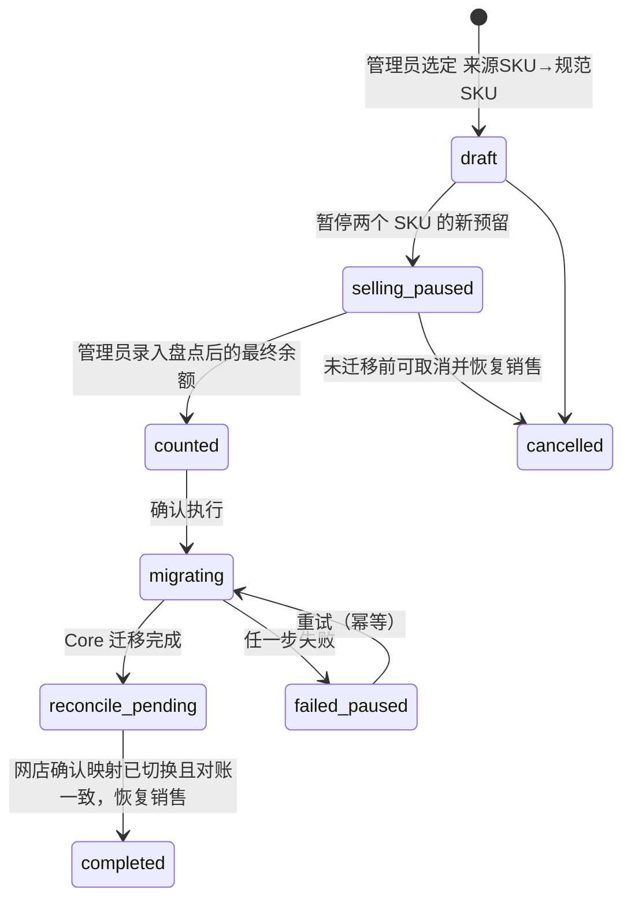
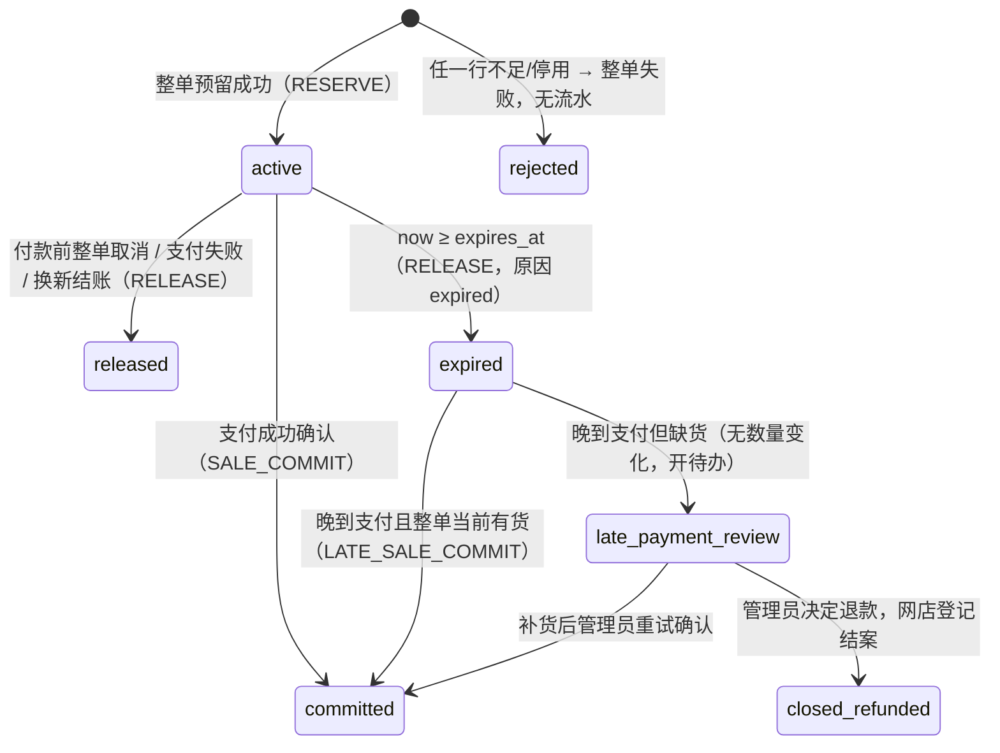

# Acuven Stock Core V1 契约草案

> 版本：草案 0.2｜2026-11-10｜状态：**已按 Kelvin 当天对 OPEN_QUESTIONS 的逐条答复修订；仍待正式批准（设计闸门），不是已实现接口**。
> 依据：[REQUIREMENTS.md](../REQUIREMENTS.md)（Core V1 需求，2026-10-08）、`acuven_hub/DECISIONS.md` 的 C-01～C-19、S-01～S-10、I-02、I-04，
> 以及 `acuven_inventory/docs/API_CONTRACT.md`、`STOCK_RULES.md`（Inventory 草案，只读参照）。
> 网店现状见 [SHOP_STOCK_INVENTORY.md](SHOP_STOCK_INVENTORY.md)；问题与 Kelvin 的答复见 [OPEN_QUESTIONS.md](OPEN_QUESTIONS.md)，本文用 **Q-xx** 引用。
>
> 本文只定**语义与边界**：名词、数量不变量、命令与状态、幂等、错误、鉴权、迁移和恢复约束。字段名、路径是建议写法，
> 设计闸门通过后再落成 OpenAPI；技术栈已定（Q-23，见 TEMPLATE_BOOTSTRAP_PLAN.md）。

---

## 0. 一页看懂

- Core 是**一个独立进程＋一个独立持久化库**，持有两样东西：**商品身份目录**（谁是谁）和**基础库存账**（有几件、被谁占着）。
- Core 不依赖 ERP、Inventory、POS 或统一门户即可支撑单卖网店，也没有面向客户的日常后台（OPS-01）。
- 网店（以及将来的 Inventory、ERP、POS）只通过 `/v1` 私有 API 访问 Core；不直接读写 Core 的表，Core 也不读写网店的表。
- 数量只有四个账面量：`stock_balance`、`reserved`、`unavailable`、`paid_pending_dispatch`；任何变化都是一条**不可改写的流水**，
  余额只是流水的累计结果。
- 每个写命令带**幂等键**和**稳定业务引用**；同一个事实最多生效一次，响应丢了可以按原键重试或按业务引用查询。
- 网店业务代码只依赖 `StockGateway` 接口：V1 由 Core 适配器实现；将来加购 Inventory 并共卖一批货时换 Inventory 适配器。
- V1 的第一个接入方是**公开 Demo**：用一个独立的 Demo Core 实例，带 Demo 专用的每日重置（§6.1）。真实网店何时、怎么接待定（Q-24）。
- 恢复目标：整台服务器永久损坏时，已确认写入最多丢 5 分钟（RPO≤5 分钟），4 小时内恢复（RTO≤4h）。原需求是 RPO=0，Kelvin 2026-11-10 放宽（Q-15，第 12 节）。
- Core 不可用时，网店**继续收款**，但按故障前最后读到的可售量封顶；恢复后补交，有货补扣、没货交管理员（§5.5，Q-03）。

---

## 1. 标识与名词

| 名词 | 标识 | 谁生成 | 规则 |
| --- | --- | --- | --- |
| 租户 | `tenant_id` | Core 运维开通 | V1 只有一个（Acuven 自用）。**永远从调用方凭据推出，不接受请求正文/路径自选。** |
| 库存地点 | `location_id` | Core | 一个物理地点（仓库/店面）。V1 每租户一个。 |
| 库存池 | `pool_id` | Core | 一批**明确归属**的实物，绑定一个地点。V1 每租户一个；数据键和 API 保留池维度，**禁止以相同 SKU 推断两个池共享**（C-07）。 |
| 销售入口 | `channel_id` | Core 运维登记 | 一个会卖货的系统实例（V1：Acuven 网店）。入口绑定它能销售的池；V1 一个入口对一个池，不共卖（C-08）。 |
| 商品 | `product_id` | Core | 展示/归类实体，不计数。 |
| 规格 SKU | `sku_id` | Core | 可独立售卖、独立计数的最小单位。**无规格商品也有一个 SKU。**所有数量都挂在 `sku_id` 上。 |
| SKU 编码 | `sku_code` | 运营人员输入或导入 | 人看的编码，租户内唯一，可修改（保留旧值审计）；**不是**稳定身份，系统间关联一律用 `sku_id`。 |
| 条码 | `barcode` | 运营人员 | 可空；非空时租户内唯一。 |

**稳定 ID 格式（Q-04 已定）：**带类型前缀的不透明字符串，前缀＋ULID，例如 `prd_01JC…`、`sku_01JC…`、`pool_01JC…`。
生成后永不复用、永不改变；调用方只做相等比较，不解析内容。跨租户可以出现相同 `sku_code`，但 `sku_id` 全局唯一。

**调用方引用（网店生成，Core 只存不解释）：**`order_ref`、`line_ref`、`payment_ref`、`shipment_ref`、`refund_ref`、`return_ref`、
`receipt_ref`、`count_ref`。格式 1–128 个 ASCII 字符 `[A-Za-z0-9._:-]`，**不得含顾客姓名、电话、邮箱、地址、金额或支付凭据**（OPS-06）。
引用的唯一性范围是 `(tenant_id, channel_id, 引用类型)`。

---

## 2. 商品身份目录

### 2.1 Core 与网店的字段边界（C-01、C-02）

| 放在 Core 目录 | 放在网店（Core 不存、不覆盖） |
| --- | --- |
| `product_id`、`sku_id`、`sku_code`、`barcode` | 图片、分类、多语言展示名称与营销文案、SEO |
| **基本名称**（商品一个、SKU 一个，英文，Q-05） | 规格展示文案（颜色/尺码的多语言标签） |
| **参考售价** `reference_price`（整数最小货币单位＋币种，如 `{"amount_minor": 12900, "currency": "MYR"}`） | **渠道营业价**、促销价、节日活动价、会员价 |
| 启停状态 `status`：`active / inactive` | 上下架、排序、陈列 |
| 版本 `version`、创建/更新时间、变更审计 | 订单行里的商品与成交价**快照** |
| SKU 合并关系 `merged_into_sku_id`、SKU 编码历史 | 网店侧的 `core_sku_id` 映射列 |

规则：

1. **参考价永不自动改营业价。**参考价变化只在 Core 变更流（2.5）里出现一条 `reference_price_changed`；网店后台把它显示成“改价建议”，
   有权人员确认后由网店自己改营业价。
2. 订单永远保存网店当时的商品名称与成交价快照；Core 改名、改参考价不影响历史订单。
3. 网店上下架 ≠ Core 停用。Core `inactive` 的 SKU **不能新建预留**，但历史查询、已付款订单的发货/退款回库/退货照常可做。
4. 存在流水或任何订单引用的商品/SKU **不能硬删除**，只能停用（CAT-02）。

### 2.2 唯一性与版本

- `(tenant_id, sku_code)` 唯一；`(tenant_id, barcode)` 在非空时唯一（部分唯一索引）。
- 每个商品、SKU 有整数 `version`，每次修改 +1。修改请求必须带 `If-Match: <version>`（或正文 `expected_version`）；
  不一致返回 409 `VERSION_CONFLICT` 并附当前版本，**不静默覆盖**（CAT-03）。
- 修改 `sku_code` 时把旧值写入 `sku_code_history`（旧值、新值、操作者、时间、原因）；旧编码永久保留，不再分配给其他 SKU（Q-06）。

### 2.3 批量导入（CAT-04、STK-03）

两步：**校验预览 → 确认执行**。

1. `POST /v1/catalog-imports`：上传行（JSON 行数组，CSV 由网店后台解析后转 JSON）。Core 只校验、不写目录，返回 `import_id`、
   逐行结果（`ok / duplicate_sku_code / duplicate_barcode / invalid_format / conflicts_existing`）和汇总。
2. `POST /v1/catalog-imports/{import_id}/confirm`：**只执行预览合格的行**（Q-07），错误行跳过。每个商品连同它的 SKU 作为一组，
   在一个事务内要么全建、要么不建，不留下半成品商品。结果逐行列出成功/跳过/失败原因，运营修正后用新的导入补齐。
   确认带幂等键；重复确认返回原结果。
3. 预览有有效期（建议 24 小时）；过期或期间目录有冲突修改须重新预览。

### 2.4 SKU 合并（CAT-05）

合并解决“同一实物被建成了两个 SKU”。**不直接把两份余额相加**（可能重复计数），而是停售、盘点、再迁移未结业务。



迁移在 Core 的**一个事务**里完成：

- 来源 SKU 的未结预留、`paid_pending_dispatch` 与订单行累计量改挂到规范 SKU（`MERGE_TRANSFER_OUT/IN` 流水，成对出现）；
- 规范 SKU 的 `stock_balance` 以盘点确认数为准（差额写 `COUNT_ADJUSTMENT` 流水并引用合并单）；来源 SKU 归零后设 `inactive`
  且 `merged_into_sku_id = 规范 SKU`；
- **历史流水、订单快照里的原 `sku_id` 不改写**；之后任何带来源 `sku_id` 的查询返回 `merged_into_sku_id`，
  带来源 `sku_id` 的**新预留**返回 409 `SKU_MERGED`（附规范 ID），**已有订单行**的发货/退款回库/退货自动作用到规范 SKU。

网店侧需要：把两个规格的映射改到规范 `sku_id`、处理两个网店规格的展示合并（这是网店的事），然后调用 `complete`。
未 `complete` 前两个 SKU 都保持停售。

### 2.5 目录变更流

`GET /v1/catalog-changes?after=<cursor>&limit=100`：按提交顺序返回目录变更事件（`product_created`、`sku_updated`、
`sku_deactivated`、`reference_price_changed`、`sku_merged`…），每条带对象 ID、新版本、变更字段、发生时间。
网店用它刷新映射和生成改价建议；游标单调、可重放。V1 用拉取，不做推送（Q-08）。

---

## 3. 库存地点、库存池与销售入口

- V1 每租户：1 个地点、1 个池、1 个销售入口（网店），入口绑定该池。
- **销售类命令**（预留、确认销售、释放、发货、退款回库、退货）的池由**销售入口绑定**决定，正文不带 `pool_id`。
- **库存管理命令**（期初、收货、盘点、不可售）正文带 `pool_id`，Core 校验该凭据是否获准操作这个池。V1 只有一个池，但校验照做。
- 没有 Inventory 时，一个池只允许一个销售入口写销售事实；登记第二个入口到同一池会被 Core 拒绝（C-07）。
  将来启用 Inventory 共卖时，由 Inventory 的入口额度在 Core 的同一事务内校验（README“网店单卖与加购 Inventory”）。

---

## 4. 数量模型

### 4.1 账面量（每个 `tenant × pool × sku` 一行）

| 字段 | 含义 |
| --- | --- |
| `stock_balance` | 尚未售出的账面库存（含不可售、含已预留未付款） |
| `reserved` | 有效（未到期、未释放、未确认）订单预留 |
| `unavailable` | 账内但不可售（损坏、待检、冻结） |
| `paid_pending_dispatch` | 已付款扣库、实物尚未交运 |
| `available` | **派生**：`stock_balance − reserved − unavailable`，不存储为可写字段 |
| `balance_version` | 每次变化 +1，用于查询核对和盘点的乐观校验 |

**不变量（每个事务提交前在锁内校验，违反则整笔回滚）：**

- 四个账面量均为非负整数；
- `reserved + unavailable ≤ stock_balance`（等价于 `available ≥ 0`）；
- 每个量 = 期初 + 该 SKU/池所有流水对应增量之和（可重建，STK-01）；
- 盘点时预期在库实物 = `stock_balance + paid_pending_dispatch`。

计量单位为整数件；不支持小数、负数和其他计量单位（未来另立版本）。

### 4.2 与 Inventory 草案（STOCK_RULES）的换算

Inventory 用 O/H/C/U；两套量可互相换算，**不需要两本账**：

| Inventory | Core | 说明 |
| --- | --- | --- |
| O（on_hand，在库实物） | `stock_balance + paid_pending_dispatch` | |
| H（held） | `reserved` | |
| C（committed，已售未出库） | `paid_pending_dispatch` | |
| U（unavailable） | `unavailable` | |
| `H + C + U ≤ O` | `reserved + unavailable ≤ stock_balance` | 两式等价 |
| A（不含安全库存时） | `available` | 安全库存 S 是 Inventory 政策，Core V1 不实现 |

**已知分歧（见 OPEN_QUESTIONS Q-20）：**Inventory 允许把真实超卖事实记成 `C > O` 的“需求缺口”并标 `needs_review`；
Core 需求要求所有量非负、缺货时“暂停履约交管理员”（ORD-03）。V1 只接网店，按 Core 需求实现；接 Inventory 前要统一。

### 4.3 库存事实（流水类型）

每条流水不可修改、不可删除。字段：`entry_id`、`tenant_id`、`pool_id`、`sku_id`、`entry_type`、四个量各自的增量与变动后值、
`source`（`channel_id`、来源单据类型与引用、`line_ref`）、`command_id`、`idempotency_key`、`actor`（服务身份＋网店用户引用＋角色）、
`reason_code`、`note`、`occurred_at`（业务发生时间，调用方给）、`recorded_at`（Core 数据库时间）。

| entry_type | 触发命令 | stock_balance | reserved | unavailable | paid_pending_dispatch |
| --- | --- | --- | --- | --- | --- |
| `OPENING_BALANCE` | 期初（仅初始化模式） | +q | | | |
| `RECEIPT` | 收货入库 | +q | | | |
| `COUNT_ADJUSTMENT` | 盘点差异确认 / 合并定数 | ±d | | | |
| `MARK_UNAVAILABLE` / `RESTORE_AVAILABLE` | 不可售 / 恢复可售 | | | +q / −q | |
| `WRITE_OFF` | 报损（从不可售量） | −q | | −q | |
| `RESERVE` | 订单预留 | | +q | | |
| `RELEASE` | 付款前整单取消、支付失败、到期 | | −q | | |
| `SALE_COMMIT` | 支付成功确认销售（有有效预留） | −q | −q | | +q |
| `LATE_SALE_COMMIT` | 晚到支付、预留已过期但当前有货 | −q | | | +q |
| `DISPATCH` | 按行/件数交运 | | | | −q |
| `REFUND_RESTOCK` | 退款已批准、确认未交运的件数回库 | +q | | | −q |
| `RETURN_SELLABLE` | 已交运退货，验收可售 | +q | | | |
| `RETURN_UNSELLABLE` | 已交运退货，验收不可售 | +q | | +q | |
| `MERGE_TRANSFER_OUT` / `IN` | SKU 合并迁移 | 按迁移量 | 按迁移量 | 按迁移量 | 按迁移量 |
| `DEMO_RESET` | Demo 每日重置（**仅 Demo 实例**，§6.1） | 拉回目标 | | | |
| `CORRECTION` | 管理员纠正错误流水（引用原 `entry_id`） | 原增量的反向 | 同左 | 同左 | 同左 |

`CORRECTION` 只能由有纠正权限的管理员发起，必须引用原流水并给原因；原流水保留。原流水之后若已有依赖动作（例如错误的收货之后又有销售），
不能简单反向，拒绝并要求走盘点更正（参考 Inventory STOCK_RULES §4 的同一原则）。

---

## 5. 网店订单的库存生命周期

### 5.1 订单行累计量

Core 按 `(tenant_id, channel_id, order_ref, line_ref)` 保存一行，`sku_id` 在首次预留时固定、以后不随映射变化：

| 字段 | 含义 |
| --- | --- |
| `quantity` | 下单数量（整单预留时确定，之后不变） |
| `committed_qty` | 已确认销售量（V1 整单确认，等于 `quantity` 或 0） |
| `dispatched_qty` | 已交运累计 |
| `refund_restocked_qty` | 付款后、未交运、已批准退款而回库的累计 |
| `returned_sellable_qty` / `returned_unsellable_qty` | 已交运后退货验收累计 |

约束：`dispatched_qty + refund_restocked_qty ≤ committed_qty`；`returned_sellable_qty + returned_unsellable_qty ≤ dispatched_qty`。
**每个后续动作都是增量，并有自己的稳定引用**（`shipment_ref`、`refund_ref`、`return_ref`）；同一引用重复送达只生效一次，
换引用重复报同一实物由累计上限兜底（ORD-04/05/07 的“重复或超量被拒”）。

### 5.2 预留状态机



规则：

1. **整单原子。**一次预留包含订单全部行；任一行缺货、停用、已合并或越权，整单失败，不产生任何预留或流水（ORD-01）。
2. **一个订单只有一个预留。**`(channel, order_ref)` 唯一；同订单同内容重复请求返回原预留，不同内容返回 409 `ORDER_REFERENCE_CONFLICT`。
   过期的订单不能原地“续期”，网店若要重新结账用新的 `order_ref`。
3. **到期时间由 Core 算、网店照用。**预留 TTL 来自 Core 配置（默认 900 秒＝15 分钟，可配置且变更有审计）；Core 返回 `expires_at`，
   网店把它作为支付截止时间显示和校验，两端不会各算一个（ORD-01）。网店**不能**在请求里指定 TTL。
4. **到期由 Core 负责关闭**：后台任务定期扫描；任何读或写命中已到期的 `active` 预留时也先在锁内转 `expired`（不只依赖定时任务）。
   判断用数据库 UTC 时间：`now ≥ expires_at` 即到期；网店报的“付款时间早于到期”不能复活预留，只能走晚到支付。
5. **确认销售必须与原预留行集完全一致**（SKU、数量、行引用）；不一致 409 `RESERVATION_MISMATCH`。
6. **晚到支付**（ORD-03）：确认请求命中 `expired` 的预留时，Core 在同一事务里检查**整单**当前 `available`：
   足够则写 `LATE_SALE_COMMIT`，返回 200 并标 `late=true`；不足则**不改任何数量**，返回 409 `LATE_PAYMENT_INSUFFICIENT_STOCK`，
   把预留转 `late_payment_review` 并记一条待办。补货后管理员可重试确认（新幂等键、同一 `payment_ref`）；或网店退款后调用结案。
7. **一个订单只能确认一次。**以 `(channel, order_ref)` 和 `(channel, payment_ref)` 双重唯一兜底：同一支付通知重复送达只扣一次（ORD-02）。

### 5.3 付款后的分支

| 场景 | 网店先做什么 | 调 Core | Core 校验 |
| --- | --- | --- | --- |
| 部分/全部发货（ORD-07） | 网店记录交运 | `dispatches`（`shipment_ref`＋行/件数） | 每行 `q ≤ committed − dispatched − refund_restocked` |
| 付款后退款（未交运部分） | 退款流程获批准，且网店确认这些件**仍在库未交运** | `refund-restocks`（`refund_ref`＋行/件数） | 同上；**仅有支付机构退款成功通知不触发**（ORD-04） |
| 已交运后退货（ORD-05） | 实物收到并验收 | `return-receipts`（`return_ref`＋行/件数＋`disposition: sellable/unsellable`） | 每行累计退货 ≤ `dispatched_qty` |
| 付款前取消 | 网店取消订单 | `reservations/{id}/release` | 只能整单；`committed` 状态返回 409 `STATE_CONFLICT` |

付款后**没有**“部分取消”命令；退款与库存是两个独立事实（ORD-04）。“只退款不退货”的已交运订单不调 Core。

### 5.4 订单查询与对账

- `GET /v1/orders/{order_ref}/stock`：返回该订单的预留状态、每行累计量和相关流水，供网店后台异常处理（ORD-06）。
- `GET /v1/reconciliation/order-lines?changed_after=<cursor>`：按变更顺序列出订单行累计量，供网店每日自动对账（ORD-08）。
  对账由网店发起、差异在网店后台成为待办；Core 不读网店数据库。对账要比较的项见 [SHOP_STOCK_INVENTORY.md](SHOP_STOCK_INVENTORY.md) 第 8 节。

### 5.5 Core 不可用时的故障收款（Q-03）

Kelvin 2026-11-10 定：Core 不可用时网店**继续收款**，并**按故障前最后读到的可售量封顶**。这取代 REQUIREMENTS 原 OPS-05 的“停止新预留与库存确认”。

**触发条件**：预留请求的结果是 `Unknown`（超时、连接失败、5xx），并且按 `order_ref` 查询也查不到结果。
**业务拒绝不触发**：缺货、停用、超量、各种冲突（4xx）照常拦截，不能当成故障放行。

**网店侧做法：**

1. **封顶。**网店为每个 SKU 记住最近一次从 Core 成功读到的 `available` 和读取时间。故障期间，满足下面两条才放行一单：
   - 该 SKU 本次故障已放行的件数加上本单件数，不超过这个读数；
   - 读数不早于 10 分钟（默认值，可配）。

   从没读到过、或读数太旧的 SKU 不放行。封顶计数只是网店的临时闸门，不是库存账，故障结束即作废。
2. **订单标记。**放行的订单标 `stock_state=unreserved_fault`。支付截止时间用网店配置的同一默认值（15 分钟），因为此时拿不到 Core 的 `expires_at`。
3. **Core 恢复后按原幂等键补交：**
   - **已付款的放行订单**：调 `sale-commits`，不带 `reservation_id`。Core 先按 `(channel, order_ref)` 找预留：
     - 找到（说明当初预留其实成功了、只是响应丢了），按 §5.2 正常确认；
     - 找不到，按晚到支付处理：整单有货写 `LATE_SALE_COMMIT`；没货不改任何数量，转 `late_payment_review`，由管理员退款或等补货（Q-20、Q-26）。
   - **未付款的放行订单**：补调预留。成功后照常走；缺货则取消订单，不再收款。
4. 当初没有成功预留的订单，取消时不调 Core 释放。

**Core 侧**：`sale-commits` 的 `reservation_id` 可为空，流水的 `reason_code` 记 `fault_mode`。对账（§5.4）要单独列出故障期间放行的订单。

---

## 6. 库存管理命令

| 命令 | 规则 |
| --- | --- |
| 期初 `opening-balances` | 只在池处于 `initializing` 状态时可用；批量“校验预览 → 确认”，与 2.3 同形；**Demo 库存数不得作为期初**（STK-03）。池切到 `live` 后期初命令一律拒绝，只能走盘点更正或经审批的重建流程（Q-09）。 |
| 收货 `receipts` | `receipt_ref` 唯一；同引用重试不重复入库（STK-02）。V1 无采购单，`receipt_ref` 由网店后台生成。 |
| 盘点 `counts` | 两步：开盘点单（Core 记下每个 SKU 当时的 `stock_balance + paid_pending_dispatch` 与 `balance_version`）→ 提交实数并确认。确认时若账面已变化（期间有销售/发货），按**期间流水**重算差额，不用旧快照硬覆盖。差额写 `COUNT_ADJUSTMENT`，记账面量、实数、差额、原因（STK-02、STK-05）。 |
| 不可售 / 恢复 / 报损 | 见 4.3；`unavailable` 不得超过 `stock_balance − reserved`。 |

确认盘点差异、更正、报损需要“库存管理员”角色；普通操作员只能录入、不能确认（STK-05）。角色由网店断言、Core 校验，见第 10 节。

### 6.1 Demo 实例与每日重置

背景：公开 Demo 是 Core V1 的第一个接入方，Kelvin 定 Demo 的每日重置用 Core 里的 Demo 专用命令来做。

**实例区分**
- Core 启动时读配置 `CORE_ENV=demo|production`，运行中不能改。
- Demo 实例与将来的生产实例各用独立的库和凭据。
- 健康检查返回这个环境标记，供网店做启动核对（§9.2）。

**重置命令**：`POST /v1/demo/resets`，只在 Demo 实例上存在。
- 请求正文：`business_date`（马来西亚日期）、`pool_id`、逐 SKU 的 `target`（网店的“每日初始库存”）。
- Core 的处理：
  1. 在一个事务里，按 SKU 升序加锁；
  2. 对每个列出的 SKU 计算 `new_balance = max(target, reserved + unavailable)`；
  3. 写一条 `DEMO_RESET` 流水，增量 = `new_balance − stock_balance`；
  4. `reserved`、`unavailable`、`paid_pending_dispatch` 都不动。
- 结果：`available = max(target − reserved − unavailable, 0)`，与网店现在的规则“当日可用 = max(初始 − 待付预留, 0)”一致；未结订单的预留和待发货量照常保留。
- 请求里没列的 SKU 不动。
- `(pool_id, business_date)` 唯一：同一天重复调用，返回第一次的结果。

**生产实例的防护**
- 该路径返回 404；
- `DEMO_RESET` 流水类型在数据库约束层面就被拒；
- 启动时如果发现 Demo 配置和生产标记冲突，直接拒绝启动。

**留在网店的部分**
- 什么时候调重置（马来西亚 00:00 之后），以及“每日恢复库存开关”，仍由网店决定。
- “每日初始库存”是 Demo 的展示配置，也留在网店，不进 Core 目录。
- Demo 原有的“当日库存调整”（直接把可用量改成某个值）改成调 Core 的盘点更正（§6），Core 不开放直接改数量的接口。

---

## 7. 幂等、业务引用与审计

### 7.1 两层去重

1. **幂等键（请求级）**：每个写请求带 `Idempotency-Key` 头（1–128 个 ASCII 字符）。作用域 `(tenant_id, 凭据, 操作类型, 键)`。
   Core 保存“规范化请求摘要（行按 `line_ref` 排序后的 JSON 的 SHA-256）＋首次确定的 HTTP 状态和响应体”，**与数量变化同一事务提交**。
   - 同键同内容 → 原样重放（含原 `expires_at` 等），加响应头 `Idempotency-Replayed: true`；
   - 同键不同内容 → 409 `IDEMPOTENCY_CONFLICT`，不产生任何变化；
   - 同键请求仍在处理 → 409 `REQUEST_IN_PROGRESS` ＋ `Retry-After`，调用方等待同一操作，不另造订单；
   - 5xx 与 `REQUEST_IN_PROGRESS` 不作为确定结果保存（可重试）；业务 4xx（如缺货）作为确定结果保存。
2. **业务引用（事实级）**：`(channel, order_ref)` 一个预留；`(channel, payment_ref)`、`shipment_ref`、`refund_ref`、`return_ref`、
   `receipt_ref`、`count_ref` 各自唯一。换幂等键重报同一业务引用：内容相同返回原结果，内容不同 409 `BUSINESS_REF_CONFLICT`。
   这一层防止“调用方崩溃后用新键重试”造成重复扣库。业务引用只被**已生效**的命令占用：被业务规则拒绝的命令（如晚到支付缺货）
   不占用该引用，所以补货后可以用新幂等键、同一 `payment_ref` 重试确认。

**网店侧生成键的建议：**由业务对象确定性派生，持久化在网店订单/支付/发货记录上，例如 `shop:order:<order_id>:reserve:1`。
进程崩溃重启后用同一个键重试，而不是新生成随机键。

**保留期：**幂等记录和业务引用唯一约束随库存流水长期保留（不放 Redis，不随缓存清理），流水与幂等记录永久保留、安全日志保留 1 年（Q-10）。

### 7.2 审计

- **库存流水**本身就是数量审计（4.3）。
- **目录审计**：商品/SKU 每次创建、修改、停用、合并记一条（前后值、操作者、原因、版本）。
- **安全日志**：凭据无效、越权、跨租户访问、幂等冲突、超限一律记录（不记录 Authorization 头与完整请求体，OPS-06、API-02）。
- 每个请求的 `X-Request-ID`（调用方提供或 Core 生成）写进所有相关记录与日志，可从网店订单一路追到 Core 流水（API-03）。

---

## 8. 版本化 API（`/v1`）

### 8.1 协议约定（API-01：所有写命令都带租户〔由凭据推出〕、来源入口、稳定业务引用、服务身份与操作者、幂等键）

- HTTPS（第 10 节）、JSON/UTF-8；时间 UTC RFC 3339，过期判断以 Core 数据库时间为准；金额为整数最小单位＋ISO 4217 币种。
- 成功：`{"data": {...}, "request_id": "..."}`；错误：`{"error": {"code", "message", "retryable", "details"}, "request_id"}`——与
  Inventory 草案同形，便于两种适配器共用解析代码。
- 请求禁止未知字段；单次批量最多 100 行、请求体最多 128 KiB；同一请求内重复 `line_ref` 为 422。
- 列表接口用不透明游标分页；游标绑定筛选条件。
- 并发：一个命令涉及多个 SKU 时，按 `(pool_id, sku_id)` 升序对余额行加行锁（`SELECT … FOR UPDATE`），在同一事务内更新余额、
  订单行累计、预留、流水、幂等记录和 outbox，避免死锁与部分生效（STK-04）。

### 8.2 接口清单（建议路径）

| 组 | 方法与路径 | 需求 |
| --- | --- | --- |
| 目录 | `POST /v1/products`，`GET/PATCH /v1/products/{product_id}`，`POST /v1/products/{id}/deactivate` | CAT-01～03 |
| | `POST /v1/products/{product_id}/skus`，`GET/PATCH /v1/skus/{sku_id}`，`POST /v1/skus/{id}/deactivate`、`/reactivate` | CAT-01～03 |
| | `GET /v1/skus?sku_code=&barcode=&ids=` | CAT-01 |
| | `POST /v1/catalog-imports`，`POST /v1/catalog-imports/{id}/confirm`，`GET /v1/catalog-imports/{id}` | CAT-04 |
| | `POST /v1/sku-merges`，`POST /v1/sku-merges/{id}/{pause,count,execute,complete,cancel}`，`GET /v1/sku-merges/{id}` | CAT-05 |
| | `GET /v1/catalog-changes?after=` | CAT-03 |
| 库存 | `GET /v1/availability?sku_id=…`（批量 ≤100，只回 `available` 与状态） | ORD-01 |
| | `GET /v1/balances?sku_id=…`（四个账面量＋版本，管理用） | STK-01 |
| | `POST /v1/stock-imports`、`/{id}/confirm`（期初） | STK-03 |
| | `POST /v1/receipts`，`POST /v1/counts`、`/v1/counts/{id}/submit`、`/confirm`，`POST /v1/unavailable-adjustments`，`POST /v1/corrections` | STK-02、05 |
| | `GET /v1/ledger?sku_id=&from=&to=&after=` | STK-01 |
| 订单 | `POST /v1/reservations`，`GET /v1/reservations/{id}`，`GET /v1/reservations?order_ref=` | ORD-01 |
| | `POST /v1/reservations/{id}/release` | ORD-03 |
| | `POST /v1/orders/{order_ref}/sale-commits`（`reservation_id` 可空〔故障收款，§5.5〕、`payment_ref`、`paid_at`） | ORD-02、03 |
| | `POST /v1/orders/{order_ref}/dispatches`、`/refund-restocks`、`/return-receipts` | ORD-04、05、07 |
| | `POST /v1/orders/{order_ref}/late-payment-review/close` | ORD-03 |
| | `GET /v1/orders/{order_ref}/stock`，`GET /v1/reconciliation/order-lines?changed_after=` | ORD-06、08 |
| Demo | `POST /v1/demo/resets`（**仅 Demo 实例**） | §6.1 |
| 运维 | `GET /healthz`（存活＋线上 commit SHA），`GET /readyz`（数据库与同步副本状态），`GET /v1/ops/invariants`（运维凭据） | OPS-04 |

### 8.3 错误码（API-03）

| HTTP | code | 含义 / 调用方动作 |
| --- | --- | --- |
| 400/422 | `INVALID_REQUEST` | 修正请求；不重试 |
| 401 / 403 | `UNAUTHORIZED` / `FORBIDDEN` | 凭据或权限问题；不重试，告警 |
| 404 | `NOT_FOUND`（`SKU_NOT_FOUND`、`RESERVATION_NOT_FOUND`…） | 跨租户对象同样返回 404，不暴露存在性 |
| 409 | `INSUFFICIENT_STOCK` | 整单不进入付款；`details.lines` 列出不足的行 |
| 409 | `SKU_INACTIVE` / `SKU_MERGED` / `SKU_SELLING_PAUSED` | 不可新预留 |
| 409 | `VERSION_CONFLICT` | 重新读取后让人决定 |
| 409 | `RESERVATION_EXPIRED` / `STATE_CONFLICT` / `RESERVATION_MISMATCH` | 查最新状态再处理 |
| 409 | `LATE_PAYMENT_INSUFFICIENT_STOCK` | 暂停履约，交管理员 |
| 409 | `QUANTITY_EXCEEDS_OUTSTANDING` | 发货/回库/退货超量；不重试 |
| 409 | `ORDER_REFERENCE_CONFLICT` / `BUSINESS_REF_CONFLICT` / `IDEMPOTENCY_CONFLICT` | 调用方 bug；不重试，告警 |
| 409 | `REQUEST_IN_PROGRESS` | 按 `Retry-After` 用同键等待 |
| 413 | `REQUEST_TOO_LARGE` | 不得把整单拆成逐行预留绕过原子性 |
| 429 | `RATE_LIMITED` | 按 `Retry-After` 同键退避 |
| 503 | `UNAVAILABLE` | 结果**确定未生效**，可同键重试 |
| 超时 / 连接中断 / 其他 5xx | — | 结果**未知**：先按业务引用查询，再同键重试；绝不当成功或失败处理 |

### 8.4 兼容规则（API-04）

V1 已实现与“保留”的字段在 OpenAPI 里逐个标注；`pool_id`、`channel_id`、`location_id` 是保留维度，V1 各只有一个值。


- `/v1` 内只做**加法**：新增可选请求字段、新增响应字段、新增错误码（调用方须把未知错误码当不可重试错误处理）。
- 删除/改名字段、改变数量语义、新增必填字段、改鉴权方式 → `/v2`，与 `/v1` 并行至少一个网店发布周期。
- 调用方在 `User-Agent` 里带自己的名字与版本（例如 `acuven-shop/<commit>`），Core 记录，用于升级前核对版本矩阵。
- 契约以 OpenAPI 3.1 文件为准（设计闸门通过后生成），CI 校验实际响应与 OpenAPI 一致。

---

## 9. 网店侧 `StockGateway`

### 9.1 接口（Python 形状示意，**不是**要现在写进网店的代码）

```python
class StockGateway(Protocol):
    # 只读
    def get_availability(self, sku_ids: list[str]) -> dict[str, Availability]: ...
    def get_order_stock(self, order_ref: str) -> OrderStock | Unknown: ...
    # 下单与付款
    def reserve_order(self, order_ref: str, lines: list[Line], key: str) -> Reserved | Rejected | Unknown: ...
    def find_reservation(self, order_ref: str) -> Reserved | NotFound | Unknown: ...
    def release(self, reservation_id: str, reason: ReleaseReason, key: str) -> Released | Rejected | Unknown: ...
    def commit_sale(self, order_ref: str, reservation_id: str, payment_ref: str, paid_at: datetime, key: str
                    ) -> Committed | Pending | Rejected | Unknown: ...
    # 付款后
    def record_dispatch(self, order_ref: str, shipment_ref: str, lines: list[LineQty], key: str) -> Applied | Pending | Rejected | Unknown: ...
    def restock_refund(self, order_ref: str, refund_ref: str, lines: list[LineQty], key: str) -> Applied | Pending | Rejected | Unknown: ...
    def receive_return(self, order_ref: str, return_ref: str, lines: list[ReturnLine], key: str) -> Applied | Pending | Rejected | Unknown: ...
```

要点：

1. **`Unknown` 是一等结果。**超时、连接中断、5xx 都返回 `Unknown`，调用方必须先 `find_*`/`get_order_stock` 查询、再用**同一个键**重试；
   不能当成功（会让订单显示已扣库）也不能当失败（会让顾客重下单造成双占）。
2. **`Pending` 现在就留着。**Core 适配器的写命令是同步的，永远不返回 `Pending`；Inventory 草案的事件接口是“202 已接收、稍后处理”，
   将来 Inventory 适配器会返回 `Pending`。网店状态机现在就要能处理“已提交、待确认”，切换时才不用改业务代码。
3. **`Rejected` 带标准化原因**（缺货、停用、超量、状态冲突…），由适配器把 Core/Inventory 各自的错误码翻译过来；顾客看到的文案由网店自己写，
   不透传内部错误。
4. 网店业务代码（结账、支付回调、后台发货/退款/退货、定时对账）只调 `StockGateway`；**不得**再直接读写 `ProductVariant.available_stock`
   这类本地库存列（生产环境）。商品目录写操作（建商品、改 SKU、合并）另走 `CatalogGateway`（同样的结果模型），后台库存操作走
   `StockAdminGateway`；它们在加购 Inventory 时**不切换**，始终直连 Core（Inventory 只在库存命令路径上，README）。

### 9.2 适配器

| 适配器 | 用在哪 | 说明 |
| --- | --- | --- |
| `CoreStockGateway` | 公开 Demo（接 Demo Core）；将来的真实网店 | 直连 Core `/v1`；同步语义。 |
| `InventoryStockGateway` | 将来加购 Inventory 且该池启用共卖 | 调 Inventory 兼容库存接口，Inventory 再向同一 Core 提交唯一命令。**未实现**，切换前须统一第 9.3 节的差异。 |
| `LocalStockGateway`（暂名，过渡用） | 纯重构阶段（Q-25） | 把网店现有本地库存列与每日重置包在同一接口后面，行为不变。Demo 切到 Core 并稳定后删除（删除前它也是 Demo 的回退路径，§11.4）。生产配置启用即启动失败。 |

适配器由部署配置选择（例如 `STOCK_BACKEND=core|local`），而不是由代码分支判断“是不是 Demo”。启动检查：后端为 `core` 时，
Core 健康检查返回的环境标记（`demo` / `production`）必须与网店自身环境一致，防止 Demo 网店连到生产 Core 或反之。

### 9.3 两种适配器语义上还没对齐的地方（切换前必须定）

| 主题 | Core V1（本文） | Inventory 草案 | 影响 |
| --- | --- | --- | --- |
| 预留有效期 | 默认 15 分钟，Core 配置 | 固定 30 分钟 | Q-19：以 Core 为准，接 Inventory 前改 Inventory 草案 |
| 付款后取消 | 只有“已批准退款且未交运”回库 | `sale_cancelled` 取消未出库部分 | Q-28：Inventory 适配器映射到 Core 的退款回库 |
| 事实提交 | 同步，200 即已生效 | 202 已接收，稍后 `processed/needs_review` | 网店须支持 `Pending` |
| 超卖事实 | 不改数量，暂停履约待管理员 | 先入账为需求缺口，`needs_review` | Q-20：V1 按 Core；接 Inventory 时再议 |
| Core 不可用时 | 故障继续收款，按最后读到的可售量封顶（§5.5） | Acuven Shop 可“故障继续收款”，不封顶 | Q-03：方向一致，接 Inventory 前统一封顶规则 |
| 未付款占用上限 | 无 | 网店本地每顾客最多 3 笔 | 网店规则，与 Core 无关，但需决定是否保留 |

### 9.4 Core → Inventory 切换步骤（将来，摘要）

1. 停止该池的新结账；等待/处理所有 `active` 预留（到期或确认）。
2. 核对 SKU 映射、库存池、未结订单行累计量和当前账面量；Inventory 登记入口与份额并在 Core 生效。
3. 网店切换适配器配置；旧 Core 直连凭据收回该池的销售写权限（防止双写）。
4. 用新路径做一笔测试订单，跑一次全量对账，恢复结账。回退时反向执行，**不删除、不倒写**切换期间的 Core 流水。

---

## 10. 租户、身份与鉴权

1. **租户来自凭据。**每个服务凭据绑定唯一 `tenant_id`、`channel_id`（如有）和一组 scope；请求里没有任何可以改变租户的字段。
   所有表的主键/唯一约束都含 `tenant_id`；跨租户对象一律 404。V1 只有一个租户，但测试必须覆盖“第二租户不可见”。
2. **一个网店服务身份（Q-11）：**每个网店环境一个 `shop` 凭据，持有网店需要的全部 scope（查可售、预留、确认销售、订单库存查询、
   目录读写、库存管理、发货、退款回库、退货验收、对账读取、合并）。凭据只在网店服务端环境变量里，不进浏览器、不进模型上下文。
   代价是网店前台进程被攻破时也能调库存管理命令；兜底靠网店自己的后台权限检查、Core 的角色校验（第 3 条）和流水审计。
   Demo Core 与将来的生产 Core 各发各的凭据，互不通用。
3. **运营人员身份。**后台命令带 `X-Actor-Ref`（网店管理员的不透明 ID，不含姓名/邮箱）与 `X-Actor-Role`
   （`stock_operator` / `stock_admin` / `catalog_admin`）。Core 不认识网店的用户，只能**信任网店服务断言**，但会：按角色表校验命令
   （例如确认盘点、更正、报损只接受 `stock_admin`）、把断言写入流水与审计。这一信任边界写在验收里，网店后台必须先做自己的权限检查。
4. **凭据形式：**随机 ≥32 字节的不透明令牌，`Authorization: Bearer`；Core 只存 SHA-256 摘要和凭据 ID；可轮换（新旧重叠期有截止时间）、
   可立即吊销；吊销后所有请求 401。运维接口用独立凭据。
5. **网络（Q-12）：**Core 不暴露公网入口（不挂到 `infra_nginx` 的公开 vhost）。与网店同机时只挂在仅内部的容器网络上，
   **不加 TLS**：流量不出宿主机，靠凭据鉴权。这偏离 REQUIREMENTS OPS-02“服务间通信加密”的字面要求，Kelvin 已接受；
   将来跨机时改走加密隧道。Demo Core 与将来的生产 Core 使用不同实例、不同库、不同凭据，网络上互不可达。
6. **不存个人资料：**Core 不接收顾客姓名、电话、地址、邮箱、订单金额和支付凭据；`payment_ref` 是网店自己的支付记录 ID，不是支付机构流水号
   （如需对照，由网店保存映射）。

---

## 11. 迁移与回退样例

### 11.1 原则

- **V1 的第一个接入方是公开 Demo（Q-02 答复）**，迁移因此分两件事：
  1. **Demo 切到 Demo Core**：把 Demo 的商品和库存数字（种子数据：30 件商品、76 个 SKU）导入 Demo Core。这些本来就是演示数据，允许导入。
  2. **将来的真实网店**（Q-24 暂缓）：Demo 数字一律不进生产 Core，期初来自实物盘点（STK-03）。
- 网店先做一次行为不变的纯重构，把库存读写收拢到 `StockGateway`＋`LocalStockGateway`（Q-25）；之后再切到 `CoreStockGateway`。
- 网店侧要加映射列，见 [SHOP_STOCK_INVENTORY.md](SHOP_STOCK_INVENTORY.md) 第 7 节。

### 11.2 样例 A：Demo 目录回填（网店 → Demo Core）

1. 导出网店的商品和规格，每个规格带上：
   - 网店的 `product_id`、`variant_id`；
   - SKU 编码：直接用网店 `product_variants.sku`（全站唯一，Q-13）；
   - 条码：网店没有这一列，留空；
   - 基本名称：取 `name_en`（Q-05）；
   - 参考价：取当前 `price_sen`。
2. 调 `catalog-imports` 预览。确认时只执行合格行（Q-07）；被跳过的行修正后重新导入，直到 76 个 SKU 全部成功。
   Core 按导入行的 `external_ref` 返回“网店规格 → `sku_id`”对照表。
3. 网店按对照表回填 `core_sku_id`。校验：规格数等于 SKU 数，没有空映射，没有重复映射；抽查 10 条，名称和编码一致。
4. **回退**：网店切换适配器之前，清空映射列即可；Demo Core 里的这批商品设为 `inactive`，不硬删除。

### 11.3 样例 B：Demo 切换到 Core

设某个 Demo SKU 的每日初始库存是 20；切换前，本地 `available_stock` 是 17，有一笔待付款订单占着 3 件。

1. **选时间、清空未结预留。**选在当天每日重置之后的低峰时段。网店进入维护：停止新结账，公开页面显示维护提示。
   等所有待付款订单付款或到 15 分钟期限被取消（本例那 3 件被释放，本地回到 20）。
2. **遗留订单不进 Core。**切换时已付款但还没发货的 Demo 订单标为 `legacy_local`，之后发货、退款都不调 Core，因为这些数量本来就不在 Core 里。
3. **导入期初。**Demo Core 的池处于 `initializing`，按当前本地 `available_stock` 导入期初（本例 20），然后池切 `live`。
4. **切换。**网店配置改为 `STOCK_BACKEND=core`，启动核对环境标记（§9.2）通过后恢复结账。

切换后的账面变化（`stock_balance / reserved / unavailable / paid_pending_dispatch / available`）：

| 步骤 | 动作 | 结果 |
| --- | --- | --- |
| 1 | 期初 20（`OPENING_BALANCE`） | 20 / 0 / 0 / 0 / 20 |
| 2 | 访客下单 3 件：预留 | 20 / 3 / 0 / 0 / 17 |
| 3 | 模拟支付成功：确认 | 17 / 0 / 0 / 3 / 17 |
| 4 | 后台发货 2 件 | 17 / 0 / 0 / 1 / 17 |
| 5 | 剩下 1 件退款获批、确认未发货：退款回库 | 18 / 0 / 0 / 0 / 18 |
| 6 | 另一访客下单 4 件，未付款，到 00:00 仍在预留 | 18 / 4 / 0 / 0 / 14 |
| 7 | 00:00 Demo 重置，target 20：`new_balance = max(20, 4) = 20`，`DEMO_RESET` +2 | 20 / 4 / 0 / 0 / 16 |

第 7 步结果符合网店现行规则：可用 = 初始 20 − 待付预留 4 = 16。

### 11.4 回退

| 情况 | 回退做法 | 不能做的 |
| --- | --- | --- |
| Demo 切到 Core 后发现问题 | Demo **可以退回**本地库存：停结账 → 等未结预留结束 → 配置切回 `local` → 跑一次本地每日重置，重建 `available_stock`（Demo 数据本来就每天重建）。只要 `LocalStockGateway` 还没删掉，这条路就在 | 不删除 Demo Core 的流水 |
| 将来真实网店切到 Core 之后 | **没有退回本地库存的路径**（Q-14）：停卖 → 修复 → 按幂等键补交 → 对账 → 恢复 | 不能把网店本地列改回权威；不能删除或倒写 Core 已确认的流水 |
| Core 所在机器损坏 | 按第 12 节从异地备份加日志恢复；网店按幂等键补交；最多 5 分钟的缺口，按网店订单和支付记录对账补录 | 不能无限期地按缓存继续卖。故障收款有封顶和读数时效（§5.5） |

### 11.5 将来的真实网店（备查，Q-24 暂缓）

真实网店的期初来自实物盘点，Demo 的数字忽略。示例：某 SKU 实物盘点 20 件，其中 2 件外盒破损。

| 步骤 | 动作 | 结果（同上五个量） |
| --- | --- | --- |
| 1 | 期初 20 | 20 / 0 / 0 / 0 / 20 |
| 2 | 2 件标不可售 | 20 / 0 / 2 / 0 / 18 |
| 3 | 订单买 3 件：预留 → 支付确认 | 17 / 0 / 2 / 3 / 15 |
| 4 | 发货 2 件；剩 1 件退款获批、确认未发货，回库 | 18 / 0 / 2 / 0 / 16 |
| 5 | 已发的 2 件退回 1 件，验收可售 | 19 / 0 / 2 / 0 / 17 |

核对：在库实物 = 20 − 2（发出）+ 1（退回）= 19，等于 `stock_balance + paid_pending_dispatch` ✓。

### 11.6 ERP 旧数据

DEVPRI 阶段 1 也要求 ERP 旧数据的升级与回退样例。Kelvin 定为分两步（Q-18）：ERP 接 Core 之前，再写“ERP 的 SKU 与多仓余额 → Core”的迁移设计。

---

## 12. RPO≤5 分钟 / RTO≤4h 对设计的约束

**Kelvin 2026-11-10 的决定（Q-15）**：已确认写入的 RPO 从 0 放宽到 **≤5 分钟**，RTO≤4 小时不变；不为同步副本另加机器。
这改变了 REQUIREMENTS 原 OPS-03 和 DECISIONS C-12（两者均已于 2026-11-10 更新）。

### 12.1 设计约束

1. **一笔命令一个数据库事务。**余额、订单行累计、预留、流水、幂等记录、outbox 在同一个库的同一个事务里提交。
   这条不是为了 RPO，而是为了恢复后网店按原幂等键补交时不会重复扣库。Redis 只能做非权威缓存。
2. **异地日志。**`infra_mysql` 开启 binlog（ROW 格式），至少每 5 分钟把新的 binlog 传到另一家供应商或另一地区的存储；
   每日全量备份也传到异地。超过 5 分钟没传成功就告警。
3. **恢复流程（RTO≤4h）。**新开一台机器（开机器的时间也算在 4 小时里）→ 拉最近一次全量备份 → 重放 binlog 到最后一份 →
   启动 Core 和网店 → 网店补交“结果未知”的命令 → 对账。写成运行手册，按步骤计时。
4. **丢失窗口怎么补。**最多丢 5 分钟的 Core 写入。网店的库在同一个 `infra_mysql` 实例上，会丢同一段时间，所以两边大体一致；
   外部可信的记录是支付机构的成功付款。恢复后，把这段窗口内支付机构有、网店没有的付款逐笔补成订单，再补交库存。
5. **数据库结构迁移只做向前兼容的扩展。**合并即部署时用“先加后删”两段式；迁移前自动备份。
6. **时间点恢复也防误操作。**binlog 加全量备份可以恢复到误操作之前的那一刻。
7. **演练是验收项（Q-16）。**上线前做一次，之后每季度一次，备份方式或数据库拓扑变化后加做一次：
   模拟整机损坏 → 在另一台机器恢复 → 核对丢失窗口 ≤5 分钟、恢复用时 ≤4 小时。
8. **不再有“副本失联就拒写”。**Core 整体不可用时，网店按 §5.5 故障收款。

### 12.2 对现有基础设施的影响

- **不需要第二台数据库服务器。**Core 的库放在共享 `infra_mysql` 里的独立库（Q-17），用独立账号、最小权限。
- binlog 异地传输是**实例级**设置，会顺带保护同实例上网店、CRM 等其他项目的库，但要在 `vps_infra` 里统一配置。
  这是 vps_infra 的改动，需另开任务。
- **需要一处异地存储**放 binlog 和全量备份（另一家供应商的对象存储之类），放在哪家待定（OPEN_QUESTIONS 第二节）。
- 将来真实网店若要求更严的恢复目标（例如重新要求 RPO=0），再回到“同步副本加第二故障域”的方案。

---

## 13. 与现有文档的出入

| # | 出入 | 涉及 | 处理 |
| --- | --- | --- | --- |
| 1 | RPO=0 改为 ≤5 分钟 | DECISIONS C-12；REQUIREMENTS OPS-03 | Q-15。REQUIREMENTS 与 DECISIONS C-12 均已于 2026-11-10 更新 |
| 2 | V1 首个验收对象由“自用网店”改为“公开 Demo（Demo Core 实例）” | DECISIONS C-13；REQUIREMENTS §1–2 | Q-02 答复。REQUIREMENTS 与 DECISIONS C-13 均已于 2026-11-10 更新 |
| 3 | Core 不可用时由“停卖”改为“封顶故障收款” | REQUIREMENTS OPS-05；Inventory API_CONTRACT §5（不封顶） | Q-03。REQUIREMENTS 已修订；Inventory 草案接入前统一 |
| 4 | 同机服务间通信不加 TLS | REQUIREMENTS OPS-02 | Q-12。REQUIREMENTS 已修订 |
| 5 | 预留 30 分钟（Inventory）对 15 分钟可配（Core） | API_CONTRACT §3.1 | Q-19：以 Core 为准 |
| 6 | 超卖事实入账为缺口（Inventory）对不入账、暂停履约（Core） | STOCK_RULES §1.1 | Q-20：V1 按 Core |
| 7 | `sale_cancelled` 对退款回库 | API_CONTRACT §4 | Q-28：Inventory 适配器映射 |
| 8 | DEVPRI 阶段 1 的 ERP 样例与套餐权限契约 | DEVPRI 阶段 1 | Q-18：分两步 |
| 9 | 网店 Demo 现行规则要改：退款不回补、当日直接改库存、迟到付款自动退款、本地每日重置 | `acuven-shop/docs/DESIGN.md` 第 6、12 条与 Stripe 第 6 条 | 网店接 Core 的设计任务（网店设计闸门） |
| 10 | REQUIREMENTS 要求运营在网店后台完成建商品、合并、期初、入库、盘点，网店现有后台没有这些页面 | REQUIREMENTS §1；网店盘点 | 计入工期（ESTIMATE_BREAKDOWN W6） |
