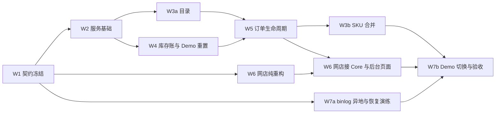

# 工期重估用的工作拆分（I-04）

> 2026-11-10，同日按 Kelvin 的答复修订：RPO 放宽到 ≤5 分钟；公开 Demo 先接 Core；故障时封顶继续收款。
> **这不是排期，也不是承诺。**DECISIONS I-04 要求设计确定后，按 Core V1 需求重估工期；本文给出重估要用的东西：拆分、每块的规模驱动因素、
> 依赖的决定，以及一个**初估区间**作讨论起点。Kelvin 已定：设计批准后重估一次，结果登记到 DECISIONS I-04（Q-29）。
> 估算基准沿用 REVISED §八：Kelvin 一人配合 AI 工具，每周 30–40 小时有效开发；单租户、单地点、单池。
> Q-xx 见 [OPEN_QUESTIONS.md](OPEN_QUESTIONS.md)。W1–W7 对应 [REQUIREMENTS.md](../REQUIREMENTS.md) §7 的七个工作包。

## 1. 拆分

| 包 | 内容 | 主要交付 | 规模驱动 / 不确定性 | 依赖的决定 | 初估（有效周） |
| --- | --- | --- | --- | --- | --- |
| **W1 契约冻结** | 本轮草案改成批准稿；写 OpenAPI 3.1；状态图；错误码；网店结账状态机小设计（盘点第 6 节第 1 条，含故障收款封顶） | `CONTRACT_V1.md`、`openapi.json`、网店侧设计 | 批准时还要来回几轮 | 已基本定完 | 1–2 |
| **W2 服务基础** | 从模板起步；CI（含 MySQL 服务容器）；`deploy.yml`（D1–D5，健康检查在主机本机跑）；凭据与 scope；租户约束；请求 ID；错误封装；**通用幂等框架**；审计骨架；`CORE_ENV` 环境区分 | 一个可部署的空服务；幂等与鉴权中间件有测试 | 幂等框架要一次做对，所有写命令都依赖它 | 已定 | 2–3 |
| **W3a 商品目录** | 商品/SKU 增改查；版本冲突；唯一性；停用；编码历史；批量导入（预览，确认时只执行合格行）；变更流 | 目录 API ＋ 测试 | 中等，规则清楚 | 已定 | 1.5–2.5 |
| **W3b SKU 合并** | 合并状态机；迁移事务（把未结预留、待发货、订单行改挂到规范 SKU）；来源 ID 解析 | 合并 API ＋ 并发测试 | 和 W5 的订单行模型强耦合，**必须在 W5 之后做** | — | 1–2 |
| **W4 库存账** | 池、余额、流水；期初（初始化模式）；收货；盘点单（快照 → 录入 → 按期间流水重算 → 确认）；不可售/报损；更正；流水查询；不变量自查；**Demo 每日重置命令** | 库存管理 API ＋ MySQL 集成测试 | 盘点时“期间变动重算”；更正前的依赖检查 | 已定 | 2.5–3.5 |
| **W5 订单生命周期** | 整单预留；到期扫描与懒到期；释放；确认销售；晚到支付与无预留补交（故障收款）；按行发货；退款回库；退货验收；订单库存查询；对账变更流；**真实 MySQL 并发测试**（抢最后一件、确认与到期竞争、重放） | 订单 API ＋ 并发测试 | 状态机分支多；并发测试只能在 CI 跑 | 已定 | 3–5 |
| **W6 网店适配**（在 `acuven-shop`） | 纯重构：`StockGateway`＋`LocalStockGateway`；`CoreStockGateway`；替换盘点第 3–5 节的全部调用点；结账与支付回调状态机重写；**故障收款封顶**；迟到付款新规则；按行发货与退货验收（新功能）；退款回库确认步骤；后台新页面（收货、盘点、不可售/报损、更正、合并向导、晚到支付待办、对账差异）；每日对账任务；Demo 每日重置改调 Core；当日库存调整改为盘点更正；网店 DESIGN.md 修订（过网店设计闸门） | 一批 SHOP-TASK，多数可由 OpenClaw Worker 执行 | **全项最大的一块**。后台页面多；结账状态机要跨服务保持一致；前端检查只能在 CI 跑 | 已定 | 5.5–9 |
| **W7a 备份与恢复** | `infra_mysql` 的 binlog 异地传输（≤5 分钟）与告警；每日全量备份传异地；时间点恢复；新机器恢复运行手册；监控告警（传输延迟、到期任务、不变量、备份）；**整机损坏演练**（上线前做一次） | 运行手册 ＋ 演练记录（丢失窗口、恢复计时） | 涉及 `vps_infra`，会影响同实例的其他项目；异地存储选哪家 | 异地存储放哪（待定） | 1–2 |
| **W7b Demo 切换与验收** | Demo Core 实例部署；Demo 目录回填与期初（契约 §11.2–11.3）；REQUIREMENTS §6 端到端验收（在 Demo 上）；切换与回退演练 | 验收记录 | 公开 Demo 要停机维护一段时间 | — | 1–2 |

**合计（简单相加）：18.5–31 有效周。**有些包可以交错进行：W6 的纯重构可以和 W2–W5 并行；W7a 的 binlog 与备份可以提前做。
实际跨度取决于网店 Demo 主线占用多少精力（I-01：一条主开发线）。

**这次修订的变化**：RPO 放宽后，W7a 从 2–4 周降到 1–2 周，不用再采购第二台机器、配同步复制、做隔离旧主；
另一方面，加了 Demo 重置命令（W4 +0.5 周），网店侧加了故障收款封顶和 Demo 规则修订（W6 +0.5–1 周）。两边大致抵消。

**与历史估算的关系**：REVISED §八 的 A 档（Core＋网店＋最小 Inventory 适配）是 16–24 周，且**不含**恢复要求。本拆分不含 Inventory 适配，
但多了 SKU 合并、按行发货/退货、网店后台页面和备份恢复演练，所以区间偏高。
**不含**将来真实网店的生产切换（Q-24 暂缓）：那时还要另做一次生产 Core 部署、实物盘点期初和生产验收，粗估 1–2 周，外加真实支付等非 Core 工作。

## 2. 关键路径与可并行项

- **最早能开始、又不依赖 Core 的**：
  - W6 的纯重构（Q-25）：把网店现有的库存读写收拢到 `StockGateway`，行为不变，可以交给 Worker 跑；
  - W7a 的 binlog 异地传输与备份：它也顺带保护网店等其他库。
- **不能提前的**：网店结账状态机的重写要等 W1 批准；SKU 合并要等 W5 的订单行模型。

## 3. 让估算变准，要先做的两件小事

1. **网店结账状态机的小设计（在 W1 内做）**：它决定 W6 里“重写”那部分有多大，包括故障收款封顶。
2. **网店后台页面清单与草图（在 W1 内做）**：把页面数出来，W6 的区间就能收窄一半。

## 4. 不在本拆分里的

- 真实网店：部署方式（Q-24）、真实支付通道、收据与电子发票（A-06）、物流与真实履约、客服。
- Inventory 适配（DEVPRI 阶段 5 之后）。
- ERP 接 Core（阶段 7；ERP 的迁移样例按 Q-18 届时再写）。
