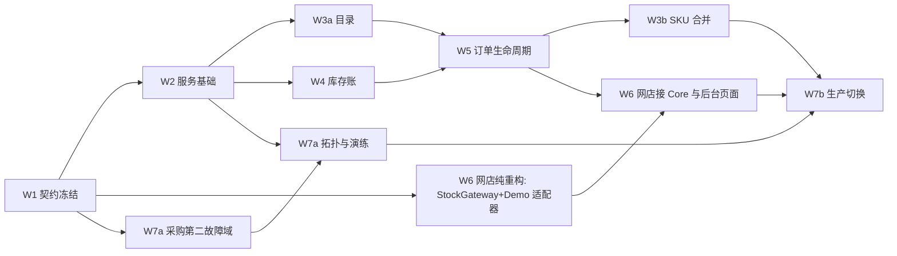

# 工期重估用的工作拆分（I-04）

> 2026-11-10｜**这不是排期，也不是承诺。**DECISIONS I-04 要求设计确定后按 Core V1 需求（含 RPO=0/RTO≤4h）重估；
> 本文给出重估要用的拆分、每块的规模驱动因素、依赖的待决问题，以及一个**初估区间**作为讨论起点。
> 估算基准沿用 REVISED §八：Kelvin 一人配合 AI 工具、每周 30–40 小时有效开发；单租户、单地点、单池。
> Q-xx 见 [OPEN_QUESTIONS.md](OPEN_QUESTIONS.md)。编号 W1–W7 对应 [REQUIREMENTS.md](../REQUIREMENTS.md) §7 的七个工作包。

## 1. 拆分

| 包 | 内容 | 主要交付 | 规模驱动 / 不确定性 | 依赖的决定 | 初估（有效周） |
| --- | --- | --- | --- | --- | --- |
| **W1 契约冻结** | 本轮草案 → 批准稿；OpenAPI 3.1；状态图；错误码；网店结账状态机小设计（盘点第 6 节第 1 条） | `CONTRACT_V1.md`、`openapi.json`、网店侧设计 | 待决问题的数量与来回轮次 | 全部一类问题 | 1–2 |
| **W2 服务基础** | 模板起步、CI（含 MySQL 服务容器）、`deploy.yml`（D1–D5，无公网入口的健康检查）、凭据与 scope、租户约束、请求 ID、错误封装、**通用幂等框架**、审计骨架、配置 | 可部署的空服务；幂等与鉴权中间件有测试 | 幂等框架要一次做对（所有写命令依赖它）；无公网入口的部署观察方式 | Q-11、Q-12、Q-21～23 | 2–3 |
| **W3a 商品目录** | 商品/SKU 增改查、版本冲突、唯一性、停用、编码历史、批量导入（预览/确认）、变更流 | 目录 API ＋ 测试 | 中等；规则清楚 | Q-04～08 | 1.5–2.5 |
| **W3b SKU 合并** | 合并状态机、迁移事务（未结预留/待发货/订单行改挂）、来源 ID 解析 | 合并 API ＋ 并发测试 | 与 W5 的订单行模型强耦合，**必须在 W5 之后做** | — | 1–2 |
| **W4 库存账** | 池/余额/流水、期初（初始化模式）、收货、盘点单（快照—录入—按期间流水重算—确认）、不可售/报损、更正、流水查询、不变量自查 | 库存管理 API ＋ MySQL 集成测试 | 盘点“期间变动重算”与更正的依赖检查 | Q-09、Q-10 | 2–3 |
| **W5 订单生命周期** | 整单预留、到期扫描＋懒到期、释放、确认销售、晚到支付、按行发货、退款回库、退货验收、订单库存查询、对账变更流；**真实 MySQL 并发测试**（最后一件、确认与到期竞争、重放） | 订单 API ＋ 并发测试 | 状态机分支多；并发测试只能在 CI | Q-19、Q-20、Q-26 | 3–5 |
| **W6 网店适配**（在 `acuven-shop`） | `StockGateway`/`CatalogGateway`/`StockAdminGateway`＋Core 适配器＋Demo 本地适配器；替换第 3–5 节全部调用点；结账与支付回调状态机重写；迟到付款新规则；按行发货与退货验收（新功能）；退款回库确认步骤；后台新页面（收货、盘点、不可售/报损、更正、合并向导、晚到支付待办、对账差异）；每日对账任务；Demo/生产配置隔离（重置、调整、种子迁移在生产失效） | 一批 SHOP-TASK，多数可由 OpenClaw Worker 执行 | **全项最大块**。后台页面数量多；结账状态机跨服务一致性；网店前端检查只能在 CI | Q-02、Q-03、Q-14、Q-24、Q-25、Q-27 | 5–8 |
| **W7a 持久化与恢复** | 第二故障域服务器/托管库采购；数据库拓扑搭建（同步复制、不退回异步）；隔离旧主与提升流程；Core 在备机启动与入口切换；全量备份＋二进制日志归档＋时间点恢复；监控告警（副本、积压、到期任务、不变量、备份）；**整机损坏演练** | 运行手册 ＋ 演练记录（RPO=0、RTO 计时） | 拓扑选择；跨机房延迟；**采购与供应商开通的日历时间不算开发时间** | Q-15、Q-16、Q-17 | 2–4 |
| **W7b 生产切换** | 生产环境搭建（Q-24）、实物盘点与期初导入、REQUIREMENTS §6 七项端到端验收、切换与“停卖—修复—恢复”回退演练 | 验收记录 | 依赖网店真实支付等非 Core 工作是否就绪 | Q-14、Q-24 | 1–2 |

**合计（简单相加）：18.5–31.5 有效周。**部分可交错（W6 的纯重构可与 W2–W5 并行；W7a 的采购可提前），实际跨度取决于网店 Demo 主线占用多少精力（I-01：一条主开发线）。
**与历史估算的关系：**REVISED §八 的 A 档（Core＋网店＋最小 Inventory 适配）是 16–24 周且**不含** RPO=0；本拆分不含 Inventory 适配，
但加了 RPO=0 基础设施、SKU 合并、按行发货/退货与网店后台页面，所以区间上移。

## 2. 关键路径与可并行项

- **最早可以开始、且不依赖 Core 的：**W6 的纯重构（Q-25）——把网店现有库存读写收拢到 `StockGateway`，行为不变，可由 Worker 跑；
  以及 W7a 的服务器/托管库采购（Q-15）。
- **不能提前的：**网店结账状态机重写要等 W1 批准；SKU 合并要等订单行模型（W5）。

## 3. 让估算变准需要先做的三件小事

1. **Q-15 定了之后做一次拓扑试验（约 2–3 天）：**两台机器起数据库，测同步写 p95 延迟、拔网线时是否拒写、提升副本耗时。
   这一项决定 W7a 的上下限。
2. **网店结账状态机的小设计（W1 内）：**它决定 W6 的“重写”有多大。
3. **网店后台页面清单与草图（W1 内）：**数一下页面数，W6 的区间就能收窄一半。

## 4. 不在本拆分里的（真实网店上线还需要）

真实支付通道选型与接入、收据/电子发票（A-06）、物流与真实履约、客服流程、Inventory 适配（DEVPRI 阶段 5 之后）、ERP 接 Core（阶段 7）。
