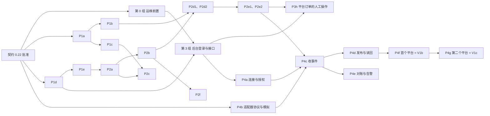

# 平台渠道：自营 Shopee 与 TikTok Shop 的授权、发布、对账与上线

> 版本：**0.1 · 日期：2026-11-23 · 状态：草案，待 Kelvin 批准**（随契约 0.22 一起）。
> 出处：原 Acuven Inventory 的最小 V1 设计（`acuven_inventory` 仓库 `docs/V1_MINIMAL_DESIGN.md` 0.3，Kelvin 2026-11-21 批准）。
> 2026-11-23 Kelvin 定把 Inventory 并入 Core、而且要**深度融合**（`acuven_hub/DECISIONS.md` C-21）：没有“Inventory 模块”，只有一个多了平台渠道能力的 Core。
> 原设计里属于库存账的规则（入口、配额、安全库存、`pending`、平台映射、平台订单事件、操作者、后台）写进了 [CONTRACT_V1.md](CONTRACT_V1.md) 0.22；本文只写**与外部平台打交道、本身不属于库存账规则**的部分：平台授权与令牌、收事件、库存发布与读回、两种“暂停”、上线切换与人工模式、对账、告警、适配器，以及整件事的工作包与改造规模。
> 原设计的业务规则原样保留；改的地方都标“（0.1 新）”或在第 13 节列出，取舍见 [OPEN_QUESTIONS.md](OPEN_QUESTIONS.md) 的 Q-81～Q-102。
> 被否决的“进程内模块”草案（PR #189 的 `docs/inventory/`）整体作废。
> 平台接口的具体行为（状态名、库存字段的含义、取消后是否自动回补、webhook、限流）要等应用获批后按官方文档与实测核实（V-08，第 12 节）；本文只写要核实什么、核实后怎么套进来，不预设平台的具体行为。

---

## 0. 一页看懂

- **范围**：V1 只服务 Acuven 自营的一个 Shopee 店、一个 TikTok Shop 店，一个地点、一个库存池，SKU 少于 100 个。不接 Acuven Shop，网店仍是公开 Demo（经 Demo 实例的 `/v1`，不受影响）。
- **两个店铺是 Core 生产实例的两个 `platform` 入口**，另有一个 `backoffice` 入口给后台做库存管理（契约 §3）。数量只记在 Core 的账上。
- **防超卖靠固定配额**：两个平台的剩余配额 `Q`、平台已售未扣 `pending`、安全库存 `S`，合计不超过 `available`（契约 §3.1）。两个平台的配额不互借。
- **平台订单事件在 Core 的一笔事务里处理**（契约 §5.10）：webhook、补拉、人工登记进同一个收件箱，去重即幂等；超卖的单 Core 拒绝预留，订单在 Core 里标为待处理，件数留在 `pending`。
- **本文管的是 Core 与平台之间的事**：授权与令牌（第 2 节）、收事件（第 3 节）、只写绝对值的发布与读回（第 4 节）、两种暂停（第 5 节）、上线切换与人工模式（第 6 节）、对账（第 7 节）、告警（第 8 节）。
- **分三期**：V1a 人工模式（不依赖平台审批，库存账先集中到 Core）；V1b 首个获批的平台（自动收事件、自动写库存）；V1c 第二个平台。
- **先做后台与公网授权回调**：本项目定过“不向平台提交占位地址”（`acuven_hub` 私有接入台账第 5 节第 4 步），所以要先有能访问的回调，才去平台后台建应用、填回调地址。

## 1. 范围

| 做 | 不做（V1） |
| --- | --- |
| 自营 Shopee、TikTok Shop 各一店，用自营卖家开发者的应用接入（C-20）。Shopee 卖家类型能不能开，待核实（V-08） | 其他商户、第三方应用的多店授权（等 C-20 的第三方路线获批后再做） |
| 一个地点、一个池；SKU 少于 100 个；整数件 | 多仓、组合装、序列号 |
| 平台商品映射、安全库存（默认 2 件）、固定配额、库存发布、订单事件、对账、人工模式、上线切换 | 按比例自动分配补货、跨平台自动调配份额（V-04） |
| Core 的后台：目录、期初、收货、盘点、库存总览、配额、连接、平台商品、人工登记、待处理、审计（契约 §8.6 第 2 条） | Acuven Shop 的预留接口、公开的平台渠道演示、AI 客服接入、SKU 合并页面 |
| 严重异常发 Telegram | 订单后台、资金、物流、顾客资料 |

## 2. 平台连接与授权

- **应用**：TikTok Shop 用开店邮箱对应的卖家账号，注册自营卖家开发者，建私有应用；Shopee 按 C-20 的做法另开卖家类型账号，能不能开、要什么资料，待核实（V-08）。
  - 连接记录的 `app_profile`：V1 只有 `self_seller`，以后第三方路线获批再加 `third_party`。
  - 换应用要重新授权、换令牌；平台商品按“入口、平台商品 ID、规格 ID”存（契约 §2.9），不受影响。
- **存放**（0.1 新）：`platform_connections`，每个 `platform` 入口一行，列见契约 §3.2（`mode`、`status`、能力、加密后的令牌、补拉游标等），另有 `app_profile`。表里只存当前状态；每次授权、断开、切换模式，以及作业把状态改为 `auth_failed` 或 `revoked`，都在 `platform_ops_log` 留一条（契约 §3.2）。
- **OAuth**：每个平台一个回调路由 `GET /api/v1/platforms/{platform}/oauth/callback`（契约 §8.6 第 3 条）。
  - 管理员在后台点“授权”时，后端生成一次性、10 分钟内有效的 `state`（随机 32 字节，库里只存它的 SHA-256），绑定管理员会话、目标入口与平台；
  - 回调先校验 `state`（存在、没用过、没过期、平台一致；用过即作废），再在后端用授权码换令牌，然后跳到不含授权码的结果页（原 DEVELOPMENT 6.2）。
  - 授权码在查询串里：Core 的访问日志只记路径，uvicorn 自带的访问日志两个实例都关掉（契约 §8.6 第 5 条）。
- **令牌**：应用层加密存储（AES-256-GCM，每次加密一个新的 12 字节随机数；主密钥用 Docker Compose secrets 文件注入，同 `ai_billing_hub` ADR-0004；主密钥不在库里）。
  - 定时刷新（作业 `platform-token-refresh`，取作业锁，契约 §8.6 第 4 条）。**平台返回新令牌后立即用一个单独的短事务存下**，再做别的事（刷新令牌常是一次性的）。
  - 刷新失败、被撤权或获批 scope 不足时：连接设为 `auth_failed` 或 `revoked`，停止这个入口的自动写入，发严重告警，后台显示“授权失效”。
  - **整机恢复或误操作恢复之后**（0.1 新）：恢复出的库里可能是丢失窗口之前的旧令牌，而平台那边已经换过一次刷新令牌、旧的已作废。刷新失败就按上一条处理，由管理员在后台重新授权；恢复步骤里写明要检查（[PRODUCTION_RUNBOOK.md](PRODUCTION_RUNBOOK.md) 的 0.22 说明）。
- **能力矩阵**：每个连接记录获批的能力（读规格、读库存、写库存、读订单、webhook），后台逐项显示可用、待批或不可用。缺写库存或缺订单事件时，这个入口不显示“自动同步”（原需求 4.1）。

## 3. 收事件：webhook、补拉、人工登记

三种来源都写进同一个收件箱 `platform_events`，由同一个处理过程处理（契约 §5.10）。

- **webhook**：`POST /api/v1/platforms/{platform}/webhook`。先验平台签名（验签密钥是平台应用的凭据，和主密钥一样经 secrets 注入），再只把事件写进收件箱（契约 §5.10 的短事务、按去重键）就应答；处理由作业异步做。
  验签失败回 401，不写收件箱；写收件箱失败（数据库不可用）回 5xx，不应答成功，让平台重发。连接的 `mode` 为 `manual` 时（授权往往早于切到自动），验签之后只应答、**不写收件箱**，补拉作业也不对这个入口运行：人工模式下收件箱里只有人工事件，免得人工登记的 `m<n>` 与平台包裹 ID 派生的引用指同一件事两次（契约 §5.10 引用格式）。自营应用能不能用 webhook，待核实；不能用就只靠补拉（V-08）。
- **补拉**：作业 `platform-order-pull` 按订单更新时间定时补拉，周期按平台限流定（V-08）。拉到的订单按它当前的状态拆成通用动作写进收件箱，`event_key` 用平台记录的状态时间；与 webhook 的去重键不同（一个用平台事件 ID、一个用状态时间），同一个动作可能两次进收件箱：第二次处理时按订单阶段或 Core 的业务引用认出已经做过，记 `ignored`、不重复改配额（契约 §5.10 第 4 步）。
  - 补拉也是乱序的解法：事件越过了订单当前的阶段时，处理作业先在事务外补拉这个订单（契约 §5.10 第 4 步）。
  - 补拉的游标（每个入口一个“已补拉到的更新时间”）存在 `platform_connections` 上，与写收件箱同一事务更新。
- **人工登记**：人工模式（第 6.2 节）与待处理的人工操作，由后台写成 `manual` 事件（契约 §8.6 第 2 条），去重键的 `event_key` 用这次提交的幂等键。
- **处理**：作业 `platform-inbox` 每隔几秒找出有未处理事件的订单，逐个订单取按订单的锁，把这个订单的未处理事件先按 payload 里的平台时间（没有就用 `received_at`）、同一时刻再按状态链先后排序（不按状态链排，免得把“先取消一行、后待发货”颠倒），一个事件一笔事务地处理（契约 §5.10 第 1–8 步）。取不到锁的订单下一轮再来；越阶段的订单在事务外补拉、按 `next_pull_at` 退避（1 分钟起翻倍、最长 60 分钟）。
- **同一个动作的判断**：发货、退款、退货的 Core 引用来自平台的稳定 ID，所以平台换了事件 ID 重发同一次部分发货，Core 仍认得是同一次（`shipment_ref` 等已用过，契约 §5.8 原样返回）。平台给不出稳定 ID 时，按“订单、动作、平台行、件数、发生时间”判断，判断不了就进待处理。
  Core 订单行的累计上限只是最后一道兜底；部分发货时余量还没用完，它兜不住（原 STOCK_RULES §4）。

## 4. 库存发布与读回

- **只写绝对值**：发布就是把平台 p 上该规格的库存设为 `Q[p]`（契约 §3.1）。平台卖出时自己会扣展示量，Core 不再写一次。
- **什么时候写**（作业 `platform-publish`，取作业锁）：
  - 该 SKU 在该入口启用自动同步时；
  - 管理员改配额后（契约 §3.1 `allocations.update` 提交之后排进发布队列）；
  - 按契约 §3.1 恢复了 `Q`，而读回发现平台没有自动加回时（原 STOCK_RULES §3 第 3 条：先核对，再写绝对目标）。
- **发布前先补拉**：写平台之前，先补拉该入口的订单到当前时刻，把期间的销售按契约 §5.10 处理完。目标值取处理完之后锁内的 `Q[p]`（在一个只读的短事务里读，读完就释放，**不在持有行锁时调平台接口**）。
- **剩余的窗口**：补拉完到写入平台之间，平台上新卖出的件会被这次绝对写入盖掉，平台会多显示这些件。这个窗口只能缩小，消不掉；由写入后的读回与下一次补拉发现，发现后标为读回不符。平台因此多卖时，契约 §3.1 的“`Q` 只减到 0”接手。
- **每次写，逐个 SKU 记结果**：已确认、明确失败、结果未知、不支持（原 DEVELOPMENT 第 6 节）。存在 `platform_publishes`（每次写一行：入口、SKU、目标值、平台确认的值、结果、时间）。
  - 失败或结果未知：保留目标值与平台已确认值的差距，不叠加，退避重试；结果未知时先读回再决定。
  - 平台以促销锁定、平台仓等理由拒写：标为“平台控制”。
- **读回比对**：写入之后、以及定时，读平台库存与 `Q[p]` 比对。读数不符（上面的窗口、平台自动回补了不该回补的量、有人直接在卖家后台改了库存）：
  - 把该“SKU × 入口”标成待核对（第 5 节的第二种暂停），暂停这个 SKU 在这个入口的自动写入，并告警；
  - 不把平台读数当成新的实物，也不未经确认就用 `Q` 覆盖平台（原需求 4.4）。
  单次读回数量相同，不能证明期间没有并发销售（原 DEVELOPMENT 第 5 节）。读回只用来发现差异，对账以订单补拉为准。
- **预期会出现的读回不符**：有行找不到平台商品的待处理单（`held`，原因 `unmapped`）被取消后，找得到平台商品的那些行下单时扣过 `Q`，取消时照原设计不加回、件数进 `F`（契约 §3.1）；平台通常会自己把显示量加回，于是读回不符、该“SKU × 入口”进待核对。这是预期的，管理员核对后改配额或解除即可。

## 5. 两种“暂停”各管什么（0.1 新，回应 PR #189 第 3 轮审查的遗留建议）

| | 自动写平台暂停 | SKU × 入口待核对 |
| --- | --- | --- |
| 范围 | 整个租户（两个平台、全部 SKU） | 一个 SKU 在一个平台入口上 |
| 存在哪 | `platform_write_pause`，每个租户一行（契约 §3.2） | `channel_allocations` 上的 `review_hold`、`review_reason`、`review_since`（契约 §3.2） |
| 谁设上 | 运行手册在整机恢复、误操作恢复起生产 Core 之前用 SQL 设上（契约 §12.1 第 3、6 条）；管理员也可以在后台手动设上（例如怀疑平台数据有问题时） | 读回不符时由发布作业设上（第 4 节）；对账发现差异时由对账作业设上（第 7 节） |
| 设上时停什么 | 库存发布与读回后的回写都不执行 | 只停这个 SKU 在这个入口的发布与回写 |
| 设上时照常做什么 | 读平台库存、补拉订单、处理收件箱（改 Core 的账、配额与 `pending`）、人工登记、后台的全部操作 | 同左；这个 SKU 在别的入口照常发布 |
| 对配额的影响 | 无 | 恢复条件不满足：取消等事件不把件数加回这个入口的 `Q`，进 `F`（契约 §3.1） |
| 谁解除 | 管理员在后台解除（`stock_admin`，记操作者与原因，写 `platform_ops_log`），前提是恢复后的对账跑完、差异处理完 | 管理员核对平台读数后在后台解除（`stock_admin`，同上），必要时先改配额 |

- **已设上时再设，不改原来的原因、设上的人与时间**：运行手册的 SQL 写成“只在 `paused` 为假时更新”；后台的“设上”按钮在已设上时不可用。这样演练机上一直设着的标记、或恢复前就因别的原因设着的标记，不会被覆盖成“整机恢复”。
- 两者都不停事件处理：平台照常在卖，Core 的账必须跟上；停的只是“往平台写数”。
- 被否决的那一稿还有一个“停止产生新步骤”标记，是为更换内部凭据准备的；没有内部凭据了，这个标记不要（契约第 14 节 0.22 的说明）。

## 6. 上线切换与人工模式

### 6.1 上线切换（每个 SKU 第一次进 Core）

按原需求 4.1 第 5 步：

1. **停售窗口**：在两个平台暂停相关商品的销售，或者把展示量调成 0。具体用哪种办法由管理员定。
2. **实盘**：点仓内全部实物，包括已售未发的件。期初导入 Core 的就是这个实物数（Core 的期初只记 `stock_balance`，契约 §6.3）。
3. **池切 live**。然后对每笔**已付款、未发货**的平台订单，在后台人工登记它的 `created` 与 `ready_to_ship`（契约 §8.6 第 2 条；平台订单号与行照卖家后台填），Core 的可售量因此扣掉这些件，之后交运也有对应的 Core 订单可报；对**未付款**的订单只登记 `created`，件数进 `pending`。
4. 设好安全库存和配额（契约 §3.1），核对 `F ≥ 0`，再把各平台的展示量设成 `Q[p]`，核对一致之后恢复销售。
5. 保存每个入口的切换时间与订单处理进度。之后补拉旧订单只补缺项（去重键挡住重复），不重复占用。

### 6.2 人工模式（V1a，平台获批前）

人工模式就是原 INTEGRATION_STANDARD 的 `manual_quota`，按原需求 4.1 的“人工配额过渡流程”和 4.3 做，两个平台通用。

1. **设配额**：管理员先把截至当时的订单登记完，再在卖家后台设置该 SKU 的库存。设成的值取“卖家后台核实的剩余展示量”与 Core 的 `Q[p]` 两者中较小的（原需求 4.3），然后在后台确认“已生效”。确认之前，这部分配额仍为该平台保留，但不显示为已生效。
2. **登记**：管理员每天至少两次在卖家后台核对新订单、待发货、取消、交运和退货，在后台登记最小事件：平台订单号、行、平台商品、件数、动作、发生时间；交运、已确认后的取消、退货**必须填平台的包裹 ID、退款 ID、退货 ID**（卖家后台的订单详情里有），确实没有时勾选“平台没有给 ID”，Core 用 `m<n>` 派生引用（契约 §5.10 引用格式，Q-98）。
   登记后先**复核**，再提交；提交就是写一条 `manual` 事件，与处理在同一个事务里，走与自动事件同一条管线（契约 §5.10“后台的人工操作”），去重规则也一样。
3. **核对记录**：每次核对都记下执行人、时间、对账区间和差异（`manual_checks`，契约 §3.2；`stock_operator` 或 `stock_admin`）。
   - 逾期：距最近一次核对的结束时间超过 12 小时（契约 §3.2，Q-99）。逾期只在后台显示，不发 Telegram；同时停止增加其他平台的配额（原需求 4.1；`allocations.update` 拒绝增加，409 `MANUAL_CHECK_OVERDUE`，契约 §3.1），这个平台的取消也不加回配额、件数进 `F`。核对补上之后自动解除。
   - 人工模式下取消加回的配额（契约 §3.1 的恢复条件），要管理员在卖家后台把显示量设成新的 `Q[p]`，再在后台“确认已生效”（记 `manual_confirmed_quota`，`stock_admin`）；在那之前库存总览显示“待生效”。平台若自己把显示量加回了，核对时照第 1 条取两者中较小的。
   - 核对中发现数量冲突或可能超卖：按严重异常告警。
4. **录错了**：提交之前的登记可以改或作废。提交之后，Core 的确认销售、发货、退款回库、退货验收都不能撤销，也不能更正（契约 §5.8“录错了怎么办”、§6.7）。
   这时照契约 §5.8 的办法用盘点、不可售或报损把账面对回实物，在后台把这一订单行记为“已知差异”（`platform_order_lines.known_discrepancy`，契约 §3.2），保留原登记、原因和处理人。这与原需求 4.3“以反向事件更正”不同，列在第 13 节。
5. **切换到自动**：适配器启用时，以该平台最后一次人工核对的 `checked_until` 为接管点，平台记录的时间早于接管点的事件不再处理（适配器拆动作时就丢掉），向前补拉、去重、对账，然后把连接的 `mode` 改为 `auto`（记 `platform_ops_log`）；已登记的旧订单不重复占用。之后对已有自动事件的订单，后台禁用人工登记（契约 §5.10）。

TikTok Shop 目前没有订单，开卖之前配额保持 0（V-10）。

### 6.3 盘点前先清收件箱

Core 要求点数之前已经发生的实物进出（收货、发货等）先入账，再提交实数（契约 §6）。所以：
- 一个 SKU 提交盘点实数之前，后台检查收件箱里没有涉及它的未处理事件，有就 409 `INBOX_NOT_DRAINED`（契约 §8.3；0.1 新：原设计还要求“命令发件箱清空”，融合后没有发件箱了）；
- 人工模式下，还要先把截至当时的交运登记完。

否则，已交运、但 Core 还没处理发货的件会在盘点时被减一次，之后处理发货时又减一次。

## 7. 对账

每天自动跑一次（作业 `platform-reconcile`），管理员也可以手动发起。查出的差异都进待处理，不自动修。整机恢复之后的第一次对账由管理员手动发起；在它跑完、差异处理完之前，“自动写平台暂停”保持设上（第 5 节）。

1. **Core 与平台**：补拉平台当前的订单状态，对照 Core 里平台订单的阶段与 Core 订单行的累计量（契约 §5.10）；平台库存读数对照 `Q[p]`。
2. **配额约束**：每个 SKU 算一次 `F`，列出超额的（契约 §3.1）。
3. **Core 自查**：在进程内直接调不变量自查的读函数（契约 §4.4，同一套查询、同一个只读快照），包括第 6 项 `channel_pending_vs_orders`；查出违反就发严重告警。Core 的巡检每 5 分钟也在跑（契约 §8.5），这一步让后台也看得到结果。

0.1 新：原设计第 9 节的第 1 项“Inventory 与 Core 比对两边的并集”取消了——平台订单与 Core 的账在同一个事务里写，不会对不上；剩下的一致性由第 3 项的自查守着。

## 8. 告警

只把严重异常推送到一个独立的 Telegram 机器人；全部异常都在后台记录。

- **严重异常**：Core 拒绝预留（可能超卖等，契约 §5.10 第 6 步）、引用冲突类的缺陷（同上）、授权失效、写库存连续失败或结果未知、读回不符、超额、对账差异、不变量自查违反、收件箱里的事件超过 15 分钟仍未处理（取不到锁、补拉不到、反复出错）、人工核对中发现冲突。
  数据库不可用时 Core 自己记不了告警状态，由巡检报出（契约 §8.5 的 `readyz`）。
- 严重告警未确认时，每 15 分钟重复一次，直到在后台确认。发出满 1 小时仍未确认，记一条超时待办，继续只提醒负责人本人（原需求第 5 节）。
- Core 发生故障时，平台照常销售。负责人收到告警后，在后台记下“继续销售”或“手动停售”的决定（原需求第 5 节）。
- 普通异常不推送，只在后台显示（V-07）。
- 存放：严重告警一条一行（`platform_alerts`，契约 §3.2）；确认告警、记“继续销售或手动停售”的决定都是后台操作（`stock_operator` 或 `stock_admin`，写 `platform_ops_log`）。
- Telegram 机器人的令牌与主密钥、平台应用凭据一样经 secrets 注入，不进仓库与日志。
- **为什么有两条告警链路、不合并**（0.1 新）：巡检（服务器 cron → Healthchecks → Telegram，契约 §8.5）在进程之外，管的是“进程死了、机器挂了、库不通、账对不上”这些进程自己报不出来的事；本节的 Telegram 机器人在进程之内，管的是平台渠道的业务异常，要带订单与 SKU、要 15 分钟重复与确认。
  进程内的机器人报不了自己的死，巡检推不出业务细节，Healthchecks 的免费位置也只有那几个（契约 §8.5），所以两条都留。两条的接收人相同（Kelvin 的 Telegram），机器人不同，通知开头写明来自哪一条。

## 9. 安全与隐私

- 不保存顾客姓名、电话、地址、支付资料，只存改变库存所需的最小订单标识（契约 §10 第 6 条）。平台订单号进 Core 引用之前，先核对不含个人资料（V-09）。
- 平台令牌、平台应用凭据、令牌加密主密钥、Telegram 令牌都不进 Git、日志或 OpenClaw 工作区。Core 没有给平台渠道用的服务令牌（契约 §10 第 2 条）。
- 令牌加密只防“库或备份单独外泄”；主密钥与平台应用凭据挂在同一个容器里，**进程被攻破时它们与库一起丢**，攻击者能以两个店铺的身份写库存、读平台上的订单与顾客资料、冒用告警机器人。被攻破之后的处置见契约 §8.6 第 6 条与运行手册。
- 授权回调的授权码不进访问日志：Core 自己与 uvicorn 的见契约 §8.6 第 5 条；边缘代理的 vhost 对 `/api/v1/platforms/` 关访问日志或用不含查询串的格式（运行手册 1.5b）。
- **出站请求脱敏**（0.1 新）：适配器调平台接口时，有的平台把访问令牌、签名放在查询串里，HTTP 客户端的异常文本也常带完整 URL。适配器统一记日志与异常时只记方法、主机之后的路径与状态码，不记查询串、请求头与请求体；捕获的异常只记类名与平台的错误码。写进第 15 节的验收。
- 后台页面与后台接口的响应带 `frame-ancestors 'none'` 与 `X-Frame-Options: DENY`（契约 §8.6 第 2 条）。
- 后台管理员用独立账号、密码登录，带限流（[ADMIN_AUTH.md](ADMIN_AUTH.md)）；配额、映射、连接的变更都记操作者与原因（契约 §2.9、§3.1）。
- 生产 Core 处理公网请求带来的风险与兜底见契约 §8.6 第 6 条。

## 10. 平台适配器

- 每个平台一个适配器，实现同一个协议，七个动作（原 DEVELOPMENT 第 6 节）：读规格列表、读库存、写库存（绝对值）、按更新时间拉订单、读一个订单、验 webhook 签名并解析成通用动作、刷新令牌。
- 先做模拟适配器与合同测试夹具（每个动作的成功、明确失败、结果未知、限流、撤权），真实适配器按同一套夹具测。
- 平台状态名到通用动作（契约 §5.10 的 `created`、`ready_to_ship`、`cancelled`、`shipped`）的对照写进各适配器的能力矩阵，获批后按官方状态表定（V-08）。Core 的确认销售对应“平台把订单交给卖家履约”的那一刻，也就是进入待发货；货到付款单进入待发货时也算；`paid_at` 取平台记录的进入待发货的时间（原设计 4.3）。
- 适配器只在事务外调用（契约 §5.10 第 4 步、本文第 4 节）。

## 11. 前置与跨项目依赖

| 依赖 | 在哪做 | 说明 |
| --- | --- | --- |
| 仓库与 OpenClaw 项目 | 本仓库（项目 `stock_core`） | 不再单建仓库（C-21 取代 V-11）；任务编号 `CORE-TASK-NNN`。`acuven_inventory` 仓库归档 |
| 契约 0.22 | 本仓库 | **批准之前不登记依赖它的实现任务**（Q-81～Q-102） |
| 子域名与 HTTPS | `vps_infra`、Cloudflare | 生产实例的子域名与 `infra_nginx` vhost：只转发 `/admin/` 与 `/api/`，覆盖设置 `X-Real-IP`（[ADMIN_AUTH.md](ADMIN_AUTH.md) 5.3）；从外网验证 |
| 生产实例挂上代理网络 | 本仓库的部署脚本 | 生产 Core 改挂 `infra_nginx` 所在的代理网络，不再建调用方内部网络（[PRODUCTION_AND_RECOVERY.md](PRODUCTION_AND_RECOVERY.md) 0.7） |
| 后台与回调上线 | 本仓库 | 之后再去平台后台建应用、填回调（第 0 节） |
| Core 生产实例 | 本仓库 | 部署脚本与工作流已就绪（CORE-TASK-067、068），运行手册见 [PRODUCTION_RUNBOOK.md](PRODUCTION_RUNBOOK.md)；开通时只签巡检凭据 |
| W7a 备份与恢复 | 本仓库、`vps_infra` | binlog 异地（≤5 分钟）、每日全量、**至少 30 天保留**、上线前演练一次、之后每季度一次（C-12）。**真实库存进 Core 之前必须完成** |
| DECISIONS 更新 | `acuven_hub` | 契约 0.22 批准后，更新“C-21 后续” |

## 12. 待定事项的来历（V-xx）

原设计第 16 节的 V-01～V-12，Kelvin 2026-11-21 全部按建议定（V-10 除外，仍待定），已登记到 `acuven_hub/DECISIONS.md` I-08。并入 Core 之后：

| 编号 | 原问题 | 现在 |
| --- | --- | --- |
| V-01 | V1 不接真实 Acuven Shop | 不变 |
| V-02 | 生产 Core 用同一仓库的第二套部署，上线前先做完 W7a | 不变 |
| V-03 | 平台超卖单不进 Core 的账，留在待处理 | 不变；待处理成了 Core 的平台订单阶段（契约 §4.2、§5.10） |
| V-04 | 补货不自动分配、不跨平台自动调配 | 不变（契约 §3.1：增量进 `F`） |
| V-05 | 不做公开演示 | 不变 |
| V-06 | 只有管理员一个角色，后台只做简体中文 | 不变；管理员持有 Core 的三个角色（契约 §8.6 第 2 条，Q-86） |
| V-07 | 只推送严重告警 | 不变 |
| V-08 | 获批后要核实的平台行为：Shopee 卖家类型账号能否开设及所需资料；自营应用的审核要求；未付款时是否扣展示库存；货到付款单的状态；“已发货”是否等于实物交运；取消、退款后是否自动回补展示量；库存字段的含义；有没有 webhook；限流；令牌有效期 | 不变：核实结果写进各平台的能力矩阵；与本文或契约冲突的，改文档并重新批准 |
| V-09 | 平台订单号与包裹、退款、退货 ID 是否满足 Core 引用格式、是否不含个人资料 | 不变：获批后用真实订单核对；不满足就改用 Core 自己的 ID（契约 §5.10 的引用格式） |
| V-10 | TikTok Shop 开卖时先走人工模式还是等适配器 | **仍待定**，由 Kelvin 按经营需要定 |
| V-11 | 仓库名与可见性 | 被 C-21 取代：不单建仓库，并入本仓库（公开） |
| V-12 | Inventory 担任唯一销售入口、在它下面给两个店分配额 | 被 C-21 与契约 0.22 取代：两个店铺各是 Core 的一个入口，配额是 Core 的规则（Q-81） |

## 13. 与原 Inventory 文档的出入

原 Inventory 设计 0.3 第 14 节列的出入（Kelvin 2026-11-21 批准）照旧成立：V1 不含 Shop（V-01）；补货增量进 `F`、手动分配（V-04）；超卖单不入账、留在待处理（V-03）；`pending` 是新概念；配额校验不在“Core 的额度事务”而在配额规则里；人工登记录错按 Core §5.8 对回实物；只有管理员；只做简体中文；只推送严重异常；不做公开演示；不用 Redis 与 Celery；先走自营卖家路线（C-20）。
并入 Core 之后另有这些（0.1 新，都待 Kelvin 确认）：

| 原写法 | 现在 | 依据 |
| --- | --- | --- |
| Inventory 是独立服务、独立库，经 Core 的版本化 API 调用（原 REQUIREMENTS 第 2 节，DEVELOPMENT、HUB_ARCHITECTURE_ALIGNMENT、SYSTEM_DECOUPLING） | 没有独立的 Inventory：两个店铺是 Core 的入口，配额等是 Core 的状态，平台事件在 Core 的事务里处理 | C-21；契约 0.22 |
| 配额与约束校验在 Inventory 库里做，Core 不存配额；“不能在 Inventory 先减 Q、另一个请求才加 H”（HUB_ARCHITECTURE_ALIGNMENT 第 5 节） | 配额在 Core，与预留、确认销售在同一个事务里改，这条要求自然满足 | 契约 §3.1、§5.10 |
| Core 的入口额度“在 Core 的同一事务内校验”留给共卖时再议 | 平台入口的配额已在 Core 的同一事务里改；`api` 入口与平台入口共卖仍是以后的事 | 契约 §3 |
| 命令发件箱、结果不明时同键重发、Core 不可用时积压 | 没有发件箱；平台事件是一笔事务；数据库不可用时一起停，恢复后补拉 | 契约 §5.5、§5.10 |
| Inventory 与 Core 每日比对两边的并集 | 取消，改由不变量自查第 6 项守着 | 契约 §4.4；本文第 7 节 |
| 用进程内调度加作业表 | 用 Core 的进程内定时任务，不能重叠的作业取命名锁，不建作业表 | 契约 §8.6 第 4 条 |
| 两个 Core 凭据（业务、运维）放在 Inventory 的密钥文件 | 不要：平台事件用系统主体，后台用管理员主体，都没有令牌 | 契约 §10 第 2、4 条 |
| 平台映射是 Inventory 的表 | 平台商品挂在 SKU 下，写目录变更记录 | 契约 §2.9 |
| Inventory 的后台与登录 | Core 的后台与登录 | 契约 §8.6；[ADMIN_AUTH.md](ADMIN_AUTH.md) |

## 14. 工作包、改造规模与先后（不是排期，不登记任务）

### 14.1 改造规模的依据（在本仓库 `app/` 上数的，2026-11-23 的 main）

- **命令体已经是“在给定连接、已开的事务里运行”的函数**：`app/services/idempotency.py` 的执行器开事务、提交或回滚，命令体只用 `execution.connection`，不自己开、提交、回滚事务（该文件开头的说明）。所以“命令体做成在给定会话、给定事务里运行的领域函数”这一半**已经是现状**，不用改。
- **与 HTTP 的牵连**只在交给命令体的执行上下文：`Execution` 持有 FastAPI 的 `Request`，命令体经 `execution.access`（租户、凭据、入口与池、操作者）与 `execution.request`（`request_id`、预留有效期）取值。
  在 9 个服务模块里共 **58 处**：`counts` 10、`sale_commits` 13、`sku_merges` 10、`reservations` 6、`stock` 6、`stock_imports` 5、`fulfilment` 4、`demo_resets` 3、`stock_documents` 1（用 `grep` 数 `execution.access`、`execution.request`、`.principal.`、`request.state.request_id`）。
  执行器自己有 16 处取 `Request` 或 `Access`。目录的两个服务（`catalog`、`catalog_imports`）不碰 `Execution` 的这两项，它们收接口层组好的 `ChangeAuthor`，只要接口层改为从上下文组。
- **接口层**：10 个接口模块、31 处调 `run_idempotent(request, …)`，签名改为传上下文（机械改动）。
- **不用做的**（与被否决的那一稿相比）：不抽“33 个写操作的操作表”、不把 §8.1 第 7–9 步改成函数、不做进程内的 JSON 解析与白名单——`/v1` 的 HTTP 路径保持原样，只把上下文换掉。
- **新增的**：执行器之外再写一个平台事件执行器（去重、按订单的锁、保存点）；后台执行器复用 HTTP 执行器的核心；操作主体只加一列；配额、平台商品、平台订单、收件箱、连接等新表。
- 现有集成测试 54 个文件、约 2.9 万行；第 1 组的重构不改行为，它们应原样全绿，这是重构的验收。
- **第 1 轮审查后补的漏项**（0.1 新）：
  - 命令体要告诉执行器“新生效”还是“按业务引用返回原结果”（契约 §5.10 第 4 步）：每个带业务引用的命令在返回原结果的分支上打一个标记，主要在 `fulfilment`、`reservations`、`sale_commits` 三个服务里，十来处；
  - （第 2 轮审查后删去“改造预留与确认销售的重新判定”一项：那一步在现有代码里是命令抛 `BusinessRefTaken`、由执行器回滚与调 `rejudge`，确认销售走 `RedoCommand`，命令体本来不开、不回滚事务；平台事件执行器自己用保存点做同一件事，命令体不用改，HTTP 也就没有改造风险。见契约 §5.10“命令体共用”。）
  - 派生的命令正文与摘要（契约 §5.10）：每个命令一个派生函数，五个；
  - `credentials` 的 `scopes` 检查约束按种类重建（契约 §10 第 4 条），算进 P1d；
  - 平台订单行的 `quota_taken`、`quota_returned`、`cancelled_qty` 与 §3.2 的运营表，算进 P2a；
  - Demo 的池失去“一个入口”的数据库层保护，开通入口的命令行要补齐组合检查的测试，算进 P1e。

### 14.2 工作包

按“一层一个任务”（本仓库 CLAUDE.md 的拆分规则）：先改 Core 的执行器与操作主体，再做配额与平台事件命令，再做后台与平台对接。行数是含测试的粗估，登记前按设计预审再定。

| 包 | 内容 | 层 | 粗估 | 依赖 |
| --- | --- | --- | --- | --- |
| **第 0 组：运维前置**（可与第 1 组并行） | | | | |
| P0a | `Dockerfile` 加 `--no-access-log` 与 `--timeout-graceful-shutdown`；`docker-compose.yml` 的 `stop_grace_period`；定时任务改为并行停止（契约 §8.6 第 4、5 条） | 部署与定时任务 | 200 | 契约批准 |
| P0b | 生产实例 `/v1` 只挂自查（按 `CORE_ENV`）；只读命令行 `app.cli inspect ledger / reservation / order-stock`（平台订单的子命令随 P2a 之后补） | 接口与命令行 | 500 | 契约批准 |
| P0c | 部署：生产实例改挂代理网络、去掉调用方内部网络，更新部署文件里过时的注释（[PRODUCTION_AND_RECOVERY.md](PRODUCTION_AND_RECOVERY.md) 0.7） | 部署 | 200 | 契约批准 |
| P0d | 后台开关 `CORE_ADMIN_ENABLED`：配置、Demo 上拒绝启动、路由按开关挂的接线（契约 §6.1） | 配置 | 200 | 契约批准 |
| **第 1 组：执行器与操作主体**（纯重构加两列，`/v1` 行为不变） | | | | |
| P1a | 命令上下文：定义与 HTTP 无关的上下文；`run_idempotent` 拆成收上下文的核心与 HTTP 包装；`Execution` 改持上下文，暂时保留 `access`、`request` 两个兼容属性，服务层不动 | 执行器 | 500 | 契约批准 |
| P1b | 订单类服务（`reservations`、`sale_commits`、`fulfilment`、`demo_resets`）与它们的接口改读上下文（26 处） | 服务层 | 400 | P1a |
| P1c | 库存与合并类服务（`counts`、`stock`、`stock_documents`、`stock_imports`、`sku_merges`）与它们的接口、目录两个接口改读上下文（32 处）；去掉兼容属性 | 服务层 | 500 | P1a |
| P1d | 操作主体：迁移加 `credentials.kind`，按种类重建 `scopes` 检查约束、非 `service` 的入口为空；命令行签发只签 `service`、轮换与吊销拒绝另两种、列表标出种类；鉴权只认 `service` 的令牌 | 数据库与命令行 | 500 | 契约批准 |
| P1e | 入口种类：迁移给 `sales_channels` 加 `kind`、`platform`、`platform_shop_id`，先建普通索引再删唯一约束；命令行开通入口的组合检查、`--channel` 只收 `api`、开通第一个平台入口时建系统主体 | 数据库与命令行 | 500 | P1d |
| **第 2 组：配额与平台事件命令** | | | | |
| P2a | 数据层之一：`pool_allocations`、`channel_allocations`（含 §3.2 的两组列）、`allocation_changes`、`sku_listings`、`platform_orders`、`platform_order_lines`（含 `quota_taken`、`quota_returned`、`cancelled_qty`）、`platform_events`，`catalog_changes.object_type` 约束重建；模型与迁移测试 | 数据库 | 1,000 | P1e |
| P2a′ | 数据层之二：契约 §3.2 的运营表（`platform_connections`、`platform_write_pause`、`manual_checks`、`platform_alerts`、`reconciliation_runs`、`platform_ops_log`） | 数据库 | 600 | P2a |
| P2b | 规则（纯函数，`app/domain/`）：契约 §3.1 的事件表、`Q` 只减到 0、恢复条件、`F` 与改配额的判定；单元测试照 §3.1 的例子逐行写 | 规则 | 600 | P2a |
| P2c | 平台商品命令（契约 §2.9）与目录的两处拒绝（停用、合并）；服务与集成测试 | 服务层 | 700 | P2a、P1c |
| P2c′ | 命令体只改一处：带业务引用的命令在“按业务引用返回原结果”的分支上打标记（HTTP 执行器不用它，行为不变，现有测试全绿） | 服务层 | 300 | P1b |
| P2d1 | 平台事件执行器之一：收件箱写入（自动来源）、按订单的锁、按状态链排序、开事务前的预建与关单、去重、锁序、事务内重新解析 SKU | 服务层 | 700 | P2b、P2a |
| P2d2 | 不调 Core 命令的动作：`created`（`quota_taken`）、扣数前的整单与行级 `cancelled`（最多加回扣走的）、`return_requested`；越阶段补拉与退避；契约 §5.10 例子第 2、3、5 种，§3.1 例子二 | 服务层 | 700 | P2d1 |
| P2e1 | `ready_to_ship`：派生正文与摘要、预留加确认一个保存点、拒绝时回滚到保存点设 `held`；§5.10 例子第 1、4、6 种，§3.1 例子一第 9–13 步 | 服务层 | 800 | P2d2、P2c′ |
| P2e2 | `shipped`、已确认后的 `cancelled`、`return_received`：派生正文与摘要、已确认后的拒绝只写 `attention`、按业务引用返回原结果时记 `ignored`；例子第 7 种 | 服务层 | 800 | P2e1 |
| P2f | `allocations.update` 服务与 `allocation_changes`；不变量自查第 6 项（契约 §4.4）；`app.cli inspect platform-order` | 服务层 | 600 | P2b |
| **第 3 组：后台** | | | | |
| P3a–P3d | 后台登录四层（[ADMIN_AUTH.md](ADMIN_AUTH.md)：数据、规则与服务、账号命令、接口） | 各一层 | 共约 2,500 | P0d、P1d |
| P3e | 后台执行器与接口骨架：会话、CSRF、页面生成的幂等键、后台的上下文（`backoffice` 入口或平台订单的入口）；第一批接口：库存总览的读、改配额 | 接口 | 800 | P3d、P2f、P1c |
| P3f | 后台接口：目录与平台商品 | 接口 | 600 | P3e、P2c |
| P3g | 后台接口：期初、池切 live、收货、盘点、不可售与报损、更正（含盘点前检查收件箱） | 接口 | 800 | P3e |
| P3h | 后台接口：平台订单的人工操作（人工登记、待处理重试、继续处理、退货验收、结束）、核对记录 | 接口 | 800 | P3e、P2e |
| P3i 起 | 后台前端：骨架与 CI 前端检查、登录页，再按页面逐个做（契约 §8.6 第 2 条的页面表；带浏览器验收） | 前端 | 每页 300–800 | P3d 起 |
| **第 4 组：平台对接** | | | | |
| P4a | 连接与授权：`platform_connections`、`state`、回调、令牌加密存储、刷新作业（命名锁、立即存下）、能力矩阵 | 数据库到接口，可拆两个 | 1,200 | P3e、P0a |
| P4b | 适配器协议、模拟适配器、合同测试夹具 | 规则与测试 | 800 | 契约批准 |
| P4c | 收事件：webhook 路由与验签、补拉作业与游标、收件箱处理作业 | 服务与接口 | 900 | P4a、P4b、P2e |
| P4d | 发布与读回作业、两种暂停、`platform_publishes` | 服务 | 900 | P4c |
| P4e | 对账作业与 Telegram 告警（严重异常、15 分钟重复、1 小时超时） | 服务 | 800 | P4c |
| P4f | 首个获批平台的真实适配器 | 适配器 | 视平台 | 平台获批；P4b–P4d |
| P4g | 第二个平台 | 适配器 | 视平台 | 平台获批；P4f |

- **合计粗估**：第 0 组约 1,100 行；第 1 组约 2,400 行；第 2 组约 6,800 行（第 1 轮审查后补了漏项、第 2 轮审查后 P2c′ 缩小并把 P2d、P2e 各拆成两个）；第 3 组接口约 5,500 行加前端；第 4 组约 4,600 行加两个真实适配器。P1b、P1c 按服务模块分开，是为了让每个任务的允许路径（服务模块加对应的接口模块）与行数都在拆分规则的上限以内；登记时逐个核对，超了再拆。
- **最没把握的估计**：P2d1、P2e1（按平台时间排序、保存点与 `BusinessRefTaken`、`RedoCommand` 的组合，测试要覆盖的情形多）与 P3i 起的前端（页面多、浏览器验收慢）。P3h 的人工操作同事务写收件箱与处理，也可能要拆成登记与重试两个。
- **V1a 上线条件**：第 0、1、2 组完成，第 3 组的登录、P3e–P3h 与必要的页面完成，P4e 的告警至少能推严重异常；生产实例上线、W7a 首次恢复演练通过；契约 0.22 批准；按第 6.1 节完成实盘、期初、平台商品与切换。

## 15. V1 验收（摘要）

- 同一平台事件重复、乱序、迟到都只生效一次；发货、退款、退货按平台稳定 ID 去重；处理到一半进程被杀，重启后只生效一次（契约 §5.10 例子第 2–4 种）。
- 找不到平台商品、Core 拒绝预留的单不扣 Core 的数，留在 `pending` 与待处理中；处理后在原订单上继续，不另造一笔销售。
- 正常路径下 `ΣQ + Σpending + S ≤ available` 不被破坏；超额时保留事实、禁止加配额并告警，不写 0、不停售（契约 §3.1 的例子逐行可复现）。
- 不变量自查第 6 项在正常运行中始终为空；故意绕过接口改 `pending` 时报出。
- 改配额时版本冲突被拒；发布前先补拉；平台写入逐个 SKU 记结果，失败或结果未知时不叠加；读回不符时暂停该 SKU 在该入口的自动写入。
- “自动写平台暂停”设上时不写平台（发布与回写都不执行），读、补拉与事件处理照常；已设上时再设不改原因；整机恢复演练里生产 Core 起来时它已经设上，演练全程不解除。
- 上线切换后，已付款未发货的订单交运时 Core 有对应订单可报；未付款订单在 `pending` 中。
- 撤权、令牌失效后停止写入并告警；重新授权后能补拉并对账。
- 人工模式与自动模式走同一条管线；切换到自动时，接管点之前的订单不重复占用；盘点前收件箱未清空时拒绝提交。
- Demo 实例上打开后台开关拒绝启动；生产实例上反向代理不转发 `/v1`、`/healthz`、`/readyz`，`/v1` 只有不变量自查（开关打开与否都一样）；两个实例的容器日志里都没有 uvicorn 的访问行、没有回调的查询串。
- 不保存顾客个人资料；平台令牌与主密钥不进 Git、日志或 OpenClaw 工作区。
- 适配器调平台失败时，日志与异常里没有查询串、请求头与请求体（用一个把令牌放在查询串里的模拟平台测）；边缘代理的日志里没有回调的 `code` 与 `state`。
- 取消时最多加回下单时扣走的配额（契约 §3.1 例子二可复现）；已确认之后被拒的单阶段不变、不进不变量自查第 6 项。
- webhook 与补拉对同一个包裹各到一次，只发货一次（引用由平台包裹 ID 确定性派生，契约 §5.10）。
- 整机恢复演练通过；恢复后先对账，再解除暂停、恢复自动写库存。

## 16. 修订记录

- **0.1**（2026-11-23，**草案，待 Kelvin 批准**）：由原 Inventory 设计 0.3 改写而来，随契约 0.22 的深度融合。0.3 里属于库存账的规则搬进契约（第 3、4、5 节的配额、事件映射与引用格式，第 3.4 节的行合并，第 10 节的后台页面）；本文保留授权、收事件、发布与读回、上线切换与人工模式、对账、告警、适配器与工作包，并改掉“Inventory 服务”“命令发件箱”“两个 Core 凭据”“Inventory 与 Core 比对并集”等说法（第 13 节）。新增：第 5 节两种暂停的对照，第 2 节恢复后重新授权，第 14 节按融合后的代码重新估算的工作包与依据。
- **0.1 第 1 轮审查后**（2026-11-23，仍是草案）：按契约 0.22 第 132–149 条改：第 2 节连接表的列与历史挪到契约 §3.2；第 3 节按订单排序处理、补拉退避；第 5 节两种暂停的存放指向契约 §3.2、解除要 `stock_admin`；第 6 节人工登记必须填平台 ID、逾期 12 小时、人工模式下加回的配额要确认生效、已知差异的存放、接管点按 `checked_until`；第 8 节告警的存放与两条告警链路为什么不合并；第 9 节如实写被攻破的后果、出站脱敏、边缘代理的访问日志、防嵌框架；第 14 节补漏项、拆 P2a、P2d、P2e；第 15 节加四条验收。
- **0.1 第 2 轮审查后**（2026-11-23，仍是草案）：按契约 0.22 第 150–160 条改：第 3 节按平台时间排序、人工模式下 webhook 只应答不写收件箱、补拉不运行；第 4 节写明有行没映射的待处理单被取消后预期读回不符；第 6.3 节盘点前未清空的错误码；第 14 节 P2c′ 只留“按业务引用返回原结果”的标记（不改预留与确认销售的重新判定），第 2 组改为约 6,800 行。
