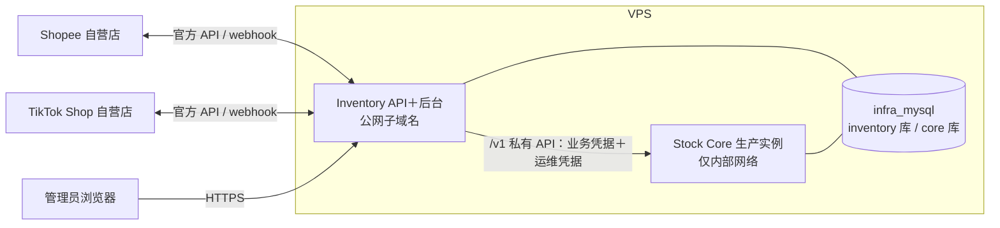
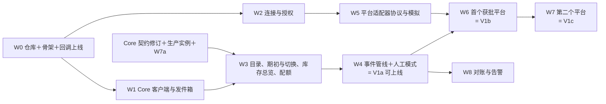

# Acuven Inventory 最小 V1 设计：只接自营 Shopee 与 TikTok Shop

> 版本：0.3 · 日期：2026-11-21 · 状态：**Kelvin 2026-11-21 批准全文**（0.2），0.3 的改动（第 3.3、5.1 节的晚到确认情形，见第 18 节）同日批准。批准的内容，包括第 14 节与现有文档的全部出入；第 16 节的待定项同日按建议定，只有 V-10 仍待定。
> 批准的是设计，不是实施授权：代码任务仍按模板流程，在建好的仓库里逐个登记、过设计预审。
> 按模板规则，设计有改动时，改动部分的批准作废、须重新批准。第 14 节列到的现有文档（REQUIREMENTS、STOCK_RULES、DEVELOPMENT 等）正文没有改；V1 范围内与它们冲突的地方，以本文为准。
> 起因：Kelvin 2026-11-21 定的当前优先——尽快接通自营 Shopee 与 TikTok Shop 的库存管理（`acuven_hub/DECISIONS.md` I-08）；
> 准入走自营卖家开发者路线，第三方申请等条件满足后继续（C-20，acuven_hub 私有仓库的接入台账 `inventory/ACCESS_APPLICATIONS.md` 2.3）。
> 依据：[REQUIREMENTS](REQUIREMENTS.md) 1.0、[STOCK_RULES](STOCK_RULES.md)、[DEVELOPMENT](DEVELOPMENT.md) 第 4–6 节、[INTEGRATION_STANDARD](INTEGRATION_STANDARD.md)、
> [OPERATIONS](OPERATIONS.md)、[HUB_ARCHITECTURE_ALIGNMENT](HUB_ARCHITECTURE_ALIGNMENT.md)，以及 `acuven_stock_core/docs/CONTRACT_V1.md` 0.16（下称“Core 契约”，`§` 指它的章节）。
> 本文是在 REQUIREMENTS 上**做减法**，只保留接通两个平台必需的部分。删掉或改动的内容列在第 14 节，待定事项列在第 16 节（**V-xx**），都要 Kelvin 逐条确认。
> 平台接口的具体行为（状态名、库存字段的含义、取消后是否自动回补、webhook、限流）要等应用获批后按官方文档和实测核实（V-08）。
> 本文只写要核实什么、核实后怎么套进来，不预设平台的具体行为。
> 0.2 按独立审阅改了以下几处，修订记录见第 18 节：
> - 平台超卖不再借用 Core 的故障补交；
> - hold 改为 pending，Core 确认成功后才减；
> - 补上线切换；
> - 修正配额保存与发布时的并发问题；
> - 补齐操作者头、动作引用、错误码与更正的写法。

---

## 0. 一页看懂

- **范围**：V1 只服务 Acuven 自营的一个 Shopee 店、一个 TikTok Shop 店，一个地点、一个库存池，SKU 少于 100 个。**不接 Acuven Shop**，网店仍是公开 Demo。
- **数量只记在 Core**（生产实例）。Inventory 是这个池在 Core 里**唯一的销售入口**，替两个平台报销售事实，不另记数量账。
  这一点要在 DECISIONS 里拍板，Core 契约里“V1 的入口是网店”的表述也要改（V-12）。
- **Inventory 自己管**：平台规格与 Core SKU 的映射、安全库存、每个平台的固定配额、平台连接与授权，外加库存发布、事件接收和对账。
- **防超卖靠固定配额**：两个平台的剩余配额、平台已售但 Core 还没扣的件数、安全库存，合计不超过 Core 的可售量。两个平台的配额不互借。
- **平台超卖时**：Core 按契约拒绝预留，订单留在 Inventory 的待处理里，由管理员处理，不借用 Core 的故障路径（第 5 节）。
- **分三期**：
  - V1a 人工模式：不依赖平台审批，库存账先集中到 Core；
  - V1b 首个获批的平台：自动收事件、自动写库存；
  - V1c 第二个平台。
- **先做骨架和公网授权回调**。本项目定过“不向平台提交占位地址”（接入台账第 5 节第 4 步），所以要先有能访问的回调，才去平台后台建应用、填回调地址。

---

## 1. 范围

| 做 | 不做（V1） |
| --- | --- |
| 自营 Shopee、TikTok Shop 各一店，用自营卖家开发者的应用接入。Shopee 卖家类型能不能开，待核实（V-08） | 其他商户、第三方应用的多店授权（等 C-20 的第三方路线获批后再做） |
| 一个地点、一个池；SKU 少于 100 个；整数件 | 多仓、组合装、序列号 |
| 映射、安全库存（默认 2 件）、固定配额、库存发布、订单事件转 Core 命令、对账、人工模式、上线切换 | 按比例自动分配补货、跨平台自动调配份额 |
| 管理后台：目录、期初、收货、盘点、库存总览、配额、连接、映射、人工登记、待处理、审计 | Acuven Shop 的预留 API（`reserve_api`）、公开 Inventory Demo、AI 客服接入、SKU 合并页面 |
| 严重异常发 Telegram | 订单后台、资金、物流、顾客资料 |

---

## 2. 系统边界与部署

- **Inventory**：FastAPI 后端加 React 后台，同一个服务，用一个独立的公网子域名（只配在服务器与 GitHub 变量里，不写进仓库）。
  - 公网只开三类入口：后台、OAuth 回调、平台 webhook。
  - 在共享 `infra_mysql` 里用独立的库和账号。
  - 定时任务（补拉订单、读回平台库存、刷新令牌、对账、发件箱重发）用进程内调度加库里的作业表，做法同 Core §5.6 的定时关单。
  - 登录限流用库表计数。V1 不用 Celery，也不用 Redis，与 REQUIREMENTS 的技术栈不同，列在第 14 节。
- **Core 生产实例**：同一个仓库的第二套部署（`CORE_ENV=production`），独立的库、独立的凭据，与 Demo Core 在网络上互不可达（§10 第 5 条）。
  不开公网入口；Inventory 与它同机，走仅内部的容器网络。
- **恢复**：两个库都在 `infra_mysql` 里，Core W7a 的 binlog 异地传输（≤5 分钟）与每日全量备份一并覆盖 Inventory 的库。
  REQUIREMENTS 第 5 节还要求两件事，W7a 现有拆分里没写，需要补进 W7a（第 13 节）：
  - 可恢复的生产备份至少保留 30 天；
  - 上线前做一次恢复演练，之后每季度一次（C-12）。

  恢复之后，先按第 9 节对账，再恢复自动写库存。

---

## 3. 与 Core 的关系

### 3.1 Inventory 是池里唯一的销售入口

Core V1 规定一个池只允许一个销售入口写销售事实（§3）。V1 由 Inventory 担任这个入口，两个平台的销售事实都由 Inventory 用同一个业务凭据报给 Core。

- **Core 不用改代码**：用到的接口都已实现（3.3）。
- **Core 的契约文字要改**：§0、§1、§3 现在写的是“V1 的入口是网店”。**Inventory 担任唯一入口、在入口之下再给两个店分配额**，这本身就是 DECISIONS 第四节“I-08 后续”里待定的事（V-12）。
  按 C-08 的判定规则，每个外部店铺各算一个销售入口；两个店卖同一批货，正需要 Inventory（C-04）。V1 由 Inventory 在 Core 的一个入口之下协调两个店。
- **哪笔单属于哪个平台**：Core 不区分，由订单引用的前缀区分（3.2）。

**为什么 V1 不违反 HUB_ARCHITECTURE_ALIGNMENT 第 5 节。** 那一节的要求是：“不能在 Inventory 先减 Q、另一 HTTP 请求才加 H，失败会留下两边数量不同步。”

V1 的顺序是这样的：
1. 平台订单到达时，Inventory 在**同一个本地事务**里把 Q 减 q、pending 加 q。两者之和不变，约束（4.1）不受影响。
2. 等 Core 确认销售**成功之后**，Inventory 才把 pending 减 q（这时 Core 的可售量已经减了 q）。

两步之间如果失败或中断，状态是“Core 已扣、pending 还没减”或者“Core 未扣、pending 还在”。这两种情况下算出来的 F 都**偏小**，只会少分配，不会多分配。
平台订单是已经发生的事实，不是向 Inventory 申请预留，所以不需要 Inventory 与 Core 之间的原子额度。以后接 Acuven Shop 的 `reserve_api` 时，这道闸门仍然有效（V-01）。

### 3.2 引用格式

Core 引用限 1–128 个 `[A-Za-z0-9._:-]` 字符，不得含个人资料，唯一性范围是 `(tenant_id, channel_id, 引用类型)`（§1）。

| Core 字段 | Inventory 填什么 | 例 |
| --- | --- | --- |
| `order_ref` | `<平台>:<店铺 ID>:<平台订单号>`，最长 112 个字符，给后缀留位 | `shp:123456:2611210ABCD` |
| `line_ref` | `L` 加 Inventory 给该订单分的行号，按 Core SKU 合并后编号（3.4） | `L1` |
| `payment_ref` | `order_ref` 加 `:c`，一单只确认一次（§5.2 第 7 条） | `shp:123456:2611210ABCD:c` |
| `shipment_ref` / `refund_ref` / `return_ref` | `order_ref` 加动作字母，再加**平台稳定的包裹 ID、退款 ID、退货 ID**；平台给不出稳定 ID 时，才用 Inventory 的事件序号（见 5.2 去重） | `…:d:<包裹 ID>`、`…:r:<退款 ID>`、`…:x:<退货 ID>` |
| `receipt_ref` / `count_ref` / `adjustment_ref` | Inventory 的单据 ID | `rcv_01J…` |

- 平台前缀 V1 只有 `shp`（Shopee）和 `tts`（TikTok Shop）。
- 平台订单号或平台 ID 含不允许的字符、或者超长时，改用 Inventory 自己的 ID，在 Inventory 里存对照（V-09）。

**操作者头**（§8.1，两个头要么都带、要么都不带；`X-Actor-Role` 只能取 §10 第 3 条的三个值之一）：
- **自动发出的订单命令**（预留、确认销售、发货、退款回库、退货验收、待审结案）**不带操作者头**，这些命令不要求角色。流水里的操作者就是 Inventory 的服务凭据，Inventory 在自己库里记下是哪个平台事件触发的。
- **后台命令**：`X-Actor-Ref` 填管理员的 Inventory 用户 ID（不透明，不含姓名、邮箱）；`X-Actor-Role` 按命令类型填：
  - 目录写命令与批量导入填 `catalog_admin`；
  - 期初、池切 live、收货、盘点、不可售与报损、更正都填 `stock_admin`。V1 只有一个管理员角色，所以操作员也能做的命令同样填 `stock_admin`。
- 管理员手动处理订单（比如补货后重试待处理的订单）时，Core 命令仍然不带操作者头，由 Inventory 记下是哪个管理员。

### 3.3 用到的 Core 接口与凭据

| 用途 | Core 接口 | 角色 |
| --- | --- | --- |
| 建 SKU、导入目录 | `POST /v1/catalog-imports`、`…/confirm`，商品与 SKU 的写命令 | `catalog_admin` |
| 期初、池切 live | `POST /v1/stock-imports`、`…/confirm`，`POST /v1/pools/{id}/go-live` | `stock_admin` |
| 收货、不可售与报损、盘点、更正 | `POST /v1/receipts`、`/v1/unavailable-adjustments`、`/v1/counts…`、`/v1/corrections` | `stock_admin` |
| 可售量、余额、流水 | `GET /v1/availability`、`/v1/balances`、`/v1/ledger` | 不要求 |
| 平台订单 | `POST /v1/reservations`、`/v1/orders/{ref}/sale-commits`、`/dispatches`、`/refund-restocks`、`/return-receipts`、`/late-payment-review/close`（只用于下面说的晚到确认情形） | 不要求 |
| 对账 | `GET /v1/reconciliation/orders`、`GET /v1/orders/{ref}/stock`、`GET /v1/reservations?order_ref=` | 不要求 |
| 自查 | `GET /v1/ops/invariants` | 运维凭据 |

- **两个凭据**：
  - 业务凭据：绑定该池的销售入口，带 `catalog.read/write`、`stock.read/write`、`orders.read/write`；
  - 运维凭据：只带 `ops.read`、不绑入口（§10 第 4 条）。

  两个都只放在 Inventory 服务端的密钥文件里。
- V1 不用预留释放（`…/release`）与 SKU 合并：确认销售紧跟在预留之后；平台超卖的单不进 Core 的待审（第 5 节）。
- **晚到确认的情形**（0.3，Core 契约 0.19 §5.5）：Core 停机超过预留有效期时，发件箱补交的确认销售会撞上已到期的预留，Core 照晚到确认处理：有货直接确认；没货把这单转入 `late_payment_review`，不扣数。这时 Inventory 把它当待处理、件数留在 pending；补货后用新幂等键、同一 `payment_ref` 重试确认，或平台取消后调用 `late-payment-review/close` 结案。

### 3.4 平台订单行到 Core 订单行

- Core 要求一个订单里同一个 SKU 只占一行（§5.6）。Inventory 先把平台订单行按映射到的 Core `sku_id` 合并，再编 `L1`、`L2`…，并保存“平台行 → Core 行”的对照。之后的发货、取消、退货都按这份对照拆到 Core 行。
- 映射缺失、重复或存疑的行，整单不报 Core，订单进待处理（REQUIREMENTS 4.2）。确认映射之后，在原事件上继续处理，不另造一笔销售。

### 3.5 发件箱、结果不明与 Core 不可用

- 每个 Core 写命令先写进 Inventory 的命令发件箱，带稳定的幂等键，再发出。超时或 5xx 时，用原幂等键重发，或者按业务引用查询。不换键重报，也不在 Inventory 一侧补造数量（Core §7.1、§8.3）。
- Core 不可用期间，平台照常销售，因为平台下单不经过 Inventory。事件在 Inventory 积压，件数留在 pending 里（4.1），F 因此偏小。Core 恢复后，按事件顺序补交。

---

## 4. 数量与配额

### 4.1 每个 SKU 的量

| 量 | 记在哪 | 说明 |
| --- | --- | --- |
| `stock_balance`、`reserved`、`unavailable`、`paid_pending_dispatch`、派生的 `available` | Core | §4.1；与 STOCK_RULES 的 O/H/C/U 如何换算见 §4.2 |
| `S` 安全库存 | Inventory | 默认 2，非负整数，每个 SKU 可改 |
| `Q[p]` 平台 p 的剩余配额 | Inventory | 平台 p 还能再卖的件数，也就是要让平台显示的库存 |
| `pending[p]` 平台 p 已售、Core 尚未扣数的件数 | Inventory | 包括：平台上未付款的订单；已经待发货、但 Core 确认销售还没成功的订单（发件箱积压、Core 不可用）；Core 拒绝预留、在待处理中的订单（超卖、SKU 停用等，第 5 节） |
| `F` 未分配 | 算出 | `available − S − ΣQ[p] − Σpending[p]` |

**正常约束**：`ΣQ[p] + Σpending[p] + S ≤ available`，即 `F ≥ 0`。

`pending` 在 REQUIREMENTS 和 STOCK_RULES 里没有对应的量：原稿把平台销售直接记成已售占用 C，列在第 14 节。

### 4.2 各事件怎么改量

| 事件 | Q[p] | pending[p] | Core |
| --- | --- | --- | --- |
| 平台新订单（未付款或已付款） | −q | +q | — |
| 订单进入待发货（4.3） | — | — | 预留，紧接着确认销售（第 5 节） |
| Core 确认销售成功 | — | −q | — |
| 付款前取消、超时关闭 | 满足下面的“恢复条件”就 +q，否则这些件进 F | −q | — |
| 待处理中的单（Core 从未扣数）被平台取消 | 不加 | −q | — |
| 已确认、未交运的件被取消（商品不再发出） | Core 回库成功后，满足恢复条件 +q，否则进 F | — | 退款回库 |
| 只退款、不取消商品（比如部分补偿） | — | — | — |
| 交运 | — | — | 发货 |
| 已发货的退货验收入库 | 不变，增量进 F | — | 退货验收 |
| 收货 | 不变，增量进 F | — | 收货 |
| 盘点确认 | 不变（正差进 F，负差可能造成超额） | — | 盘点 |
| 管理员改配额 | 改为新值（4.4） | — | — |

**恢复条件**（采用 STOCK_RULES §3 第 1、2、4 条）：连接仍然正常、该 SKU 的映射有效、没有待核对的差异，并且加回之后仍满足约束。不满足的那部分件数进 F。

- 平台取消后可能自己把展示量加回来：
  - 本来就该加回的，Inventory 读回核对一致即可，不再写一次；
  - 不该加回的（比如待处理单被取消），读回不一致，按第 6 节标成读回不符。

  平台取消后是否自动回补，待核实（V-08）。
- 补货和退货的增量**先进 F**，由管理员手动分给平台（V-04）。
- **超额**（`F < 0`，比如提高了安全库存、盘点短缺、平台超卖）：保留事实，不自动削配额，不向平台写 0，也不停售；该 SKU 禁止增加配额，进待处理并告警（STOCK_RULES §1.1、REQUIREMENTS 4.4）。

### 4.3 “确认销售”在平台上指什么

Core 的确认销售，在平台上对应“平台把订单交给卖家履约”的那一刻，也就是进入待发货；货到付款单进入待发货时也算。`paid_at` 取平台记录的进入待发货的时间。
具体对应哪个平台状态，等获批后按官方状态表确定（V-08）。在那之前的未付款阶段，件数记在 `pending[p]`，不报 Core。

### 4.4 改配额与发布的并发

1. **保存**：在 Inventory 库里锁住该 SKU 的配额行（含版本号）。锁内用 Core 当前的可售量和当前的 pending 校验新约束，通过就写入新的 Q 并提高版本号。
   平台事件处理改 Q 和 pending 时也要取同一把锁，所以保存时用的 pending 是最新的；管理员页面上看到的旧版本会被拒绝。
2. **发布前先补拉**：写平台之前，先补拉该平台的订单到当前时刻，把期间的销售按 4.2 处理完。目标值取补拉之后锁内的 `Q[p]`。
3. **剩余的窗口**：补拉完到写入平台之间，平台上新卖出的件会被这次绝对写入盖掉，平台会多显示这些件。这个窗口只能缩小，消不掉；由写入后的读回（第 6 节）和下一次补拉发现，发现后标为读回不符。

---

## 5. 平台订单事件到 Core 命令

### 5.1 映射

下表用通用状态名，平台的实际状态名在核实后写进适配器的能力矩阵。

| 平台事件（通用） | Inventory 处理 | Core |
| --- | --- | --- |
| 新订单 | 映射行；`Q −q`、`pending +q` | — |
| 进入待发货 | 发件箱依次发出 ① 预留、② 确认销售（带预留 ID、`payment_ref`、`paid_at`）；② 成功后 `pending −q` | ① `POST /v1/reservations` ② `sale-commits`。预留有效期不影响，因为是马上确认 |
| ↳ ① 被拒：`INSUFFICIENT_STOCK`（平台超卖） | 订单进待处理，件数留在 pending，F 变小或变负；发严重告警 | **不再调 Core**。§5.5 规定缺货这类业务拒绝不能当故障放行，所以不走 `reservation_id` 为 `null` 的故障补交 |
| ↳ ① 被拒：`SKU_INACTIVE`、`SKU_SELLING_PAUSED`、`SKU_NOT_FOUND`、`SKU_MERGED`、`POOL_NOT_LIVE` | 同上，进待处理并告警，写明原因 | 不再调 Core |
| 待处理单的处理：补货或解除停用后 | 管理员按“重试”，新幂等键、同一 `order_ref` 重新预留（§5.6：被拒不占用 `order_ref`），再确认销售 | ① ② |
| 待处理单的处理：平台取消 | `pending −q`，Q 不加 | 一般不调 Core；如果这单在 Core 处于 `late_payment_review`（3.3 的晚到确认情形），调 `late-payment-review/close` |
| 付款前取消 | 按 4.2 | — |
| 已确认、未交运的件被取消 | 按平台行拆到 Core 行；Core 成功后按 4.2 加 Q | `refund-restocks` |
| 交运（部分或全部） | 按平台行拆到 Core 行。平台的“已发货”是否等于实物已交给承运商，待核实（V-08）；§5.8 要求实物交运时才报 | `dispatches` |
| 已发货后申请退货退款 | 只记事件，不动数量，等实物到仓 | — |
| 退货实物验收（管理员在后台登记可售、不可售件数） | 增量进 F | `return-receipts` |

为了不让已付款的单卡在 Core 外面：**后台禁止停用仍有生效映射的 SKU**，要先停用映射；V1 后台也不提供 SKU 合并。

### 5.2 去重、乱序与补拉

- **去重**：事件按“平台、店铺、平台订单号、平台行、动作、平台事件 ID（没有就用状态时间）”持久去重，同一动作重复送达只处理一次。
  - 发货、退款、退货的 Core 引用来自平台的稳定 ID（3.2），所以平台换了事件 ID 重发同一次部分发货，Core 仍认得是同一次。
  - 平台给不出稳定 ID 时，Inventory 用“订单、动作、平台行、件数、发生时间”判断是不是同一个动作，判断不了就进待处理，不自动报 Core。
  - Core 订单行的累计上限只是最后一道兜底；部分发货时余量还没用完，它兜不住（STOCK_RULES §4）。
- **乱序**：比如交运先于待发货到达，就先补拉订单当前的状态，按状态链补齐前面缺的动作，再处理这一步，不按到达顺序增减库存（STOCK_RULES §4）。
- **补拉**：webhook 之外，定时按订单更新时间补拉；周期按平台限流确定（V-08）。

---

## 6. 平台库存发布

- **只写绝对值**：发布就是把平台 p 上该规格的库存设为 `Q[p]`，按 4.4 的方法取值。平台卖出时自己会扣展示量，Inventory 不再写一次。
- **什么时候写**：
  - 该 SKU 在该平台启用自动同步时；
  - 管理员改配额后；
  - 4.2 恢复了 Q，而读回发现平台没有自动加回时（STOCK_RULES §3 第 3 条：先核对，再写绝对目标）。
- **每次写，逐个 SKU 记结果**：已确认、明确失败、结果未知、不支持（DEVELOPMENT 第 6 节）。
  - 失败或结果未知：保留目标值与平台已确认值的差距，不叠加，退避重试；结果未知时先读回再决定。
  - 平台以促销锁定、平台仓等理由拒写：标为“平台控制”。
- **读回比对**：写入之后、以及定时，读平台库存与 `Q[p]` 比对。读数不符（4.4 第 3 步的窗口、平台自动回补了不该回补的量、有人直接在卖家后台改了库存）：
  - 把该“SKU × 平台”标成待核对，暂停自动写入，并告警；
  - 不把平台读数当成新的实物，也不未经确认就用 Q 覆盖平台（REQUIREMENTS 4.4）。

  单次读回数量相同，不能证明期间没有并发销售（DEVELOPMENT 第 5 节）。读回只用来发现差异，对账以订单补拉为准。

---

## 7. 上线切换与人工模式

### 7.1 上线切换（每个 SKU 第一次进 Core）

按 REQUIREMENTS 4.1 第 5 步：

1. **停售窗口**：在两个平台暂停相关商品的销售，或者把展示量调成 0。具体用哪种办法由管理员定。
2. **实盘**：点仓内全部实物，包括已售未发的件。期初导入 Core 的就是这个实物数（Core 的期初只记 `stock_balance`，§6.3）。
3. **池切 live**。然后对每笔**已付款、未发货**的平台订单，按 3.2 的引用先预留、再确认销售，Core 的可售量因此扣掉这些件，之后交运也有对应的 Core 订单可报；
   对**未付款**的订单，记进 `pending[p]`。
4. 设好安全库存和配额，核对约束，再把各平台的展示量设成 `Q[p]`，核对一致之后恢复销售。
5. 保存每个店铺的切换时间与订单处理进度。之后补拉旧订单只补缺项，不重复占用。

### 7.2 人工模式（V1a，平台获批前）

人工模式就是 INTEGRATION_STANDARD 的 `manual_quota`，按 REQUIREMENTS 4.1 的“人工配额过渡流程”和 4.3 做，两个平台通用。

1. **设配额**：管理员先把截至当时的订单登记完，再在卖家后台设置该 SKU 的库存。设成的值取“卖家后台核实的剩余展示量”与“Inventory 的 `Q[p]`”两者中较小的（REQUIREMENTS 4.3），然后在 Inventory 里确认“已生效”。确认之前，这部分配额仍为该平台保留，但不显示为已生效。
2. **登记**：管理员每天至少两次在卖家后台核对新订单、待发货、取消、交运和退货，在 Inventory 登记最小事件：平台订单号、行、SKU、件数、动作、发生时间。登记后先**复核**，再提交，走与自动事件**同一条管线**（第 5 节），去重规则也一样。
3. **核对记录**：每次核对都记下执行人、时间、对账区间和差异。
   - 漏了一次核对：只在后台显示逾期，不发 Telegram；同时停止增加该 SKU 在其他平台的配额（REQUIREMENTS 4.1）。
   - 核对中发现数量冲突或可能超卖：按严重异常告警。
4. **录错了**：提交之前的登记可以改或作废。提交之后，Core 的确认销售、发货、退款回库、退货验收都不能撤销，也不能更正（§5.8“录错了怎么办”、§6.7）。
   这时照 §5.8 的办法用盘点、不可售或报损把账面对回实物，Inventory 把这一订单行记为“已知差异”，并保留原登记、原因和处理人。这与 REQUIREMENTS 4.3“以反向事件更正”不同，列在第 14 节。
5. **切换到自动**：适配器启用时，以该平台最后一次人工核对的时间为接管点，向前补拉、去重、对账，然后结束人工模式；已登记的旧订单不重复占用。

TikTok Shop 目前没有订单，开卖之前配额保持 0（V-10）。

### 7.3 盘点前先清队列

Core 要求点数之前已经发生的实物进出（收货、发货等）先入账，再提交实数（§6）。所以：
- 一个 SKU 提交盘点实数之前，要求它的事件收件箱和命令发件箱都已清空；
- 人工模式下，还要先把截至当时的交运登记完。

否则，已交运、但 Core 还没收到发货的件会在盘点时被减一次，之后补报发货时又减一次。

---

## 8. 连接与授权

- **应用**：TikTok Shop 用开店邮箱对应的卖家账号，注册自营卖家开发者，建私有应用；Shopee 按 C-20 的做法另开卖家类型账号，能不能开、要什么资料，待核实（V-08）。
  - 连接记录 `app_profile`：V1 只有 `self_seller`，以后第三方路线获批再加 `third_party`。
  - 换应用要重新授权、换令牌；映射按“平台、店铺、商品 ID、规格 ID”存，不受影响。
- **OAuth**：每个平台一个回调路由，例如 `GET /api/v1/integrations/{platform}/oauth/callback`。
  - 开始授权时，后端生成一次性、短期有效的 `state`，绑定管理员会话与目标平台；
  - 回调先校验 `state`，再在后端用授权码换令牌，然后跳到不含授权码的结果页（DEVELOPMENT 6.2）。
- **令牌**：应用层加密存储（AES-256-GCM，主密钥用 Docker Compose secrets 文件注入，同 `ai_billing_hub` ADR-0004）。定时刷新。刷新失败、被撤权或获批 scope 不足时，停止该连接的自动写入，发严重告警，后台显示“授权失效”。
- **Webhook**：每个平台一个接收路由，先验签、快速应答，事件写进收件箱后异步处理。自营应用能不能用 webhook，待核实；不能用就只靠补拉（V-08）。
- **能力矩阵**：每个连接记录获批的能力（读规格、读库存、写库存、读订单、webhook），后台逐项显示可用、待批或不可用。缺写库存或缺订单事件时，不显示“自动同步”（REQUIREMENTS 4.1）。

---

## 9. 对账

每天自动跑一次，管理员也可以手动发起。查出的差异都进待处理，不自动修。

1. **Inventory 与 Core**：比对的是**两边的并集**（§5.9）：
   - Core 对账查询这个窗口里有变化的订单；
   - Inventory 这个窗口里有变化的订单；
   - 发件箱里还没成功的命令所属的订单。

   后两类不在 Core 窗口里的，逐单用 `GET /v1/orders/{ref}/stock` 查。比的是每个订单行的累计量与 Inventory 的事件链是否一致。
2. **Inventory 与平台**：补拉平台当前的订单状态，对照 Inventory 的事件链；平台库存读数对照 `Q[p]`。
3. **配额约束**：每个 SKU 算一次 F，列出超额的。
4. **Core 自查**：用运维凭据调 `GET /v1/ops/invariants`，查出违反就发严重告警。Core 自己的 OPS-04 定时告警还没登记，V1 由这一步代为调用（第 13 节）。

---

## 10. 管理后台（V1 最少页面）

V1 只有**管理员一个角色**，后台只做**简体中文**（V-06）。

| 页面 | 内容 |
| --- | --- |
| 登录 | 密码登录、限流、记录异常尝试（REQUIREMENTS 第 5 节） |
| 目录 | 列出 Core 的 SKU；CSV 导入（调 Core 的批量导入：先预览，再确认）；新建、停用（有生效映射时禁止停用，第 5 节） |
| 期初与上线切换 | 第 7.1 节的步骤：实盘导入、池切 live、已售未发的订单补进 Core、未付款订单计入 pending、设配额、核对 |
| 库存总览 | 每个 SKU：Core 四个量与可售量、S、各平台的 Q 和 pending、平台读数与最近发布结果、F、异常标记 |
| 配额 | 改 S 与各平台的 Q；按 4.4 校验、保存、发布 |
| 收货、盘点、不可售与报损、更正 | 包装 Core 对应的命令，带原因；盘点前按 7.3 检查队列 |
| 连接 | 授权、状态、能力矩阵、最近同步时间、积压 |
| 映射 | 导入平台规格，逐行确认对应的 Core SKU；记录变更人、原因、新旧关系（REQUIREMENTS 4.2） |
| 人工登记 | 7.2 的登记、复核、提交与核对记录；显示逾期 |
| 待处理 | 映射不明、Core 拒绝预留（超卖、停用等）、发布失败或结果未知、读回不符、超额、对账差异、已知差异 |
| 审计 | 查 Inventory 的变更记录（可按 SKU、连接、时间过滤）；查 Core 流水（按 SKU、时间，§6.8），按平台过滤时在 Inventory 一侧用 `source_ref` 的前缀筛 |

---

## 11. 告警

只把严重异常推送到一个独立的 Telegram 机器人；全部异常都在后台记录。

- **严重异常**：Core 拒绝预留（可能超卖等）、授权失效、写库存连续失败或结果未知、读回不符、超额、对账差异、Core 不变量自查违反、Core 持续不可用、发件箱积压超时。
- 严重告警未确认时，每 15 分钟重复一次，直到在后台确认。发出满 1 小时仍未确认，记一条超时待办，继续只提醒负责人本人（REQUIREMENTS 第 5 节）。
- Inventory 或 Core 发生故障时，平台照常销售（第 3.5 节）。负责人收到告警后，在后台记下“继续销售”或“手动停售”的决定（REQUIREMENTS 第 5 节）。
- 普通异常不推送，只在后台显示（V-07）。

---

## 12. 安全与隐私

- 不保存顾客姓名、电话、地址、支付资料，只存改变库存所需的最小订单标识（REQUIREMENTS 第 5 节）。平台订单号进 Core 引用之前，先核对不含个人资料（V-09）。
- 平台令牌、Core 两个凭据、令牌加密主密钥都不进 Git、日志或 OpenClaw 工作区。
- 后台管理员用独立账号、密码登录，带限流；所有数量、配额、映射、连接的变更都记操作者与原因。

---

## 13. 前置与跨项目依赖

| 依赖 | 在哪做 | 说明 |
| --- | --- | --- |
| 建 `acuven_inventory` 仓库 | 本项目 | 从 `acuven-project-template` 起步：`.platform/`、CI、`deploy.yml`、健康检查。仓库名与可见性由 Kelvin 定（V-11） |
| 子域名与 HTTPS | `vps_infra`、Cloudflare | Inventory 的子域名与 `infra_nginx` vhost，从外网验证 |
| 骨架与回调路由上线 | 本项目 | 之后再去平台后台建应用、填回调（第 0 节） |
| Core 契约修订 | `acuven_stock_core` | §0、§1、§3 加上“Inventory 担任池的唯一销售入口”；按模板规则，改动部分要重新批准（V-12） |
| Core 生产实例 | `acuven_stock_core` | 第二套部署配置、生产库、签发业务凭据与运维凭据。C-13 只定了 V1 先接公开网店 Demo，生产实例给 Inventory 用，要在 DECISIONS 里另记（V-02） |
| Core W7a 备份与恢复 | `acuven_stock_core`、`vps_infra` | binlog 异地（≤5 分钟）、每日全量、**至少 30 天保留**、上线前演练一次、之后每季度一次（C-12、REQUIREMENTS 第 5 节）。**真实库存进 Core 之前必须完成** |
| Core 不变量定时告警 | `acuven_stock_core` | 已列为“待登记”；V1 先由 Inventory 每日对账代为调用（第 9 节） |
| OpenClaw 登记 | 控制面目录另开会话 | 仓库建好、首批任务过设计预审之后 |
| DECISIONS 更新 | `acuven_hub` | 本文批准后，把 V-xx 的答复登记到 I-08 |

---

## 14. 与现有文档的出入（要 Kelvin 逐条确认）

| 现有文档 | 原写法 | V1 改为 |
| --- | --- | --- |
| REQUIREMENTS 1、2、4.5，DELIVERY_PLAN 第 1 节 | 真实 Acuven Shop 与两个平台同为首批渠道，Shop 经 Inventory 原子预留 | V1 不含 Shop，Shop 保持公开 Demo（V-01） |
| REQUIREMENTS 4.3，STOCK_RULES §5 | 补货按比例自动分配；跨平台自动调配剩余份额 | 增量进 F，由管理员手动分配；不做自动调配（V-04） |
| STOCK_RULES §1.1、§2“无预留销售确认” | 已确认的超卖事实照样入账，允许 `C > O`，记为需求缺口 | Core 所有量非负（Core Q-20、§4.2），而且缺货不能当故障放行（§5.5）。超卖单不进 Core，留在 Inventory 的 pending 与待处理中（V-03） |
| REQUIREMENTS 4.3，STOCK_RULES 第 2 节 | 平台售出即产生销售占用 C | 未付款或 Core 尚未扣数的件记在 Inventory 的 `pending`（新概念，4.1）；进入待发货并经 Core 确认后才成为 C |
| STOCK_RULES §7，DEVELOPMENT 第 4 节表、5.1，HUB_ARCHITECTURE_ALIGNMENT 第 5 节 | 配额总额先在 Core 的政策或额度事务里检查；Q/T 原子方案批准前不得编码两套状态；不能在 Inventory 先减 Q、另一个请求才加 H | 配额与约束校验在 Inventory 库里做（4.4）；Core 不存配额。V1 为什么不会多分配，见 3.1。以后接 `reserve_api` 时，原闸门仍适用（V-01） |
| REQUIREMENTS 4.3，STOCK_RULES §4，OPERATIONS 第 1 节 | 人工登记录错，用反向事件更正 | 提交前可改或作废；提交到 Core 后，按 Core §5.8 用库存命令对回实物，Inventory 记为已知差异（7.2 第 4 条） |
| REQUIREMENTS 第 3 节，OPERATIONS 第 1 节 | 管理员与运营员两个角色 | 只做管理员（V-06） |
| REQUIREMENTS 第 2、5 节 | 后台英文加简体中文 | 只做简体中文（V-06） |
| REQUIREMENTS 第 5 节 | 普通异常在工作时间推送 | 只推送严重异常（V-07） |
| REQUIREMENTS 第 6 节 | 公开 Inventory Demo，访客登记后体验 | V1 不做；第三方路线审核需要时再做（V-05） |
| REQUIREMENTS 第 2 节，DEVELOPMENT 第 3 节 | 技术栈含 Redis，Redis 用独立的逻辑空间 | V1 不用 Redis，也不用 Celery，用进程内调度加作业表（第 2 节） |
| REQUIREMENTS 1、4.1，DEVELOPMENT 6.1 | 两个平台都按第三方开发者类别申请，首批只授权自营店 | 先走自营卖家开发者路线（C-20，已定；私有接入台账 2.3 已于 2026-11-21 更新，这两份尚未更新） |

---

## 15. 工作包与先后（不是排期）

| 包 | 内容 | 依赖 |
| --- | --- | --- |
| W0 | 从模板建仓、CI、`deploy.yml`、健康检查；后台登录；两个平台的 OAuth 回调路由（先只做 `state` 校验与换令牌的骨架）；子域名上线并从外网验证 | Kelvin 配 DNS |
| W1 | Core 客户端（鉴权、幂等键、操作者头、错误映射、结果不明时查询）与命令发件箱 | Core 契约（已批准） |
| W2 | 连接模型、令牌加密存储、刷新、撤权处理、能力矩阵 | W0 |
| W3 | 目录导入、期初与上线切换（7.1）、库存总览、安全库存、配额与 4.4 的校验 | W1；真实期初要等 Core 契约修订、生产实例与 W7a |
| W4 | 事件收件箱、去重与乱序（5.2）、平台行到 Core 行的拆分、第 5 节的映射、待处理；人工登记、复核、提交与核对（7.2）；盘点前检查（7.3） | W3 |
| W5 | 平台适配器协议、模拟适配器、合同测试夹具（DEVELOPMENT 第 6 节的七个动作） | W2 |
| W6 | 先获批的那个平台：真实适配器、webhook 验签、补拉、发布、读回，逐个 SKU 启用 | 平台获批；W4、W5 |
| W7 | 第二个平台 | 平台获批；W6 |
| W8 | 每日对账（第 9 节）、Telegram 告警（第 11 节）、待处理页面 | W4 |

**V1a 上线条件**：
- W0–W4、W8 完成；
- Core 契约修订已批准，生产实例上线，W7a 首次恢复演练通过；
- 按 7.1 完成实盘、期初、映射与切换。

---

## 16. 待 Kelvin 决定

**2026-11-21 Kelvin 答复：全部按下表的建议定。** 逐项落实如下：
- V-01～V-07、V-12 按建议定；
- V-11 先定为私有，同日建仓时改为**公开**。原因是免费 GitHub 账号的私有仓库开不了分支保护（实测 API 返回要升级 Pro），而这个仓库合并到 main 就部署生产。公开以后，代码与文档里不放密钥、主机名、IP；
- V-08、V-09 是获批后的核实项，按建议的方式处理；
- V-10 的建议是“由 Kelvin 按经营需要定”，没有具体取舍，**仍待定**，TikTok Shop 开卖前再定。

答复已登记到 `acuven_hub/DECISIONS.md` I-08。

| 编号 | 问题 | 建议 |
| --- | --- | --- |
| V-01 | V1 不接真实 Acuven Shop、网店保持 Demo，可以吗？ | 可以。网店要真实化还有支付、物流、政策页等大量非库存工作，放进 V1 会拖慢两个平台的接入 |
| V-02 | 生产 Core 用同一仓库的第二套部署（`CORE_ENV=production`）吗？上线前先做完 W7a？ | 是。契约已为生产实例留了位置；W7a 是 C-12 的硬要求 |
| V-03 | 平台超卖单不进 Core，留在 Inventory 待处理，补货后重试或等平台取消（第 5 节），可以吗？ | 可以。这样不违反 Core §5.5，也不用改 Core。代价是这些单在处理完之前，Core 的账面看不到，只在 Inventory 的 pending 和待处理里。超卖如果常见、需要 Core 记下外部销售事实，就要在 Core 重议 Q-20，改契约后重新批准 |
| V-04 | 补货不按比例自动分配，由管理员手动分；不做跨平台自动调配 | 同意。SKU 不到 100 个、只有一个管理员，手动可控；自动调配是 STOCK_RULES 里最复杂的部分 |
| V-05 | V1 不做公开 Inventory Demo | 同意。第三方路线的审核要用时再做 |
| V-06 | V1 只有管理员一个角色，后台只做简体中文 | 同意。以后加英文和运营员，不影响数据模型 |
| V-07 | 只推送严重告警（含 15 分钟重复与 1 小时超时），普通异常只在后台显示 | 同意 |
| V-08 | 获批后要核实的平台行为：Shopee 卖家类型账号能否开设及所需资料；自营应用的审核要求；未付款时是否扣展示库存；货到付款单的状态；“已发货”是否等于实物交运；取消、退款后是否自动回补展示量；库存字段的含义；有没有 webhook；限流；令牌有效期 | 核实结果写进各平台的能力矩阵；与本文冲突的，改本文并重新批准 |
| V-09 | 平台订单号与包裹、退款、退货 ID 是否满足 Core 引用格式，是否不含个人资料 | 获批后用真实订单核对；不满足就改用 Inventory 的 ID 加对照表 |
| V-10 | TikTok Shop 现在没有订单：开卖时先走人工模式，还是等适配器？ | 由 Kelvin 按经营需要定；技术上两种都支持 |
| V-11 | 仓库名与可见性：其他业务仓库是公开的，这个仓库会放平台接入代码 | 建议私有；公开也行，但要确保不进密钥。由 Kelvin 定 |
| V-12 | 由 Inventory 担任 Core 里这个池的唯一销售入口，在它下面给两个店分配额（3.1）；相应修订 Core 契约 §0、§1、§3 | 同意。这样 Core 不用改代码，与 C-04、C-08 一致；这条要先定，Core 契约修订和生产实例都依赖它 |

---

## 17. V1 验收（摘要）

- 同一平台事件重复、乱序、迟到都只生效一次；发货、退款、退货按平台稳定 ID 去重；Core 结果不明时用原键重试，不多扣。
- 映射不明、Core 拒绝预留的单不扣 Core 的数，留在 pending 与待处理中；处理后在原事件上继续，不另造一笔销售。
- 正常路径下（含 Core 不可用、发件箱积压期间），`ΣQ + Σpending + S ≤ available` 不被破坏；超额时保留事实、禁止加配额并告警，不写 0、不停售。
- 改配额时版本冲突被拒；发布前先补拉；平台写入逐个 SKU 记结果，失败或结果未知时不叠加；读回不符时暂停该 SKU 在该平台的自动写入。
- 上线切换后，已付款未发货的订单交运时 Core 有对应订单可报；未付款订单在 pending 中。
- 撤权、令牌失效后停止写入并告警；重新授权后能补拉并对账。
- 人工模式与自动模式走同一条管线；切换到自动时，接管点之前的订单不重复占用；盘点前队列未清空时拒绝提交。
- 每日对账按并集找出 Inventory、Core、平台三方的差异；Core 不变量自查违反时告警。
- 不保存顾客个人资料；令牌与 Core 凭据不进 Git、日志或 OpenClaw 工作区。
- 整机恢复演练通过；恢复后先按第 9 节对账，再恢复自动写库存。

---

## 18. 修订记录

- **0.1**（2026-11-21）：初稿。
- **0.2**（2026-11-21）：按同日独立审阅修改。
  1. 平台超卖不再借用 Core 的故障补交（与 §5.5 冲突），改为留在 Inventory 待处理（第 5 节、V-03）。
  2. `hold` 改为 `pending`，等 Core 确认销售成功后才减，覆盖发件箱积压与待处理的单（4.1）。
  3. 新增上线切换（7.1）与盘点前清队列（7.3）。
  4. 改配额改为加锁、带版本号写入，发布前先补拉，并写明剩余的竞态窗口；删掉 0.1 中错误的并发论证（4.4）。
  5. 发货前取消在 Core 回库成功后才加回 Q；只退款不调 Core；采用 STOCK_RULES §3 的恢复条件（4.2）。
  6. 发货、退款、退货的引用改由平台稳定 ID 派生（3.2、5.2）。
  7. 写明操作者头的用法，以及预留的其他拒绝码；禁止停用有生效映射的 SKU（3.2、第 5 节）。
  8. 人工登记先复核再提交，提交后的纠错改按 Core §5.8 处理（7.2）。
  9. 对账改为比对两边的并集（第 9 节）。
  10. 补上告警的 1 小时超时与故障时的决定记录（第 11 节）、备份保留 30 天与每季度演练（第 2、13 节）。
  11. 新增 V-12（Inventory 担任唯一销售入口、修订 Core 契约），并把未核实的平台行为并入 V-08。
  12. 第 14 节补列五处出入：配额校验的位置、`pending`、人工登记的更正、Redis 与 Celery、准入路线的原文出处。
- **0.2 批准**（2026-11-21）：Kelvin 按建议定了第 16 节的待定项（V-10 除外），随后批准全文。
- **0.3**（2026-11-21，Kelvin 同日批准）：跟 Core 契约 0.19 的独立审查对齐。Core 停机超过预留有效期时，补交会走晚到确认，没货的单会进 Core 的待审；3.3 节原写“V1 不用晚到支付待审结案”不成立，改为写明这一情形与处理，5.1 节待处理单被平台取消的一行同步。其余不变。
